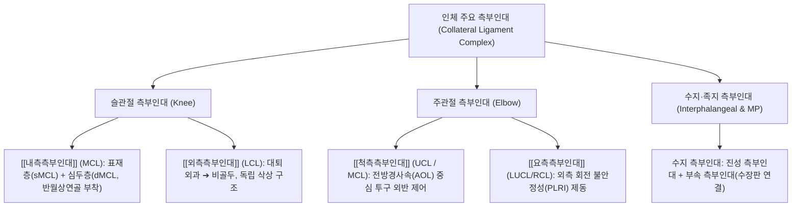

# [[측부인대]] (Collateral Ligaments)

> **핵심 요약 (Key Summary)**:
> 관절의 양측면에 위치하여 전두면(Coronal plane) 상의 외반(Valgus) 및 내반(Varus) 변형력을 흡수하고 관절의 비정상적 측방 전위와 회전을 억제하는 강력한 섬유성 인대 복합체.
> [[슬관절]](무릎)의 [[내측측부인대]](MCL)와 [[외측측부인대]](LCL), [[주관절]](팔꿈치)의 [[척측측부인대]](UCL)와 [[요측측부인대]](RCL), 그리고 수지·족지 관절의 측부인대로 대별됨.
> 스포츠 투구 동작, 접촉성 충돌 외상 및 관절 과신전 시 인장 손상이 호발하며, 손상 등급(Grade I~III) 판정 및 관절 안정성 복원을 위한 약침·침구·단계별 재활 프로토콜의 핵심 대상.

---

## 📌 목차
1. [해부학적 정밀 구조 및 주행/부착](#1-해부학적-정밀-구조-및-주행부착)
2. [생체역학·기능 (Biomechanics)](#2-생체역학기능-biomechanics)
3. [임상 평가 및 이학적 검사](#3-임상-평가-및-이학적-검사)
4. [초음파 해부학(Sonoanatomy) 및 중재 랜드마크](#4-초음파-해부학sonoanatomy-및-중재-랜드마크)
5. [⭐ 원장님 심층 임상 고찰 및 원본 필기 (Clinical Pearls)](#5--원장님-심층-임상-고찰-및-원본-필기-clinical-pearls)
6. [관련 임상 질환 및 손상](#6-관련-임상-질환-및-손상)
7. [추나·도수치료 & 침구·약침·재활 프로토콜](#7-추나도수치료--침구약침재활-프로토콜)
8. [출처 및 학술 참고 문헌 (References)](#8-출처-및-학술-참고-문헌-references)

---

## 1. 해부학적 정밀 구조 및 주행/부착

* **슬관절 측부인대 (Knee Collateral Ligaments)**:
  * **[[내측측부인대]] (Medial Collateral Ligament, MCL)**:
    * **표재층 (Superficial MCL, sMCL)**: [[대퇴골]] 내측상과(Medial epicondyle)에서 기시하여 [[경골]] 내측 과간선 하방 4~6cm 부위(거위발건 심부)에 광범위하게 정지하는 넓은 띠(Band) 구조.
    * **심두층 (Deep MCL, dMCL)**: 관절낭의 일부로 비후된 섬유로, 대퇴반월인대(Meniscofemoral)와 반월경골인대(Meniscotibial)로 구성되어 [[내측반월상연골]] 체부와 단단히 결합.
  * **[[외측측부인대]] (Lateral Collateral Ligament, LCL)**:
    * 대퇴골 외측상과 외상방에서 기시하여 [[비골]]두(Fibula head) 전외측 결절에 정지하는 연필 굵기의 독립된 원형 삭상(Cord-like) 구조. 외측 반월상연골과 관절낭 사이에 슬와근건이 주행하여 상호 분리됨.
* **주관절 측부인대 (Elbow Collateral Ligaments)**:
  * **[[척측측부인대]] (Ulnar Collateral Ligament, UCL / Medial Collateral Ligament)**:
    * **전방 경사속 (Anterior Oblique Ligament, AOL)**: 상완골 내측상과 전하방에서 척골 구상돌기(Coronoid process) 결절에 정지하며, 주관절 외반 안정성의 85% 이상을 독점적으로 담당.
    * **후방 경사속 (Posterior Bundle)** 및 **횡인대 (Transverse Band / Cooper's ligament)**: 보조적 안정성 제공.
  * **[[요측측부인대]] (Lateral Collateral Ligament Complex, LCLC)**:
    * 요측측부인대(RCL), 외측척측측부인대(LUCL), 윤상인대(Annular ligament)로 구성. 특히 LUCL은 상완골 외측상과에서 척골 회내근능(Supinator crest)으로 주행하여 외측 회전 불안정성(PLRI)을 차단.
* **수지 및 족지 측부인대 (Digital Collateral Ligaments)**:
  * 중수수지관절(MCP) 및 지절간관절(PIP, DIP)의 양측면을 보호. 진성 측부인대(True collateral ligament)와 장측판(Volar plate)으로 주행하는 부속 측부인대(Accessory collateral ligament)로 구성.

---

## 2. 생체역학·기능 (Biomechanics)

* **외반(Valgus) 및 내반(Varus) 구속력**:
  * 슬관절 신전 시(0도): 관절낭, 후방십자인대, 십자인대 복합체가 협동하여 외반/내반력의 약 50%를 지지.
  * 슬관절 경미 굴곡 시(20~30도): 관절낭과 후방 구조물이 느슨해지면서 **MCL이 외반력의 약 78%**, **LCL이 내반력의 약 70%**를 일차적으로 부담.
* **주관절 투구 시의 극단적 외반 스트레스**:
  * 야구 투구 동작의 후기 코킹(Late cocking) 및 가속(Acceleration) 구간에서 주관절에는 최대 64~100 Nm에 달하는 파괴적 외반 모멘트가 발생하며, 이는 UCL 전방속(AOL)의 인장 한계에 육박함.
* **캠 효과(Cam Effect)와 신전/굴곡 시 인장 변화**:
  * 대퇴골 및 중수골 두부의 비대칭적 타원형(Cam) 구조로 인해, 슬관절 굴곡 시 LCL은 이완되고 MCL 전방 섬유는 긴장됨. 수지 MCP 관절에서는 90도 굴곡 시 측부인대가 최대 긴장되어 손가락의 좌우 벌림이 물리적으로 차단됨.

---

## 3. 임상 평가 및 이학적 검사

* **슬관절 측부인대 평가 검사**:
  1. **외반 스트레스 검사 (Valgus Stress Test)**:
     * 30도 굴곡 상태: 순수 MCL 손상 평가 (관절 간격 열림 정도 및 종말감 확인).
     * 0도 완전 신전 상태: 간격이 열릴 경우 MCL뿐만 아니라 [[십자인대]], 후방 관절낭의 심각한 복합 손상 의미.
     * 등급: Grade I (0~5mm 이완, 명확한 종말감), Grade II (5~10mm 이완, 부드러운 종말감), Grade III (>10mm 이완, 종말감 완전 소실).
  2. **내반 스트레스 검사 (Varus Stress Test)**:
     * 30도 굴곡 및 0도 신전에서 LCL의 인장 연속성 및 비골두 부위 간격 개대 평가.
* **주관절 측부인대 평가 검사**:
  1. **밀킹 기동 (Milking Maneuver)**:
     * 주관절 90도 굴곡 상태에서 환자의 엄지손가락을 하방으로 당겨 외반력을 가할 때 UCL 전방속 통증 재현.
  2. **외반 스트레스 검사 (Elbow Valgus Stress Test)**:
     * 20~30도 굴곡 위에서 외반 부하 시 내측 관절선 통증 및 불안정성 유발.
  3. **외측 추축 변위 검사 (Lateral Pivot-Shift Test)**:
     * 환자를 앙와위로 눕히고 축성 압박과 회외(Supination), 외반력을 가하며 굴곡할 때 요골두 탈구 및 정복 관찰(LUCL 결손 진단).
* **수지 측부인대 평가**:
  * 모지 MCP 관절의 척측 측부인대 스트레스 검사(외반 부하 시 30도 이상 열림 시 Skier's/Gamekeeper's thumb 진단).

---

## 4. 초음파 해부학(Sonoanatomy) 및 중재 랜드마크

* **슬관절 MCL 초음파 주행 스캔**:
  * 대퇴골 내측상과와 경골 내측 관절선을 종단(Longitudinal)으로 가로지르는 선형 탐촉자 거치.
  * 표재층(sMCL)은 밝고 균일한 섬유성 선상 고에코 띠로 관찰되며, 심두층(dMCL)은 내측 반월상연골의 삼각형 저에코 연골판에 밀착되어 관찰됨.
  * 손상 시 섬유 팽윤(Swelling), 저에코성 삼출액 저류 및 인대 연속성 단절 확인.
* **주관절 UCL 초음파 동적 검사**:
  * 내측상과와 척골 구상돌기를 잇는 전방속(AOL)을 종단 스캔하며, 검사자가 외반 스트레스를 가할 때 상완척골 관절 간격(Joint space)이 1mm 이상 벌어지는지 실시간 동적 계측.
* **약침 및 재생 주입 중재술 랜드마크**:
  * In-plane 접근으로 대퇴골 내과 및 상완골 내측상과의 인대 골부착부(Enthesis)에 바늘 끝을 유도하여 관절강 내 유입을 피하고 인대 실질 주위에 정확히 분주.

---

## 5. ⭐ 원장님 심층 임상 고찰 및 원본 필기 (Clinical Pearls)

* **MCL Grade I~II의 강력한 자연 치유 잠재력과 한의 보존 치료**:
  * MCL은 혈관 분포가 풍부한 활액막 외(Extra-articular) 인대이므로 완전 단열(Grade III)이 아닌 1~2도 손상은 수술 없이 4~6주의 보존적 한의 치료로 95% 이상 완벽히 재생됩니다. 초기 2주간 외반 제한 힌지 보조기와 침구/신바로약침 치료를 병행하면 관절 강직 없이 정상 인장 강도를 회복합니다.
* **MCL 손상 시 내측 반월상연골 동반 손상(Unhappy Triad)의 감별**:
  * MCL 손상 환자가 관절선 압통(Joint line tenderness)과 함께 무릎을 굽히고 펼 때 '덜컹거림(Clicking)'이나 '잠김(Locking)'을 호소한다면 단순 인대 염좌가 아니라 [[내측반월상연골]] 체부 파열이나 [[전방십자인대]] 파열이 동반된 O'Donoghue 불행 3대 징후를 강력히 의심하고 정밀 MRI를 의뢰해야 합니다.
* **주관절 내측 통증에서 골프엘보와 UCL 손상의 촉진 감별**:
  * 내측상과의 바로 앞쪽 뼈 돌출부를 누를 때 아프면 [[골프엘보]](내측상과염)이고, 내측상과에서 원위부로 약 1cm 떨어진 관절선 및 척골 구상돌기 방향의 인대 주행부를 누를 때 날카로운 통증이 발생하면 UCL 손상입니다. 투구 후반부 릴리즈 시 통증은 UCL 병변의 결정적 단서입니다.
* **수기 추나 시 외반/내반 스러스트의 절대 금기**:
  * 급성 및 아급성 측부인대 손상 환자에게 무릎이나 팔꿈치를 회전시키거나 측방으로 꺾는 고속저진폭(HVLA) 스러스트 추나를 적용하면 치유 중인 콜라겐 가교 결합이 파괴되어 만성 불안정성을 초래합니다. 축성 견인 및 관절낭 가동술(Gentle mobilization)만을 적용해야 합니다.

---

## 6. 관련 임상 질환 및 손상

| 질환 및 손상 | 주요 발생 기전 | 임상 양상 및 합병증 |
| :--- | :--- | :--- |
| 슬관절 MCL 파열 | 무릎 외측에서의 직접 타격(Clipping injury) 또는 외번-외회전 비접촉 손상 | 내측 관절 부종, 보행 시 무릎이 안쪽으로 꺾이는 불안정감 |
| 슬관절 LCL 파열 | 무릎 내측에서의 타격 또는 극단적 내반 외상 (단독 손상은 드묾) | 외측 관절선 통증, [[비골신경]] 손상 동반 시 족하수(Foot drop) 위험 |
| 주관절 UCL 파열 (토미존 손상) | 야구 투구, 배구 스파이크 등 반복적 가속 외반 견인 스트레스 | 구속 저하, 투구 시 내측 관절 '뚝'하는 파열감, 척골신경 포착통 |
| 주관절 외측 회전 불안정성 (PLRI) | 팔을 짚고 넘어지며 발생하는 축성 하중, 외반력, 회외력의 복합 외상 | 팔꿈치 굴곡-신전 시 덜컹거림, 푸시업 시 팔꿈치 불안정성 |
| 모지 척측측부인대 파열 | 스키 폴대에 엄지손가락이 걸려 과도하게 외전되는 급성 외상 | 모지 집게력(Pinch grasp) 약화, 스터너 병변(Stener lesion) 합병 위험 |

---

## 7. 추나·도수치료 & 침구·약침·재활 프로토콜

### 1) 단계별 보존적 고정 및 한의 추나요법
* **초기 보호 (1~2주차)**:
  * 외반/내반 제어 힌지 보조기(Hinged brace) 착용 (굴곡 30~90도 제한). 체중 부하는 목발을 사용하여 점진적으로 허용.
* **관절 가동술 (Mobilization)**:
  * 슬관절 및 주관절의 장축 견인(Long-axis traction)과 전후방 활주를 적용하여 인대 유착을 방지하고 정상 활액 순환 촉진. 측방 전단력은 철저히 배제.

### 2) 침구 및 약침 치료
* **슬관절 측부인대 혈위**:
  * 곡천(LR8), 음릉천(SP9), 슬양관(GB33), 양릉천(GB34): MCL 및 LCL 부착부 염증 완화 및 국소 미세혈류 증진.
* **주관절 측부인대 혈위**:
  * 소해(HT3), 곡택(PC3), 곡지(LI11), 수삼리(LI10): UCL 전방속 및 전완 굴근-회내근군 긴장 완화.
* **약침 처방**:
  * **신바로 약침 / 자하거 약침**: 손상된 인대 부착부(대퇴골/상완골 내측상과)에 0.5~1.0cc 분주하여 섬유모세포 증식 및 인장 강도 회복 촉진.
  * **황련해독탕 약침 / 중성어혈 약침**: 급성기 혈종 및 삼출액 흡수 촉진.

### 3) 기능적 재활 및 동적 안정화 운동
* **1단계 (등척성 수축)**:
  * 대퇴사두근 세팅(Quad setting), 하지직거상(SLR), 전완 회내근-굴근 복합체 등척성 강화.
* **2단계 (폐쇄역학 사슬 운동)**:
  * 미니 스쿼트, 레그 프레스 (무릎이 안쪽으로 모이지 않도록 밴드로 저항 제어).
* **3단계 (고유수용성 감각 및 플라이오메트릭)**:
  * 밸런스 패드 편측 지지 훈련, 민첩성 사다리 훈련을 통해 관절 위치 감각 회복.

---

## 8. 출처 및 학술 참고 문헌 (References)

1. **Runer A, et al. (2026)**. Current concepts in isolated and combined injuries of the medial collateral ligament complex-Part I: Anatomy, biomechanics, clinical and radiological examination of the medial collateral ligament of the knee. *Knee Surg Sports Traumatol Arthrosc*. PMID: 42748362.
   - `[연구 요약]` 슬관절 내측측부인대 복합체(sMCL, dMCL, 후내측 관절낭)의 3차원 미세 해부학, 외반 및 회전 하중에 대한 생체역학적 기여도, 초음파 및 MRI 정밀 진단 기준 제시.
2. **Arrigoni P, et al. (2021)**. Ultrasound evaluation shows increase in laxity after partial common extensor origin detachment but not after additional lesion of the radial band of the lateral collateral ligament. *Knee Surg Sports Traumatol Arthrosc*. 29(12):4067-4074. PMID: 34455451.
   - `[연구 요약]` 주관절 외측 건-인대 복합체(LCL 및 총신근건)의 초음파 동적 스트레스 평가 및 회전 불안정성 기전 분석.
