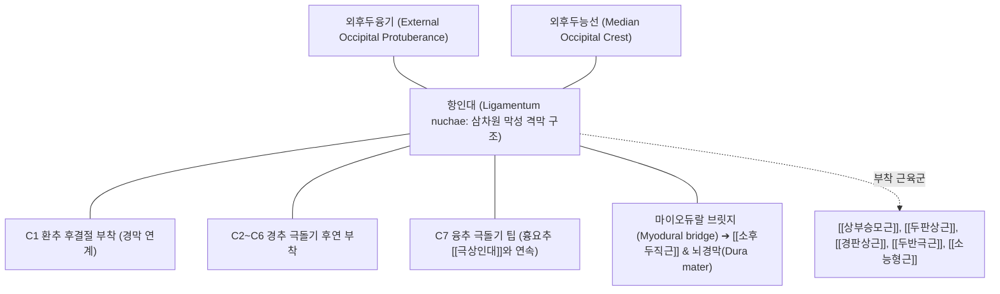

# [[항인대]] (Ligamentum nuchae)

> **핵심 요약 (Key Summary)**:
> 후두골 외후두융기(EOP)에서 시작하여 C1~C7 경추 극돌기를 연결하며 시상면 상에서 두경부를 지탱하는 강력한 섬유탄력성 막성 인대.
> 경추 과굴곡(Hyperflexion)을 제동하고 무거운 머리의 무게를 풍부한 탄력섬유의 수동적 탄성 복원력으로 지지하며 [[상부승모근]], [[두판상근]], [[두반극근]]의 견고한 부착 기저판 제공.
> 마이오듀랄 브릿지(Myodural bridge)를 통해 뇌경막과 기계적으로 연동되어 [[거북목 증후군]]의 만성 견인 손상, 항인대 골화증(ONL) 및 [[대후두신경]] 포착에 의한 [[경추성 두통]]의 핵심 병소.

---

## 📌 목차
1. [해부학적 정밀 구조 및 주행/부착](#1-해부학적-정밀-구조-및-주행부착)
2. [생체역학·기능 (Biomechanics)](#2-생체역학기능-biomechanics)
3. [임상 평가 및 이학적 검사](#3-임상-평가-및-이학적-검사)
4. [초음파 해부학(Sonoanatomy) 및 중재 랜드마크](#4-초음파-해부학sonoanatomy-및-중재-랜드마크)
5. [⭐ 원장님 심층 임상 고찰 및 원본 필기 (Clinical Pearls)](#5--원장님-심층-임상-고찰-및-원본-필기-clinical-pearls)
6. [관련 임상 질환 및 손상](#6-관련-임상-질환-및-손상)
7. [추나·도수치료 & 침구·약침·재활 프로토콜](#7-추나도수치료--침구약침재활-프로토콜)
8. [출처 및 학술 참고 문헌 (References)](#8-출처-및-학술-참고-문헌-references)

---

## 1. 해부학적 정밀 구조 및 주행/부착

* **부착부 및 주행 (Anatomical Attachments)**:
  * **상단 부착**: 후두골 외후두융기(EOP) 및 외후두능선(Median occipital crest).
  * **하단 부착**: 제7경추(C7, 융추) 극돌기 첨부. 여기서부터 흉요추의 [[극상인대]]로 직접 연속됨.
  * **심부 전방 부착**: C1(환추) 후결절 및 C2~C6 경추 극돌기의 후연을 따라 치밀하게 부착하여 좌우 경부 근육을 격리하는 정중 시상면 중격(Midline sagittal septum) 형성.
* **조직학적 특성 (Histological Characteristics)**:
  * 풍부한 황색 탄력섬유(Elastin)가 치밀 교원섬유(Type I Collagen)와 격자형으로 얽혀 있는 독특한 탄성 결합조직 구조.
  * 혈관 분포는 상대적으로 희소하나, 고유수용성 감각 수용기(파치니 소체, 루피니 소체)가 풍부하여 두경부의 3차원 공간 위치 감각을 소뇌로 피드백.
* **마이오듀랄 브릿지 (Myodural Bridge) 복합체**:
  * 환추후두막(Atlanto-occipital membrane) 및 C1-C2 분절 사이에서 항인대의 심부 섬유성 지지띠가 [[소후두직근]](Rectus capitis posterior minor) 건막 및 척수 경막(Spinal dura mater)과 직접 연결되어 있음.

---

## 2. 생체역학·기능 (Biomechanics)

* **두경부의 수동적 서스펜션 (Passive Suspension System)**:
  * 4~5kg에 달하는 인간 두부의 중력 중심(Center of gravity)은 경추 회전축보다 전방에 위치하므로, 머리는 항상 앞으로 떨어지려는 전방 굴곡 모멘트(Flexion moment)를 받음.
  * 항인대는 풍부한 탄력섬유의 수동적 장력(Passive elastic tension)을 통해 경추 신근들의 지속적인 등척성 수축 없이도 두부의 전방 추락을 에너지 소모 없이 지탱함.
* **경추 과굴곡(Hyperflexion)의 1차 제동기**:
  * 교통사고나 스포츠 외상 시 목이 앞으로 꺾이는 과굴곡 손상에 대해 후방 인대 복합체 중 가장 외측에서 가장 긴 모멘트 팔(Moment arm)을 형성하여 경추 극돌기 간 간격 개대를 강력하게 제동함.
* **경막 견인과 뇌척수액 순환 역학**:
  * 두경부 굴곡 시 항인대-소후두직근-경막으로 이어지는 마이오듀랄 브릿지가 경막을 후방으로 가볍게 당겨주어, 굴곡 시 척수강 내 정맥총 및 뇌척수액(CSF)의 비정상적 압박을 방지하는 동적 펌프 역할 수행.

---

## 3. 임상 평가 및 이학적 검사

* **항인대 정밀 촉진 검사 (Palpation Protocol)**:
  * 환자의 경추를 약 15~20도 경미하게 굴곡시켜 인대를 팽팽하게 만든 후, 검사자의 시지와 중지로 EOP 바로 아래 풍부혈(GV16) 부위부터 C7 대추혈(GV14)까지 정중선을 따라 수직 및 횡단으로 탄력성을 평가.
  * **양성 소견**: 두꺼워진 섬유성 띠(Taut fibrous band), 모래알처럼 만져지는 결절성 병변, 극돌기 부착부의 국소적 압통(Jump sign).
* **경추 굴곡 저항 및 유발 검사**:
  * 능동적 및 수동적 경추 완전 굴곡 시 후두하부 및 하부 경추 정중선의 뻐근한 당김통 및 후두부 방사통 재현 여부 확인.
* **스펄링 검사(Spurling test) 및 후두신경 감별**:
  * 신경근 압박([[경추 추간판 탈출증]])에 의한 방사통과 항인대성 연관통(Sclerotomal pain)을 구별하기 위해 [[Spurling test]] 및 견관절 외전 검사(Bakody test) 병행.

---

## 4. 초음파 해부학(Sonoanatomy) 및 중재 랜드마크

* **초음파 시상면 스캔 (Sagittal Sonoanatomy)**:
  * 고주파 선형 탐촉자를 경추 후방 정중선에 종단으로 거치하여 EOP에서 C7 극돌기까지 연속 스캔.
  * 정상 항인대는 피하지방 아래에서 균일한 층상 고에코(Echogenic) 섬유 띠로 뚜렷하게 관찰됨.
  * 만성 손상 시: 인대 실질의 저에코성 비후(Hypoechoic thickening), 섬유 결손, 또는 C5~C6 극돌기 인접부의 불규칙한 고에코 석회화 음영 및 후방 음향 음영(Posterior acoustic shadow) 확인.
* **초음파 횡단면 스캔 (Transverse View)**:
  * 좌우 [[상부승모근]] 및 [[두판상근]] 사이를 가르는 고에코 정중 삼각 중격 구조 확인.
* **침도(Acupotomy) 및 약침 중재 랜드마크**:
  * EOP 골부착부(풍부, 천주 내측)와 C2 극돌기 후연 부착부의 안전한 골막 접촉(Bone contact) 확인 후 자입하여 척수강 내 척수 손상을 물리적으로 원천 차단.

---

## 5. ⭐ 원장님 심층 임상 고찰 및 원본 필기 (Clinical Pearls)

* **거북목(Forward Head Posture) 환자의 뒷목 당김은 근육통이 아니라 항인대 피로다**:
  * 스마트폰을 보며 고개를 45~60도 숙이면 경추에 걸리는 하중이 정상(5kg)의 5~6배인 27kg까지 폭증합니다. 이 하중을 견디지 못해 [[상부승모근]]과 [[두판상근]]이 지치면 최후의 보루인 항인대가 모든 인장 스트레스를 떠안게 됩니다. 근육만 마사지해서는 낫지 않고, 항인대 부착부의 견인 손상을 치료해야 뒷목이 가벼워집니다.
* **항인대 골화증(ONL)과 '목 뒤에 뼈가 만져져요'의 진실**:
  * C5~C6 극돌기 뒷부분에 마치 뼈처럼 단단한 결절이 만져진다고 내원하는 환자들이 많습니다. 이는 뼈 종양이 아니라, 만성적인 장력 스트레스에 적응하기 위해 항인대 섬유 내에 화생성 골 형성(Heterotopic ossification)이 일어난 항인대 골화증(ONL)입니다. 이 결절 주위의 유착을 풀어주면 만성 경추 운동제한이 즉각 호전됩니다.
* **마이오듀랄 브릿지와 경추성 두통의 상관고리**:
  * 뒷머리가 조이고 눈알이 빠질 듯이 아픈 [[경추성 두통]] 환자에서, C1-C2 레벨의 항인대 유착을 [[침도]]나 [[약침]]으로 박리해주면 즉각적으로 시야가 맑아지고 두통이 사라집니다. 이는 항인대와 [[소후두직근]]을 매개로 경막(Dura)으로 전달되던 기계적 견인 장력이 해소되기 때문입니다.
* **침도요법 시의 안전 제1원칙**:
  * 후두하부 정중선(풍부, 아문) 시술 시 절대 [[침도]]를 깊이 찔러 넣어서는 안 됩니다. 반드시 후두골 외후두능선이나 C2 극돌기의 골면에 먼저 닿는 것을 확인한 후, 골면을 긁어내듯이(Scraping) 인대 부착부 유착만 박리해야 경막 천자와 척수 손상을 예방할 수 있습니다.

---

## 6. 관련 임상 질환 및 손상

| 질환 및 손상 | 병태생리 기전 | 전형적 증상 및 임상 소견 |
| :--- | :--- | :--- |
| [[거북목 증후군]] (Text Neck) | 장시간 두부 전방 전위로 인한 항인대 만성 견인 손상 | 경항부 만성 중압감, 경추 굴곡 시 통증, 만성 피로 |
| 항인대 골화증 (ONL) | 만성 미세 외상 및 견인 스트레스에 의한 이소성 골화 | 목 뒤 단단한 골성 결절 촉진, 경추 신전 및 회전 제한 |
| [[경추성 두통]] | 항인대 경직 및 [[대후두신경]] 압박, 경막 견인 | 후두부 둔통, 두정부 및 안와 후방으로의 방사통 |
| [[경추 채찍질 손상]] (Whiplash) | 급가속-급감속 손상 시 경추 과굴곡에 의한 항인대 급성 파열 | 수상 직후 극심한 경추 운동 불능, 심부 압통 |
| 경추 근막통증증후군 | 항인대 부착부 긴장에 따른 승모근·판상근 연쇄 경직 | 견배부 방사통, [[능형근]] 부위의 2차성 연관통 |

---

## 7. 추나·도수치료 & 침구·약침·재활 프로토콜

### 1) 한의 추나 및 관절 가동술
* **상부 경추 후두하 이완 추나 (Suboccipital Release)**:
  * 환자를 앙와위로 눕히고 양 손가락 끝으로 후두골 하연 항인대 부착부와 후두하근군을 접촉한 후, 두부 자체의 무게를 이용하여 부드럽게 상방 견인(Traction)을 3~5분간 유지.
* **경추 신전 회복 관절가동술**:
  * 소실된 경추 전만을 회복하기 위해 C5~C7 분절에 수건이나 도수 블록을 받치고 완만한 P-to-A mobilization 적용. 급격한 경추 회전 스러스트는 골화된 인대의 골절 위험이 있으므로 금기 ➔ [[추나]] · [[도수치료]].

### 2) 침구, 침도 및 약침 치료
* **주요 혈위 자침**:
  * 풍부(GV16), 아문(GV15): 항인대 상부 기시부 및 경막 연계 지점.
  * 천주(BL10), 풍지(GB20): 대후두신경 통과점 및 후두하근 긴장 완화.
  * 대추(GV14), 신주(GV12): 항인대 하부 정지부 및 상부 흉추 이행부.
* **침도 치료 (Acupotomy)**:
  * EOP 하단 및 C2 극돌기 외측의 단단하게 섬유화된 항인대 결절 부위를 소침도로 골막을 따라 종방향으로 절개 박리(Release)하여 경막 장력 즉각 해소 ➔ [[침도]].
* **약침 처방**:
  * **[[신바로약침]] / [[자하거약침]]**: 만성 항인대 변성 및 골화 부위에 분주하여 조직 재생 촉진.
  * **[[중성어혈약침]]**: 급성 채찍질 손상 후 항인대 미세 출혈 및 부종 신속 흡수.

### 3) 운동 재활 및 자세 교정
* **친 턱(Chin-tuck) 운동**:
  * 턱을 가슴 쪽으로 당겨 경추 심부 굴곡근([[경장근]], [[두장근]])을 강화하고 항인대의 만성 신장 스트레스 경감.
* **흉추 신전 가동성 운동**:
  * 폼롤러를 흉추 후면에 대고 신전 스트레칭을 시행하여 굽은 등(Thoracic kyphosis)을 교정 ➔ [[체형교정]].

---

## 8. 출처 및 학술 참고 문헌 (References)

1. **Chiang CW, et al. (2026)**. Ossification of the Nuchal Ligament With Text Neck Syndrome. *Cureus*. 18(9):e115774. PMID: 42831019.
   - `[연구 요약]` 장시간 스마트폰 사용에 따른 텍스트 넥 증후군 환자에서 경추 전방 굴곡 하중 증가와 항인대 골화증(ONL) 발병 간의 임상적 상관성 규명 및 영상의학적 평가.
2. **Wu B, et al. (2021)**. An Unrecognized Ligament and its Ossification in the Craniocervical Junction: Prevalence, Patient Characteristics, and Anatomic Evidence. *Clin Orthop Relat Res*. 479(8):1816-1826. PMID: 33739308.
   - `[연구 요약]` 두경부 접합부에서 항인대 심부 섬유와 마이오듀랄 브릿지의 3차원 해부학적 미세 구조, 골화 유병률 및 환자 임상 특성 분석.

