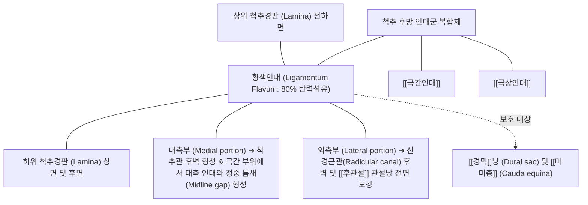

# [[황색인대]] (Ligamentum Flavum)

> **핵심 요약 (Key Summary)**:
> C2(축추)부터 S1(천골)까지 인접한 두 척추경판(Lamina)의 전하면과 상면을 연결하여 척추관(Spinal canal)의 후벽 및 후외측벽을 형성하는 강력한 특수 탄성 인대.
> 인체 결합조직 중 가장 높은 비율(약 70~80%)의 탄력섬유(Elastin)를 함유하여 척추 굴곡 시 팽팽하게 늘어났다가 직립 신전 시 주름(Buckling) 없이 복원되어 척수 경막을 보호.
> 노화 및 만성 기계적 스트레스, 대식세포 침윤(TREM2-TGF-β1 경로)에 의해 탄력섬유가 소실되고 교원섬유화 및 비후(Hypertrophy > 4mm)가 발생하여 [[요추 척추관협착증]] 및 [[신경인성 파행]](Neurogenic Claudication)을 초래하는 핵심 병인학적 구조물.

---

## 📌 목차
1. [해부학적 정밀 구조 및 주행/부착](#1-해부학적-정밀-구조-및-주행부착)
2. [생체역학·기능 (Biomechanics)](#2-생체역학기능-biomechanics)
3. [임상 평가 및 이학적 검사](#3-임상-평가-및-이학적-검사)
4. [초음파 해부학(Sonoanatomy) 및 중재 랜드마크](#4-초음파-해부학sonoanatomy-및-중재-랜드마크)
5. [⭐ 원장님 심층 임상 고찰 및 원본 필기 (Clinical Pearls)](#5--원장님-심층-임상-고찰-및-원본-필기-clinical-pearls)
6. [관련 임상 질환 및 손상](#6-관련-임상-질환-및-손상)
7. [추나·도수치료 & 침구·약침·재활 프로토콜](#7-추나도수치료--침구약침재활-프로토콜)
8. [출처 및 학술 참고 문헌 (References)](#8-출처-및-학술-참고-문헌-references)

---

## 1. 해부학적 정밀 구조 및 주행/부착

* **부착부 및 주행 (Anatomical Attachments)**:
  * **상단 부착**: 상위 척추경판(Lamina)의 전하면(Anterior-inferior surface) 약 절반 부위.
  * **하단 부착**: 하위 척추경판의 상면(Superior margin) 및 후상면.
  * **정중 접합 (Midline Gap)**: 좌우 한 쌍의 황색인대는 척추 극돌기 기저부 정중선에서 만나며, 소혈관이 통과하는 작은 틈새(Midline cleft/gap)를 형성하며 전방으로 [[극간인대]]와 맞닿음.
  * **외측 주행**: 외측으로 연장되어 [[추간공]](Intervertebral foramen)의 내측 경계 및 [[후관절]](Facet joint) 관절낭의 전내측 벽과 직접 융합하여 관절낭인대(Capsular ligament)로 기능.
* **조직학적 특성 (Yellow Elastic Tissue)**:
  * 육안적으로 황색을 띠는 이유는 단백질의 70~80%가 황색 탄력섬유(Elastin)로 구성되어 있기 때문임 (일반 인대는 Type I Collagen이 80% 이상).
  * 풍부한 엘라스틴 구조 덕분에 인장 한계가 매우 높고, 30% 이상 신장된 후에도 원래 길이로 즉각 반동 복원(Elastic recoil)되는 독보적 물성을 지님.
* **두께의 분절별 구배**:
  * 경추(약 1.5~2mm)에서 가장 얇고, 흉추를 거쳐 요추(L4-L5, L5-S1 레벨에서 약 3~4mm)로 내려갈수록 체중 부하에 비례하여 두꺼워짐.

---

## 2. 생체역학·기능 (Biomechanics)

* **척추관 내 주름 방지 (Anti-Buckling Mechanism)**:
  * 척추가 전방으로 굴곡(Flexion)될 때 황색인대는 약 35~45%까지 매끄럽게 늘어나며 척추의 과도한 굴곡을 제동함.
  * 척추가 직립 또는 신전(Extension) 상태로 복귀할 때, 인체 일반 인대처럼 느슨하게 처지거나 주름(Buckling)이 생기지 않고, 탄성 복원력에 의해 팽팽한 장력을 유지하여 **척추관 내부의 [[경막]]낭(Dural sac)을 찌르거나 압박하지 않음**.
* **직립 자세 유지의 에너지 절약 기구**:
  * 황색인대의 휴식기 고유 장력(Pre-stress tension)은 체간 신근([[척추기립근]], [[다열근]])이 미세하게 이완된 상태에서도 추궁판 사이를 적정 간격으로 묶어주어 척추 중립위 유지에 필요한 근육 대사 에너지를 절감함.
* **후관절 관절낭 보호**:
  * 외측부 섬유는 척추 운동 시 [[후관절]]의 활액막 주름(Synovial fold)이 관절면 사이에 끼이지 않도록 외측으로 당겨주는 역학적 가이드 역할 수행.

---

## 3. 임상 평가 및 이학적 검사

* **신경인성 간헐적 파행 ([[신경인성 파행]], NIC) 평가**:
  * 보행 시 하지(둔부, 대퇴 후외측, 하퇴부)의 뻐근한 쥐어짜는 통증, 저림, 힘빠짐 발생 여부 확인.
  * **자전거 검사 (Bicycle Test of van Gelderen)**: 허리를 펴고 걸을 때는 5분 만에 파행이 오지만, 허리를 굽힌 상태로 실내 자전거를 탈 때는 장시간 통증 없이 페달을 밟을 수 있음 (혈관성 파행과의 핵심 감별점).
* **쇼핑카트 징후 (Shopping Cart Sign)**:
  * 마트에서 쇼핑카트를 짚고 허리를 약간 구부리면 척추관이 넓어져 통증 없이 오래 걸을 수 있는 징후 (황색인대 비후에 의한 [[요추 척추관협착증]]의 특이적 임상 소견).
* **켐프 검사 (Kemp's Test) 및 요추 신전 검사**:
  * 요추를 신전시키고 환측으로 외측 굴곡 및 회전 시킬 때, 비후된 황색인대가 척추관 및 [[추간공]]을 더욱 협소하게 만들어 하지 방사통과 둔부 압박통 재현 ➔ [[Kemp 검사]].
* **신경학적 검사**:
  * 만성 마미총 압박 시 족하수(Foot drop), 족무지 배굴력 약화(L5), 족저굴곡력 및 아킬레스건 반사 소실(S1), 안장 감각 이상(Saddle anesthesia) 점검.

---

## 4. 초음파 해부학(Sonoanatomy) 및 중재 랜드마크

* **초음파 척추 후궁간 스캔 (Interlaminar Sonoanatomy)**:
  * 볼록형(Curved) 저주파 탐촉자를 요추 정중선 또는 척추방(Paramedian)에 거치하여 후궁간 창(Interlaminar window) 스캔.
  * 상하 척추경판의 고에코 뼈 표면 사이에 위치하는 균일한 저에코 또는 중간 에코의 띠 구조로 황색인대 식별.
  * 바로 전방에 위치하는 고에코의 후방 경막(Posterior dura)과의 사이에 얇은 경막외강(Epidural space) 확인.
* **초음파 유도하 경막외 차단술 및 약침 자입 랜드마크**:
  * 바늘이 황색인대를 관통할 때 특유의 '툭'하는 저항 소실감(Loss of resistance, LOR) 확인.
  * In-plane paramedian 접근법으로 후궁간을 통해 황색인대 배측(Dorsal surface) 또는 경막외강으로 정확한 [[약침]]액 주입.

---

## 5. ⭐ 원장님 심층 임상 고찰 및 원본 필기 (Clinical Pearls)

* **황색인대 비후의 본질은 '단순 붓기'가 아니라 '탄력섬유의 섬유화와 석회화'다**:
  * 정상 황색인대는 말랑말랑한 고무줄 같지만, 60대 이상 [[요추 척추관협착증]] 환자의 황색인대는 딱딱한 가죽이나 석고처럼 굳어 있습니다. 반복적인 역학적 과부하와 젖산 대사 이상, TREM2 대식세포 침윤으로 인해 엘라스틴이 파괴되고 Type I 콜라겐이 침착되어 두께가 5~8mm까지 두꺼워지면서 뒤에서 신경을 목 조르듯이 누르게 됩니다.
* **요추 굴곡 추나요법(Williams Flexion)이 즉각적 효과를 내는 기전**:
  * 허리를 굽히면 후궁판 사이가 벌어지면서 두꺼워진 황색인대가 얇게 펴지고, 척추관 단면적이 약 15~20% 일시적으로 넓어집니다. 따라서 협착증 환자 치료 시 억지로 요추 전만을 만들려고 신전 운동([[맥켄지 신전운동]])을 시키면 황색인대가 척추관 안으로 불룩 튀어나와 증상이 급격히 악화됩니다. 초기에는 철저히 굴곡 중심 치료([[Williams 굴곡운동]])를 적용해야 합니다.
* **약침 시술 시 '심도(Depth)'의 엄격한 통제**:
  * [[극간인대]]와 황색인대 배측을 목표로 약침을 시술할 때, 극돌기 골면에 먼저 닿아 깊이를 측정한 후 극간으로 진입해야 합니다. 황색인대를 뚫고 경막을 천자하면 뇌척수액 누출로 인한 극심한 기립성 두통이 발생할 수 있으므로, 숙련된 자입 깊이 조절과 골막 랜드마크 확인이 절대적 안전 수칙입니다.
* **비후된 황색인대 주위의 신경근 유착 박리**:
  * 황색인대 비후증 환자는 인대 자체의 부피 증가뿐만 아니라 경막외 유착과 국소 정맥 울혈이 심합니다. [[침도]](Acupotomy)나 심부 침치료로 후궁간 외측의 유착을 미세하게 박리하고 [[신바로약침]]을 주입하면 미세혈류가 재개되어 보행 거리가 비약적으로 늘어납니다.

---

## 6. 관련 임상 질환 및 손상

| 질환 및 병태 | 주요 병리기전 | 임상 양상 및 진단 소견 |
| :--- | :--- | :--- |
| [[요추 척추관협착증]] | 황색인대 비후(>4mm) 및 [[추간판]] 팽륜에 의한 척수관 후방 압박 | 신경인성 간헐적 파행, 보행 시 하지 저림 및 중압감 |
| 황색인대 골화증 (OLF) | 흉추(T9~T12) 및 요추 황색인대 내 수산화인회석 결정 침착 및 골화 | 진행성 하지 경직, 보행 실조(Gait ataxia), 하반신 마비 위험 |
| 황색인대 낭종 (Cyst) | 인대 퇴행성 파열 부위로 관절액 유출 또는 점액성 변성으로 낭종 형성 | 급성 신경근 압박증, 디스크 탈출증과 유사한 좌골신경통 |
| 경추 척수증 ([[경추 척수증]]) | 경추 후굴 시 비후된 황색인대의 주름 접힘(Infolding)에 의한 척수 압박 | 단추 채우기 곤란, 젓가락질 장애, Hoffmann 반사 양성 |
| 요추 천자 후 두통 (PDPH) | 황색인대 관통 후 경막 천자 시 뇌척수액 누출 | 좌위/기립 시 악화되고 앙와위 시 완화되는 박동성 두통 |

---

## 7. 추나·도수치료 & 침구·약침·재활 프로토콜

### 1) 한의 굴곡 추나 및 골반 가동술
* **요추 굴곡-신연 추나요법 (Cox Flexion-Distraction)**:
  * 콕스 테이블을 활용하여 요추 후궁간을 부드럽게 굴곡-신연시킴으로써 황색인대의 장력을 일시적으로 늘리고 척추관 내 음압을 유도하여 신경근 감압 ➔ [[추나]] · [[도수치료]].
* **골반 후방 경사 유도 도수치료**:
  * 단축된 [[장요근]]을 이완시키고 [[대둔근]]을 활성화하여 골반의 과도한 전방 경사를 바로잡고 요추 과전만을 해소.
* **금기 사항**:
  * 급격한 회전력이 가해지는 요추 롤링 스러스트(Lumbar roll thrust) 및 강한 요추 신전 기법은 비후된 황색인대의 척수관 압박을 가중시키므로 엄격히 금기.

### 2) 침구, 침도 및 약침 복합 치료
* **핵심 혈위 자침**:
  * 대장유(BL25), 관원유(BL26), 요양관(GV3), 협척혈(EX-B2 L4-L5, L5-S1): 후궁간 창 인접부로 자침하여 국소 신경근 주위 부종 및 어혈 완화.
  * 위중(BL40), 승산(BL57), 곤륜(BL60): 좌골신경 주행 경로의 근 긴장 완화.
* **침도 치료 (Acupotomy)**:
  * [[극간인대]]와 황색인대 배측 경계부의 섬유성 유착을 소침도로 미세 절개하여 후방 인대 복합체의 긴장을 줄이고 척추관 압력을 감압 ➔ [[침도]].
* **약침 처방**:
  * **[[신바로약침]] / [[자하거약침]]**: 협척혈 심부 황색인대 외측 부착부 주위에 1.0~2.0cc 분주하여 신경 염증을 억제하고 신경근 혈류 개선.
  * **[[황련해독탕약침]]**: 급성기 신경근 부종 및 염증성 통증 제어.

### 3) 굴곡 기반 운동 재활 프로토콜
* **윌리엄스 굴곡 운동 ([[Williams 굴곡운동]])**:
  * 무릎을 가슴으로 당기는 단측/양측 무릎 가슴 닿기(Knee-to-chest) 스트레칭.
  * 복부 크런치(Curl-up)를 통한 복직근 및 [[복횡근]] 강화.
* **고치 요법 및 고정식 실내 자전거**:
  * 허리를 가볍게 숙인 상태에서 타는 실내 자전거 타기(매일 20~30분)를 통해 하지 혈류 순환 촉진 및 유산소 능력 유지.

---

## 8. 출처 및 학술 참고 문헌 (References)

1. **Vadhanan P, et al. (2026)**. Radiofrequency Lesioning of Hypertrophied Ligamentum Flavum in Lumbar Spinal Stenosis - A Report of Two Cases. *Pain Med Case Rep*. 10(6):501-505. PMID: 42679078.
   - `[연구 요약]` 요추 척추관협착증 환자에서 비후된 황색인대에 대한 고주파 열응고술 중재의 임상적 통증 감소 효과 및 척추관 후벽 해부학적 평가.
2. **Qiu J, et al. (2026)**. TREM2 induces ligamentum flavum fibrosis by promoting TGF-β1 secretion from M2 macrophages. *Cell Signal*. 148():112827. PMID: 42604666.
   - `[연구 요약]` 황색인대 비후의 핵심 분자 기전으로서 M2 대식세포의 TREM2 신호 전달에 의한 TGF-β1 분비 촉진과 콜라겐 섬유화 촉진 기전 규명.
3. **Zhu L, et al. (2026)**. Proteomics combined with single-cell sequencing reveals key genes and computational lead compound related to ligamentum flavum hypertrophy, lactate metabolism and lactate modification. *Biochem Biophys Res Commun*. 834():154413. PMID: 42632329.
   - `[연구 요약]` 단일세포 전사체 및 단백질체학 분석을 통해 황색인대 비후증에서 젖산 대사 이상 및 섬유화 유전자의 발현 양상과 치료 표적 도출.
