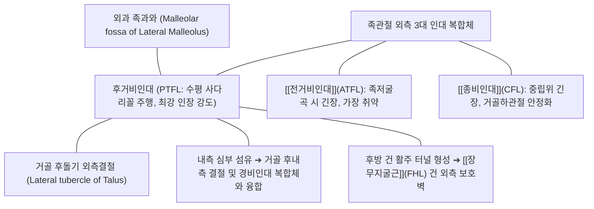

# [[후거비인대]] (Posterior Talofibular Ligament, PTFL)

> **핵심 요약 (Key Summary)**:
> [[비골]] 외과 후내측의 족과와(Malleolar fossa)에서 기시하여 [[거골]] 후돌기 외측결절(Lateral tubercle)에 정지하는 족관절 외측 3대 인대 중 가장 두껍고 강력한 사다리꼴 섬유성 인대.
> 족배굴곡(Dorsiflexion) 시 최대로 긴장하여 거골의 후방 전위, 과도한 내번 및 외회전을 최종적으로 차단하는 족관절의 '최후의 보루(Ultimate restraint)'.
> 단순 내번 염좌에서는 단독 파열이 극히 드물며, 삼복사 골절이나 족관절 완전 탈구를 동반한 Grade III 복합 중증 외상 시 손상되고, 삼각골([[삼각골]]) 증후군 및 후방 충돌 증후군과의 정밀 감별이 필수적인 구조물.

---

## 📌 목차
1. [해부학적 정밀 구조 및 주행/부착](#1-해부학적-정밀-구조-및-주행부착)
2. [생체역학·기능 (Biomechanics)](#2-생체역학기능-biomechanics)
3. [임상 평가 및 이학적 검사](#3-임상-평가-및-이학적-검사)
4. [초음파 해부학(Sonoanatomy) 및 중재 랜드마크](#4-초음파-해부학sonoanatomy-및-중재-랜드마크)
5. [⭐ 원장님 심층 임상 고찰 및 원본 필기 (Clinical Pearls)](#5--원장님-심층-임상-고찰-및-원본-필기-clinical-pearls)
6. [관련 임상 질환 및 손상](#6-관련-임상-질환-및-손상)
7. [추나·도수치료 & 침구·약침·재활 프로토콜](#7-추나도수치료--침구약침재활-프로토콜)
8. [출처 및 학술 참고 문헌 (References)](#8-출처-및-학술-참고-문헌-references)

---

## 1. 해부학적 정밀 구조 및 주행/부착

* **부착부 및 주행 (Anatomical Attachments)**:
  * **기시부 (Origin)**: [[비골]] 외과(Lateral malleolus) 후내측면의 깊은 오목한 함몰부인 족과와(Malleolar fossa).
  * **정지부 (Insertion)**: [[거골]](Talus) 후돌기의 외측결절(Lateral tubercle of posterior process). 일부 섬유는 거골 후면을 가로질러 내측결절 및 삼각골 결합부까지 연장됨.
  * **주행 방향**: 거의 수평에 가까운 사선 주행(Horizontal-transverse orientation)을 보이며, 관절낭 외측벽의 후면을 단단하게 감싸는 두터운 부채꼴/사다리꼴 형태를 이룸.
* **주변 해부학적 구조물과의 관계**:
  * **[[장무지굴근]](Flexor Hallucis Longus, FHL) 건**: 거골 후돌기의 내측결절과 외측결절 사이의 고랑(Sulcus)을 주행하므로, PTFL은 FHL 건의 외측 지지벽을 형성함.
  * **후경비인대 (PTIFL) 및 하횡인대 (Transverse tibiofibular ligament)**: PTFL의 상연 바로 위에 위치하여 경비원위관절(Syndesmosis)의 후방 안정성을 상호 보강.
* **조직학적 강도 및 형태학적 특성**:
  * 외측 인대 중 가장 두껍고 섬유 다발이 치밀함 (인장 파단 강도 약 350~400 N 이상으로 [[전거비인대]]의 2.5배).
  * 풍부한 혈관망과 관절 활액막 주름에 둘러싸여 있어 인대 치유 잠재력이 상대적으로 높음.

---

## 2. 생체역학·기능 (Biomechanics)

* **족관절 각도에 따른 인장 역학 (Dorsiflexion vs Plantarflexion)**:
  * **족배굴곡 (Dorsiflexion)**: 거골의 전방 폭이 넓은 활차면이 비골과 경골 사이로 쐐기처럼 밀려들어갈 때, PTFL은 팽팽하게 최대 긴장(Taut)되어 거골의 과도한 후방 전위를 차단하고 족관절의 완전 잠김(Screw-home & Close-packed position)을 달성.
  * **족저굴곡 (Plantarflexion)**: PTFL은 느슨(Slack)해지며, 이때는 [[전거비인대]](ATFL)가 수직으로 팽팽해져 하중을 대신 감당함.
* **거골의 회전 제어 (Rotational Restraint)**:
  * 발목이 안쪽으로 꺾이는 내번(Inversion) 및 외회전(External rotation) 시 거골이 비골로부터 멀어지는 분리력을 억제하는 최종 제동 장치(Secondary restraint)로 기능.
* **거골하관절(Subtalar Joint)과의 협동 안정화**:
  * [[종비인대]](CFL)와 함께 거골과 [[종골]], 비골로 이어지는 3차원 외측 지주를 형성하여 울퉁불퉁한 지면 보행 시 족부의 과도한 회내/회외 흔들림을 통제.

---

## 3. 임상 평가 및 이학적 검사

* **후방 서랍 검사 (Posterior Drawer Test of Ankle)**:
  * 환자를 좌위 또는 앙와위로 두고 족관절을 중립(90도) 또는 경미한 족배굴곡 상태로 유지.
  * 한 손으로 원위 경비골을 전방에서 지지하고, 다른 손으로 거골과 종골을 쥐고 후방으로 강하게 밀어냄.
  * **양성 소견**: 거골의 비정상적 후방 전위, 외과 후방의 덜컹거림 및 날카로운 통증 (PTFL 완전 단열 시에만 양성).
* **외회전 스트레스 검사 (Kleiger's Test / External Rotation Test)**:
  * 하퇴를 고정하고 발을 외회전시킬 때 족관절 후외측 및 경비원위부 통증 유발 여부 확인 (경비인대 손상 및 PTFL 심부 섬유 손상 평가).
* **후방 충돌 유발 검사 (Posterior Impingement Sign)**:
  * 검사자가 발목을 급격하게 강제 족저굴곡시킬 때 외과 후방 및 [[아킬레스건]] 심부에서 찝히는 듯한 통증 재현 여부 확인 (삼각골 증후군 감별).
* **골절 배제를 위한 오타와 발목 규칙 (Ottawa Ankle Rules)**:
  * 비골 외과 후연 및 첨부 6cm 부위의 골 압통이 있거나 수상 직후 4걸음 이상 체중 부하가 불가능한 경우 단순 [[발목 염좌]]로 치부하지 않고 X-ray 촬영 필수.

---

## 4. 초음파 해부학(Sonoanatomy) 및 중재 랜드마크

* **초음파 탐촉자 거치 및 스캔 기법**:
  * 환자를 복와위(Prone)로 눕히고 발을 침대 밖으로 떨어뜨린 후 발목을 약 90도 족배굴곡 유지.
  * 고주파 선형 탐촉자를 외과 후하방에서 거골 후돌기를 향해 사선(수평에 가까운 횡단 관상면)으로 거치.
  * 비골 외과의 족과와(Malleolar fossa)와 거골 후외측 결절 사이를 잇는 두껍고 밝은 섬유성 고에코 띠로 관찰되는 PTFL 확인.
* **동적 검사 (Dynamic Sono-stress Test)**:
  * 발목을 능동적으로 배굴-저굴 시킬 때 인대 섬유가 팽팽하게 펴지고 이완되는 동적 연속성 관찰. 인대 실질의 저에코성 결손이나 단열 확인.
* **약침 및 재생 주사 중재 랜드마크**:
  * 비골 후연 외측에서 내측 전방을 향해 In-plane 접근으로 거골 외측결절 골막 접촉 후 약침액 분주. [[장무지굴근]] 건초와 비골건하 활액낭을 피해 정확한 인대 실질 주위 타겟팅.

---

## 5. ⭐ 원장님 심층 임상 고찰 및 원본 필기 (Clinical Pearls)

* **PTFL 파열 환자가 걸어서 한의원에 오는 일은 없다**:
  * 일상적인 발목 삠([[발목 염좌]])의 90%는 [[전거비인대]](ATFL), 50%는 [[종비인대]](CFL) 손상이며 PTFL까지 찢어지는 경우는 5% 미만입니다. PTFL이 찢어지려면 발목이 완전히 탈구되거나 삼복사 골절이 동반될 정도의 극심한 고에너지 외상이어야 합니다. 환자가 제 발로 걸어 들어왔다면 PTFL 단열보다는 거골 후방 충돌이나 비골건 아탈구를 먼저 의심해야 합니다.
* **삼각골(Os trigonum) 증후군과의 결정적 감별 포인트**:
  * 발레리나나 축구선수처럼 발끝으로 서거나(En pointe) 공을 발등으로 찰 때(과도한 족저굴곡) 발목 뒤쪽이 아프다면, 이는 PTFL 염좌가 아니라 거골 후돌기의 미융합 골편인 [[삼각골]]이 경골 후연과 [[종골]] 사이에 끼이는 '후방 충돌 증후군'입니다. 외과 뒤쪽의 외측 압통(PTFL)과 [[아킬레스건]] 심부 정중부 압통(삼각골/FHL 건)을 손가락 끝으로 정밀하게 분리 촉진해야 합니다.
* **만성 족관절 불안정성(CAI) 치료 시 후방 지지대의 가치**:
  * [[전거비인대]] 수술 후에도 발목이 계속 불안정하다고 호소하는 만성 환자들의 경우, 족배굴곡 시 거골을 뒤에서 잡아주는 PTFL 및 후방 관절낭이 느슨해져 있는 경우가 많습니다. 곤륜혈과 복삼혈 부위의 심부 침구 및 [[신바로약침]] 치료로 후방 관절낭을 강화해주면 덜컹거림이 현저히 줄어듭니다.
* **단골 환자의 발목 삠 치료 시 비골건 탈구 동반 점검**:
  * 외과 바로 뒤를 만질 때 통증과 함께 발목을 젖힐 때 [[비골근]] 건이 앞으로 '툭' 튀어나오는 탄발음이 느껴진다면, 이는 상비골건지대(SPR) 파열 및 비골건 아탈구입니다. PTFL 손상으로 오진하여 단순 침치료만 할 경우 만성 탈구로 고착되므로 족외번 저항 검사를 반드시 병행해야 합니다.

---

## 6. 관련 임상 질환 및 손상

| 질환 및 병태 | 발생 기전 및 병리 | 임상 소견 및 감별 요점 |
| :--- | :--- | :--- |
| 급성 족관절 3도 복합 염좌 | 족배굴곡-외번-회전 또는 극단적 내번 탈구로 외측 인대 전수 파열 | 족관절 극심한 혈관절증, 완전 체중 부하 불능, 광범위 피하 반상출혈 |
| 족관절 삼복사 골절 | 거골의 강력한 후방 회전 전위로 내과, 외과, 후과(Posterior malleolus) 동시 골절 | 발목의 육안적 심각한 변형, 신경혈관 결손 응급 점검 필수 |
| 거골 후방 충돌 증후군 | 과도한 족저굴곡 시 [[삼각골]] 또는 PTFL 비후 부위가 경골-종골 사이 압박 | 까치발 들기 시 발목 뒤쪽 날카로운 통증, 후방 충돌 검사 양성 |
| 장무지굴근(FHL) 건초염 | PTFL 인접 고랑을 지나는 [[장무지굴근]] 건의 과사용 및 마찰성 건초염 | 엄지발가락을 굽히고 펼 때 족관절 후내측 통증 및 염발음 |
| 족관절 후외측 회전 불안정성 | PTFL 및 [[종비인대]] 만성 이완에 따른 거골하관절 흔들림 | 평지 보행 시 발목이 겉도는 느낌, 계단 하강 시 불안정 |

---

## 7. 추나·도수치료 & 침구·약침·재활 프로토콜

### 1) 한의 도수 및 추나요법
* **거골 후방 활주 추나요법 (Posterior Talar Glide)**:
  * 족배굴곡 제한이 동반된 만성 족관절 기능부전 환자에게 환자의 족관절을 가볍게 배굴시키며 거골 활차면을 후하방으로 가동(A-to-P mobilization)하여 정상 궤적 회복 ➔ [[추나]] · [[도수치료]].
* **비골두 및 원위 비골 가동술**:
  * 족과와의 정상 위치 회복을 위해 [[비골]]의 상하 활주 및 전후방 회전을 정상화.

### 2) 침구 및 약침 복합 치료
* **핵심 혈위 자침**:
  * 곤륜(BL60), 신맥(BL62), 복삼(BL61): 비골 외과 후방 및 거골 외측결절 부착부 침치료로 국소 어혈 및 신경 포착 완화.
  * 태계(KI3), 대종(KI4): 후내측 FHL 건초 및 경골신경 주행 부위 안정화.
  * 구허(GB40), 현종(GB39): 외측 인대군 전체의 기혈 순환 촉진.
* **약침 처방**:
  * **[[신바로약침]] / [[자하거약침]]**: 외과 후내측 족과와 및 PTFL 인대 부착부에 0.5~1.0cc 분주하여 콜라겐 섬유 재형성 및 미세 인장력 복원.
  * **[[중성어혈약침]]**: 급성기 후방 관절낭 혈종 흡수 촉진.

### 3) 단계별 재활 및 고유수용성 감각 훈련
* **1단계 (보호 및 관절가동역)**:
  * 족배굴곡 0도 이상 과도한 저굴을 제한하는 에어캐스트(Aircast) 보조기 적용.
* **2단계 (비골근 및 하퇴 신근 강화)**:
  * 탄력 밴드를 이용한 족외번(Eversion) 및 족배굴곡 원심성(Eccentric) 근력 강화 ➔ [[비골근]].
* **3단계 (동적 균형 감각 훈련)**:
  * 보수볼(BOSU ball) 및 흔들판(Wobble board) 상에서 단하지 기립 밸런스 훈련을 통해 거골하관절 위치감각 완성 ➔ [[고유수용성 감각]].

---

## 8. 출처 및 학술 참고 문헌 (References)

1. **Anandh N, et al. (2026)**. High ankle sprains in athletes: A comprehensive imaging focused review. *Skeletal Radiol*. PMID: 42606584.
   - `[연구 요약]` 운동선수에서 발목 고위 염좌 및 외측 인대 복합체(ATFL, CFL, PTFL) 손상의 MRI 및 초음파 영상 감별 진단, 후방 인대군 파열 시 역학적 불안정성 평가.
2. **Bergman R, et al. (2026)**. Triplane and Tillaux Ankle Fractures. *StatPearls*. PMID: 31613517.
   - `[연구 요약]` 족관절의 복합 회전 외상에서 후거비인대(PTFL) 및 하횡인대의 견인력에 의한 비골·거골·경골 후과 골절의 병태생리 및 정복 가이드라인.

