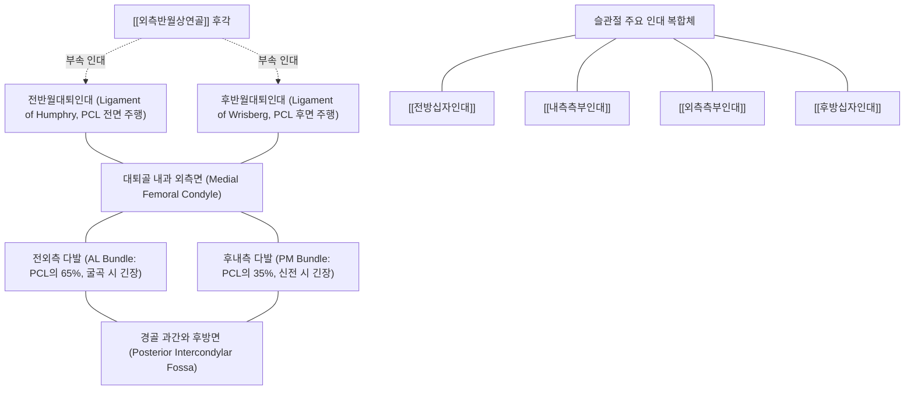

# [[후방십자인대]] (Posterior Cruciate Ligament, PCL)

> **핵심 요약 (Key Summary)**:
> [[대퇴골]] 내과 외측면 전하방에서 기시하여 [[경골]] 과간구 후방 관절면 아래 1cm 부위에 정지하는 [[슬관절]] 최강의 중심 안정화 인대 (단면적 [[전방십자인대]](ACL)의 1.5~2배, 인장강도 약 2,500~3,000 N).
> 모든 굴곡 각도에서 경골의 비정상적 후방 전위를 약 95% 차단하며 전외측 다발(AL bundle)과 후내측 다발(PM bundle)로 구성되어 [[대퇴사두근]]과 협력하여 무릎 관절을 보호.
> 교통사고 대시보드 충격([[대시보드 손상]]) 및 무릎 굴곡 낙상으로 호발하며, [[후방 전위 검사]], 후방 처짐(Posterior Sag sign), 능동 대퇴사두근 검사 양성 및 보존적 한의 [[신바로약침]]과 대퇴사두근 중심 재활의 핵심 대상.

---

## 📌 목차
1. [해부학적 정밀 구조 및 주행/부착](#1-해부학적-정밀-구조-및-주행부착)
2. [생체역학·기능 (Biomechanics)](#2-생체역학기능-biomechanics)
3. [임상 평가 및 이학적 검사](#3-임상-평가-및-이학적-검사)
4. [초음파 해부학(Sonoanatomy) 및 중재 랜드마크](#4-초음파-해부학sonoanatomy-및-중재-랜드마크)
5. [⭐ 원장님 심층 임상 고찰 및 원본 필기 (Clinical Pearls)](#5--원장님-심층-임상-고찰-및-원본-필기-clinical-pearls)
6. [관련 임상 질환 및 손상](#6-관련-임상-질환-및-손상)
7. [추나·도수치료 & 침구·약침·재활 프로토콜](#7-추나도수치료--침구약침재활-프로토콜)
8. [출처 및 학술 참고 문헌 (References)](#8-출처-및-학술-참고-문헌-references)

---

## 1. 해부학적 정밀 구조 및 주행/부착

* **2중 다발 시스템 (Double-Bundle Functional Anatomy)**:
  * **전외측 다발 (Anterolateral Bundle, AL Bundle)**:
    * [[대퇴골]] 내과 외측면 전하방에서 기시하여 [[경골]] 과간와 전외측에 정지.
    * PCL 전체 용적의 약 65~70%를 차지하는 주력 다발로, **슬관절 굴곡(Flexion > 70~90도) 시 최대 긴장(Taut)**되어 굴곡 상태의 후방 안정성을 도맡음.
  * **후내측 다발 (Posteromedial Bundle, PM Bundle)**:
    * 대퇴골 내과 외측면 후상방에서 기시하여 경골 과간와 후내측 능선에 정지.
    * PCL 용적의 약 30~35%를 차지하며, **슬관절 신전(Full extension) 시 최대 긴장**되어 관절의 과신전과 회전을 제어.
* **반월대퇴인대 복합체 (Meniscofemoral Ligaments)**:
  * [[외측반월상연골]] 후각(Posterior horn of lateral meniscus)에서 기시하여 PCL을 따라 대퇴골 내과로 주행하는 부속 인대:
    * **험프리 인대 (Ligament of Humphry / Anterior Meniscofemoral Ligament)**: PCL 실질의 앞쪽을 통과 (인구의 약 35~40% 존재).
    * **리스버그 인대 (Ligament of Wrisberg / Posterior Meniscofemoral Ligament)**: PCL 실질의 뒤쪽을 통과 (인구의 약 70~80% 존재).
    * PCL 파열 시 경골 후방 전위를 막아주는 2차 보조 지지대로 기능.
* **혈류 공급 및 신경 지배**:
  * 중슬동맥(Middle genicular artery)의 풍부한 혈관총이 활액막을 통해 유입되어 [[전방십자인대]]보다 혈액 순환이 우수하여 자연 치유 능력이 뛰어남.
  * 후경골신경 분지의 루피니 및 파치니 소체가 관절낭 내 풍부하게 분포.

---

## 2. 생체역학·기능 (Biomechanics)

* **경골 후방 전위의 일차적 억제기 (Primary Restraint)**:
  * [[슬관절]]의 모든 굴곡 각도에서 경골이 대퇴골에 대해 후방으로 밀려나는 외력에 대해 **약 90~95%의 구속력(Restraint)**을 발휘함.
  * 인장 파단 강도는 약 2,500~3,000 N으로 ACL(약 1,700~2,160 N)을 능가하는 인체 무릎 최강의 인대.
* **대퇴사두근과 햄스트링의 역학적 역전 (The Biomechanical Reversal)**:
  * [[대퇴사두근]](Quadriceps) 수축: [[슬개골]]과 [[슬개건]]을 통해 경골 조면을 전방으로 잡아당기므로, PCL에 가해지는 인장 부하를 직접 감소시키는 **가장 강력한 보호 협동근(Protective Agonist)**.
  * [[슬괵근]](Hamstrings) 수축: 경골 근위부를 후방으로 견인하므로, PCL 손상 급성기에는 인대를 찢어지게 만드는 **위험한 길항근(Antagonist)**으로 작용.
* **과신전 및 외회전 최종 제동**:
  * 완전 신전 시 PM 다발과 후외측 복합체(PLC)가 협력하여 대퇴-경골 관절의 과신전을 차단하고 스크루 홈 기전(Screw-home mechanism)을 보조.

---

## 3. 임상 평가 및 이학적 검사

* **후방 전위 검사 ([[후방 전위 검사]], Posterior Drawer Test)**:
  * 환자를 앙와위로 눕히고 슬관절 90도 굴곡, 발을 검사대 위에 고정.
  * 양 손으로 경골 근위부를 쥐고 후방으로 강하게 밀어내며 변위량 계측.
  * **등급 판정**:
    * Grade I: 0~5mm 전위 (경골 내측과가 여전히 대퇴 내과 전방 약 1cm에 위치).
    * Grade II: 5~10mm 전위 (경골 내측과가 대퇴 내과와 편평하게 일치).
    * Grade III: >10mm 전위 (경골 내측과가 대퇴 내과 후방으로 푹 꺼짐 ➔ PLC 또는 ACL 복합 손상 동반 의미).
* **후방 처짐 징후 (Posterior Sag Sign / Godfrey Test)**:
  * 고관절 90도, 슬관절 90도 굴곡 상태에서 양 발뒤꿈치를 들어 올렸을 때, 중력에 의해 환측 경골 조면이 아래로 푹 꺼져 처지는 형태학적 관찰.
* **대퇴사두근 능동 검사 (Quadriceps Active Test)**:
  * 슬관절 90도 굴곡 상태에서 환자에게 발을 떼지 말고 침대를 밀면서 [[대퇴사두근]]을 수축시키도록 지시.
  * 후방으로 처져 있던 경골이 대퇴사두근의 전방 견인력에 의해 앞으로 '툭' 튀어나오며 정상 위치로 정복되는 현상 확인 (특이도 97% 이상).
* **후외측 회전 불안정성(PLC) 동반 평가 (Dial Test)**:
  * 30도 및 90도 굴곡에서 경골 외회전 각도 측정. 30도에서만 10도 이상 증가하면 순수 PLC 손상, 30도와 90도 모두에서 증가하면 PCL + PLC 복합 손상.

---

## 4. 초음파 해부학(Sonoanatomy) 및 중재 랜드마크

* **초음파 후방 슬와부 스캔 (Posterior Popliteal View)**:
  * 환자를 복와위로 눕히고 무릎 아래에 베개를 받쳐 약 20~30도 굴곡 유지.
  * 고주파 선형 또는 볼록형 탐촉자를 슬와주름(Popliteal crease) 중앙에서 종단(Sagittal)으로 거치.
  * 경골 후방 과간와 골표면에서 비스듬히 상방 대퇴골 내과를 향해 주행하는 두터운 균일한 저신호/중간에코의 띠 구조로 PCL 확인.
* **초음파상 손상 소견**:
  * PCL의 두께 비후(>7mm), 섬유 주행의 연속성 소실, 인대 내부의 불규칙한 저에코성 혈종 및 삼출액 관찰.
* **약침 중재 랜드마크**:
  * 슬와동맥(Popliteal artery) 및 경골신경(Tibial nerve)이 PCL 바로 후방을 주행하므로 도플러 초음파를 켜고 혈관 신경 다발의 위치를 실시간 확인한 후 외측 안전 창을 통해 In-plane으로 바늘 자입.

---

## 5. ⭐ 원장님 심층 임상 고찰 및 원본 필기 (Clinical Pearls)

* **PCL 단독 손상은 수술보다 보존 치료가 정답이다**:
  * [[전방십자인대]]는 혈류가 부족해 파열 시 수술이 불가피한 경우가 많지만, PCL은 두터운 후방 활액막 혈관망 덕분에 단독 Grade I~II 파열의 80~90%는 수술 없이 보존적 한의 치료로 안정적으로 치유됩니다. 초기 4~6주간 무릎이 뒤로 처지지 않도록 후방 지지 보조기(Dynamic PCL brace)를 철저히 착용시키고 대퇴사두근 세팅을 지도하는 것이 승패를 가릅니다.
* **"초기 6주간 햄스트링 컬은 절대 금기다!"**:
  * PCL 환자가 헬스장에서 무릎 굽히는 기구(Leg curl)를 하거나 엎드려서 무릎을 접는 운동을 하면, [[슬괵근]]이 경골을 뒤로 잡아당겨 붙어가던 PCL 섬유가 그대로 뜯겨 나갑니다. 초기 3개월간은 오직 대퇴사두근 강화 운동(레그 익스텐션, 스쿼트 0~60도)만 시켜야 하며 햄스트링 강화는 12주 이후로 미루어야 합니다.
* **위중혈과 위양혈 심부 침구의 드라마틱한 부종 흡수**:
  * PCL 손상 환자는 슬와부(오금)의 묵직한 통증과 압박감을 지속적으로 호소합니다. 위중(BL40), 위양(BL39), 음곡(KI10) 혈위에 전침을 통전하고 [[자하거약침]]을 [[슬와근]] 건 및 PCL 정지부 주위에 자입해주면 오금 붓기가 빠르게 가라앉고 무릎 굴곡 각도가 회복됩니다.
* **대시보드 외상 환자의 비골신경 및 고관절 후방 탈구 동반 점검**:
  * 자동차 조수석에서 무릎을 부딪친 [[대시보드 손상]] 환자는 PCL만 다치는 것이 아닙니다. 후방으로 전달된 충격이 대퇴골을 타고 고관절로 전해져 비구 후벽 골절이나 고관절 탈구가 동반될 수 있으며, 비골두 손상에 따른 [[비골신경]] 마비로 족하수가 올 수 있으므로 고관절과 발목의 운동 기능을 반드시 함께 확인해야 합니다.

---

## 6. 관련 임상 질환 및 손상

| 질환 및 손상 | 주요 발생 기전 | 임상 소견 및 합병증 |
| :--- | :--- | :--- |
| PCL 단독 급성 파열 | 무릎 굴곡 상태 지면 충돌, [[대시보드 손상]] | 오금 부위 통증 및 팽만감, 후방 서랍 검사 양성 |
| PCL + PLC 복합 손상 | 심한 과신전 외상 또는 내반-외회전 복합 외력 | 보행 시 무릎이 뒤로 꺾이며 돌아가는 극심한 불안정성 |
| 슬관절 다발성 인대 손상 | 고에너지 교통사고로 ACL, PCL, MCL 동시 파열 | 슬관절 완전 탈구, 슬와동맥 파열에 의한 하지 허혈 응급 |
| PCL 견열 골절 (Avulsion) | PCL 경골 정지부의 골편을 물고 떨어지는 골절 | X-ray 측면상 경골 과간와 후방 골편 분리 관찰 |
| [[슬개대퇴관절]] 퇴행성 관절염 | PCL 만성 기능부전으로 경골이 처져 슬개골 접촉압 급증 | 전방 슬관절통, 계단 하강 시 슬개골 마찰음 및 통증 |

---

## 7. 추나·도수치료 & 침구·약침·재활 프로토콜

### 1) 한의 추나 및 관절 위치 교정
* **경골 전방 활주 가동술 (P-to-A Tibial Mobilization)**:
  * 환자를 복와위로 눕히고 슬관절을 가볍게 지지한 상태에서 경골 근위부 후면을 부드럽게 전방으로 밀어내어(P-to-A) 후방으로 처진 경골의 중심 정렬 회복 ➔ [[추나]] · [[도수치료]].
* **슬와근 이완 기법 (Popliteus Release)**:
  * 경골 후방 변위로 인해 단축 경직된 [[슬와근]]을 심부 마찰 마사지 및 수기 압박으로 이완.
* **금기 사항**:
  * 경골을 뒤로 미는 후방 관절가동술(A-to-P) 및 급격한 과굴곡 추나는 엄격히 금기.

### 2) 침구 및 약침 복합 치료
* **핵심 혈위 자침**:
  * 위중(BL40), 위양(BL39), 음곡(KI10): 후방 관절낭 및 슬와부 근막 긴장 완화.
  * 독비(ST35), 내슬안(EX-LE4), 양구(ST34), 복토(ST32): 전방 대퇴사두근 활성화 및 관절강 미세순환 촉진.
* **약침 처방**:
  * **[[신바로약침]] / [[자하거약침]]**: 경골 과간와 PCL 부착부 및 슬안혈 부위에 분주하여 인대 섬유 모세혈관 신생 및 인장 강도 복원.
  * **[[중성어혈약침]]**: 급성기 슬관절 혈종 및 관절낭 염증성 삼출액 흡수.

### 3) 대퇴사두근 중심 단계별 재활 운동
* **1단계 (급성기 0~6주)**:
  * PCL 보호 신전 보조기 착용.
  * 등척성 대퇴사두근 세팅(Quad set), 무릎 아래 수건 누르기(Towel roll extension).
  * 직선 다리 들기(Straight Leg Raise, [[SLR test]]) 전방 방향 집중.
* **2단계 (아급성기 6~12주)**:
  * 부분 체중 부하 및 0~60도 범위의 폐쇄사슬 레그 프레스.
  * 월 슬라이드(Wall slides) 및 미니 스쿼트 (무릎 각도 60도 이내 제한).
* **3단계 (기능 회복기 12주 이후)**:
  * 고유수용성 감각 훈련(밸런스 보드) 및 가벼운 햄스트링 등척성 운동 점진적 도입 ➔ [[점진적 과부하]].

---

## 8. 출처 및 학술 참고 문헌 (References)

1. **Barroso BG, et al. (2026)**. Beyond the quadriceps tendon: The rectus femoris as a distinct autograft for knee ligament reconstruction-A narrative review. *J Exp Orthop*. 13(3):e70862. PMID: 42534476.
   - `[연구 요약]` 슬관절 십자인대 재건술에서 대퇴직근 및 사두근 건 자가건 이식의 최신 술기, 인장 강도 특성 및 후방 안정성 복원 역학 분석.
2. **Runer A, et al. (2026)**. Current concepts in isolated and combined injuries of the medial collateral ligament complex-Part I: Anatomy, biomechanics, clinical and radiological examination of the medial collateral ligament of the knee. *Knee Surg Sports Traumatol Arthrosc*. PMID: 42748362.
   - `[연구 요약]` 슬관절 중심 인대(ACL/PCL)와 내측 및 후외측 인대 복합체 간의 회전 및 전후방 전위 제어 협동 메커니즘과 정밀 영상 진단 체계.
