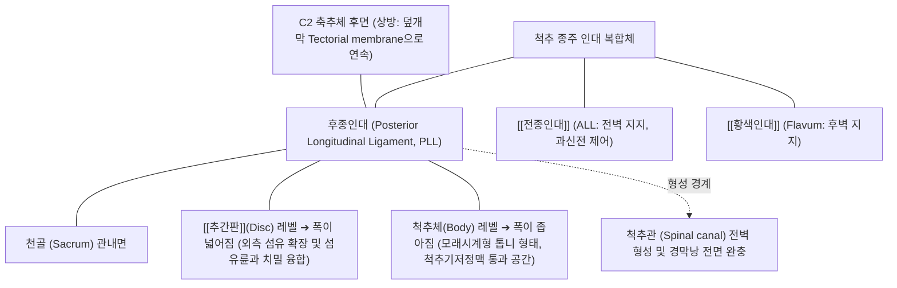

# [[후종인대]] (Posterior Longitudinal Ligament, PLL)

> **핵심 요약 (Key Summary)**:
> C2(축추) 추체 후면에서 시작하여 천골까지 척추체(Vertebral bodies) 및 추간판(Intervertebral discs)의 후면을 종주하며 척추관(Spinal canal)의 전벽을 형성하는 치밀 결합조직 인대.
> 척추의 과도한 전방 굴곡(Hyperflexion)을 기계적으로 제동하고 추간판 수핵의 척추관 내 직접 탈출을 방어하나, 외측 폭이 좁아지는 톱니 모양(Denticulate) 구조로 인해 [[요추 추간판 탈출증]]이 후외측(Posterolateral)으로 호발하는 결정적 해부학적 원인 제공.
> 아시아계 남성에서 호발하는 [[후종인대골화증]](OPLL)의 주 병소로, 인대 골화에 따른 [[경추 척수증]](Cervical Myelopathy), 보행 실조, 사지 마비를 유발하며 정밀 신경학적 평가와 급격한 경추 회전 스러스트 금기 원칙이 적용되는 구조물.

---

## 📌 목차
1. [해부학적 정밀 구조 및 주행/부착](#1-해부학적-정밀-구조-및-주행부착)
2. [생체역학·기능 (Biomechanics)](#2-생체역학기능-biomechanics)
3. [임상 평가 및 이학적 검사](#3-임상-평가-및-이학적-검사)
4. [초음파 해부학(Sonoanatomy) 및 중재 랜드마크](#4-초음파-해부학sonoanatomy-및-중재-랜드마크)
5. [⭐ 원장님 심층 임상 고찰 및 원본 필기 (Clinical Pearls)](#5--원장님-심층-임상-고찰-및-원본-필기-clinical-pearls)
6. [관련 임상 질환 및 손상](#6-관련-임상-질환-및-손상)
7. [추나·도수치료 & 침구·약침·재활 프로토콜](#7-추나도수치료--침구약침재활-프로토콜)
8. [출처 및 학술 참고 문헌 (References)](#8-출처-및-학술-참고-문헌-references)

---

## 1. 해부학적 정밀 구조 및 주행/부착

* **부착부 및 주행 (Anatomical Attachments)**:
  * **상단 기시부**: 제2경추(C2, 축추) 추체 후면. 상방으로는 대후두공(Foramen magnum) 안쪽으로 연속되어 **덮개막(Membrana tectoria / Tectorial membrane)**을 형성.
  * **하단 정지부**: 천골(Sacrum) 전벽 내측까지 척추 전 길이를 종주.
  * **형태학적 특징 (Denticulate / Hourglass Shape)**:
    * **추간판 부착부**: 좌우 폭이 넓게 확장되어 [[추간판]] 섬유륜(Annulus fibrosus)의 후면 및 척추체 상하면 연골단판(Endplate)과 극히 치밀하게 결합.
    * **척추체 중앙부**: 좌우 폭이 좁아져 잘록한 모래시계(Hourglass) 형태를 띰. 척추체 후면 뼈와 인대 사이에 작은 틈이 존재하여 척추기저정맥(Basivertebral vein) 및 영양 혈관이 자유롭게 통과.
* **표재층과 심두층 (Superficial vs Deep Layers)**:
  * **표재층 (Superficial layer)**: 3~5개 척추 분절을 연속으로 가로지르는 긴 종주 섬유.
  * **심두층 (Deep layer)**: 인접한 두 척추체와 추간판 사이만을 짧게 연결하는 섬유로, 외측으로 부채꼴 형태로 퍼져 척추신경근을 감싸는 신경근초(Root sleeve) 전면과 결합.
* **신경 지배 (Sinuvertebral Nerve)**:
  * 척추동신경(Sinuvertebral nerve / Luschka's nerve)의 풍부한 자유 신경 종말 및 통각 수용기가 분포하여 추간판 질환 시 극심한 심부 척추통증(Discogenic back pain)을 뇌로 전달 ➔ [[척추동신경]].

---

## 2. 생체역학·기능 (Biomechanics)

* **척추 과굴곡(Hyperflexion) 제동 기구**:
  * 체간이 전방으로 굴곡될 때 후종인대는 팽팽하게 신장되어 척추체 후방 간격의 과도한 개대를 막고 굴곡 모멘트에 대한 수동적 장력 구속력을 발휘. [[전종인대]]가 신전을 제동하는 것과 상호 길항 작용.
* **추간판 탈출 방향의 결정인자 (The Posterolateral Herniation Defect)**:
  * 후종인대는 정중앙선(Midline)에서는 두껍고 단단하지만, 척추체 외측으로 갈수록 두께가 급격히 얇아짐.
  * 수핵(Nucleus pulposus)이 후방 압박을 받을 때 가장 저항이 약한 **후종인대의 외측 경계부(후외측, Posterolateral)**로 밀려나와 신경근(Nerve root)을 직접 압박하는 해부학적 취약 경로를 제공함 ➔ [[요추 추간판 탈출증]] · [[경추 추간판 탈출증]].
* **척수 경막(Dura Mater)의 전방 보호벽**:
  * 척추관 내부의 척수 및 [[마미총]]이 척추체 후면의 거친 골극(Osteophyte)이나 전위된 추체에 직접 충돌하지 않도록 완충해주는 매끄러운 활주 면 제공.

---

## 3. 임상 평가 및 이학적 검사

* **경추 척수증([[경추 척수증]]) 정밀 신경학적 평가 (OPLL 감별)**:
  1. **호프만 징후 ([[Hoffmann 반사]])**: 환자의 중지 원위지절을 튕겨 굴곡시킬 때 엄지와 검지가 불수의적으로 모여 굴곡되는 상위운동신경원(UMN) 병변 징후.
  2. **10초 주먹 쥐고 펴기 검사 (Grip and Release Test)**: 10초 동안 주먹을 빠르게 쥐었다 펴는 동작을 20회 이상 수행하지 못하면 경추 척수증 강력 시사.
  3. **롬버그 검사 (Romberg Test) 및 일자 보행 (Tandem Gait)**: 눈을 감고 설 때 비틀거리거나 일직선 보행 시 균형을 잃는 고유수용성 감각 소실 및 보행 실조 평가.
  4. **바빈스키 반사 (Babinski Reflex) 및 족간대 (Ankle Clonus)**: 족저 외측을 긁을 때 족무지가 배굴되는 병적 반사 확인.
* **경추 신경근병증(Radiculopathy) 검사**:
  * **스펄링 검사 ([[Spurling test]])**: 경추 신전 및 환측 회전-측굴 상태에서 축성 압박 시 상지 방사통 재현.
  * **견관절 외전 검사 (Bakody's Sign)**: 손을 머리 위에 얹었을 때 신경근 긴장이 줄어 통증이 완화되는 소견.
* **요추부 평가**:
  * 하지직거상 검사([[SLR test]]) 및 건측 하지직거상 검사(Well-leg raising test, 거대 탈출증 진단).

---

## 4. 초음파 해부학(Sonoanatomy) 및 중재 랜드마크

* **초음파상 한계와 랜드마크**:
  * 후종인대는 척추체 후면 및 척추관 전벽의 깊은 골성 구조물 내부에 위치하므로 초음파 음파가 후궁판(Lamina)과 척추경에 가려져 직접적인 초음파 관찰은 매우 제한적임.
  * 전방 경추 초음파 스캔 시, 갑상선과 경동맥초(Carotid sheath)를 외측으로 젖히고 척추체 전면의 [[전종인대]](ALL)와 [[경장근]](Longus colli)을 확인하여 전방 경추 접근의 해부학적 깊이를 가늠.
* **방사선 및 영상의학적 표준 평가 (CT & MRI)**:
  * **경추 단순 방사선(X-ray) 측면상**: 척추체 후면을 따라 하얗게 석회화된 굵은 골화 띠 관찰.
  * **경추 3D-CT (표준 진단)**: 골화의 4대 유형 분류 — ① 연속형(Continuous), ② 분절형(Segmental), ③ 혼합형(Mixed), ④ 국소형(Circumscribed).
  * **MRI T2 강조영상**: 비후·골화된 후종인대가 척수 경막을 압박하여 척수 내 고신호 강도 병변(Myelomalacia / 척수 연화증)이 동반되었는지 정밀 평가.

---

## 5. ⭐ 원장님 심층 임상 고찰 및 원본 필기 (Clinical Pearls)

* **OPLL 환자에게 경추 쓰러스트 추나를 치는 것은 '의료사고의 지름길'이다**:
  * 목이 뻣뻣하고 손이 저리다고 내원한 환자 중 X-ray를 찍지 않고 무턱대고 목을 비틀어 '우두둑' 소리를 내는 고속저진폭(HVLA) 스러스트 추나를 시행하면 절대 안 됩니다. 만약 [[후종인대골화증]](OPLL)이 있는 환자라면 척수관이 이미 50% 이상 좁아져 있어, 순간적인 회전력에 의해 뼈처럼 자란 인대가 척수를 강타하여 사지마비(Quadriplegia)를 초래할 수 있습니다. 척수증 의심 환자는 철저히 비회전성 견인 및 가동술만 적용해야 합니다.
* **OPLL vs DISH(미만성 특발성 골과다증)의 결정적 감별**:
  * 척추 인대가 뼈로 변한다는 점에서 두 질환을 혼동하기 쉽습니다. DISH는 척추체 '앞쪽'의 [[전종인대]](ALL)가 촛농이 흘러내리듯 4개 분절 이상 굳는 질환으로 척수 압박 증상이 거의 없고 연하곤란(Dysphagia)이 주 증상입니다. 반면 OPLL은 척추체 '뒤쪽'의 후종인대가 굳어 척수관을 침범하므로 손의 세밀한 동작 장애와 보행 실조라는 치명적인 척수증을 유발합니다.
* **"단추 잠그기가 힘들고 젓가락질을 자꾸 떨어뜨려요"**:
  * 50대 이상 환자가 목 디스크인 줄 알고 왔는데 "글씨가 삐뚤빼뚤해지고 젓가락질이 서툴러졌으며 밤에 걸을 때 구름 위를 걷는 것처럼 휘청거린다"고 말한다면, 이는 신경근 압박이 아니라 후종인대 병변에 의한 [[경추 척수증]](Cervical Myelopathy)의 절대적 경고 징후(Red Flag)입니다. 즉각적인 신경외과 협진 및 정밀 MRI 의뢰가 최우선입니다.
* **추간판 탈출증 환자에서 후종인대 천공(Perforation) 여부의 의미**:
  * MRI 판독지에서 'Subligamentous extrusion'은 수핵이 튀어나왔지만 후종인대가 아직 막아주고 있는 상태로 한의 보존 치료([[신바로약침]], 한약, [[추나]])의 예후가 매우 뛰어납니다. 반면 'Transligamentous / Sequestered'는 후종인대를 찢고 수핵이 척수강 내로 완전히 터져 나간 상태입니다. 후자의 경우 면역 대식세포의 탐식 작용에 의해 장기적으로 디스크가 자연 흡수될 확률은 오히려 더 높으나, 초기 급성 신경근 마비 증상이 심할 수 있으므로 주의 깊게 추적 관찰해야 합니다.

---

## 6. 관련 임상 질환 및 손상

| 질환 및 병태 | 병태생리 및 호발 부위 | 주요 임상 소견 및 합병증 |
| :--- | :--- | :--- |
| [[후종인대골화증]] (OPLL) | 후종인대의 병리적 이소성 골화 (경추 C4~C6 최호발, 동아시아계 남성 다발) | 경추 척수증, 보행 장애, 상지 미세운동 실조, 중증 시 사지 부전마비 |
| [[추간판 탈출증]] (HIVD) | 후종인대 외측 경계부 취약점으로 수핵 후외측 탈출 | 신경근 압박성 방사통, 감각 저하, 심부건반사 감약 |
| 경추 과굴곡성 인대 손상 | 교통사고 충돌 시 급격한 경추 과굴곡에 의한 PLL 파열 | 척추 후방 지주 불안정성, 척추 전방 전위증(Retrolisthesis) 유발 |
| 경추 척추증성 척수증 ([[경추 척수증]]) | 퇴행성 PLL 비후 및 골극 형성에 의한 척수관 전방 협착 | 점진적 하지 강직성 보행, 대소변 장애, 병적 반사 양성 |
| 수핵 파열성 격리증 (Sequestration) | 탈출 수핵이 후종인대를 뚫고 척추관 내로 유리 | 급성 마미 증후군(Cauda equina syndrome) 위험, 하지 마비 |

---

## 7. 추나·도수치료 & 침구·약침·재활 프로토콜

### 1) 한의 도수 및 추나요법 원칙
* **경추 완만 축성 견인 추나 (Gentle Axial Traction)**:
  * 앙와위에서 경추의 회전이나 과도한 신전 없이 장축을 따라 부드러운 도수 견인(Manual cervical traction)을 10~15초간 간헐적으로 적용하여 척추관 전후경을 미세하게 확보 ➔ [[추나]] · [[도수치료]].
* **상부 흉추 가동술**:
  * 흉추 후만을 부드럽게 이완하여 경추부에 집중되는 만성 전단 굴곡 응력을 분산.
* **절대적 금기 기법**:
  * 경추 회전 스러스트(Cervical rotational thrust), 강한 과신전 및 급격한 관절 조작은 골화된 인대에 의한 척수 급성 손상을 유발하므로 절대 금기.

### 2) 침구 및 약침 복합 치료
* **핵심 혈위 자침**:
  * 경추 협척혈(EX-B2 C3~C7): 심부 [[다열근]] 및 후종인대 인접 분절 주위 자침으로 국소 척수근 혈류 순환 개선.
  * 풍지(GB20), 견정(GB21), 천주(BL10): 경추 척수증 환자의 2차성 경배부 근육 강직 완화.
  * 곡지(LI11), 수삼리(LI10), 합곡(LI4), 외관(TE5): 상지 마비 증상 및 감각 이상 회복 촉진.
  * 족삼리(ST36), 양릉천(GB34), 현종(GB39): 하지 근력 저하 및 보행 장애 개선.
* **약침 처방**:
  * **[[신바로약침]] / [[자하거약침]]**: 경추 협척혈 심부에 1.0~2.0cc 분주하여 척수 신경근의 만성 허혈성 신경병증 완화 및 신경 보호(Neuroprotection) 작용 유도.
  * **[[봉독약침]]**: 퇴행성 염증 반응 억제 및 신경 부종 흡수.

### 3) 일상생활 관리 및 자세 재활
* **경추 중립위 유지 교육**:
  * 스마트폰을 눈높이로 올려 경추 과굴곡 자세(Text neck) 철저히 차단 ➔ [[거북목 증후군]].
* **수면 자세 교정**:
  * 경추 전만을 자연스럽게 받쳐주는 C자형 경추 베개 사용 지도 (높은 베개 절대 금기).

---

## 8. 출처 및 학술 참고 문헌 (References)

1. **Farahbakhsh F, et al. (2026)**. Comparative Therapeutic Effectiveness and Complications of Anterior Versus Posterior Surgical Approach in Non-Ossification of the Posterior Longitudinal Ligament (Non-OPLL) Degenerative Cervical Myelopathy: A Systematic Review and Meta-Analysis. *World Neurosurg*. 216():125372. PMID: 42815851.
   - `[연구 요약]` 후종인대 병변을 동반한 퇴행성 경추 척수증 환자에서 전방 감압술 대 후방 감압술의 임상적 유효성, 합병증 및 척추관 전벽 해부학적 감압 메커니즘 메타분석.
2. **Lombardo G, et al. (2026)**. Retropharyngeal hematoma following anterior cervical spine surgery: a narrative review. *J Spine Surg*. 12(8):137. PMID: 42719310.
   - `[연구 요약]` 후종인대 절제 및 전방 경추 유합술 후 인대 주위 혈관 해부학과 인두후 혈종 발생 기전 및 안전성 고찰.
3. **Chiang CW, et al. (2026)**. Ossification of the Nuchal Ligament With Text Neck Syndrome. *Cureus*. 18(9):e115774. PMID: 42831019.
   - `[연구 요약]` 경추 후방 인대 복합체와 후종인대(PLL)의 상호 역학적 부하 전달 및 척추 굴곡 기형에 따른 인대 골화증 병태생리.
