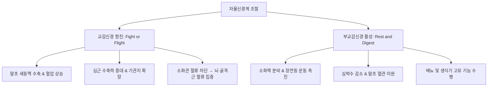
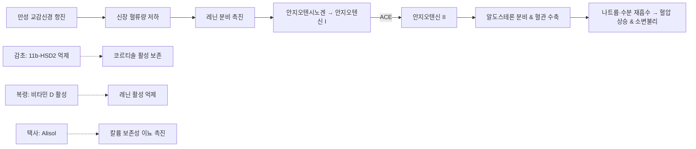
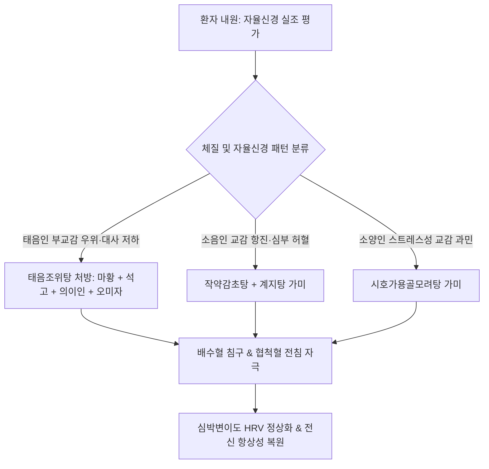

# 자율신경계 임상활용성 (Clinical Applications of the Autonomic Nervous System)

> **핵심 임상 요약 (Key Clinical Summary)**:
> - **체액·혈류 재분배의 자율신경 조절**: [[교감신경]]은 위장관·피부 혈관을 수축시켜 뇌·심장·골격근으로 혈류를 재분배하며, [[부교감신경]]은 개별 장기의 고유 생리 기능을 활성화한다. 부신수질에서 분비되는 [[에피네프린]](80%)과 [[노르에피네프린]](20%)은 급격한 말초혈관 수축성 혈압 상승을 완충한다.
> - **수용체별 세포내 2차 신호전달**: Alpha-1 수용체는 Gq-PLC-IP3/DAG 경로를 통해 세포질 내 [[칼슘]] 농도를 높여 혈관 평활근을 수축시키고, Beta-2 수용체는 Gs-AC-[[cAMP]] 경로를 통해 기관지 및 골격근 혈관을 확장한다.
> - **RAAS 축과 한약 본초의 분자약리**: 교감신경 항진으로 인한 신장 혈류 감소는 [[RAAS]]를 자극하여 혈압 상승과 소변불리를 유발한다. [[감초]](Glycyrrhizin)는 11beta-HSD2를 억제하여 [[코르티솔]] 활성을 유지하고, [[복령]](Pachyman, Ergosterol)은 비타민 D 활성화로 레닌을 억제하며 하부 혈류를 증가시킨다. [[택사]](Alisol)는 신장 원위세뇨관의 칼륨 보존·나트륨 배설을 촉진한다.
> - **자율신경 포착 증후군(SNEP)과 채프만 반사점**: 요추 및 흉추 주위 심부근육의 단축은 교감신경 절후섬유를 포착하여 체표 한선·입모근 수축 및 채프만 반사점(Chapman's reflex)을 형성하므로, 척추 교정과 압통점 치료로 자율신경 실조를 역조절한다.
> - **자율신경 타겟 본초 배오**: 교감 항진·부교감 저하 환자에는 [[마황]](Ephedrine), [[석고]](Calcium), [[부자]](Aconitine)를 체질에 맞게 운용하고, 부교감 촉진·평활근 조절에는 [[대복피]](Arecoline), [[반하]](Calcium oxalate), [[향부자]]를 배오한다.

---

## 1. 자율신경계(ANS)와 체액·혈류 재분배의 생체 조절 기전
자율신경계(Autonomic Nervous System, ANS)는 의식적 통제를 벗어나 내장기, 혈관계, 내분비선의 기능을 조율하며 전신의 항상성을 유지한다.

교감신경과 부교감신경은 단순한 길항 작용이 아니라 상보적 협동 관계(Complementary synergy)로 체내 혈류와 체액을 역동적으로 재분배한다.

- **부신수질의 완충 작용**:
  - 교감신경 절전섬유는 부신수질 크롬친화세포에 직접 시냅스하여 [[아세틸콜린]]을 분비한다.
  - 이에 반응하여 부신수질은 약 80%의 [[에피네프린]]과 20%의 [[노르에피네프린]]을 혈중으로 방출한다.
  - 순수 노르에피네프린만 분비될 경우 발생하는 과도한 전신 세동맥 수축과 위험한 혈압 급상승을, 에피네프린의 Beta-2 수용체 매개 골격근·간 혈관 확장 작용으로 완충한다.
- **땀샘과 피부 혈관의 특이적 지배**:
  - 피부의 한선, 입모근, 미세혈관은 교감신경의 단독 지배를 받는다.
  - 체온 상승을 방지하기 위해 땀샘으로 가는 교감신경 절후섬유는 예외적으로 노르에피네프린이 아닌 **[[아세틸콜린]]**을 신경전달물질로 분비한다.

---

## 2. 아드레날린 수용체(Alpha vs Beta) 및 세포내 2차 신호전달(cAMP·Ca²⁺)
자율신경 작동 약물과 본초의 효능은 효과기 세포막에 존재하는 G-단백질 연결 수용체(GPCR)의 아형에 의해 결정된다.

| 수용체 아형 | G-단백질 결합 | 2차 전령 전달계 | 주요 분포 장기 | 생리적 효과 |
| :--- | :--- | :--- | :--- | :--- |
| **Alpha-1 ($lpha_1$)** | Gq | PLC $
ightarrow$ $	ext{IP}_3$ / DAG $
ightarrow$ $	ext{Ca}^{2+}$ 방출 | 혈관 평활근, 동공 산대근, 요도 괄약근 | 혈관 수축, 말초 저항 증가, 동공 산대 |
| **Alpha-2 ($lpha_2$)** | Gi | Adenylyl cyclase 억제 $
ightarrow$ [[cAMP]] 감소 | 시냅스 전막(중추), 췌장 베타세포 | 노르에피네프린 방출 억제, 인슐린 분비 감소 |
| **Beta-1 ($eta_1$)** | Gs | Adenylyl cyclase 활성 $
ightarrow$ [[cAMP]] 증가 $
ightarrow$ PKA | 심근세포, 신장 사구체인접세포 | 심박수·수축력 증대, 레닌 분비 촉진 |
| **Beta-2 ($eta_2$)** | Gs | AC $
ightarrow$ [[cAMP]] 증가 $
ightarrow$ MLCK 인산화 억제 | 기관지 평활근, 골격근 혈관, 간 | 기관지 확장, 골격근 혈관 확장, 당신생 촉진 |

- **심근 수축 기전**: [[에피네프린]]이 $eta_1$ 수용체에 결합하면 cAMP-PKA 경로를 통해 L-type 칼슘 채널이 개방되고, 근형질세망의 Ryanodine 수용체를 자극하여 대량의 [[칼슘]]이 방출되어 강력한 수축을 유발한다.
- **평활근 이완 기전**: $eta_2$ 수용체 자극으로 증가한 cAMP는 Myosin Light Chain Kinase(MLCK)를 인산화시켜 불활성화함으로써 평활근을 이완시킨다.

---

## 3. 레닌-안지오텐신-알도스테론계(RAAS)와 체액 조절의 한의학적 연계
교감신경이 만성적으로 항진되면 신장 동맥이 수축하여 신장 관류압이 저하되고, 이는 사구체인접기구에서 레닌(Renin) 분비를 촉발하여 [[RAAS]] 축을 활성화한다.

- **[[감초]]와 혈압·호르몬 조절**:
  - 감초의 주성분인 [[글리시리진]]은 신장 원위세뇨관의 11beta-HSD2 효소를 억제하여 [[코르티솔]]이 비활성형인 코르티손으로 전환되는 것을 차단한다.
  - 유지된 코르티솔은 미네랄코르티코이드 수용체에 완만하게 작용하여 [[알도스테론]] 유사 항이뇨 효과를 나타내어 저혈압·무력 상태의 소음인 환자에게 순환 혈장량을 확보해 준다.
- **[[복령]]과 [[택사]]의 신장 혈류 개선**:
  - **[[복령]]**: 다당체 pachyman과 ergosterol(비타민 D 전구체)을 함유하여 비타민 D 활성화를 통해 RAAS 축의 과도한 레닌 분비를 억제하고 신장 혈류를 촉진한다.
  - **[[택사]]**: alisol 성분이 사구체 여과율을 높이고 칼륨을 보존하면서 나트륨 배출을 유도하여 부종과 교감성 수분 정체를 해소한다.

---

## 4. 자율신경계와 포도당 대사 및 산염기 평형(Acid-Base Balance)
자율신경계는 신경-내분비 축을 통해 혈당 대사와 체액 산염기 항상성을 실시간 제어한다.

1. **혈당 조절의 신경내분비 연계**:
   - 저혈당 스트레스 시 교감신경 흥분으로 부신수질에서 [[에피네프린]], 췌장 알파세포에서 [[글루카곤]], 부신피질에서 [[코르티솔]]이 분비되어 간 글리코겐 분해와 당신생을 촉진한다.
   - 고혈당 시에는 부교감신경 미주신경 자극으로 췌장 베타세포에서 [[인슐린]]이 분비되어 세포 내 포도당 흡수를 촉진한다.
2. **산염기 불균형과 자율신경 상호작용**:
   - 흉식호흡 환자의 과호흡은 호흡성 알칼리증을 유발하고, 호흡 부전은 [[호흡성 산증]]을 초래한다.
   - 혈중 $H^+$ 농도 변화는 혈청 알부민과 결합하는 [[칼슘]]의 이온화 분율을 변화시켜 세포막 전위와 교감신경 흥분성을 교란한다.

---

## 5. 자율신경 포착 증후군(SNEP)과 채프만 반사점(Chapman's Reflex)의 임상 진단
자율신경 포착 증후군(Sympathetic Nerve Entrapment Syndrome, SNEP)은 척추 주위의 만성 근육 단축이 교감신경 가지를 압박하여 발생하는 기능 장애이다.

- **SNEP의 병태생리**:
  - 척추기립근과 다열근의 만성 연축은 척추간공 외측을 통과하는 회색교통지를 기계적으로 포착한다.
  - 이로 인해 해당 피부분절의 한선 수축, 입모근 발기, 국소 피부 빈혈이 발생하며, 이는 촉진 시 굳은 피부 결절인 **채프만 반사점(Chapman's reflex point)**으로 확인된다.
- **진단학적 응용**:
  - 맥진에서 심박수 증가에 따른 삭맥(數脈)과 혈관 긴장성 현맥(弦脈)이 관찰되면 교감신경 과항진으로 진단한다.
  - 흉배부 배수혈의 피부 온도 저하와 피하 경결을 추적하여 침도 및 약침으로 교감신경 포착을 해제한다.

---

## 6. 자율신경 조절 본초의 분자 약리 기전(마황·석고·부자·대복피·반하·향부자)
한방 임상에서 자율신경계를 직접 조절하는 핵심 본초의 분자생물학적 작용 기전이다.

### 6.1 교감신경 활성화 및 강심 본초
- **[[마황]]**: 주성분 [[에페드린]] 및 슈도에페드린이 교감신경 수용체($lpha_1, eta_1, eta_2$)에 직접 결합하고 내인성 노르에피네프린 분비를 촉진한다. 체내 반감기가 3~6시간으로 길어 지속적인 기관지 확장, 혈압 상승, 대사 활성을 유도한다.
- **[[석고]]**: 주성분인 황산칼슘($	ext{CaSO}_4 \cdot 2	ext{H}_2	ext{O}$)이 탕전 시 [[칼슘]] 이온을 방출하여, 마황의 급격한 교감신경 흥분으로 인한 근육 경련과 체액 고갈을 보조하고 세포내 2차 전령 농도를 안정화한다.
- **[[부자]]**: diterpenoid 알칼로이드인 [[아코니틴]]과 히게나민이 심근세포의 나트륨 및 칼슘 채널을 활성화하여 강력한 강심·승압 작용을 발휘한다.

### 6.2 부교감신경 조율 및 평활근 이완 본초
- **[[대복피]]**: 주성분인 [[Arecoline]]이 무스카린성 아세틸콜린 수용체를 자극하여 소화관 분비를 촉진하고 심박수를 완화하며 장관 연동운동을 정상화한다.
- **[[반하]]**: 바늘 모양의 [[옥살산칼슘]] 결정과 호모겐티신산이 점막을 미세 자극하여 식도-기관지 부교감신경 반사를 유도, 역류성 식도 연축을 하강시키고 진토 효과를 낸다.
- **[[향부자]]**: isocurcumenol 및 cyperene 성분이 GABA-A 수용체 복합체를 안정화하고 소화관 평활근의 과도한 연축을 이완시켜 스트레스성 자율신경 실조를 진정시킨다.

---

## 7. 한방 임상 변증 처방(태음조위탕 등) 및 자율신경 통합 치료 프로토콜
임상 질환별 자율신경 불균형 패턴과 한의 복합 치료 처방이다.

- **[[태음조위탕]]의 자율신경 조절 역학**:
  - 위장 연동운동은 빠르나 전신 대사율이 낮고 환기량이 부족한 태음인 체형에 [[마황]]으로 교감신경을 적절히 활성화하여 기초대사율과 폐포 환기량을 높인다.
  - [[의이인]]으로 급격한 혈당 스파이크를 방지하고, [[오미자]]로 산염기 평형을 보조하여 완벽한 대사 균형을 확립한다.

---

## 8. 참고문헌 및 학술 연구 요약

- de Souza Horsth T et al. (2025). Heart rate variability responses to instrument-assisted atlas (C1) chiropractic manipulation: A randomized placebo-controlled trial. *J Bodyw Mov Ther*. 44():784-788. PMID: 40954661

  - [연구 요약] 상부 경추(C1) 수기 교정이 자율신경계 조절 지표인 심박변이도(HRV)와 미주신경 톤에 미치는 즉각적 활성화 효과를 무작위 위약 대조 시험으로 규명함.

- Hartz CS et al. (2025). Effect of osteopathic manipulative treatment on pain, flexibility, autonomic modulation of heart rate, energy and thermal profile in patients with chronic low back pain. blind randomized clinical trial. *J Bodyw Mov Ther*. 44():452-461. PMID: 40954616

  - [연구 요약] 만성 요통 환자에서 수기 치료가 척추 통증 완화, 심박 자율신경 변조 및 체표 적외선 열화상 프로파일에 미치는 복합적 개선 효능을 규명함.
