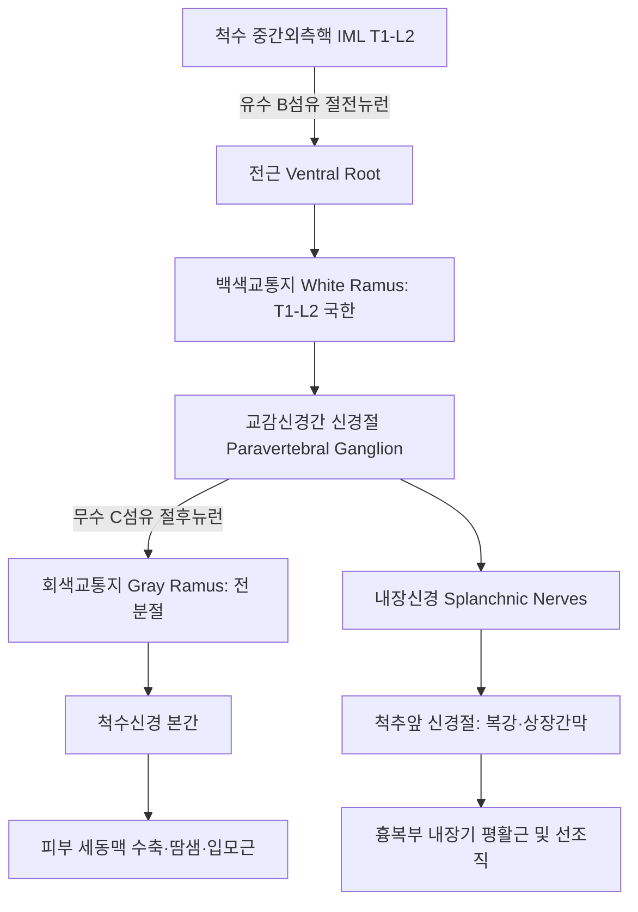
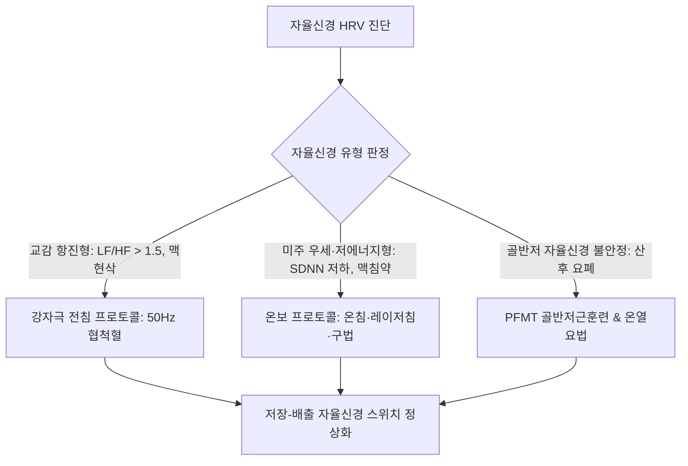

# 자율신경계 (Autonomic Nervous System: Anatomy & Clinical Physiology)

> **핵심 임상 요약 (Key Clinical Summary)**:
> - **해부학적 교통지 구조**: 자율신경계는 유수신경섬유(B 섬유) 중심의 백색교통지(White rami communicantes, T1-L2/3에만 국한)와 무수신경섬유(C 섬유) 중심의 회색교통지(Gray rami communicantes, 전 척수 분절에 존재)로 구성된다.
> - **척추 분절별 내장기 투사**: 심장(T1-T4), 신장(L1-L2), 췌장(T5-T9), 간·담낭(T7-T10), 부신(T5-T11), 대장(T12-L2)으로 교감신경 원심성 섬유가 투사되므로, 척추 변위는 특정 내장기의 허혈성 기능부전을 초래한다.
> - **심부 척추주위근 포착과 경추성 어지럼증**: [[다열근]], [[최장근]], [[두판상근]], [[두반극근]] 등 심부 척추주위근의 만성 연축은 척추옆 신경절 및 교감신경을 물리적으로 압박하여椎基底 동맥 수축 및 심한 경추성 어지럼증을 유발한다.
> - **심박변이도(HRV) 정량 평가**: 자율신경 균형의 임상 평가 기준은 LF/HF 비 정상범위(0.8~1.2)이며, SDNN, RMSSD를 통해 전반적인 자율신경 조절능을 객관적으로 판정한다.
> - **침구 자극의 차별적 자율신경 조절**: 교감 항진·실증 환자에는 고주파(50Hz) [[전침]] 강자극을 적용하고, 미주 우세·허증 환자에는 [[온침]], 구법, [[레이저침]] 등 온보(溫補) 자극을 적용하여 자율신경 항상성을 복원한다.

---

## 1. 자율신경계의 해부학적 구조와 교통지(백색교통지 vs 회색교통지) 특성
자율신경계(Autonomic Nervous System)의 교감신경 성분은 척수의 중간외측핵(Intermediolateral nucleus, IML, T1-L2/3)에서 기시하여 척추옆 신경절(Paravertebral ganglia)과 교통지를 통해 연결된다.

| 구분 | 신경섬유 유형 | 수초화 여부 | 분포 척수 레벨 | 주요 기능 및 경로 |
| :--- | :--- | :--- | :--- | :--- |
| **백색교통지 (White Ramus)** | B 섬유 (전절섬유) | 유수신경 (Myelinated) | **T1 ~ L2(L3)** 국한 | 척수 IML에서 기시한 교감신경성 운동섬유를 교감신경간으로 운반, 내장 감각(GVA) 수송 |
| **회색교통지 (Gray Ramus)** | C 섬유 (후절섬유) | 무수신경 (Unmyelinated) | **모든 척수 분절** (C1~Co) | 교감신경절에서 나온 절후섬유를 체신경으로 보내 체표 혈관 평활근, 입모근, 한선 지배 |

---

## 2. 척추 분절별 교감신경 분포와 내장기 연계 반사(Viscerosomatic Reflex)
척추의 특정 분절 변위나 관절 기능부전은 척추신경과 함께 주행하는 교감신경을 자극하여 내장 혈류 장애를 유발한다.

- **분절별 표적 장기 매핑**:
  - **T1 ~ T4**: 심장(Heart) 및 폐기관지(Lungs) 지배. 기능부전 시 부정맥, 가슴 두근거림, 심계항진 유발.
  - **T5 ~ T9**: 위장(Stomach) 및 췌장(Pancreas). 기능부전 시 소화불량, 위산 역류, 혈당 조절 장애.
  - **T7 ~ T10**: 간(Liver) 및 담낭(Gallbladder). 담즙 분비 장애 및 지질 대사 이상 연계.
  - **T5 ~ T11**: 부신피질 및 수질(Adrenal glands). 만성 피로 증후군 및 호르몬 불균형.
  - **T10 ~ L1**: 신장(Kidneys). 사구체 혈류 감소 및 신성 고혈압 연계.
  - **T12 ~ L2**: 대장(Colon) 및 직장. 변비, 과민성 장증후군 유발.

---

## 3. 척추주위 심부근육군 포착과 자율신경 기능부전(경추성 어지럼증 등)
척추를 지지하는 심부 단관절 근육인 [[다열근]](Multifidus)과 [[회선근]], 그리고 경부의 [[두판상근]], [[두반극근]]의 만성 단축은 자율신경 포착의 직접적 원인이 된다.

- **경추성 어지럼증(Cervicogenic Dizziness)의 발생 기전**:
  - 상부 경추 및 상부 흉추의 심부 척추주위근이 과도하게 긴장하면, 경추 횡돌기공을 통과하는 [[추골동맥]] 주위의 교감신경 신경총(Vertebral nerve plexus)을 자극한다.
  - 이는椎基底 동맥의 혈관 연축을 유발하여 내이의 전정신경핵(Vestibular nuclei)으로 공급되는 혈류를 차단함으로써 자세 변화 시 극심한 어지럼증과 시야 혼탁을 야기한다.
  - 치료 시 두판상근 및 C1-C2 분절 후두하근군에 대한 정밀 침구·약침 치료가 필수적이다.

---

## 4. 교감신경과 부교감신경의 상보적 혈류 재분배 및 신경전달물질 체계
자율신경계는 상황에 따라 표적 장기의 세동맥을 선택적으로 수축 또는 확장시켜 체액을 재분배한다.

- **수용체 차이에 따른 혈관 반응**:
  - 골격근, 심장, 폐, 간의 동맥 평활근에는 $eta_2$ 아드레날린 수용체가 다수 분포하여 [[에피네프린]]에 의해 혈관이 확장된다.
  - 반면 피부, 점막, 신장, 위장관 평활근에는 $lpha_1$ 수용체가 지배적이어서 [[노르에피네프린]]에 의해 혈관이 강하게 수축한다.
- **상보적 생리 조절**:
  - 교감신경의 흥분으로 인한 특정 장기의 만성 허혈이 방치되면, 비가역적인 조직 섬유화와 고유 기능 상실로 이어지므로 부교감신경 활성 유도가 임상적으로 중요하다.

---

## 5. 부신수질 및 피부 부속기(땀샘·입모근)의 독특한 신경 지배 원리
부신수질과 피부 부속기는 일반적인 자율신경 이중 지배 원칙(Dual innervation)에서 벗어나는 독특한 특성을 가진다.

1. **부신수질(Adrenal Medulla)**:
   - 교감신경절을 거치지 않고 내장신경(Splanchnic nerve)의 절전섬유가 크롬친화세포에 직접 도달하여 [[아세틸콜린]]을 분비한다.
   - 크롬친화세포 자체가 변형된 절후 신경절 역할을 수행하여 혈중으로 [[에피네프린]](80%)과 [[노르에피네프린]](20%)을 대량 방출한다.
2. **피부 땀샘(Eccrine Sweat Glands)**:
   - 교감신경의 지배만을 받으며, 체온 조절 목적의 에크린 한선에 분포하는 절후섬유는 유일하게 **[[아세틸콜린]]**을 분비하여 무스카린 수용체를 자극한다.

---

## 6. 심박변이도(HRV) 기반 자율신경 정량 평가 및 진단학적 지표
심장의 동방결절은 미주신경(부교감)과 교감신경의 지속적인 상호 간섭을 받으며, 심박 간격의 미세 변동을 측정하는 심박변이도(Heart Rate Variability, HRV)는 자율신경 평가의 표준 도구이다.

| HRV 정량 지표 | 생리학적 의미 | 정상 기준 및 임상적 해석 |
| :--- | :--- | :--- |
| **SDNN (ms)** | 전체 심박 간격 표준편차 | **전반적인 자율신경 조절 능력 및 항상성 유지력** (50ms 이하 시 조절능 저하) |
| **RMSSD (ms)** | 인접 RR 간격 차이의 제곱평균제곱근 | **부교감신경(미주신경) 활성도**의 직접적 반영 (20ms 이하 시 부교감 저하) |
| **LF/HF Ratio** | 저주파(LF)와 고주파(HF) 파워의 비율 | **교감/부교감 자율신경 균형 지표** (정상범위: **0.8 ~ 1.2**) |

- **해석상의 주의점**:
  - LF/HF 비가 0.8 미만으로 낮다고 해서 무조건 '미주신경 항진'으로 단정해서는 안 된다.
  - HF 절대값과 SDNN이 동시에 극단적으로 낮으면 이는 자율신경계 총 조절능이 고갈된 **'저에너지형(Low energy state)'**이므로, 강한 사법(瀉法) 자극을 피하고 보법(補法)을 적용해야 한다.

---

## 7. 한의 임상 치료(전침·레이저침·온열요법)의 자율신경 조절 기전
자율신경 실조 환자 치료 시 환자의 HRV 지표와 변증 유형에 맞추어 침구 자극의 모달리티를 정밀하게 선택해야 한다.

- **[[전침]] vs [[레이저침]] 임상 선택**:
  - 교감신경 과흥분(불안, 불면, 긴장성 고혈압): 50Hz 고주파 전침을 협척혈 및 사관혈(합곡, 태충)에 적용하여 교감신경 억제성 엔돌핀 분비를 유도한다.
  - 미주 우세·저에너지형(월경통, 만성피로): 비침습 [[레이저침]]이나 2Hz 저주파 전침을 신수(BL23), 관원(CV4), 족삼리(ST36)에 온보 적용하여 부교감신경 톤을 정상화한다.

---

## 8. 참고문헌 및 학술 연구 요약

- Gao X et al. (2026). [The body-brain mechanism of acupuncture: insight and inspiration from neuroimmunology and regulation of organ function]. *Zhen Ci Yan Jiu*. 51(10):1269-1281. PMID: 42908444

  - [연구 요약] 침 치료가 신경-면역 축 및 자율신경 반사를 통해 뇌-신체 상호작용과 내장기 고유 기능을 조절하는 분자생물학적 메커니즘을 규명함.

- Mathis KW et al. (2026). Autonomic-immune cross talk in lupus: impaired cholinergic signaling and consequences for cardiovascular-renal physiology. *Am J Physiol Cell Physiol*. 331(5):C1224-C1232. PMID: 42788284

  - [연구 요약] 콜린성 항염증 경로 및 자율신경성 면역 상호작용 장애가 심혈관-신장 생리에 미치는 병태생리와 자율신경 조절 중재의 의의를 규명함.

- Chien TJ et al. (2025). Comparative Efficacy of Low-Level Laser Acupuncture and Electroacupuncture in Women With Dysmenorrhea and Autonomic Imbalance: A Pilot Randomized-Controlled Trial. *Pain Res Manag*. 2025():3494216. PMID: 41179650

  - [연구 요약] 자율신경 불균형(LF/HF 비 이상)을 동반한 원발성 월경통 환자에서 저출력 레이저침과 전침이 심박변이도(HRV) 및 통증 완화에 미치는 임상 효과를 비교 검증함.
