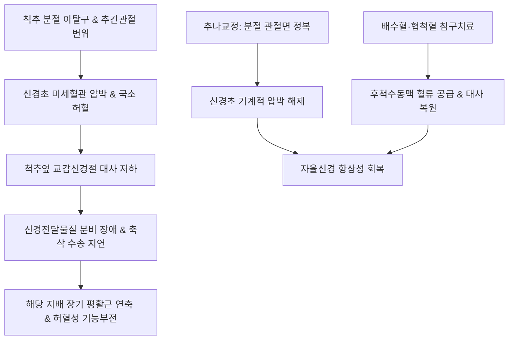

# 자율신경계와 추나요법(+침, 뜸) (Autonomic Nervous System & Chuna, Acupuncture, Moxibustion)

> **핵심 임상 요약 (Key Clinical Summary)**:
> - **척추 변위와 내장 자율신경 증상**: 척추의 분절성 아탈구(Subluxation)는 척추옆 신경절(Paravertebral ganglia)을 기계적으로 압박하거나 혈류 관류압을 떨어뜨려 해당 분절이 지배하는 내장기의 허혈 및 기능부전을 유발한다.
> - **방광경 배수혈·협척혈의 신경해부학적 실체**: 방광경 제1선(척수극돌기 외측 1.5촌)은 교감신경간 및 척수신경 후지 내측지와 일치하고, 제2선(3촌)은 외측지와 연계된다. 배수혈과 협척혈 자침은 후척수동맥 혈류를 증가시켜 척수와 자율신경절의 대사를 복원한다.
> - **신경 전달 방향과 축삭반사**: 자율신경은 전통적으로 원심성(Efferent) 경로를 의미하며 운동은 전근, 감각은 후근으로 통한다는 벨-마장디 법칙(Bell-Magendie law)을 따른다. 그러나 감각 C 섬유 말단에서는 역방향 축삭반사(Axon reflex)로 [[CGRP]]와 [[Substance P]]가 분비되어 신경인성 염증과 혈관 확장을 유도한다.
> - **상부 경추(C1)와 10번 미주신경의 절대적 중요성**: 전신 부교감신경 지배의 약 75%는 [[10. 미주신경|제10뇌신경 미주신경(Vagus nerve)]]이 담당하며, 후두골-환추(C1) 변위 교정 및 [[흉쇄유돌근]] 치료는 경정맥공과 경동맥동의 압수용기(Baroreceptor)를 안정화하는 핵심 치료점이다.
> - **장기별 척추 치료점 매핑**: 폐기관지(T1-T5 & C1), 심장(T4-T5 심수·궐음수), 부신(T5-T8), 췌장(T5-T9 & C1), 위장(T6-T9), 간(T7-T10 & 족삼리), 신장(T10-L1), 대장(T9-L2), 방광(L1-L2 & 천골)으로 척추 추나와 침구 치료점을 정밀 매핑한다.

---

## 1. 척추 변위와 자율신경계 기능부전의 신경해부학적 기전
척추 분절의 정렬 이상(변위)은 단순히 척추 주변 근육과 인대의 역학적 긴장에 그치지 않고, 척추옆 공간을 주행하는 자율신경계에 직접적인 병리적 영향을 미친다.

- **신경 압박 시 통증 및 기능부전 발생 원리**:
  - 신경 조직이 기계적으로 압박되면 신경을 영양하는 미세 혈관(Vasa nervorum)의 관류압이 급감한다.
  - 이로 인해 신경 절후 뉴런의 미토콘드리아 ATP 생성이 중단되고 신경전달물질의 역행성 축삭 수송이 차단되어 해당 분절 장기의 기능 저하가 유발된다.

---

## 2. 방광경 배수혈·협척혈과 척추옆 신경절(Paravertebral Ganglia)의 상관성
족태양방광경의 배수혈(背兪穴)과 화타협척혈(華佗夾脊穴)은 해부학적으로 척추 교감신경절과 완벽히 대응한다.

1. **해부학적 위치 대응**:
   - **협척혈 (극돌기 외측 0.5촌)**: 척추 신경 후지 내측지가 추간공을 빠져나오는 부위에 위치하여 척수 신경근을 직접 자극한다.
   - **방광경 제1선 (외측 1.5촌)**: 척추옆 교감신경간(Paravertebral sympathetic chain)의 주행선과 정확히 일치하여 내장기 혈류 조절의 핵심 포인트가 된다.
   - **방광경 제2선 (외측 3촌)**: 척수신경 후지 외측지와 최장근, 장늑근 외측연에 위치하여 체간 근막 긴장을 조절한다.
2. **배수혈 치료의 혈류역동학적 기전**:
   - 배수혈(예: 위수 BL21, 간수 BL18)에 침을 놓고 [[뜸|뜸(구법)]]을 뜨면, 축삭반사를 통해 후척수동맥(Posterior spinal artery)과 늑간동맥의 혈류량이 증가하여 척수 분절과 해당 내장기로 유입되는 미세순환이 복원된다.

---

## 3. 원심성 자율신경 경로와 감각신경 축삭반사(CGRP·Substance P)
신경 전달 방향의 고전 법칙과 감각신경 말단의 역행성 반사 기전이다.

- **벨-마장디 법칙(Bell-Magendie Law)**:
  - 감각 정보는 무조건 척수 후근(Dorsal root)을 통해 척수로 들어가고(구심성), 운동 정보는 척수 전근(Ventral root)을 통해 앞으로 나간다(원심성). 자율신경 운동 경로는 전근을 통해 유출된다.
- **감각 C 섬유의 역방향 축삭반사(Axon Reflex)**:
  - 유해 자극이나 침 자극이 가해지면 감각신경 C 섬유의 말단에서 중추로의 신호 전달뿐 아니라 인접 분지 말단으로 역행성 탈분극이 전파된다.
  - 이때 말단에서 혈관 확장 펩타이드인 [[CGRP|CGRP(Calcitonin Gene-Related Peptide)]]와 [[Substance P]]가 방출되어 모세혈관 투과성을 높이고 국소 조직의 혈류량을 급증시킨다.

---

## 4. 장기별 교감·부교감 신경 분절 분포 및 척추 레벨 매핑
흉복부 주요 내장기의 분절성 신경 지배와 해당 추나 치료 포인트이다.

| 표적 장기 | 교감신경 기원 (흉요수) | 부교감신경 기원 | 주요 추나 및 배수혈 치료점 |
| :--- | :--- | :--- | :--- |
| **폐·기관지** | T1 ~ T5 (상경·성상신경절) | [[10. 미주신경]] | C1, T1-T5, 폐수(BL13), 풍문(BL12), SCM |
| **심장 (Heart)** | T1 ~ T5 (상경·중경·성상) | [[10. 미주신경]] | C1, T4-T5, 심수(BL15), 궐음수(BL14) |
| **위장·식도** | T6 ~ T9 (대내장신경 $
ightarrow$ 복강신경절) | [[10. 미주신경]] | T6-T9, 격수(BL17), 위수(BL21), 중완(CV12) |
| **췌장 (Pancreas)** | T5 ~ T9 (복강신경절) | [[10. 미주신경]] | C1, T5-T9, 췌수(의사 EX-B3), 비수(BL20) |
| **간·담낭** | T7 ~ T10 (복강신경절) | [[10. 미주신경]] | T7-T10, 간수(BL18), 담수(BL19), [[족삼리]](ST36) |
| **신장 (Kidneys)** | T10 ~ L1 (소내장신경) | [[10. 미주신경]] + 천수(S2-4) | T10-L1, 신수(BL23), 지실(BL52) |
| **소장·대장** | T9 ~ L2 (상장간막신경절) | [[10. 미주신경]] (횡행결장 2/3까지) | T9-L2, 대장수(BL25), 소장수(BL27), 천추(ST25) |
| **방광·생식선** | L1 ~ L2 (하장간막신경절) | 천수 골반내장신경 (S2-S4) | L1-L2, 천골(Sacrum), 관원수(BL26), 방광수(BL28) |

---

## 5. 내장-체성 및 체성-내장 반사에 기반한 상부 경추(C1)와 미주신경 조절
전신 부교감신경의 약 75%는 제10뇌신경인 [[10. 미주신경|미주신경(Vagus nerve)]]이 지배하므로, 상부 경추의 구조적 안정성은 부교감 조절의 핵심 관문이다.

- **환추(C1)와 경정맥공(Jugular Foramen)**:
  - 미주신경은 후두골과 측두골 사이의 경정맥공을 통해 두개강을 탈출하여 환추(C1) 횡돌기 전방을 통과한다.
  - C1의 회전 및 측방 변위는 경정맥공 주위 근막을 긴장시켜 미주신경 전도를 압박·차단한다. 따라서 위장장애, 부정맥, 만성 불안 환자에서 C1 교정은 부교감신경 회복의 필수 술기이다.
- **[[흉쇄유돌근]](SCM)과 압수용기(Baroreceptor)**:
  - SCM 심부에는 경동맥동(Carotid sinus)의 압수용기와 화학수용기가 인접 주행한다. SCM의 과긴장을 도수 이완하면 경동맥동의 과민 반응이 해소되어 혈압과 뇌혈류가 안정화된다.

---

## 6. 소화기·순환기·호흡기 질환별 추나 치료점 및 임상 적용
임상에서 다빈도로 발생하는 내과 질환에 대한 분절성 추나 접근법이다.

1. **소화기 궤양 및 [[역류성 식도염]]**:
   - 교감신경 과항진 시 소화액의 점도가 비정상적으로 높아지고 위장 점막 혈류가 감소하여 점막 괴사와 궤양이 유발된다.
   - 흉추 T6-T9 분절의 신전 교정과 복강신경절 부위(상복부 심부) 이완을 통해 점막 혈류를 복원하고 위산 분비를 안정화한다.
2. **기관지 [[천식]] 및 만성 기침**:
   - 교감신경은 기관지 평활근을 이완시키고, 부교감신경(미주신경)은 기관지를 수축시키며 점액 분비를 촉진한다.
   - 상부 흉추(T1-T5) 변위를 정복하고 성상신경절(Stellate ganglion, C7-T1 전방) 주위를 이완시켜 기도 과민성을 정상화한다.
3. **만성 [[변비]] 및 장관 연동 저하**:
   - 하부 흉추와 상부 요추(T11-L2)의 후관절 가동성을 회복시켜 장간막신경절의 긴장을 해소한다.

---

## 7. 침구·온열구법·추나요법의 척수 혈류 개선 및 자율신경 회복 기전
추나와 침구치료가 척추 자율신경계에 미치는 복합적 치유 기전이다.

- **관절 기계적 감압(Decompression)**:
  - 추나 수기요법으로 척추 후관절의 비정상적 전단력을 해소하면 척추 신경절 주위의 정맥 울혈이 해소된다.
- **온열구법과 침구의 복합 작용**:
  - 협척혈과 배수혈에 자침 후 온침이나 뜸을 적용하면 피부 및 심부 온도가 상승하여 일산화질소(NO) 방출이 촉진된다.
  - 이는 척수 혈관을 확장시키고 손상된 신경 세포 내 미토콘드리아의 산소 대사를 촉진하여 자율신경 신경전달물질 생성을 가속화한다.

---

## 8. 참고문헌 및 학술 연구 요약

- Monteiro ER et al. (2025). Effect of cervical manipulation on blood pressure and heart rate variability responses in adults: A scoping review. *J Bodyw Mov Ther*. 42():1120-1127. PMID: 40325646

  - [연구 요약] 경추 수기 교정(Cervical manipulation)이 성인의 혈압 및 심박변이도(HRV) 자율신경 반응에 미치는 신경생리학적 영향을 체계적으로 고찰함.

- Hansen L et al. (2025). Effects of mobilization or manipulation of the thoracic spine on autonomic nervous system markers in symptomatic and asymptomatic participants - a systematic review and meta-analysis. *J Man Manip Ther*. 33(6):466-489. PMID: 40232939

  - [연구 요약] 흉추 가동술 및 교정술(Thoracic manipulation)이 피부 전도도, 심박변이도 등 전신 자율신경계 지표에 미치는 조절 효과를 메타분석으로 검증함.
