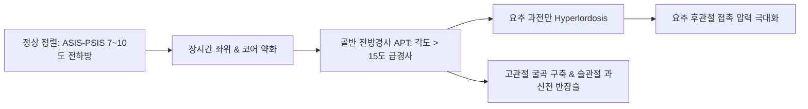
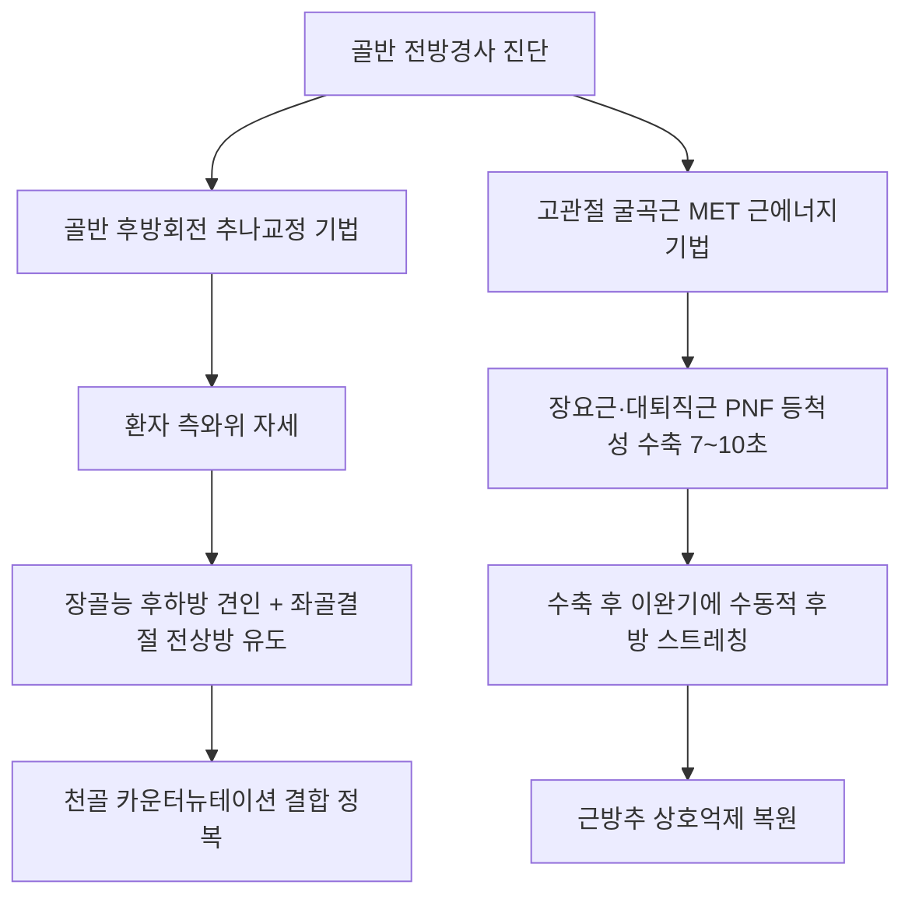

# 골반 전방경사(추나) (Anterior Pelvic Tilt Chuna Manual Therapy)

> **핵심 임상 요약 (Key Clinical Summary)**:
> - **골반 전방경사의 정의 및 정렬 기준**: 정상 기립 상태에서 전상장골극([[ASIS]])은 후상장골극([[PSIS]])보다 약 7~10도(2~3횡지) 전하방에 위치하며, 이 각도가 10~15도 이상으로 급경사 하강된 상태를 골반 전방경사(Anterior Pelvic Tilt, APT)로 진단한다.
> - **얀다(Janda) 하부교차증후군(LCS)의 병태역학**: 고관절 굴곡근군([[장요근]], [[대퇴직근]], [[대퇴근막장근]])과 척추 신전근군([[척추기립근]], [[요방형근]])의 단축·과긴장과 고관절 신전근군([[대둔근]]) 및 복벽 안정화근군([[복직근]], [[복횡근]])의 약화·억제가 교차하는 생체역학적 불균형이다.
> - **요천추 운동역학 사슬 왜곡과 합병증**: 요추 전만각 증대로 인한 요추 추간판 후방 압박 및 후관절 증후군, L5-S1 전방 전단력 증가로 인한 [[척추전방전위증]], 대퇴비구 충돌증후군([[FAI]]), 그리고 천골의 전하방 카운터뉴테이션 결손이 연쇄 발생한다.
> - **골반 후방회전 추나교정 및 MET**: 측와위에서 장골능을 후하방으로, 좌골결절을 전상방으로 견인하는 골반 후방회전 교정기법과 함께, 단축된 [[장요근]]과 [[대퇴직근]]에 대한 근에너지기법(MET)을 적용하여 골반 중립을 회복한다.
> - **침구·약침 복합 치료 및 코어 강화**: 신수(BL23), 대장수(BL25), 관원수(BL26), 거료(GB29), 환도(GB30)에 자침 및 심부 중성어혈약침을 주입하고, 둔근 활성화 브릿지 운동과 데드버그 복벽 안정화 재활을 처방한다.

---

## 1. 골반 전방경사(APT)의 정의 및 시상면 정렬 기준
골반 전방경사(Anterior Pelvic Tilt, APT)는 골반대(Pelvic girdle)가 관골구 중심의 횡축을 기준으로 시상면(Sagittal plane) 상에서 앞쪽으로 과도하게 회전하여 기울어진 부정렬 상태이다.

- **측정 및 진단 지표**:
  - 정상 정렬: 기립 시 전상장골극([[ASIS]])이 후상장골극([[PSIS]])보다 수평면 대비 약 7~10도(약 2~3횡지) 전하방에 위치한다.
  - 전방경사: ASIS-PSIS 경사각이 15도 이상으로 가파르게 하강하며, 치골결합(Symphysis pubis)이 전상장골극보다 후방으로 밀려난다.

---

## 2. 얀다(Janda) 하부교차증후군과 생체역학적 근육 불균형 기전
얀다([[Janda]])가 정립한 하부교차증후군(Lower Crossed Syndrome, LCS)은 시상면 상에서 대각선으로 교차하는 상호억제(Reciprocal inhibition) 기전에 의해 발생한다.

| 근육 분류군 | 주요 해당 근육 | 기능적 병태 상태 | 주동 생체역학적 이상 |
| :--- | :--- | :--- | :--- |
| **단축·과긴장군 A (전하방)** | [[장요근]](Psoas major, Iliacus), [[대퇴직근]](Rectus femoris), [[대퇴근막장근]](TFL) | 지속적 단축성 구축 | 골반 전면을 전하방으로 강하게 견인 |
| **단축·과긴장군 B (후상방)** | [[척추기립근]](요추부), [[요방형근]](QL), [[광배근]] 흉요건막 | 만성 보상적 과긴장 | 장골 후상부를 위로 끌어올림 |
| **약화·억제군 C (전상방)** | [[복직근]], [[복횡근]], [[내복사근]], [[외복사근]] | 신장성 약화 및 불활성화 | 골반 전면 거상력 상실, 복부 돌출 |
| **약화·억제군 D (후하방)** | [[대둔근]](Gluteus maximus), [[중둔근]] 후부 | 상호억제로 인한 둔근 기억상실 | 골반 후방 회전 및 고관절 신전력 상실 |

---

## 3. 요천추 운동역학 사슬 왜곡과 이차적 척추·관절 병태생리
골반의 과도한 전방 회전은 척추와 하지 전체의 운동역학 사슬(Kinetic chain)을 심각하게 왜곡시킨다.

1. **요추 후관절 압박([[후관절 증후군]])**:
   - 요추 전만이 급증하여 하부 요추(L4-L5, L5-S1)의 후관절면이 강하게 맞부딪히며 활액막염과 골극 형성을 촉진한다.
2. **척추전방전위증([[척추전방전위증]]) 유발**:
   - 천골 기저부의 경사각(Sacral base angle)이 40도 이상으로 증가하여 L5 추체에 가해지는 전방 전단력(Anterior shear force)이 극대화된다.
3. **대퇴비구 충돌증후군([[FAI]])**:
   - 비구(Acetabulum)가 전하방으로 회전하여 고관절 굴곡 시 대퇴골두 경부와 비구 순(Labrum)의 전방 충돌이 조기에 발생한다.
4. **천장관절 증후군([[천장관절 증후군]])**:
   - 장골의 전방 염전으로 천장인대 및 천결절인대가 비정상적으로 신장되어 천장관절 불안정성이 초래된다.

---

## 4. 임상 평가 및 이학적 검사(Thomas·Trendelenburg·골반경사각)
골반 전방경사 환자를 정밀 평가하기 위한 표준 검사 프로토콜이다.

- **토마스 검사([[Thomas Test]])**:
  - 환자를 검사대 끝에 앙와위로 눕히고 반대측 고관절을 가슴 쪽으로 최대 굴곡시켰을 때, 검사측 대퇴골이 검사대에서 공중으로 뜨면 **[[장요근]] 단축 양성**, 슬관절 신전이 동반되면 **[[대퇴직근]] 단축 양성**으로 판정한다.
- **트렌델렌부르크 검사([[Trendelenburg]])**:
  - 한 발로 설 때 반대측 골반이 아래로 떨어지는지 관찰하여 골반 안정화 외전근인 [[중둔근]]과 [[대둔근]]의 약화 정도를 평가한다.
- **시상면 만곡 및 복부 촉진**:
  - 벽에 기대어 섰을 때 요추부와 벽 사이에 손이 두 개 이상 쉽게 들어가는 과전만 징후를 확인한다.

---

## 5. 골반 후방회전 추나교정 및 연부조직 근에너지기법(MET)
골반 전방경사의 생체역학적 치료는 장골의 후방 회전력 복원과 단축근의 신경근성 이완을 축으로 한다.

- **골반 후방회전 추나교정술기**:
  - 환자를 병변측이 위로 오도록 측와위로 위치시킨다.
  - 술자의 상방 손은 전상장골극 및 장골능 전연을 후하방으로 밀어주고, 하방 손은 좌골결절(Ischial tuberosity)을 전상방으로 퍼올리는 지레대 토크(Torque)를 가한다.
  - 환자의 날숨 끝에서 순간적인 HVLA 저진폭 교정을 가하여 장골의 후방 활주를 완성한다.
- **고관절 굴곡근 MET**:
  - 환자가 고관절을 가벼운 힘(최대 수축력의 20~30%)으로 굴곡시킬 때 술자는 이에 저항하여 7~10초간 등척성 수축을 유도한 후, 완전 이완기에 고관절을 신전 방향으로 부드럽게 신장시킨다.

---

## 6. 경혈학적 침구 치료 및 심부 약침(장요근·둔근) 프로토콜
경혈학적 취혈과 심부 결합조직 치료를 결합한 통합 침구 치료이다.

- **주요 경혈 배오**:
  - **요배부**: 신수(BL23), 대장수(BL25), 관원수(BL26), 요양관(GV3) — 요추 기립근 이완 및 신경근 감압.
  - **둔부 및 측복부**: 환도(GB30), 거료(GB29), 장문(LR13) — [[대둔근]] 활성화 및 [[장요근]] 부착부 이완.
- **심부 [[약침]] 적용 프로토콜**:
  - 초음파 가이드하에 서혜인대 직하방의 대퇴신경 외측에서 장요근 건 부착부에 중성어혈약침 또는 자하거약침 1.0~2.0cc를 자입하여 건막염과 연축을 해소한다.
  - 억제된 대둔근 기시부(장골 외측면)에는 온보성 약침을 주입하여 근육의 신경근 동원률을 향상시킨다.

---

## 7. 코어 안정화 재활 운동 및 골반 중립자세 티칭
수기 치료로 정복된 골반 위치를 유지하기 위해 환자의 능동적 근력 재교육이 필수적이다.

1. **둔근 활성화 글루트 브릿지 (Glute Bridge)**:
   - 앙와위에서 슬관절을 90도 굴곡하고 발바닥으로 지면을 밀어 골반을 들어 올리며, 이때 요추 기립근이 아닌 [[대둔근]]의 수축으로 골반 후방 회전 중립을 인지하도록 지도한다.
2. **복벽 안정화 데드버그 (Deadbug) & 플랭크**:
   - 요추가 바닥에서 뜨지 않도록 복벽을 바닥으로 납작하게 누르는 복횡근 활성화 상태에서 상·하지를 교차 신전한다.
3. **일상생활 자세 티칭**:
   - 서 있을 때 무릎을 과도하게 뒤로 펴는 록킹(Hyperextension, [[반장슬]])을 피하고, 배꼽을 살짝 척추 쪽으로 당기는 골반 중립 기립 자세를 상시 훈련시킨다.

---

## 8. 참고문헌 및 학술 연구 요약

- Burile G et al. (2024). Prevalence of Lower Cross Syndrome in Housemaids. *Cureus*. 16(4):e57425. PMID: 38699138

  - [연구 요약] 만성 좌위 및 부적절한 노동 자세를 취하는 인구군에서 얀다 하부교차증후군(LCS)과 골반 전방경사의 유병률 및 근육 불균형 패턴을 역학적으로 규명함.

- Leong CH et al. (2024). Posterior chain and core training improves pelvic posture, hamstrings-to-quadriceps ratio, and vertical jump performance. *J Sports Med Phys Fitness*. 64(1):7-15. PMID: 37800401

  - [연구 요약] 후방 사슬(대둔근, 햄스트링) 및 복부 코어 근육 강화 훈련이 골반 전방경사 자세 교정, 햄스트링-대퇴사두근 근력 비율 정상화 및 운동 수행 능력에 미치는 유효성을 규명함.
