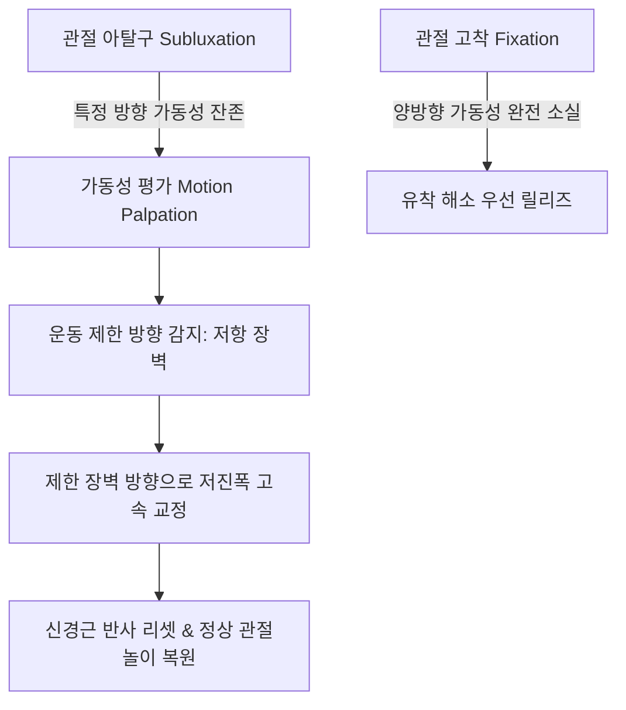
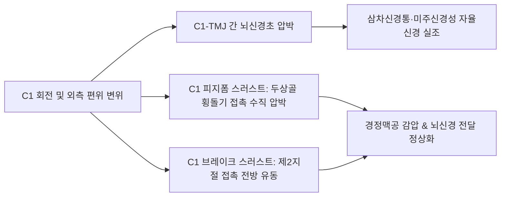

# 복잡추나 (Advanced Complex Chuna Manual Therapy)

> **핵심 임상 요약 (Key Clinical Summary)**:
> - **아탈구(Subluxation)와 관절 고착(Fixation)**: 아탈구는 관절면의 비정상적 정렬로 특정 방향 운동은 과도하나 반대 방향 운동이 차단된 상태이며, 양방향 가동성이 모두 상실된 상태는 관절 고착(Fixation)으로 규정하여 저항 장벽(Barrier)을 해소하는 교정을 시행한다.
> - **6대 변위 유형과 스러스트 술기**: 회전(Rotation, 다분절 로터리 vs 단일 분절 브레이크), 굴곡(Flexion, SP 간격 증대), 신전(Extension, SP 간격 축소), 측굴(Lateral flexion, [[척추측만증]] 동반), 염전(Listhesis, 후방 전위 다발), 압박(Compression)으로 분류하여 운동 방향을 결정한다.
> - **통증 완화와 체형 교정의 임상적 충돌**: 일자허리 및 골반 후방경사 환자에서 기계적으로 전방경사를 강제하면 추간판 후방 내압이 급증하여 통증이 악화될 수 있으며, [[척추전방전위증]] 환자는 통증 제어를 위해 전방경사(커브 유지)를, 장기적 역학 관리를 위해 후방경사를 적용하는 이원적 접근이 필요하다.
> - **상부 경추(C1) 정밀 교정**: C1과 악관절(TMJ) 사이를 주행하는 뇌신경(삼차신경, 안면신경, 설인신경, [[10. 미주신경|미주신경]]) 감압을 위해 C1 횡돌기 접촉 피지폼(Pisiform) 스러스트 및 브레이크 테크닉을 구사한다.
> - **골반 변위별 드랍 교정**: AS(전상방 장골) 변위는 환자 하지 굴곡 후 좌골결절(Ischial tuberosity)에 손바닥을 접촉하여 후방 회전 드랍을 치고, PI(후하방 장골) 변위는 PSIS 및 천골 S2 결절에 피지폼을 접촉하여 전상방 드랍을 적용한다.

---

## 1. 척추 아탈구(Subluxation)와 관절 고착(Fixation)의 병태생리
[[추나요법]]에서 다루는 관절 장애는 미세 정렬의 이상인 아탈구(Subluxation)와 완전한 관절면 유착인 관절 고착(Fixation)으로 구분된다.

- **운동 제한성의 비대칭성**:
  - 변위가 발생한 척추 분절은 변위된 방향으로는 가동성이 유지되거나 과운동성(Hypermobility)을 보이지만, 반대 방향으로는 움직임이 심각하게 제한된다.
  - 추나 교정은 항상 **움직이지 않는 제한 가동점(Barrier)**을 향해 힘을 가해야 하며, 억지로 변위 방향으로 과신장시키면 인대 손상이나 관절 탈구를 초래할 수 있다.
- **경추 회전 제한의 임상 감별**:
  - 두경부 회전 시 초기 각도(0~45도)에서 즉각적인 회전 제한이 나타나면 환추-축추([[환추]], [[축추]]) 복합체의 병변이고, 끝범위(45~80도)에서 저항이 걸리면 하부 경추(C3-C7)의 후관절 고착으로 판정한다.

---

## 2. 변위 유형별(회전·굴곡·신전·측굴·염전·압박) 생체역학
척추 분절의 3차원 운동학적 변위는 극돌기(SP)와 관절돌기간 관절의 공간적 위치 관계에 따라 6가지 유형으로 분석된다.

| 변위 유형 | 영상의학 및 촉진 지표 | 주요 발생 분절 | 표준 추나 수기 기법 |
| :--- | :--- | :--- | :--- |
| **회전 (Rotation)** | 극돌기와 추궁판(Pedicle) 간 비대칭 | 전 척추 분절 | 다분절: 로터리 스러스트 (Rotary thrust) 단분절: 브레이크 테크닉 (Break technique) |
| **굴곡 (Flexion)** | 인접 극돌기 간격(SP distance) 확장 | 경추(일자목), 요추 | 후두골 신전 유도 및 중부 경추 전방 염전 교정 |
| **신전 (Extension)** | 인접 극돌기 간격 협소화 및 접촉 | 흉요추 과전만부 | 굴곡 견인 기법을 통한 후관절 간격 개방 |
| **측굴 (Lateral Flexion)** | 척추 극돌기의 일측 편위 (회전 동반) | [[척추측만증]] 호발부 | 측굴-회전 짝운동 벡터를 결합한 관절 가동술 |
| **염전 (Listhesis)** | 하위 추체 대비 상위 추체의 미끄러짐 | 흉추(측방), 요추(전후방) | 분절성 추체 접촉 전방/후방 유동 복원 |
| **압박 (Compression)** | 추체 전방 붕괴 및 후관절 충돌 | 골다공증성 척추 | 직접적 HVLA 금기, 경성 견인 및 안정성 고정 |

---

## 3. 추나요법의 이중 목표: 급성 통증 제어와 체형 교정의 임상 충돌
추나 치료의 목표는 **급성 통증 완화 및 신경근 감압**과 **전신 체형 교정을 통한 재발 방지**의 두 가지 축으로 구성되며, 임상 현장에서는 두 목표가 상충할 때 정밀한 우선순위 설정이 요구된다.

- **일자허리(후방경사)와 추간판 탈출증의 충돌**:
  - 골반 후방경사로 인해 요추 전만이 소실된 일자허리 환자에서 체형 교정을 목표로 급격한 전방경사 유도 룸바롤(Lumbar roll)을 시술할 경우, 비틀림(Torsion) 전단력이 가해져 수핵이 후방으로 더 강하게 밀려나 신경근 증상이 급격히 악화될 수 있다.
  - 급성기에는 디스크 압박을 피하기 위해 중립위를 유지하고, 통증 제어 후 점진적인 시상면 만곡 형성을 시도한다.
- **[[척추전방전위증]] 환자의 치료 딜레마**:
  - 체형 분석 상으로는 과도한 요추 전만을 줄이기 위해 골반 후방경사를 유도해야 하지만, 실제 환자의 신경근 통증은 척추를 신전시키고 전방경사를 약간 유지해 줄 때 후관절 긴장이 완화되는 경우가 존재하므로 환자의 통증 유발 동작을 최우선 기준으로 삼는다.

---

## 4. 상부 경추(C1) 정밀 교정: 피지폼(Pisiform) 및 브레이크 스러스트
환추(C1)는 두개골과 경추를 연결하며 그 외측 횡돌기 전방으로는 제5, 7, 9, 10번 뇌신경이 통과하는 중요한 신경혈관 통로이다.

1. **C1 피지폼 스러스트 (Pisiform Thrust)**:
   - 환자의 두경부를 회전시켜 C1 횡돌기가 표재로 노출되도록 유도한 후, 술자의 두상골(Pisiform)을 C1 횡돌기 후외측면에 정확히 안착시킨다.
   - 제한 가동벽까지 유격을 제거한 후, 유양돌기와 하악지를 보호하면서 순간적인 수직 임팩트를 가한다.
2. **C1 브레이크 스러스트 (Break Thrust)**:
   - 술자 검지의 제2지절 측면으로 C1 횡돌기를 걸어 잡고, 전방으로 밀어내며 미세 회전을 해소한다.

---

## 5. 거북목·일자목 증후군의 감별과 흉경추 분절 교정
컴퓨터 및 스마트폰 과사용으로 호발하는 두경부 부정렬을 병태생리별로 감별 진단한다.

- **[[거북목]](Forward Head Posture)**:
  - 하부 경추의 과굴곡 + 상부 경추의 과신전 + 흉추 과후만이 복합된 체형이다.
  - [[상부승모근]], [[견갑거근]], [[흉쇄유돌근]], [[후두하근]], [[두판상근]]이 과단축되어 있으므로 후관절(Articular pillar) 접촉 로터리 스러스트와 함께 흉추 신전 교정을 병행한다.
- **일자목(Straight Neck)**:
  - 경추 정상 전만곡이 완전히 소실된 과소전만(Hypolordosis) 상태이다.
  - C0-C1 후두환추관절을 신전시키는 테크닉과 중부 경추를 전방으로 유도하는 브레이크 테크닉을 적용한다.
- **기능적 후만 vs 구조적 후만 감별**:
  - 환자를 앙와위로 눕혔을 때 견갑골이 바닥에 닿고 체간을 뒤로 젖힐 때 만곡의 반전이 발생하면 **기능적 후만**이며, 눕거나 젖혀도 후만 각도가 변하지 않고 굳어 있으면 **구조적 후만**으로 판정한다.

---

## 6. 골반 변위 교정: AS(전상방) 및 PI(후하방) 장골 드랍 테크닉
골반대의 장골 변위는 시상면 회전 방향에 따라 상반된 수기 벡터를 적용한다.

1. **골반 전방경사 (AS 장골 교정)**:
   - 장골이 전상방으로 회전한 상태로, 환자의 고관절과 슬관절을 복부 쪽으로 최대 굴곡시켜 골반 후방 회전 장력을 형성한다.
   - 술자의 손바닥을 좌골결절(Ischial tuberosity)에 접촉하고 후하방에서 전상방으로 퍼올리는 벡터로 순간 바디드랍(Body drop)을 가한다.
2. **골반 후방경사 (PI 장골 교정)**:
   - 장골이 후하방으로 회전하여 요추 전만이 상실된 상태이다.
   - 환자를 복와위로 위치시키고 장골의 후상장골극([[PSIS]]) 및 천골 S2 결절에 두상골을 밀착시킨 후, 전상방을 향해 순간적인 드랍 교정을 적용하여 정상 골반 전만을 회복시킨다.

---

## 7. 디스크 질환 및 척추전방전위증 환자의 추나 금기 및 안전 수칙
복잡추나 시술 시 신경 손상 및 구조적 불안정성을 예방하기 위한 절대적 안전 가이드라인이다.

- **추간판 탈출증 환자의 회전력 배제**:
  - 섬유륜 파열이 동반된 급성 [[요추 추간판 탈출증]] 환자에게 강한 회전 비틀림(Torsion)을 가하는 룸바롤 시술은 섬유륜 파열을 확장시킬 수 있다.
  - 반드시 환자의 무릎을 접촉면에 고정하고 비틀림 각도를 15도 이내로 엄격히 제한하여 관절면 열림(Gapping)만 유도해야 한다.
- **척추 불안정증 환자의 과도한 스러스트 금기**:
  - 척추 분절의 인대 이완증([[천장관절|천장인대]], 극간인대)이나 척추분리증 환자에게 과도한 충격 교정을 반복하면 골성 지지력이 붕괴되므로, 저진폭 가동술 및 [[화침]], [[약침]]을 이용한 증식 치료를 우선한다.

---

## 8. 참고문헌 및 학술 연구 요약

- Langenfeld A et al. (2025). Systematic review on biomechanical effects of high-velocity, low amplitude spinal manipulation. *PLoS One*. 20(7):e0328048. PMID: 40680063
  - [연구 요약] 고속저진폭(HVLA) 척추 수기 치료가 척추 분절의 3차원 운동학적 변위, 후관절 개방 및 고유수용성 감각 신경근 반사에 미치는 생체역학적 효과를 체계적으로 고찰함.

- Young KJ et al. (2024). Mechanisms of manipulation: a systematic review of the literature on immediate anatomical structural or positional changes in response to manually delivered high-velocity, low-amplitude spinal manipulation. *Chiropr Man Therap*. 32(1):28. PMID: 39261958
  - [연구 요약] 수기 척추 교정 직후 발생하는 척추 관절면의 해부학적 위치 변화, 후관절 관절낭 신장 및 신경 감압 메커니즘을 문헌 분석을 통해 정량 규명함.
