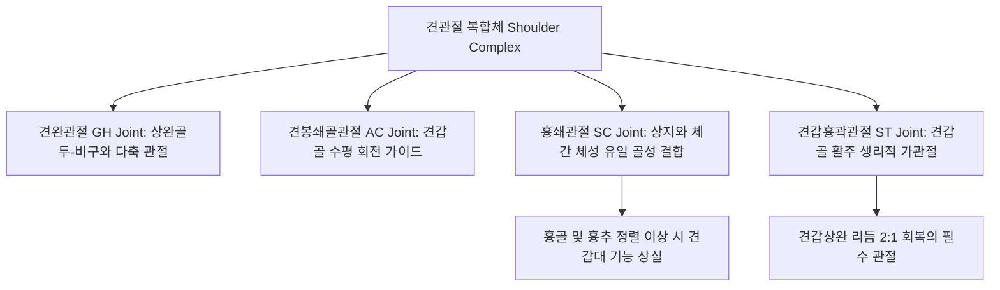

# 어깨 추나 (Shoulder Girdle Chuna Manual Therapy)

> **핵심 임상 요약 (Key Clinical Summary)**:
> - **견관절 복합체의 4대 관절 연동**: 어깨 관절은 견완관절(GH), 견봉쇄골관절(AC), 흉쇄관절(SC), 견갑흉곽관절(ST)의 4개 관절면이 흉골, 쇄골, 견갑골, 상완골, 늑골과 유기적으로 결합되어 있으므로 쇄골과 흉추 정렬을 필히 병행 진단한다.
> - **현대인 라운드 숄더와 상완골 전방 변위**: 장시간 좌식 및 전방 작업으로 인해 [[견갑하근]], [[오훼완근]], [[대흉근]], [[광배근]], [[대원근]]이 단축되어 상완골두를 전하방으로 아탈구시키고 견봉하 공간을 협소화한다.
> - **흉쇄관절 및 쇄골 후방 드랍 술기**: 전방으로 돌출된 쇄골 내측단을 교정하기 위해 상지를 경도 외전시킨 상태에서 쇄골 내측두를 후하방으로 정복하는 어깨 드랍 테크닉을 적용한다.
> - **견갑하근(Subscapularis) 심부 이완**: 상완골 내회전 구축의 주범인 견갑하근을 액와 후벽을 통해 파지하고 횡단 마찰 및 지속 신장(쭉쭉이 이완)을 가하여 상완골두의 중심화(Centering)를 유도한다.
> - **통합 한의 치료 프로토콜**: 흉추 후만 교정으로 견갑골 상방회전을 회복시키고, 견우(LI15), 견료(TE14), 노수(SI10) 혈위 자침 및 자하거약침으로 회전근개 염증을 가라앉힌 후 능형근 강화 운동을 처방한다.

---

## 1. 견관절 복합체(Shoulder Complex)의 기능 해부학과 4대 관절면
견관절(Shoulder Joint)은 인체에서 가동 범위가 가장 넓은 관절이지만, 해부학적 골성 지지력이 취약하여 4개의 관절면이 협응하는 복합 기능 구조를 가진다.

- **쇄골(Clavicle)의 스트럿(Strut) 역할**:
  - 쇄골은 상완골을 체간 흉곽으로부터 적절한 외측 거리에 유지시켜 주는 기계적 버팀목이다.
  - 흉쇄관절(SC)이나 견쇄관절(AC)에 미세 아탈구가 발생하면 견갑골의 3차원 회전 운동이 차단되어 어깨 충돌이 불가피하게 발생한다.

---

## 2. 현대인 라운드 숄더(Rounded Shoulder)의 병태역학 및 상완골 전방 변위
스마트폰과 컴퓨터를 장시간 사용하는 현대인은 전형적인 전방 머리 자세와 함께 [[라운드 숄더]](Rounded Shoulder Posture)를 나타낸다.

| 병리 상태 | 단축 및 과긴장 근육군 | 약화 및 억제 근육군 | 역학적 결과 |
| :--- | :--- | :--- | :--- |
| **상완골 전방 아탈구** | [[대흉근]], [[소흉근]], [[견갑하근]], [[대원근]], [[광배근]], [[오훼완근]] | [[극하근]], [[소원근]], 상완이두근 장두 | 상완골두가 전방으로 활주하여 오훼견봉인대와 충돌 |
| **견갑골 전방 경사 & 외전** | [[소흉근]], [[쇄골하근]], [[상부승모근]] | [[전거근]], [[능형근]], 중·하부 [[승모근]] | 견봉 전외측이 하강하여 극상근건 압박 |

---

## 3. 흉쇄관절(SC) 및 견쇄관절(AC)의 변위 평가와 쇄골 후방 드랍
어깨 통증 환자 진찰 시 단순 견봉하 공간만 관찰하지 않고 흉골병과 쇄골이 만나는 흉쇄관절의 돌출 여부를 필히 시진·촉진해야 한다.

- **흉쇄관절 전방 변위의 평가**:
  - 환자를 앙와위로 눕히고 양측 흉쇄관절 내측두를 비교 촉진할 때, 환측 쇄골 내측단이 전방으로 튀어나와 뚜렷한 압통을 나타낸다.
- **쇄골 후방 드랍(Clavicular Drop) 술기**:
  1. 환자의 상지를 약 30도 외전 및 경도 신전시켜 쇄골의 관절면 유격을 확보한다.
  2. 술자의 모지구 또는 무지두를 돌출된 쇄골두 전면에 밀착시킨다.
  3. 환자가 숨을 내쉬는 끝점에서 쇄골두를 후하방 방향으로 순간적인 드랍력을 가하여 관절낭 내로 정복시킨다.

---

## 4. 상완골두 전방 아탈구 교정과 견갑하근(Subscapularis) 근막 이완술
상완골두가 관절와 전방으로 쏠려 있는 환자는 견관절 외회전 결손과 함께 수평 신전 시 전방 관절낭 통증을 호소한다.

1. **상완골두 후방 정복 테크닉**:
   - 상완골을 견갑골 면(Scapular plane)에 맞추어 일직선으로 정렬한 후, 술자의 양손으로 상완골두 근위부를 감싸 쥐고 후상방 벡터로 지긋이 밀어 넣어 관절와 중심에 위치시킨다.
2. **[[견갑하근]] 심부 스트레칭 (쭉쭉이 이완술)**:
   - 환자의 팔을 외전 및 거상시킨 상태에서 술자의 수지를 액와 후벽을 통해 견갑골 전면 늑골면으로 깊숙이 진입시킨다.
   - 단축된 견갑하근의 근복과 건 부착부를 압박하면서 상완골을 수동적 외회전시켜 근막 유착을 신속히 박리한다.

---

## 5. 견갑흉곽 관절(ST) 가동성과 흉추 후만 교정의 운동사슬 연계
견갑골은 흉곽 후면의 늑골 위를 활주하는 생리적 관절이므로, 흉추의 후만 변형은 견갑골 운동을 물리적으로 방해한다.

- **운동사슬(Kinetic Chain)의 연계성**:
  - 흉추가 과후만(Hyperkyphosis)되면 견갑골은 외전되고 전방으로 기울어지며(Anterior tilting), 상지 거상 시 필요한 60도의 견갑골 상방회전이 불가능해진다.
  - 따라서 어깨 수기 치료 시 견갑흉곽 계면 이완과 함께 흉추 신전 고속저진폭(HVLA) 스러스트를 반드시 선행하여 흉벽의 평탄도를 복원해야 한다.

---

## 6. 회전근개 병변 및 충돌증후군의 한의 복합 침구·약침 치료
어깨 주변 연부조직 염증을 가라앉히고 건인대 결합을 복원하기 위한 한의 복합 치료이다.

- **주요 경혈 배오**:
  - 견우(LI15), 견료(TE14): 견봉하 점액낭 및 극상근건 부착부 직접 감압.
  - 노수(SI10), 천종(SI11): 견갑골 후면 극하근 및 소원근 발통점 이완.
  - 견정(GB21): 과긴장된 상부승모근과 견갑거근 하강.
- **[[약침]] 요법 프로토콜**:
  - 상완이두근 장두건구 및 극상근건 염증 부위에 신바로약침 또는 중성어혈약침을 1.0cc 주입하여 무균성 활액막염을 제어한다.
  - 만성 퇴행성 파열기에는 자하거약침을 극상근 정지부에 투여하여 콜라겐 합성을 촉진한다.

---

## 7. 상지 체형 교정을 위한 견갑골 후방 견인 및 능형근 강화 운동
수기 치료 후 상완골과 쇄골의 바른 위치를 유지하기 위한 환자 능동 재활 처방이다.

1. **W-V 운동 (Scapular Retraction & Depression)**:
   - 양팔을 W자로 만들어 팔꿈치를 옆구리에 붙이고 견갑골을 후하방으로 강하게 조여 5초간 유지하며 중·하부 [[승모근]]과 [[능형근]]을 강화한다.
2. **도어웨이 대흉근 스트레칭 (Doorway Pectoralis Stretch)**:
   - 문틀에 전완을 지지하고 체간을 앞으로 전진시켜 단축된 [[대흉근]]과 소흉근을 신장시킨다.
3. **벽 슬라이드 (Wall Slide)**:
   - 등을 벽에 밀착하고 팔을 슬라이딩하여 거상함으로써 [[전거근]] 활성화를 유도한다.

---

## 8. 참고문헌 및 학술 연구 요약

- Han JT et al. (2015). The mechanical effect of kinesiology tape on rounded shoulder posture in seated male workers: a single-blinded randomized controlled pilot study. *Physiother Theory Pract*. 31(2):120-5. PMID: 25264014
  - [연구 요약] 장시간 좌식 노동자에서 라운드 숄더 체형에 대한 물리적 테이핑과 생체역학적 중재가 견봉-전방 흉벽 거리 및 자세 정렬에 미치는 영향을 단일맹검 무작위 대조 시험으로 검증함.

- Wong CK et al. (2010). The effects of manual treatment on rounded-shoulder posture, and associated muscle strength. *J Bodyw Mov Ther*. 14(4):326-33. PMID: 20850039
  - [연구 요약] 수기 치료(도수 치료)가 라운드 숄더 자세 교정, 쇄골 및 상완골 전방 변위 회복, 견갑대 근력에 미치는 유의한 임상적 개선 효과를 입증함.
