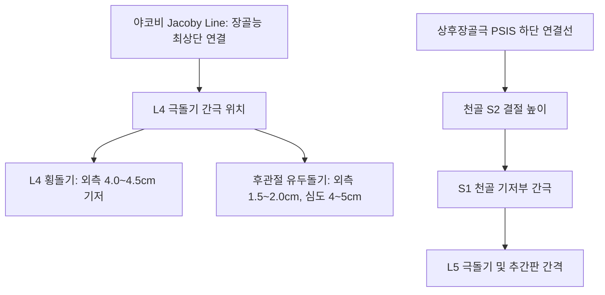
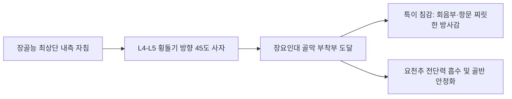

# 요골반 리스팅 (Lumbopelvic Listing & Motion Palpation)

> **핵심 임상 요약 (Key Clinical Summary)**:
> - **요천추부 랜드마크와 심부 해부학**: [[요추]] L4 [[극돌기]]-횡돌기 간 거리는 약 4.0~4.5cm이며, 관골구([[후관절 증후군|후관절]] 관골돌기)는 극돌기 외측 1.5~2.0cm, 심도 4.0~5.0cm에서 확실한 본터치(Bone touch)가 이루어진다.
> - **PSIS와 천골 정렬 랜드마크**: 상후장골극([[PSIS]]) 하단부는 [[천골]] S2 정중 능선 높이에 위치하며, S1은 L5 극돌기 하연 연부조직 결손부(Lumbosacral soft spot) 직하방에서 만져져 [[요추 추간판 탈출증]] 및 L5 척추체 변위 감별에 결정적이다.
> - **탄성 검사(Spring Test)**: 요추 극돌기를 수직 압박하여 관절 종말 탄성 반동(Springing)을 촉진하며, 반동 결여 시 P(후방) 변위로 판정하고 [[다열근]] 및 [[약침]] 심부 자침 치료점을 설정한다.
> - **장요인대 심부 자침과 침감**: 장골능 최상단([[ASIS]] 연장선)과 L4-L5 [[횡돌기]] 사이 오목한 부위에서 장골능 골막에 비스듬히 자침하여 장요인대를 정확히 자극하면 회음부(항문) 방향으로 찌릿하고 시원한 방사감([[좌골신경통]] 유사 득기)이 발생한다.
> - **천장관절 가동성 검사**: 복와위 하지 신전 검사 시 다리가 안 들리는 쪽이 [[장골]] PI(후하방) 변위이고, FABER 검사 시 무릎이 안 내려가는 쪽은 [[장골]] EX(외회전) 변위이다. 룸바롤 시술 시 상체 회전(Torsion)을 배제하고 시술자 대퇴골-환자 PSIS 간 직선 벡터로 교정력을 전달한다.

---

## 1. 요골반 생체역학과 표면해부학: 유두돌기(Mamillary Process)와 랜드마크
요추와 [[장골]]의 3차원 변위를 진단하기 위해서는 신뢰도 높은 골성 랜드마크를 정확히 촉지해야 한다.

- **유두돌기(Mamillary Process)의 임상적 중요성**:
  - [[요추]] 상관절돌기 후외측면에 돌출된 유두돌기는 [[다열근]](Multifidus)의 심부 기시 건이 부착하는 핵심 해부학적 구조물이다.
  - [[요통]] 및 [[척추관 협착증]] 환자에서 다열근의 국소 위축과 경결을 해소하는 골막 심부 자침([[약침]] 및 [[봉약침]])의 결정적 타겟점이다.
  - [[장골]]의 변위와 연동되어 발생하는 요추 분절 회전 변위를 안정화하는 핵심 지주 역할을 수행한다.

---

## 2. 관골구(후관절) 및 L4-L5 횡돌기 심부 자침(Bone Touch)
요추 [[후관절 증후군]] 및 척추신경 후지 내측지 포착 증후군을 치료하기 위한 정밀 침술 가이드이다.

- **후관절(Facet Joint) 유두돌기 자침**:
  - [[극돌기]] 중심선 외측 1.5~2.0cm 지점에서 직자 또는 약 10도 내측으로 0.30mm, 길이 50~60mm 호침을 진침한다.
  - 심도 4.0~5.0cm에서 요추 기립근([[척추기립근]])과 [[다열근]]을 통과하여 상관절돌기 외측 골막에 단단하게 닿는 본터치(Bone touch) 감각을 확인한다.
  - 여기에 [[자하거약침]] 또는 [[중성어혈약침]] 0.5~1.0cc를 주입하여 관절낭 염증을 즉각 완화한다.
- **횡돌기(Transverse Process) 접근 주의점**:
  - [[횡돌기]]는 [[극돌기]] 외측 4.0~4.5cm에 위치하여 거리가 멀고 심도가 얕지 않으며, 과도하게 외측 깊이 자침하면 복강이나 신장 손상 위험이 있으므로 반드시 골성 접촉을 유지해야 한다.
  - 요추 [[요방형근]]의 심부 긴장을 이완하기 위해 횡돌기 늑골돌기 상연을 뼈를 스치듯 안전하게 자침한다.

---

## 3. 척추 극돌기 탄성 검사(Spring Test)와 P(후방) 변위 촉진
탄성 검사(Spring Test)는 환자를 복와위로 눕힌 상태에서 척추 분절의 시상면 후방 변위(P)를 찾아내는 표준 동적 촉진법이다.

- **검사 수기 및 판정 절차**:
  1. 시술자의 두상골(Pisiform 또는 소어제)을 환자의 [[요추]] [[극돌기]] 후방에 위치시킨다.
  2. 팔꿈치를 신전한 상태에서 체중을 실어 전하방(약 45도 전방)으로 부드럽고 빠르게 압박을 가한다.
  3. 정상 분절은 탄력 있는 스프링 반동(Springing recoil)을 나타내지만, 관절 기능부전(Fixation) 분절은 시멘트 바닥처럼 딱딱하게 저항하며 튕겨 나오지 않는다.
  4. 스프링 탄성이 소실된 분절을 후방 변위(P)로 확정하고, 해당 분절의 [[다열근]] 경결점을 향해 [[도침]] 또는 정밀 [[추나요법]] 교정을 적용한다.

---

## 4. 장요인대(Iliolumbar Ligament) 심부 사자 및 특이 침감(득기)
만성 난치성 [[요통]]과 골반 불안정증을 치료하는 장요인대 심부 자침술이다.

- **장요인대 자침 경로와 득기(得氣)**:
  - [[장골]]능 최상단(L4 높이)에서 약간 전내측으로 들어간 부위에서 L4-L5 [[횡돌기]] 방향으로 60~75mm 장침을 비스듬히 자침한다.
  - 침첨이 장요인대와 장골능 골막에 정확히 도달하면, 환자는 **"허리 깊은 곳에서 항문(회음부) 쪽으로 묵직하게 전기가 통하듯 퍼지면서 대단히 시원하다"**는 특이한 침감을 호소한다.
  - 이는 [[장요근]] 및 [[이상근]]의 긴장성 단축을 반사적으로 억제하여 [[좌골신경통]] 증상을 개선한다.

---

## 5. 천장관절(SI Joint) 가동성 평가: 복와위 하지 신전 검사와 PI 변위
[[천장관절]](Sacroiliac Joint)의 기능부전을 진단하기 위한 대표적인 동적 검사법이다.

1. **복와위 하지 신전 검사 (Prone Leg Extension Test)**:
   - 환자를 엎드리게 한 뒤 시술자는 한 손으로 [[천골]] 기저부를 촉진하고 다른 손으로 환자의 발목을 잡는다.
   - 환자에게 무릎을 편 채로 다리를 천장 쪽으로 들어 올리게 한다.
   - 정상 장골([[ASIS]] 전상방 회전)측은 약 15~20도 원활하게 거상되지만, **장골 PI(후하방 변위)측은 대퇴부가 침대에서 걸려 전혀 들리지 않는다**.
2. **단족(Short Leg)과의 상관관계**:
   - PI 변위측은 비구(Acetabulum)가 전상방으로 이동하여 해부학적으로 동측 하지의 가성 단족(짧은 다리)을 유발하며, [[대둔근]]과 [[중둔근]]의 약화를 동반한다.

---

## 6. FABER 검사 및 골반 특수 검사를 통한 EX/IN 변위 감별
임상에서 흔히 천장관절의 활주 이상이나 회전 변위를 확인하는 정밀 검사이다.

- **FABER 검사 (Patrick Test)**:
  - 굴곡(Flexion), 외전(Abduction), 외회전(External Rotation) 복합 동작을 시행하여 무릎이 반대측 침대에 닿지 못하고 허공에 뜨는 쪽은:
    - 장골의 **EX(외회전, Inflare)** 변위 또는 고관절 자체 병변을 시사한다.
- **ASIS-천골 간 거리 측정**:
  - 전상장골극([[ASIS]])과 배꼽, 그리고 상후장골극([[PSIS]])과 [[천골]] 중앙선 간 거리를 비교하여 거리가 멀어진 쪽은 **IN(내회전, Outflare)** 변위, 좁아진 쪽은 **EX** 변위로 확진한다.
  - 변위된 장골에 따라 [[이상근]]과 [[대퇴근막장근]]의 상호 비대칭 긴장을 감별한다.

---

## 7. 룸바롤 시술 시 대퇴골-PSIS 벡터와 후관절 비틀림(Torsion) 방지
골반 룸바롤 시술 시 흔히 발생하는 부작용(디스크 손상)을 방지하기 위한 절대 수기 원칙이다.

- **상체 비틀림(Torque)의 위험성**:
  - 골반 룸바롤 시 환자의 상체를 과도하게 뒤로 비틀어 회전 토크를 주면 L4-L5 추간판에 회전 전단력이 집중되어 디스크 파열이나 급성 요추 염좌를 유발한다.
  - 상체는 바닥과 수직 상태를 유지하도록 최소한만 고정하고, 시술자의 하복부와 체중 벡터를 **환자의 [[대퇴골]] 외측에서 [[PSIS]] 방향으로 직선화**시켜야 한다.
  - 이렇게 하면 회전 토크가 요추 추간판에 미치지 않고 오직 [[천장관절]] 면에만 100% 전달되어 안전하고 완벽한 관절 분리음(Cavitation)이 유도된다.
  - 이를 통해 [[요추 추간판 탈출증]] 및 [[척추전방전위증]] 환자에서도 디스크 자극 없이 안전하게 교정할 수 있다.

---

## 8. 실존 임상 연구 논문 요약

- Colonna S et al. (2026). The Standing Forward Flexion Test in Manual Therapy: A Critical Review and a Functional Reinterpretation. *Cureus*. 18(1):e101225. PMID: 41669570
  - [연구 요약] 도수치료 및 추나의학에서 천장관절 가동성 진단을 위한 입위 전굴 검사의 생체역학적 타당성과 요골반 리스팅 판정 기준의 임상적 신뢰도를 체계적으로 규명.

- Nejati P et al. (2020). Accuracy of the Diagnostic Tests of Sacroiliac Joint Dysfunction. *J Chiropr Med*. 19(1):28-37. PMID: 33192189
  - [연구 요약] 천장관절 기능부전 진단에 사용되는 다양한 도수 검사(Gillet, Patrick, Springing, Thigh thrust)의 민감도와 특이도를 평가하여 복합 진단 알고리즘의 유효성을 입증.
