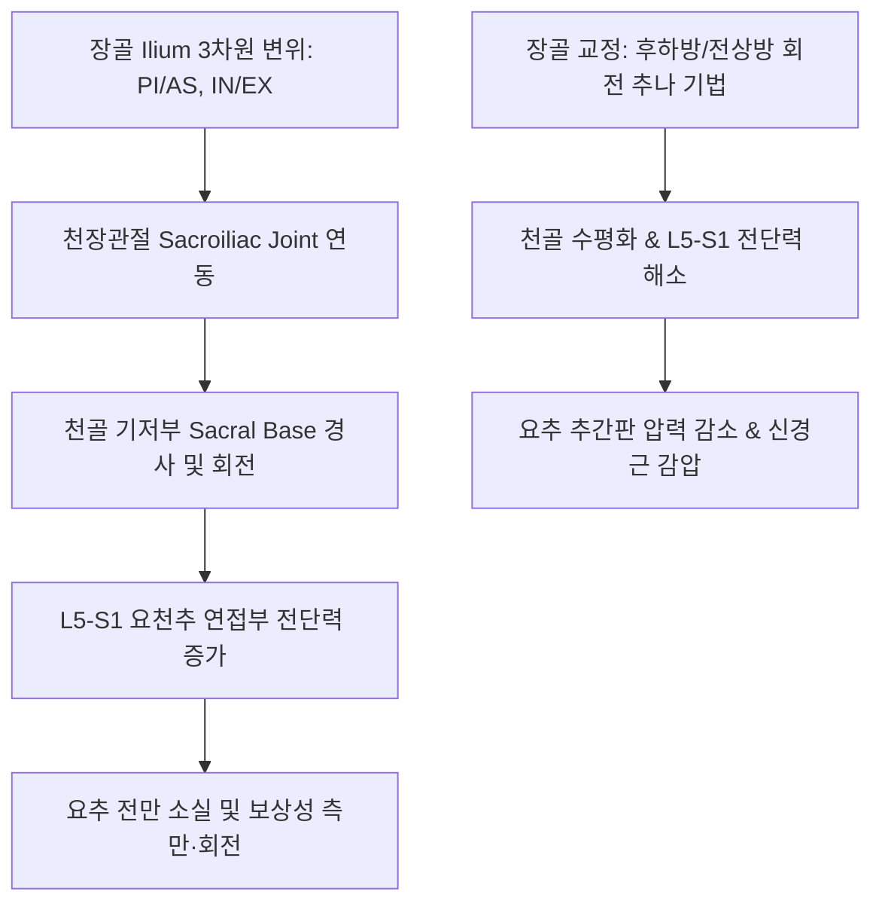
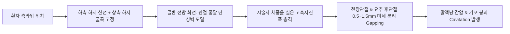

# 요골반 추나 (Lumbopelvic Chuna Manual Therapy)

> **핵심 임상 요약 (Key Clinical Summary)**:
> - **흉요추-골반대 통합 역학**: [[요추]]는 [[천골]] 위에 얹혀 있고 천골은 양측 [[장골]] 사이에 쐐기(Wedge)처럼 끼워져 결합되어 있으므로, 장골의 3차원 변위를 먼저 교정하면 요추의 측만과 비틀림이 근본적으로 해소된다.
> - **유두돌기(Mamillary Process) 타겟팅**: 요추 유두돌기는 [[다열근]](Multifidus)의 심부 부착부이자 후관절낭 해부학적 지표로서, [[극돌기]] 외측 1.5~2.0cm에서 5.0~6.0cm 심도로 자침하여 골막 본터치를 달성해야 신경 반사 억제 효과가 극대화된다.
> - **변형 굴곡 요골반 룸바롤(Lumbar Roll)의 안전성**: 요추 룸바롤 시 상체 과회전 토크는 후방 섬유륜 손상을 유발할 수 있으므로, 환자의 골반을 수직으로 세우고 굴곡 각도를 조절하여 비틀림을 배제한 '변형 굴곡 요골반 자세(Modified flexed position)'를 적용한다.
> - **천장관절 분리(Gapping) 생체역학**: 장골 후하방 변위 교정 시 환자의 상체 대신 골반과 대퇴부를 지렛대로 활용하는 후방 회전 토크를 가하여 [[천장관절]] 면의 미세 관절 분리(Gapping)를 유도한다.
> - **요골반 침구·약침 복합 치료**: [[약침]]([[자하거약침]], [[중성어혈약침]])을 장요인대와 천결절인대에 심부 주입하고, [[도침]]으로 유착된 [[요방형근]]과 천장관절낭을 박리하여 요골반 안정성을 완성한다.

---

## 1. 흉요추 골반대 해부학 및 역학: 장골 치료를 통한 요추 치료 원리
골반대(Pelvic girdle)는 척추를 지지하는 역학적 주춧돌 역할을 수행하며, 요추와 밀접한 보상 운동 사슬을 형성한다.

- **장골 교정을 통한 요추 치료의 원리**:
  - [[요추]] 자체를 무리하게 회전 교정하지 않더라도, [[장골]]의 회전 변위를 바로잡으면 [[천골]] 기저부(Sacral base)가 수평을 회복하면서 요추의 비틀림이 자연스럽게 정렬된다.
  - 디스크 손상 위험이 높은 급성 [[요통]] 환자에서 가장 안전하고 효과적인 간접 [[추나요법]] 원리이다.
  - 이를 통해 만성 [[요추 추간판 탈출증]]과 [[척추관 협착증]] 환자의 신경학적 증상을 효과적으로 완화한다.

---

## 2. 요추 횡돌기 및 유두돌기(Mamillary Process)의 정밀 촉진과 타겟팅
요추 [[횡돌기]]와 유두돌기는 척추기립근 심부와 요추 분절의 안정성을 담당하는 핵심 구조물이다.

- **유두돌기(Mamillary process)의 해부학적 특성**:
  - 상관절돌기 후외측면에 위치하며, 척추 분절 안정화의 핵심 심부 근육인 [[다열근]] 건섬유가 강력하게 부착한다.
  - 침 치료 시 [[극돌기]] 중심선 외측 1.5~2.0cm, 심도 5~6cm 부위에 위치하며, 이 부위를 침이나 [[약침]]으로 자극하면 국소 연축 반응과 함께 척추 주위 긴장이 즉각 완화된다.
  - 인접한 [[척추기립근]]과 [[요방형근]]의 심부 허혈을 개선하여 만성 근막통을 근본적으로 차단한다.

---

## 3. 관골구(후관절) 심부 본터치 자침과 척추신경 후지 차단술
요추 [[후관절 증후군]] 치료를 위한 후관절 유두돌기 자침은 신경해부학적 목표점을 정확히 타겟팅해야 한다.

1. **본터치(Bone Touch)의 확인**:
   - 요추 기립근을 통과하여 후관절 외측 골막에 침첨이 단단하게 닿는 '본터치' 감각이 확인되어야 후관절을 지배하는 척추신경 후지의 내측지(Medial branch)를 직접 자극할 수 있다.
2. **복합 침구 자침 치료의 임상 효과**:
   - 본터치 상태에서 침첨 부위에 [[자하거약침]] 0.5~1.0cc를 주입하거나 2~4Hz 전침 자극을 가하면 척추 심부 혈류가 확장되어 [[좌골신경통]] 및 하지 방사통이 현저히 감소한다.
   - 필요 시 섬유화된 관골낭 인접부에 [[도침]]을 적용하여 유착을 감압 박리한다.

---

## 4. 요천추 정렬 랜드마크(PSIS-S2-S1-L5) 촉진과 진단 알고리즘
요천추부 척추 분절의 정확한 해부학적 위치를 확인하는 단계별 진찰 절차이다.

- **단계별 촉진 순서**:
  1. 양측 상후장골극([[PSIS]])의 하단을 확인하여 수평선을 긋는다 $
ightarrow$ [[천골]] 제2결절(S2) 높이 확인.
  2. S2 높이에서 정중선을 따라 두부 방향으로 올라가며 S1 극돌기를 촉진한다.
  3. S1 극돌기 직상방의 오목한 연부조직 결손부(Lumbosacral soft spot)를 확인한다.
  4. 그 바로 상부에서 처음으로 만져지는 척추 극돌기가 바로 **L5 [[극돌기]]**이다.
  5. 이를 기준으로 상방으로 1분절씩 단계적으로 올라가며 L4, L3 분절의 후방(P) 변위를 확인한다.
  6. 전상장골극([[ASIS]])과의 높낮이 비대칭을 비교하여 장골의 전상방(AS) 또는 후하방(PI) 변위를 확진한다.

---

## 5. 요골반 룸바롤(Lumbar Roll)과 천장관절 분리(Gapping) 생체역학
요골반 룸바롤(Lumbar Roll)은 요추 후관절과 [[천장관절]] 면을 순간적으로 분리시키는 대표적인 고속저진폭(HVLA) 기법이다.

- **관절 분리(Gapping)의 신경생리학적 효과**:
  - 후관절낭 내 음압을 유도하여 관절액 내 용존 기체가 기포화되었다가 붕괴되는 관절음(Cavitation)을 발생시킨다.
  - 관절낭 내 기계수용기(Type I, II)를 강력하게 자극하여 척추 반사궁을 통해 척추주위근육의 이상 긴장을 즉각 억제하고 관절 가동 범위를 회복시킨다.
  - [[대둔근]]과 [[이상근]]의 반사적 이완을 유도하여 골반 통증을 차단한다.

---

## 6. 추간판 탈출증 환자에서의 변형 굴곡 요골반 룸바롤 자세
급성 요추 [[추간판]] 탈출증 환자에서 무리한 회전 비틀림을 가하면 수핵 탈출이 악화될 수 있다.

- **변형 굴곡 요골반 자세 (Modified Flexed Position)**:
  - 전통적 룸바롤의 상체 회전을 배제하고, 고관절과 슬관절의 굴곡 각도를 조절하여 요추 후관절을 안전하게 개방한다.
  - 시상면에서 요추 굴곡을 유지한 상태에서 골반 회전만을 유도하는 '변형 굴곡 자세'는 디스크 환자의 통증 유발을 완벽히 차단하면서 천장관절 기능부전을 성공적으로 회복시킨다.
  - 이를 통해 [[요추 추간판 탈출증]] 급성기 환자에서도 신경근 압박 없이 안전한 교정이 가능하다.

---

## 7. 천장관절 아탈구 및 요골반 통합 침구·약침 복합 치료 프로토콜
천장관절 불안정성 및 골반 변위를 교정하기 위한 한의 통합 치료 프로토콜이다.

- **추나 교정 후 골반 안정화 침구 치료**:
  - 천장관절 후하방/전상방 아탈구를 교정한 직후, 골반 인대를 안정화하기 위해 [[이상근]], [[대둔근]], [[중둔근]] 부착부와 팔료혈(차료, 중료)에 자침한다.
- **약침 및 인대 강화 치료**:
  - 만성 이완 환자에게는 [[자하거약침]] 또는 [[봉약침]]을 장요인대 및 천결절인대 부착부에 1.5~2.0cc 심부 주입하여 인대 증식과 결합조직 강화를 도모한다.
  - 골반저근육과 [[장요근]], [[대퇴근막장근]]의 단축을 병행 해소하여 재발을 방지한다.

---

## 8. 실존 임상 연구 논문 요약

- Wang S et al. (2025). Comfort during side posture lumbopelvic manipulation in a low back pain population-effects of a typical versus modified flexed lumbopelvic position: a crossover randomized control trial. *Chiropr Man Therap*. 34(1):1. PMID: 41316191
  - [연구 요약] 요통 환자에서 전통적 요골반 도수치료 자세와 변형 굴곡 요골반 자세의 환자 편안도, 통증 유발 위험도 및 척추 치료 반응을 교차 무작위 대조 시험으로 검증.

- Huang G et al. (2026). Efficacy and mechanisms of lumbopelvic manipulation combined with Baduanjin exercise for postpartum low back pain: a study protocol for a randomized controlled trial. *Front Med (Lausanne)*. 13():1889797. PMID: 42741003
  - [연구 요약] 요골반 추나 수기치료와 팔단금 운동 요법을 병용한 산후 요통 환자의 천장관절 가동성 회복, 골반 안정성 증진 및 신경통 완화 기전을 체계화한 임상 프로토콜.
