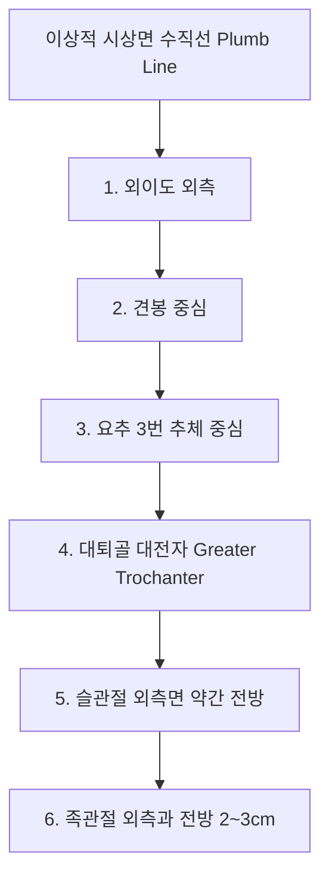
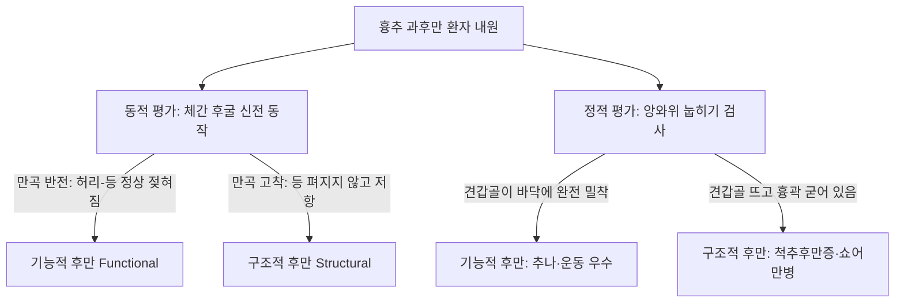

# 자세분석 (Clinical Postural Alignment & Biomechanical Analysis)

> **핵심 임상 요약 (Key Clinical Summary)**:
> - **이상적 측면 정렬선(Plumb Line)**: 외이도(External acoustic meatus) $
ightarrow$ 견봉(Acromion) $
ightarrow$ 요추 3번 추체(L3) $
ightarrow$ 대전자(Greater trochanter) $
ightarrow$ 슬관절 중앙 전방 $
ightarrow$ 발목 외측과 전방 2~3cm를 관통하는 수직선이 인체 생체역학의 기준선이다.
> - **척추 시상면 만곡 정상각**: 경추 전만(Lordosis) 30~35도, 흉추 후만(Kyphosis) 20~40도, 요추 전만 40~45도이며, 이 만곡 각도의 과도한 증대(Hyper) 또는 평탄화(Hypo)를 통해 체형 변형을 정량 평가한다.
> - **두경부 정렬 평가**: 턱과 목의 각도가 90도이면 정상, 둔각을 형성하면 [[거북목]](Forward head posture)으로 판정하며, C2 치돌기 중심 수직선이 C7 추체 전상방 1/3을 통과하면 정상, 앞으로 벗어나면 거북목, 뒤로 밀리면 일자목으로 확진한다.
> - **흉추 후만의 기능적 vs 구조적 변별**: 체간 후굴 시 만곡 반전이 나타나고 앙와위에서 견갑골이 바닥에 완전히 밀착되면 치료 예후가 우수한 **기능적 후만**이며, 동작 시 만곡이 굳어 있으면 **구조적 후만**으로 분류한다.
> - **요골반 정렬과 근육 불균형**: 전상장골극([[ASIS]])과 치골결합이 동일 수직면 상에 있고 후상장골극([[PSIS]])이 ASIS보다 약간 높아야 정상 중립 골반이며, 고관절 굴곡근군([[장요근]], [[대퇴직근]]) 단축 시 전방경사, 신전근군([[대둔근]], [[햄스트링]]) 단축 시 후방경사가 유도된다.

---

## 1. 시상면 이상 정렬선(Plumb Line)과 인체 무게중심 역학
체형 분석의 출발점은 중력장에 대항하여 최소한의 근육 에너지 소모로 기립 자세를 유지할 수 있는 이상적 시상면 중력선(Plumb line)의 설정이다.

- **발목 기준 상행성 분석 원칙**:
  - 체형을 관찰할 때는 위에서 아래로 보지 않고, 지면과 맞닿아 있는 **발목 외측과(Lateral malleolus)에서부터 수직선을 세워 상향식으로 평가**하는 것이 척추 골반의 보상성 정렬 왜곡을 찾아내는 임상 원칙이다.
  - 전방 머리 자세나 골반 변위가 발생하면 무게중심(Center of gravity)이 전후방으로 이동하여 척추 기립근과 항중력근에 비정상적인 전단 피로가 누적된다.

---

## 2. 척추의 정상 만곡(경추·흉추·요추) 및 시상면 각도 측정 기준
척추는 충격 흡수를 위해 시상면 상에서 3개의 교대 만곡을 형성한다.

| 척추 분절 | 정상 시상면 만곡 | 정상 콥스 각도 (Cobb Angle) | 과도 증대 (Hyper) | 평탄화 (Hypo) |
| :--- | :--- | :--- | :--- | :--- |
| **경추 (C-spine)** | 전만 (Lordosis) | **30° ~ 35°** | 경추 과전만 ([[거북목]] 보상) | 일자목 (Straight neck), 역C자목 |
| **흉추 (T-spine)** | 후만 (Kyphosis) | **20° ~ 40°** | 흉추 과후만 ([[라운드 숄더]] 동반) | 편평흉추 (Flat thoracic) |
| **요추 (L-spine)** | 전만 (Lordosis) | **40° ~ 45°** | 요추 과전만 (골반 전방경사 동반) | 일자허리 (Flat lumbar) |

---

## 3. 경추 시상면 자세 분석: 턱-목 각도, C2-C7 수직선, 거북목·일자목 감별
경추 부정렬은 단순 통증을 넘어 악관절 장애, 긴장성 두통 및 흉곽출구증후군을 유발한다.

- **턱-목 각도(Craniofacial Angle) 평가**:
  - 외이도와 견봉의 상대적 위치를 관찰하되, 어깨가 둥글게 말려 앞으로 나온 환자는 외이도와 견봉이 일직선처럼 보이는 착시가 발생한다.
  - 이때 하악골 하면과 경추 전면이 이루는 각도를 측정한다. 정상은 약 90도 직각이며, 턱이 들려 둔각을 형성하면 전형적인 [[거북목]]으로 확진한다.
- **C2-C7 수직선 분석**:
  - 방사선 또는 자세 측정 상 C2 치돌기(Dens)의 중심점에서 내린 수직선이 C7 추체 전상방 1/3 경계면을 관통해야 정상이다.
  - 수직선이 C7 추체보다 전방으로 2cm 이상 벗어나면 거북목, C7 추체 내부나 후방으로 떨어지면 일자목으로 분류한다.

---

## 4. 흉추 과후만(Hyperkyphosis)과 기능적 후만 vs 구조적 후만의 변별
흉추 후만이 40도 이상으로 증가한 환자에서 관절 가동성과 치료 예후를 결정짓는 핵심 판별법이다.

- **기능적 후만(Functional Kyphosis)**:
  - 잘못된 자세 습관으로 인한 대흉근·견갑거근 단축과 능형근·중하부 승모근 약화가 주원인이다. 추나 교정과 재활 운동으로 완전 회복이 가능하다.
- **구조적 후만(Structural Kyphosis)**:
  - 쇼어만병(Scheuermann's disease)이나 압박골절로 인해 추체 전방 쐐기 변형이 고착된 상태로, 과도한 강제 신전 스러스트는 금기이며 안정성 운동을 우선한다.

---

## 5. 요추 전만과 골반 경사각(ASIS-PSIS-치골결합)의 3차원 평가
골반의 중립 정렬(Neutral pelvis)은 척추 전체의 기저 밸런스를 결정한다.

1. **골반 중립 기준**:
   - 전상장골극([[ASIS]])과 치골결합(Symphysis pubis)이 동일한 수직 평면(Coronal plane)에 정렬되어야 한다.
   - 후상장골극([[PSIS]])은 ASIS보다 수평면 대비 약 7~10도(약 2~3횡지) 높아야 한다.
2. **골반 회전과 근육 사슬**:
   - 고관절 굴곡근군([[장요근]], [[대퇴직근]], [[봉공근]], [[내전근]])이 단축되면 골반이 전방경사(AS)되고 요추 과전만이 유도된다.
   - 고관절 신전근군([[대둔근]], [[햄스트링]])이 단축되면 골반이 후방경사(PI)되어 일자허리가 형성된다.

---

## 6. 상부교차증후군(UCS) 및 하부교차증후군(LCS)의 복합 자세 패턴
얀다([[Janda]])의 교차 패턴이 경흉추와 요골반대에서 동시에 중첩 발현되는 임상 증후군이다.

- **상부교차증후군 ([[상부교차증후군|UCS]])**:
  - 단축: [[상부승모근]], [[견갑거근]], [[대흉근]], [[소흉근]].
  - 약화: 경추 심부굴곡근([[경장근]], [[두장근]]), 하부 [[승모근]], [[전거근]].
- **하부교차증후군 ([[골반 전방경사(추나)|LCS]])**:
  - 단축: [[장요근]], [[대퇴직근]], [[척추기립근]], [[요방형근]].
  - 약화: [[복직근]], [[복횡근]], [[대둔근]], [[중둔근]].

---

## 7. 체형 불균형 환자의 임상 치료 전략: 통증 제어와 능동 운동 재교육
체형 교정의 임상적 완성은 수동적 수기 치료를 넘어 환자의 능동적 운동 학습에 의해 달성된다.

1. **급성 통증 제어 단계**:
   - 단축된 관절낭과 근막 결절에 [[추나요법]](HVLA 및 관절가동술)과 심부 침구·[[약침]] 치료를 적용하여 통증 역치를 정상화한다.
2. **자세 인지(Postural Awareness) 훈련**:
   - 환자가 거울 앞에서 Plumb line과 자신의 자세 비대칭(어깨 거상, 턱 들림, 골반 회전)을 시각적으로 인지하도록 교육한다.
3. **능동 코어 및 안정화 재활**:
   - 경추 턱 당기기(Chin-tuck), 흉곽 확장 호흡 운동, 글루트 브릿지 및 플랭크를 단계별로 처방하여 교정된 골격 정렬을 근육 기억으로 고착화한다.

---

## 8. 참고문헌 및 학술 연구 요약

- Shabana AMM et al. (2026). Radiographic and clinical effects of core stabilization on cervical pain and sagittal balance in forward head posture: a randomized controlled trial. *Asian Spine J*. 20(3):431-441. PMID: 41490718
  - [연구 요약] 거북목 자세 환자에서 코어 안정화 운동이 경추 시상면 정렬 각도(Craniovertebral angle), 방사선학적 시상 균형 및 경추부 통증 감소에 미치는 효과를 무작위 대조 임상시험으로 규명함.

- Mun WL et al. (2024). Effects of 60 versus 30 Minutes of Pilates Exercise on Cervicothoracic Alignment, Muscle Strength, and Endurance in University Students with Upper Crossed Syndrome. *J Clin Med*. 13(15):4399. PMID: 39124643
  - [연구 요약] 상부교차증후군(UCS) 환자에서 자세 교정 운동이 경흉추 정렬 각도 회복, 견갑대 근력 강화 및 정렬 비대칭 개선에 미치는 임상 유효성을 입증함.
