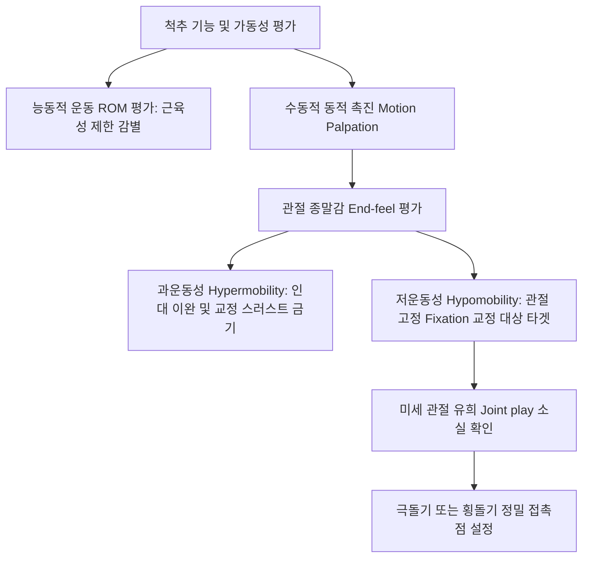
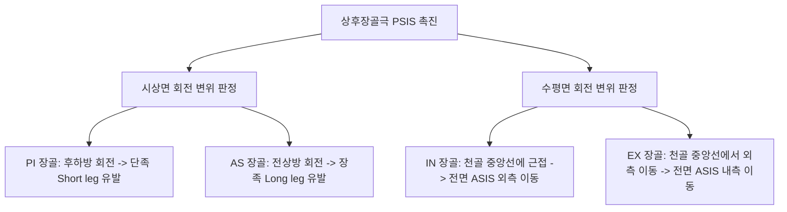

# 추나 리스팅 (Chuna Spinal & Pelvic Listing System)

> **핵심 임상 요약 (Key Clinical Summary)**:
> - **동적 촉진(Motion Palpation)과 관절 유희(Joint Play)**: 척추 리스팅은 정적 방사선 사진의 비뚤어짐뿐만 아니라 척추 분절 하나하나를 동적 촉진하여 관절 유희(Joint play)가 상실된 고정 분절(Fixation/Hypomobility)을 진단하고 치료점을 찾아내는 체계이다.
> - **3대 리스팅 체계 상호 호환**: 극돌기를 기준으로 기술하는 풀스파인(Full-spine, 예: PLI), 횡돌기/추체를 기준으로 하는 다이버시파이드(Diversified, 예: RPS), 운동 방향 제한을 기준으로 하는 어브리비에이션(Abbreviation) 표기 체계를 상호 완벽히 환산해야 한다.
> - **관절 기능부전 vs 관절 고정 감별**: 능동 가동 범위(Active ROM) 저하는 환자의 근육 수축이나 통증 회피(근막 브레이크 현상)로 인한 겉보기 제한일 수 있으나, 관절 고정은 수동 ROM 종말감(Joint play)에서 나타나는 구조적 락(Lock)이다.
> - **척추 변위 대원칙**: 환추([[경추]] C1)를 제외한 모든 척추 분절은 해부학적 상관절돌기 경사각으로 인해 **후방(P, Posterior) 변위를 기본**으로 하며, 이에 회전 및 측굴 변위가 복합된다. 극돌기가 상방(S)이면 극돌기를, 하방(I)이면 횡돌기를 접촉점으로 삼는다.
> - **골반 진단 특수 검사군**: 상후장골극([[PSIS]])을 기준으로 [[장골]] PI/AS, IN/EX를 판정하며, 질렛(Gillet), 좌위 굴곡(Seated flexion), Yeoman, Craig, Laslett 검사를 종합하여 장골과 [[천골]]의 가동성을 확진한다.

---

## 1. 척추 가동성 검사(Motion Palpation)와 관절 유희(Joint Play)
[[추나요법]]에서 척추 리스팅(Listing)은 정적인 방사선 형태학에 매몰되지 않고, 척추 분절의 기능적 관절 유희(Joint play)와 가동성 제한을 확인하는 동적 진단 과정이다.

- **팔꿈치 수용기 활용과 촉진 중요성**:
  - 초심자는 손가락 끝이나 손바닥 압력에만 의존하지만, 숙련된 한의사는 팔꿈치 고유수용기와 어깨 관절을 안정화한 상태에서 체중 중심을 실어 척추 분절의 종말 탄성을 감지한다.
  - 가장 뻣뻣하고 관절 종말감이 시멘트 벽처럼 굳어 있는 분절(Stiffest spinal site)을 정확히 찾아내는 것이 임상 치료의 핵심이다.
  - 여기에 [[약침]] 및 [[도침]]을 병행하여 관절낭 주변 인대 유착을 선행 이완한다.

---

## 2. 척추 아탈구 진단 3대 명명 체계(Full-spine·Diversified·Abbreviation)
임상에서 통용되는 척추 리스팅 3대 표준 부호의 상호 호환 원리이다.

| 명명 체계 | 기준 해부학적 지표 | 대표 표기 예시 | 구체적 역학적 의미 |
| :--- | :--- | :--- | :--- |
| **풀스파인 (Full-spine)** | [[극돌기]] (Spinous process) | **PLI** (Posterior Left Inferior) | 극돌기가 후방(P), 좌측(L), 하방(I)으로 변위됨 |
| **다이버시파이드 (Diversified)** | 추체 및 [[횡돌기]] (Vertebral body) | **RPS** (Right Posterior Superior) | 우측 횡돌기(추체)가 후방(P) 및 상방(S)으로 변위됨 (PLI와 동일 병변) |
| **어브리비에이션 (Abbreviation)** | 제한된 운동 방향 (Motion restriction) | **-θY, +θZ** 또는 회전 제한 표기 | 척추체의 3차원 데카르트 좌표계 회전 운동 제한 방향을 수학적으로 기술 |

- 풀스파인 리스팅의 PLI-Sp는 극돌기 접촉을 의미하며, RPS-Tp는 다이버시파이드의 우측 횡돌기 접촉을 의미하므로 시술자는 두 표기법을 자유자재로 환산하여 진료에 적용해야 한다.

---

## 3. 관절 기능부전(능동 ROM저하)과 관절 고정(수동 ROM소실·Fixation)의 감별
척추 통증 환자에서 연부조직성 제한(근육, 근막)과 관절성 제한(관절낭, 인대, 후관절)을 정확히 감별해야 한다.

- **관절 기능부전의 임상적 특징**:
  - 환자의 능동적 가동 범위(Active ROM) 검사 시 통증이나 두려움으로 인해 조기에 종말감이 발생한다.
  - 주동근의 경결이나 길항근의 반사적 억제(브레이크 현상)가 작용하고 있는 상태이며, 근육 내 발통점([[근막통증증후군]])이 촉지된다.
- **관절 고정(Fixation)의 임상적 특징**:
  - 수동적 가동 범위 검사 시 마지막 끝범위에서 미세하게 느껴져야 할 관절 유희(Joint play)가 소실되어 벽에 부딪히는 단단한 저항감이 촉지된다.
  - 관절 고정을 해소하지 않고 근육만 치료하면 치료 직후 일시적으로 통증이 완화되더라도 수 시간 내에 척추 긴장이 재발한다.
  - [[요추]] 및 [[흉추]] 분절의 고정을 해결하기 위해 정확한 추나 수기 치료가 필수적이다.

---

## 4. 척추 변위 기본 대원칙: C1 제외 P(후방) 변위 대원칙과 접촉점
척추 교정 치료를 시행할 때 반드시 숙지해야 하는 6대 불변의 원칙이다.

1. **상위 척추 기준**: 항상 **하위 척추체에 대한 상위 척추체의 상대적 변위**를 기술한다.
2. **후방 변위(P)의 절대성**: 상관절돌기 해부학적 경사각과 중력선, 굴곡 손상 기전으로 인해 척추 아탈구는 척추체가 **후방(P, Posterior)으로 밀리는 변위**를 기본으로 한다 (극돌기가 없는 환추 [[경추]] C1만 예외).
3. **회전 및 측굴 복합**: 후방 변위에 극돌기의 좌/우 회전(Rotation)과 상/하 경사(Tilt)가 추가된다.
4. **접촉점(Contact point) 선정 원칙**:
   - 극돌기가 상방(S)으로 들려 있으면 극돌기를 접촉점으로 삼아 교정력을 전달한다.
   - 극돌기가 하방(I)으로 처져 있으면 추체 반대측 횡돌기(Tp)를 접촉점으로 삼아 상방 리프팅을 유도한다.
5. **안전성 검증**: [[추골동맥]] 포착 징후나 심한 [[요추 추간판 탈출증]] 파열이 의심되는 경우 고속저진폭(HVLA) 기법을 배제하고 관절가동술(Mobilization)로 전환한다.

---

## 5. 장골 및 천골 변위 리스팅: PSIS 기준 PI/AS 및 IN/EX 체계
골반대의 3차원 변위를 규정하는 표준 골반 리스팅 체계이다.

- **장골 변위의 복합 양상**:
  - 장골 변위는 시상면(PI/AS)과 수평면(IN/EX)이 결합하여 PI-IN, PI-EX, AS-IN, AS-EX의 4대 기본 복합 변위로 나타난다.
  - PI 변위는 [[대둔근]] 약화와 [[햄스트링]] 단축을 유발하며, [[천장관절]]의 후방 하중 집중을 초래한다.
  - [[천골]] 기저부의 전방 경사(Anterior base)나 후방 전위(Posterior base)와 복합되어 [[요통]] 및 [[골반]] 불균형을 형성한다.

---

## 6. 골반 진단 특수 검사(질렛·Yeoman·Craig·Laslett)의 임상적 적용
천장관절 아탈구와 고관절 질환을 감별하기 위한 다각적 특수 이학적 검사군이다.

- **질렛 검사 (Gillet Test / Stork Test)**:
  - 환자가 서 있는 상태에서 한쪽 다리를 90도 이상 들어 올릴 때 동측 [[PSIS]]가 정상적으로 하방 이동하는지 확인하며, 움직이지 않고 상방으로 들리면 천장관절 고정(Fixation)으로 판정한다.
- **좌위 굴곡 검사 (Seated Flexion Test)**:
  - 하지 길이 차이(단족)의 영향을 배제하고 순수한 [[천골]]에 대한 [[장골]]의 기능부전을 평가하는 골든 스탠다드 검사이다.
- **라스렛 검사군 (Laslett Cluster)**:
  - Distraction test, Thigh thrust, Compression test, Sacral thrust 4가지 검사 중 2가지 이상 양성 시 천장관절 병변으로 확진하며, 진단 특이도가 80% 이상에 달한다.
  - 여기에 [[Patrick 검사]](FABER)와 Yeoman 검사를 결합하여 [[이상근]] 포착 및 요천추 인대 손상을 감별한다.

---

## 7. JS 신전 기법 및 관절 생리적 장벽(Barrier) 극복을 위한 치료 전략
척추 관절의 해부학적 한계를 보호하면서 기능적 장벽(Restrictive barrier)을 돌파하는 정밀 테크닉이다.

- **관절 장벽(Barrier)의 개념**:
  - 생리적 장벽(Physiological barrier) $
ightarrow$ 탄성 장벽(Elastic barrier) $
ightarrow$ 해부학적 장벽(Anatomic barrier).
  - 추나 치료의 교정 스러스트(Thrust)는 병리적 제한 장벽(Restrictive barrier)을 통과하여 탄성 장벽 직전의 관절 공간(Paraphysiological space)에서 이루어져야 하며, 해부학적 장벽을 넘어서면 인대 파열과 골절이 발생한다.
- **JS 신전 치료 전략**:
  - 척추 굴곡 변위로 인해 편평화된 척추 분절에 대해 부드러운 신전 모빌라이제이션을 적용하여 추간판 전방 높이를 회복시키고 척추 전만의 이상적 만곡을 복원한다.
  - 치료 후 [[배수혈]] 자침과 [[봉약침]]을 병용하여 국소 안정성을 영구화한다.

---

## 8. 실존 임상 연구 논문 요약

- Fryer G et al. (2018). The effect of spinal manipulation on motion palpation stiffness and pain in participants with chronic neck pain. *J Man Manip Ther*. 26(4):228-237. PMID: 30449306
  - [연구 요약] 만성 척추 통증 환자에서 동적 촉진(Motion palpation)으로 확인된 관절 고정(Fixation) 분절에 가해진 고속저진폭 도수치료가 관절 강직도를 유의하게 감소시키고 통증 역치를 증가시킴을 입증.

- Cooperstein R et al. (2017). Interexaminer reliability of the seated flexion test for sacroiliac joint dysfunction. *J Chiropr Med*. 16(1):1-7. PMID: 28031786
  - [연구 요약] 천장관절 기능부전 진단에서 좌위 굴곡 검사(Seated flexion test) 및 골반 리스팅 판정의 검사자 간 신뢰도와 임상적 타당성을 체계적으로 검증.
