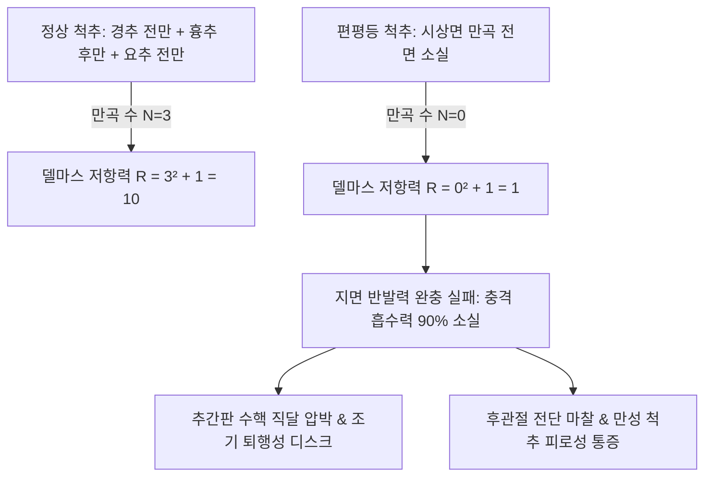

# 편평등 (Flat Back Syndrome: Biomechanics & Chuna Treatment)

> **핵심 임상 요약 (Key Clinical Summary)**:
> - **편평등의 생체역학적 정의**: 경추 전만, 흉추 후만, 요추 전만의 정상 시상면 만곡이 모두 소실되어 척추 전체가 평평하게 펴진 일자척추 증후군(Flat Back Syndrome)으로, 충격 흡수 완충 능력이 정상의 10~20%로 급감한다.
> - **델마스(Delmas) 저항력 역학 공식**: 척추의 축성 저항력은 $R = N^2 + 1$로 만곡 수($N$)의 제곱에 비례하므로, 만곡 3개인 정상 척추($R=10$) 대비 만곡이 소실된 편평등($N=0 
ightarrow R=1$)은 지면 반발력이 추간판에 여과 없이 직달되어 조기 디스크 퇴행과 압박골절을 초래한다.
> - **근육 불균형 패턴**: 골반 후방경사([[골반 전방경사(추나)|PPT]])와 함께 슬괵근군([[햄스트링]]) 및 [[복직근]]이 심각하게 단축·과긴장되어 있으며, 항중력 지지근인 [[장요근]], [[대퇴직근]], 요추 [[척추기립근]], [[다열근]]은 신장성 약화 상태에 놓인다.
> - **시상면 불균형(Sagittal Imbalance)**: 중심선이 전방으로 쏠리는 시상면 전방 붕괴로 인해 환자는 직립 유지를 위해 무릎과 고관절을 굴곡시키는 보상 보행을 취하며 만성 요배통증과 조기 피로를 호소한다.
> - **한의 통합 치료 프로토콜**: 골반 전방회전 추나교정, 슬괵근 근에너지기법([[MET]]), 요추 전만 형성 신전 관절가동술을 적용하고, 신수(BL23), 지실(BL52), 승산(BL57) 취혈 및 자하거약침과 캣카우(Cat-Cow) 코어 재교육을 처방한다.

---

## 1. 편평등(Flat Back Syndrome)의 정의 및 델마스(Delmas) 저항력 역학
편평등(Flat Back Syndrome, 일자척추 증후군)은 척추의 시상면(Sagittal plane) 생리적 만곡이 상실되어 경추, 흉추, 요추가 하나의 직선 장대처럼 곧게 펴진 체형 불균형 질환이다.

- **델마스(Delmas) 척추 저항력 공식**:
  $$R = N^2 + 1$$
  - 정상 척추는 S자 만곡을 통해 보행 시 지면에서 올라오는 충격 에너지를 용수철처럼 분산시킨다.
  - 편평등 환자는 저항력이 정상인의 1/10 수준에 불과하여 단순 기립이나 가벼운 보행만으로도 추간판과 척추체에 직접적인 압박 손상이 가해진다.

---

## 2. 척추 시상면 만곡 소실과 지면 반발력 직달의 추간판 병태생리
정상 척추 만곡의 소실은 추간판 내 수핵(Nucleus pulposus)의 생체역학적 위치를 심각하게 변화시킨다.

- **수핵의 전방 압박과 후방 전단력**:
  - 요추 전만이 소실된 상태에서 상체를 숙이거나 체중을 지탱하면, 추체 전면 간격이 협소화되면서 수핵을 후방으로 강하게 밀어낸다.
  - 이는 후방 섬유륜에 심각한 인장 스트레스를 가하여 조기 [[요추 추간판 탈출증]] 및 디스크 퇴행성 균열을 야기한다.

---

## 3. 골반 후방경사(PPT) 및 햄스트링·복직근 단축의 근육 불균형 패턴
편평등은 골반대의 후방 회전 변위인 골반 후방경사(Posterior Pelvic Tilt, PPT)와 불가분의 관계를 맺는다.

| 근육 구분 | 주요 해당 근육 | 생체역학적 기능 부전 | 임상적 결과 |
| :--- | :--- | :--- | :--- |
| **단축 및 과긴장** | [[햄스트링]]([[대퇴이두근]], [[반건양근]], [[반막양근]]) | 좌골결절을 하방 견인하여 골반 후방 회전 고착 | 무릎 굴곡 구축 및 보행 보폭 단축 |
| **단축 및 과긴장** | [[복직근]](Rectus abdominis) | 치골결합을 상방 견인하여 요추 전만 차단 | 흉곽 하강 및 복벽 강직 |
| **약화 및 신장** | [[장요근]](Psoas major & Iliacus) | 골반 전상방 지지력 상실 | 요추 전만 재형성력 결손 |
| **약화 및 신장** | 요추 [[척추기립근]], 심부 [[다열근]] | 척추 기립 신전 토크 소실 | 만성 허혈성 등·허리 뻐근함 |

---

## 4. 만성 요배통증과 시상면 불균형(Sagittal Imbalance) 중심 전방 붕괴
편평등이 장기화되면 인체의 중력선이 발목보다 앞으로 쏠리는 시상면 양성 불균형(Positive sagittal balance)이 발생한다.

- **보상적 굴곡 보행**:
  - 시선과 체간의 전방 붕괴를 보상하기 위해 환자는 고관절과 무릎을 무의식적으로 구부리고 걷게 된다.
  - 이로 인해 대퇴사두근과 둔근에 극단적인 피로가 누적되며, 계단을 오르내릴 때 극심한 관절통을 호소한다.

---

## 5. 골반 전방회전 유도 추나 교정술기와 요추 전만 회복 관절가동술
편평등 치료의 핵심은 고착된 골반을 전방으로 회전시키고 요추의 신전 관절놀이를 재형성하는 데 있다.

- **골반 전방회전 추나 술기**:
  - 환자를 복와위로 위치시키고 후상장골극([[PSIS]])과 천골 기저부에 두상골을 접촉하여 전상방 방향으로 드랍 교정을 적용한다.
  - 요추 분절마다 복와위 신전 모빌라이제이션을 적용하여 후관절의 굴곡 구축을 해소한다.

---

## 6. 슬괵근(햄스트링) 근에너지기법(MET) 및 심부 척추기립근 약침 치료
단축된 연부조직을 이완시키고 약화된 심부 척추근을 강화하는 복합 치료이다.

1. **햄스트링 근에너지기법([[MET]])**:
   - 앙와위에서 환자의 하지를 거상하여 슬괵근의 제한 장벽에 도달한 후, 환자가 하지를 바닥 쪽으로 미는 등척성 수축(20~30% 힘)을 7~10초간 유도한다.
   - 완전 이완기에 고관절 굴곡 각도를 수동적으로 증가시켜 좌골결절의 하방 견인을 해제한다.
2. **침구 및 [[약침]] 요법**:
   - 신수(BL23), 대장수(BL25), 관원수(BL26), 지실(BL52), 승산(BL57), 은문(BL37)에 자침한다.
   - 약화된 요추 다열근 및 극간인대에 신바로약침 또는 자하거약침을 주입하여 척추 지지 인대의 장력을 복원한다.

---

## 7. 코어 안정화 재활 운동(Cat-Cow·장요근 강화)과 척추 리듬 재학습
일자척추의 유연성을 회복하고 정상적인 요골반 리듬(Lumbopelvic rhythm)을 회복시키는 능동 재활 운동이다.

- **캣카우 (Cat-Cow) 스트레칭**:
  - 네발기기 자세에서 호흡과 연동하여 척추 전체를 둥글게 말았다가(굴곡), 천천히 배꼽을 바닥으로 내리며 요추 전만과 흉추 신전을 형성하는 동작을 매일 20회 반복한다.
- **장요근 강화 런지 (Psoas Lunge)**:
  - 후방 하지를 신전시켜 고관절 전면 장요근의 능동적 신장을 유도하고 골반 전방 경사 지지력을 재교육한다.

---

## 8. 참고문헌 및 학술 연구 요약

- Harrison DE et al. (2018). Non-operative correction of flat back syndrome using lumbar extension traction: a CBP(®) case series of two. *J Phys Ther Sci*. 30(8):1131-1137. PMID: 30154615
  - [연구 요약] 편평등 증후군(Flat back syndrome) 환자에서 요추 신전 견인 및 생체역학적 교정 치료가 요추 전만각 복원, 시상면 정렬 개선 및 통증 완화에 미치는 비수술적 치료 효과를 규명함.

- Glassman SD et al. (2005). The impact of positive sagittal balance in adult spinal deformity. *Spine*. 30(18):2024-2029. PMID: 16166889
  - [연구 요약] 성인 척추 변형에서 시상면 만곡 소실 및 전방 불균형(Positive sagittal balance)이 환자의 기능 장애, 통증 지수 및 삶의 질 저하에 미치는 결정적 영향을 대규모 다기관 연구로 입증함.
