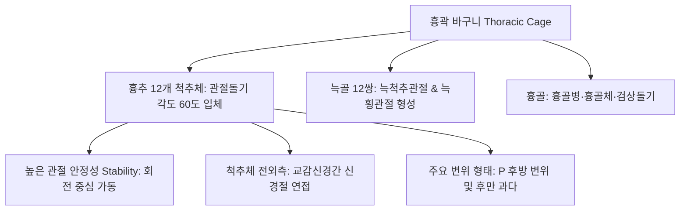
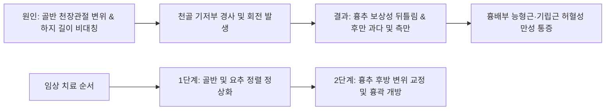

# 흉추 추나 (Thoracic Spine Chuna Manual Therapy)

> **핵심 임상 요약 (Key Clinical Summary)**:
> - **흉곽 바구니 구조와 관절 안정성**: [[흉추]]는 12개의 흉추골과 12쌍의 [[늑골]], 그리고 전면의 흉골이 결합된 견고한 흉곽 바구니(Thoracic cage)를 이루므로, 단순 회전보다 후방(P, 후방) 변위가 호발하며 낙하(Drop) 및 신전 교정이 탁월한 치료 효과를 보인다.
> - **횡돌기 골절 위험과 라미나 타겟팅**: 흉추 횡돌기는 늑횡관절로 인해 늑골과 결합되어 있어 과도한 압박 시 늑골골절이나 늑간신경 손상 위험이 있으므로, 극돌기 외측의 **추궁판(Lamina) 부위**를 정확한 접촉점으로 삼아야 한다.
> - **'가해자 골반, 피해자 흉추'의 운동사슬**: 흉추 통증을 호소하는 환자의 대다수는 [[흉추]] 자체의 원발성 병변이 아니라 골반 변위와 요추 측만으로 인한 2차적 보상 비틀림이므로, 반드시 골반을 먼저 교정해야 흉추가 치료된다.
> - **흉골 경사면 측정과 후만 정점 분절**: 단순 척추 방사선뿐만 아니라 흉골병과 흉골체 표면의 각도를 측정하여 최대 후만 정점(Peak kyphotic apex)을 찾아내고, T7(견갑골 하각 연결선)을 중심으로 상/하부 치료 전략을 분립한다.
> - **두부 견인 및 X자 교차 낙하 테크닉**: 후방 변위된 흉추 분절을 교정할 때는 환자의 호흡 날숨 말기에 경추-두부를 살짝 상방 견인하면서, 양손을 X자로 교차하여 환자의 갈비뼈 탄성을 이용해 안전하고 강력하게 교정한다.

---

## 1. 흉곽 복합체 생체역학: 흉추-늑골-흉골 관절의 흉곽 바구니 구조
[[흉추]](Thoracic spine)는 경추나 요추와 달리 [[늑골]](Ribs) 및 흉골(Sternum)과 함께 상체 내장기를 보호하는 흉곽 복합체를 이룬다.

- **흉곽의 구조적 안정성과 운동성**:
  - 전면의 흉골과 후면의 흉추, 측면의 늑골이 원통형의 바구니(Cage)를 형성하여 굴곡 및 신전 가동성은 제한적이지만 회전 운동 범위가 넓다.
  - 관절돌기 관절면이 관상면에 가깝게 60도 경사져 있어 회전 운동 시 전단력이 크게 발생하며, 잘못된 흉곽 뒤틀림은 [[근막통증증후군]]과 [[늑간신경통]]의 주원인이 된다.
  - 주변의 [[능형근]], [[승모근]], [[광배근]], [[전거근]]이 복합적으로 단축되어 흉곽 호흡 운동을 제한한다.

---

## 2. 흉추 랜드마크(T7 견갑골 하각·T12-L1 변곡점) 촉진과 삼분법칙
흉추 척추 분절을 정확히 촉진하기 위한 해부학적 표면 지표이다.

- **견갑골 하각 (T7 분절)**:
  - 환자를 복와위로 눕힌 상태에서 양측 [[견갑골]] 하각(Inferior angle of scapula)을 연결하는 수평선은 **흉추 7번(T7)** [[극돌기]] 간극에 위치한다.
- **흉요추 변곡점 (T12-L1 연접부)**:
  - 흉추 후만과 요추 전만이 전환되는 T12-L1 분절은 흉요추 이행부 증후군(TLJ syndrome)이 호발하는 부위로 만성 [[요통]]의 숨은 원인이 된다.
- **극돌기-추체 삼분법칙 (Rule of Three)**:
  - 중부 흉추(T5-T8)는 극돌기가 하방으로 매우 심하게 경사져 있어, 극돌기 바로 전방의 추체는 **해당 극돌기 1분절 상위 척추체**에 위치하므로 교정 접촉점 설정 시 이를 반드시 보정해야 한다.

---

## 3. 흉추 변위 교정 원칙: 횡돌기 압박 금지와 척추경-라미나(Lamina) 타겟팅
흉추 교정 시 늑골 골절과 늑간신경 손상을 방지하기 위한 절대 원칙이다.

- **횡돌기(Transverse process) 직접 압박의 위험성**:
  - 흉추 횡돌기는 늑횡관절(Costotransverse joint)을 형성하며 늑골과 결합되어 있어 골성 지지가 취약하다.
  - 여기에 체중을 실어 교정 스러스트를 가하면 늑골 골절이나 늑간신경 포착이 발생할 수 있다.
- **추궁판(Lamina) 접촉 원칙**:
  - [[극돌기]] 중심선 외측 1.0~1.5cm 지점의 도톰하게 솟아 있는 **추궁판(Lamina) 및 후관절 부위**를 두상골(Pisiform)로 정밀하게 접촉해야 안전하고 완벽한 관절 교정이 달성된다.
  - 인접한 [[다열근]]과 흉최장근([[척추기립근]])의 긴장을 사전에 완화하여 접촉 통증을 줄인다.

---

## 4. 흉곽 가동성 역학: '가해자 골반, 피해자 흉추'의 보상 운동사슬
임상에서 흉배부 통증을 호소하는 환자의 다수는 흉추 자체의 이상이 아니라 골반 변위로 인한 2차적 보상 반응이다.

- **운동사슬의 통합적 치료 접근**:
  - 환자가 컴퓨터 업무나 스마트폰 사용으로 굽은등(라운드숄더) 상태가 되면 흉추 후만이 심화되고, 이는 골반 후방경사를 유도한다.
  - 역으로 골반의 틀어짐은 척추를 타고 올라와 흉추 7번 중심의 최대 회전 변위를 유발하므로, 반드시 골반과 요추를 먼저 교정한 뒤 흉추를 치료해야 재발을 방지할 수 있다.

---

## 5. 흉골 경사면 각도 측정과 흉추 후만 정점 분절 P 변위 촉진
흉추의 최대 후만 정점(Apex)을 찾아내어 치료의 표적을 좁히는 진단법이다.

- **흉골 경사각의 활용**:
  - 흉골병과 흉골체 표면에 수평계나 각도기를 대어 보았을 때, 경사각이 급격하게 꺾이는 각도와 일치하는 후방 흉추 분절이 최대 카이포시스(Kyphosis) 정점에 해당한다.
  - 이 정점 분절이 전체 흉추 운동사슬의 핵심적인 P(후방) 변위 분절이 된다.
  - 여기에 [[약침]]([[봉약침]], [[자하거약침]])을 시술하여 극간인대와 흉추 후관절의 염증을 신속히 제거한다.

---

## 6. 흉추 낙하(Drop) 테크닉 메커니즘: 두부 견인 및 X자 교차 압박 교정
흉추 후방 변위를 안전하고 강력하게 교정하는 표준 테이블 교정 테크닉이다.

1. **두부 상방 견인 (T7 중심)**:
   - 환자를 엎드리게 하고 시술자는 환자의 측면에 위치한다.
   - 한 손으로 상부 흉추와 두부를 살짝 잡고 환자의 호흡 날숨 말기에 머리 쪽(T7 상방)으로 부드럽게 신전 견인력을 가하여 척추 간격을 확보한다.
2. **양손 X자 교차 낙하 (Crossed Hand Drop)**:
   - 교정하고자 하는 분절의 양측 추궁판(Lamina) 부위에 양 손바닥의 두상골을 교차하여 얹는다.
   - 환자가 숨을 완전히 내쉬는 순간, 양손을 X자 형태로 밀착시킨 채 체중을 실어 전하방으로 순간적인 스러스트를 가하여 테이블 드랍 기법을 적용한다.

---

## 7. 흉추 자율신경계 분절 반응(교감신경간)과 흉배부 배수혈 침구 복합 치료
흉추체 양 외측면은 인체 모든 내장기를 조절하는 교감신경간(Sympathetic chain)이 주행하는 길목이다.

- **자율신경 조절과 배수혈 침치료**:
  - 흉추 분절의 변위를 교정하면 척추 신경근 압박이 해소되면서 심장, 폐, 위장관으로 주행하는 교감신경 전달 속도가 즉각 정상화된다.
- **배수혈 부항 및 [[약침]] 병용 요법**:
  - 흉추 양측 방광경 1선과 2선(배수혈)에 부항 치료를 적용하여 척추기립근과 [[다열근]]의 미세 순환을 개선한다.
  - 흉추 후관절 주위 결절에 [[봉약침]] 또는 [[도침]]을 적용하여 만성 섬유화 유착을 박리함으로써 치료 효과를 극대화한다.

---

## 8. 실존 임상 연구 논문 요약

- Pasquier M et al. (2026). Thoracic spinal manipulation: exploring force-time profiles and force modulation strategies in French chiropractors. *Chiropr Man Therap*. 34(1):. PMID: 42121251
  - [연구 요약] 흉추 도수치료 및 추나 수기 시술 시 발생하는 힘-시간 프로파일(Force-time profile), 예하중(Preload) 및 순간 최대 충격력의 생체역학적 특성을 분석하여 안전하고 효과적인 흉추 교정 기법의 표준 기준을 제시.

- Langenfeld A et al. (2025). Systematic review on biomechanical effects of high-velocity, low amplitude spinal manipulation. *PLoS One*. 20(7):e0328048. PMID: 40680063
  - [연구 요약] 고속저진폭(HVLA) 흉추 조작 치료가 척추 분절의 3차원 운동범위 회복, 늑골-척추관절의 가동성 향상 및 주변 척추근막 긴장도 감소에 미치는 생체역학적 효과를 체계적으로 고찰.
