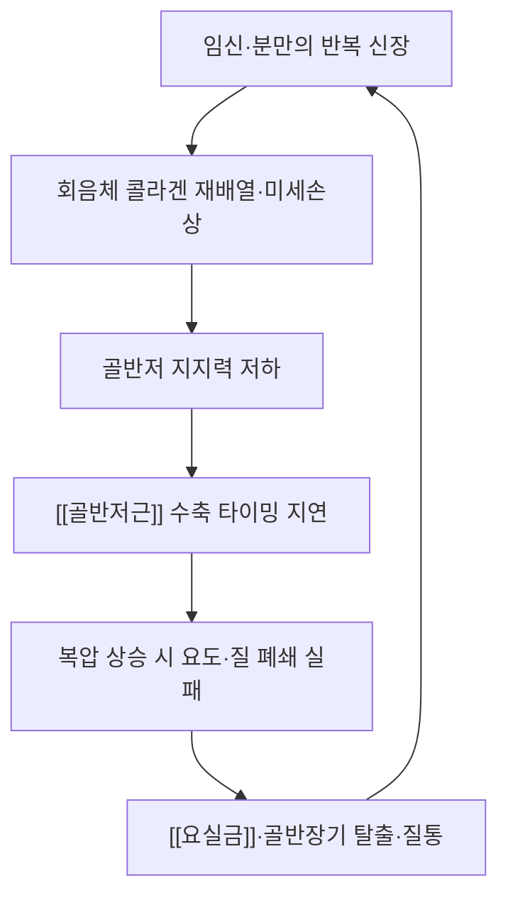

# 🫁 회음부 (Perineum)

> 🖼️ 이미지: 여성 회음부 골반저 근육 도해 1장 수록 (OpenStax, CC BY 4.0). 시술·수기 실사는 [[회음부 마사지]]·[[회음절개술]] 노트에 각각 배치했다.

> **핵심 요약 (Key Summary)**:
> [[회음부]]는 골반 출구를 아래에서 막는 마름모꼴 연조직 구역으로, 전방의 비뇨생식삼각과 후방의 항문삼각으로 나뉜다. 중심에는 회음체가 있어 질·요도·항문의 괄약 기능과 골반저 지지를 하나로 묶는다. 분만 손상의 주 무대이며, [[골반저근]] 약화·[[요실금]]·질통의 해부학적 출발점이다.

---

## 📌 목차
1. [해부학적 정밀 구조 및 지배 신경/혈관](#1-해부학적-정밀-구조-및-지배-신경혈관)
2. [생체역학·토크 분석 & 근막 사슬](#2-생체역학토크-분석--근막-사슬)
3. [근막통증증후군(TP) & 연관통 패턴](#3-근막통증증후군tp--연관통-패턴)
4. [중재 시술 랜드마크와 안전 마진](#4-중재-시술-랜드마크와-안전-마진)
5. [⭐ 원장님 심층 임상 고찰](#5--원장님-심층-임상-고찰)
6. [관련 임상 질환 총괄](#6-관련-임상-질환-총괄)
7. [한의 치료·재활 프로토콜](#7-한의-치료재활-프로토콜)
8. [출처 및 학술 참고 문헌](#8-출처-및-학술-참고-문헌)

---

## 1. 해부학적 정밀 구조 및 지배 신경/혈관

![[회음부_01_여성골반저_근육도해.png|450]]
> [그림 1: 여성 회음부의 표재 근육과 중심 구조 — 음핵·요도구·질구·항문, 좌해면체근·구해면체근·천회음횡근·외항문괄약근, 후방의 항문거근과 미골이 표시되어 있다 — 출처: OpenStax Anatomy and Physiology (CC BY 4.0)]

| 항목 | 상세 내용 |
| :--- | :--- |
| **경계 (Boundary)** | 전방 치골결합, 양측 좌골결절, 후방 미골을 잇는 마름모. 회음체를 잇는 선으로 전방 비뇨생식삼각과 후방 항문삼각을 구분 |
| **중심 구조** | 회음체 — 구해면체근·천회음횡근·외항문괄약근·항문거근이 교차 부착하는 섬유성 건판 |
| **표재 근육** | 구해면체근, 좌해면체근, 천회음횡근, 외항문괄약근 |
| **심부 근육** | 심회음횡근, 요도괄약근, [[골반저근]](항문거근 — 치골미골근·치골직장근·장골미골근) |
| **신경 지배** | [[음부신경]](S2–S4) — 하직장신경·회음신경·음핵등신경. 항문거근은 S3–S4 직접 가지와 음부신경 가지의 이중 지배 |
| **혈관 공급** | 내음부동맥(내장골동맥 가지) → 하직장동맥·회음동맥·음핵동맥. 정맥은 내음부정맥으로 환류 |

* **층 구조**: 피부 → 표재 회음막(Colles 근막) → 표재 근육층 → 심회음막 → 심부 근육·골반저. 회음체는 이 층들을 관통해 하나의 기능 단위로 묶는다.
* **여성 특유 구조**: 질구와 요도구가 비뇨생식삼각에 함께 놓여 회음체가 질·요도 지지의 공통 앵커 역할을 한다. 남성에서는 회음체가 얇아 같은 손상에도 임상 파급이 작다.

---

## 2. 생체역학·토크 분석 & 근막 사슬

* **앵커 기능**: 회음체는 전방(질·요도)과 후방(항문직장) 힘선의 교차점이다. 복압이 오르면 항문거근이 앞뒤로 당기고 회음체가 이를 고정해 요도·질을 폐쇄 방향으로 압박한다.
* **신장-회복 곡선**: 질식분만 시 회음부 연조직은 원래 길이의 수 배까지 신장된다. 콜라겐 섬유의 재배열과 점탄성 이완이 충분하면 열상이 국소에 그치고, 급격한 신장·조직 저항이 크면 [[회음열상]] 3·4도로 이행한다.
* **근막 사슬**: 회음체는 질벽 근막과 항문거근 근막, 천골결절인대 계열과 기능적으로 연결되어, 만성 골반저 긴장은 요추-천장관절 긴장과 동반되기 쉽다.

---

## 3. 근막통증증후군(TP) & 연관통 패턴

* **호발 발통점**: 구해면체근·천회음횡근·항문거근(특히 치골직장근 슬링). 질벽 촉진 시 압통점과 연관통이 재현된다.
* **연관통 양상**: 질통·외음부 작열·회음부 둔통, 항문 직장 이물감, 빈뇨·잔뇨감, 천골 하부 통증. 만성 골반통에서는 복직근·내전근 긴장이 동반되는 경우가 많다.
* **감별 포인트**: 신경 포착성 통증은 [[음부신경]] 주행(좌골극·Alcock 관) 압통과 좌위 악화가 특징이고, 근막성은 촉진으로 국소 재현이 된다.

---

## 4. 중재 시술 랜드마크와 안전 마진

* **랜드마크**: 좌골결절과 항문 사이의 중간점이 음부신경 차단·자극의 표준 지점이다. 회음체는 질구 후방 1~2 cm, 항문 전방 1~2 cm 사이에 위치한다.
* **침·약침 시 안전 마진**: 회음부는 점막과 얇은 피부가 겹쳐 자극량을 낮게 잡고, 요도구·음핵 감각신경을 피한다. 항문직장 쪽은 세균 오염 위험이 있어 소독과 자극 깊이를 엄격히 관리한다.
* **금기**: 임신 중 질 출혈·파수·조기진통, 급성 질염·헤르페스 병변, 산후 창상 미치유 상태.

---

## 5. ⭐ 원장님 심층 임상 고찰

* 산전·산후 여성 환자를 볼 때 회음부는 시진만으로 끝내지 말고, 골반저 수축 지시(켜겔 유사 지시)로 회음체의 상승 여부를 촉진해 확인하면 [[골반저근]] 기능 평가가 훨씬 구체화된다.
* 회음부 통증 호소에서 원인을 찾지 못할 때는 좌위 시간·자전거·승마 등 직접 압박력을 먼저 문진하라. 압박력 교정만으로 절반이 좋아진다.
* 산욕기 회음 통증은 창상 감염과 신경 포착을 반드시 감별한다. 발적·분비물·발열이 있으면 창상 문제, 통증이 좌위에서 악화되고 감각 이상이 동반되면 [[음부신경]] 문제다.

---

## 6. 관련 임상 질환 총괄

| 임상 질환 / 증후군 | 병리적 연관 기전 | 주요 증상 및 평가 | 핵심 교정 타깃 |
| :--- | :--- | :--- | :--- |
| [[회음열상]] | 분만 시 회음체·괄약근 신장 파열 | 열상 정도(1~4도), 봉합 여부, 대변 실금 | 회음체 회복, 골반저 재교육 |
| [[회음절개술]] | 의인성 절개로 출구 확장 | 창상 통증, 봉합 부위 당김 | 절개 적응증 최소화, 창상 관리 |
| [[골반저근]] 약화 | 신장 손상·탈신경 | 요실금, 탈출감, 성기능 저하 | 골반저 근력·지구력 훈련 |
| [[요실금]] | 요도 지지·괄약압 저하 | 기침·재채기 시 누출 | 복압성/절박성 감별 후 훈련 |
| 만성 회음부 통증 | 근막 발통점·음부신경 포착 | 좌위 악화, 작열감 | 발통점 치료, 압박력 교정 |

---

## 7. 한의 치료·재활 프로토콜

* **경혈 매핑**: 회음(CV1)은 회음부 중심에 위치하며 산후 회음부 통증·국소 순환에 응용한다. 골반저 긴장에는 천추 하부 배수혈과 태충(LR3)·삼음교(SP6)를 변증에 따라 가한다. 혈자리는 노트 표기 관례상 순수 텍스트로 둔다.
* **침·전침**: 회음부 직접 자침은 점막 손상·감염 위험 때문에 침 치료에서는 신중히 접근하고, 천골 신경분절(차료 BL32·중료 BL33) 자극과 [[전침]]으로 대체하는 편이 안전하다.
* **도수·운동**: 골반저 수축-이완 호흡 훈련, 복압 관리 교육, [[바이오피드백]]을 병용하면 수축 타이밍 학습이 빨라진다.
* **산전 관리**: 임신 34주 이후 [[회음부 마사지]] 교육을 정규 항목으로 넣으면 [[회음열상]]·[[회음절개술]] 위험 감소에 도움이 된다.

---

* **양방 치료 & 의뢰 기준**:
  * **약물** — 회음부 통증에는 아세트아미노펜·NSAIDs를 단기 사용하고, 신경병성 통증이 의심되면 전문과로 넘긴다.
  * **시술** — 음부신경 차단·펄스 고주파가 난치성 음부신경통에 사용된다.
  * **수술 적응증** — 3·4도 열상의 즉시 봉합, 골반장기 탈출 증상이 심한 경우 수술적 교정.
  * **의뢰 트리거** — 산후 발열·악취 분비물(창상 감염), 대변 실금(괄약근 손상), 진행하는 감각 저하.

## 8. 출처 및 학술 참고 문헌

1. **Standring, S. (2020)**. *Gray's Anatomy: The Anatomical Basis of Clinical Practice* (42nd ed.). Elsevier.
   * [연구 요약] 회음부 층 구조·근육 부착·음부신경 분지의 표준 해부학 기술.
2. **OpenStax (2016)**. *Anatomy and Physiology*, Chapter 11. The Muscular System — Muscles of the Pelvic Floor and Perineum. [OpenStax](https://openstax.org/books/anatomy-and-physiology/pages/11-5-muscles-of-the-pelvic-floor-and-perineum)
   * [연구 요약] 여성·남성 회음부 근육의 배열과 작용을 도해로 정리한 공개 교재(CC BY 4.0). 본 노트 그림 1의 출처.
3. **Travell, J. G., & Simons, D. G. (1999)**. *Myofascial Pain and Dysfunction: The Trigger Point Manual*, Vol. 1.
   * [연구 요약] 골반저근 발통점의 촉진법과 연관통 분포 기술.
