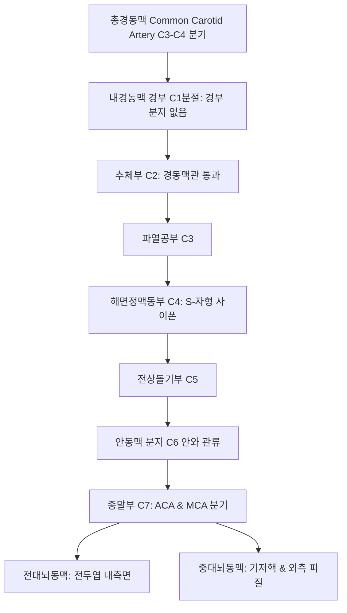
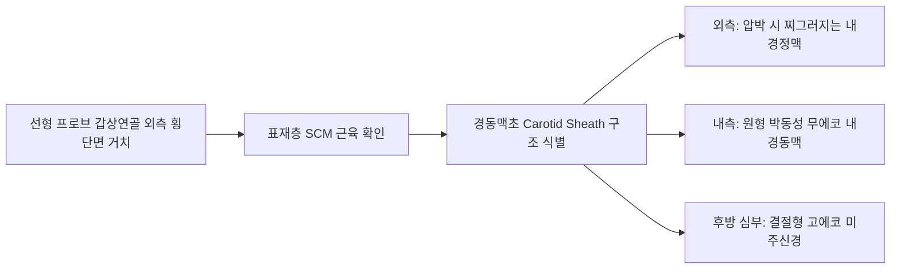

# 내경동맥 (Internal Carotid Artery: Anatomy, Hemodynamics & Clinical Interventions)

> **핵심 임상 요약 (Key Clinical Summary)**:
> - **해부학적 기원 및 무분지 주행**: [[총경동맥]]에서 C3-C4(갑상연골 상연) 높이에서 분기하며, 경부에서는 분지하지 않고 곧장 두개저 경동맥관(Carotid canal)으로 진입하는 것이 [[외경동맥]]과의 결정적 감별점이다.
> - **두개내 주행과 윌리스 환 기여**: 두개강 내로 진입하여 해면정맥동(Cavernous sinus) 내에서 S-자형 사이폰(Carotid siphon)을 형성하고, 안동맥·후교통동맥 분지 후 전대뇌동맥([[ACA]])과 중대뇌동맥([[MCA]])으로 종지하여 대뇌 반구 전방 2/3의 관류를 전담한다.
> - **혈류역학적 특성**: 뇌실질의 지속적 대사를 지원하기 위해 확장기에도 혈류가 끊기지 않는 전형적인 저저항성 파형(Low-resistance waveform)을 나타낸다.
> - **경부 자침의 절대 안전 원칙**: [[인영]](ST9), [[부돌]](LI18), [[천정]](LI17) 자침 시 반드시 박동을 촉진하여 경동맥초(Carotid sheath)를 외측 또는 내측으로 밀어낸 뒤 자침하며, 혈관 직자를 엄금한다.
> - **혈관성 경부통 감별**: 외상력이나 경돌기 신장([[이글증후군]])으로 인한 [[경동맥 박리]](Carotid artery dissection)는 급성 후두통·호너증후군을 유발하므로 근골격계 경부통과 감별하여 즉시 의뢰한다.

---

## 1. 해부학적 기원·주행 경로 및 분지 체계 (Anatomical Pathway & Branches)
내경동맥(Internal Carotid Artery, ICA)은 인체 뇌혈류의 70% 이상을 공급하는 핵심 간선 동맥이다.

- **경부 분절 (Cervical segment, C1)**:
  - [[흉쇄유돌근]](SCM) 전연 심부, 경동맥삼각(Carotid triangle) 내에서 주행한다.
  - 경동맥초(Carotid sheath) 내에서 [[내경정맥]]의 내측, [[10. 미주신경|미주신경]]의 전내측에 위치한다.
  - 경부에서는 단 하나의 분지도 내지 않고 곧장 두개골 기저부로 향한다.
- **두개내 분절 (C2~C7)**:
  - 측두골 바위부분의 경동맥관을 관통한 뒤 해면정맥동 내벽을 따라 주행한다.
  - 주요 분지: 안동맥(Ophthalmic artery), 후교통동맥(PCoA), 전맥락총동맥(Anterior choroidal artery).

---

## 2. 혈류역학·관류 영역 및 주변 근막·근육 연계 (Hemodynamics & Perfusion)
내경동맥은 고도의 뇌 대사를 유지하기 위해 특화된 혈류역학적 메커니즘을 구비하고 있다.

- **저저항 혈관상 (Low-Resistance Vascular Bed)**:
  - 뇌혈관 저항이 낮기 때문에 수축기 피크 혈류(PSV 60~100 cm/s)뿐만 아니라 확장기 말기 혈류(EDV 20~40 cm/s)가 풍부하게 유지되는 저저항 파형을 형성한다.
  - 저항지수(Resistive Index, RI)는 정상적으로 0.55~0.70 범위를 유지한다.
- **경부 심부 근막과의 연계**:
  - 경동맥초는 경부 심부근막(Deep cervical fascia)의 천층·기관전층·추골전층이 융합된 결합조직 초이다.
  - [[사각근]], [[두장근]], [[경장근]]의 과긴장은 경동맥초의 가동성을 제한하여 미세 혈류 장애를 유발할 수 있다.

---

## 3. 혈관성 박동 촉진·청진 및 이학적 검사 (Physical Examination & Pulsation)
경부 혈관 진찰은 뇌허혈 질환 선별과 한의 자침 안전성을 확보하는 필수 관문이다.

- **박동 촉진 (Palpation)**:
  - 갑상연골 상연 높이, [[흉쇄유돌근]] 전연 내측에서 총경동맥 및 내경동맥 기저부 박동을 부드럽게 촉지한다.
  - 양측을 동시에 강하게 압박하면 경동맥동 반사(Carotid sinus reflex)로 인한 서맥 및 실신이 발생할 수 있으므로 편측씩 검사한다.
- **혈관 잡음 청진 (Bruit Auscultation)**:
  - 청진기 종형(Bell)을 하악각 하방에 가볍게 대고 환자에게 숨을 참게 한 뒤 청진한다.
  - 수축기 잡음(Systolic bruit)이 들릴 경우 50% 이상의 내경동맥 협착을 의심한다.

---

## 4. 초음파 해부학(Sonoanatomy) 및 도플러 혈류 랜드마크 (Ultrasound & Doppler)
초음파는 경동맥 협착과 경부 심부 자침 시 혈관 손상을 방지하는 골든 스탠다드 도구이다.

- **초음파 감별 포인트**:
  - [[내경동맥]]은 [[외경동맥]]에 비해 구경이 더 크고, 대개 외후방에 위치하며 경부 분지가 없다.
  - 컬러 도플러 상 수축기와 확장기 모두 지속적인 전방 혈류 신호가 관찰된다.

---

## 5. ⭐ 원장님 심층 임상 고찰 및 원본 필기 (Clinical Pearls & Melt-In)
- **경부 자침의 최우선 안전 원칙**:
  - 경부 전외측의 혈자리인 [[인영]](ST9), [[부돌]](LI18), [[천정]](LI17) 자침 시 박동을 손가락으로 먼저 확인한 뒤, 검지와 중지로 경동맥초를 반대 방향으로 밀어 공간을 확보하고 자침한다.
  - 박동이 느껴지는 혈관 벽을 직접 관통하는 행위는 절대 금기이다.
- **혈관성 경부통과 경동맥 박리 감별**:
  - 외상력, 카이로프랙틱 과회전 조작, 또는 [[경돌기]]가 비정상적으로 신장된 [[이글증후군]] 환자에서 경돌기가 내경동맥을 자극하여 박리를 유발할 수 있다.
  - 일측성 경부통과 함께 동측 안검하수·축동([[호너증후군]])이 동반되면 즉시 뇌혈관 응급 영상(CTA/MRA)을 의뢰해야 한다.
- **해부학적 변이 주의**:
  - 내경동맥의 분기 높이는 교과서적으로 C3-C4이지만 고위 분기(C2) 또는 저위 분기(C5) 변이가 20% 이상 존재하므로 맹목적 자침을 지양한다.

---

## 6. 관련 임상 질환 및 허혈·압박·혈전 증후군 (Pathology & Entrapment)
- **경동맥 죽상경화증 및 협착증**:
  - 분기부의 와류(Turbulence)로 인해 플라크가 호발하며, 색전 탈락 시 일과성 뇌허혈발작([[TIA]]) 및 [[뇌경색]]을 초래한다.
- **경동맥 박리 (Carotid Artery Dissection)**:
  - 혈관 내막 파열로 가강(False lumen)이 형성되어 뇌혈류가 차단되는 질환으로 젊은 연령 뇌졸중의 주요 원인이다.
- **섬유근이형성증 (FMD)**:
  - 비죽상경화성 혈관벽 비후로 혈관 조영 상 '염주알 모양(String of beads)'을 나타낸다.

---

## 7. 한의 통합 혈관·신경 치료 프로토콜 (추나·초음파 약침·침구·한약)
- **경부 추나 시 혈관 보호 원칙**:
  - 경추 고속저진폭(HVLA) 스러스트 시 경추의 과도한 회전과 신전 결합을 배제하여 경동맥 및 [[추골동맥]]에 가해지는 회전 전단력을 최소화한다.
- **심부 근막 이완 침구 요법**:
  - [[풍지]](GB20), [[천주]](BL10), [[완골]](GB12) 등 후두하근막 부착부를 자침하여 뇌혈류 유입 저항을 줄인다.
- **초음파 유도하 약침 치료**:
  - 경동맥초 후외측의 경동맥교감신경총(Carotid plexus) 주변에 [[황련해독탕]] 또는 [[자하거약침]]을 안전하게 소량 주입하여 혈관 긴장도를 정상화한다.
- **혈관 건강 한약 처방**:
  - 미세혈관 순환 장애와 동맥경화 예방을 위해 [[보양환오탕]], [[당귀수산]], [[단삼]] 제제를 변증 투여한다.

---

## 8. 실존 임상 연구 논문 요약 (Evidence-Based Research)

- Hayashi S et al. (2023). Internal carotid artery dissection caused by elongated styloid process. *Auris Nasus Larynx*. 50(6):968-972. PMID: 36764863
  - [연구 요약] 신장된 경돌기(Eagle syndrome)가 내경동맥을 기계적으로 압박·손상시켜 경동맥 박리와 급성 허혈성 뇌졸중을 유발한 증례를 분석하고 임상적 감별 기준 제시.

- Rudnay M et al. (2023). Internal carotid artery anatomy - not always straightforward. *Vascular*. 31(3):551-553. PMID: 34983265
  - [연구 요약] 내경동맥의 해부학적 주행 변이(Kinking, Coiling, Tortuosity)가 경부 중재 시술 및 혈관 수술에 미치는 위험 요인을 임상 영상으로 체계적으로 고찰.
