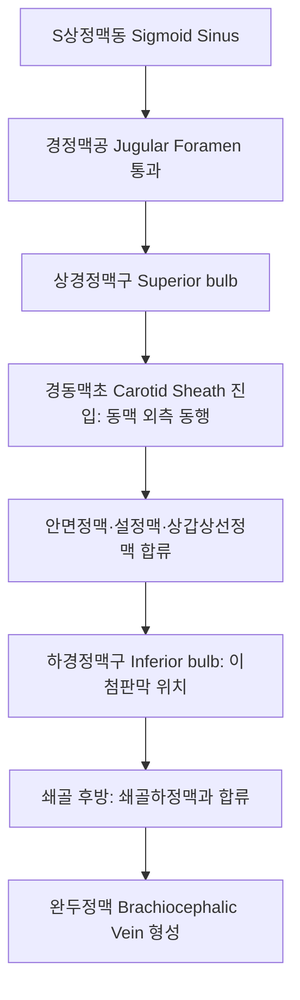

# 내경정맥 (Internal Jugular Vein: Anatomy, Hemodynamics & Clinical Interventions)

> **핵심 임상 요약 (Key Clinical Summary)**:
> - **해부학적 기원 및 주행**: 두개저 경정맥공(Jugular foramen)에서 S상정맥동의 연속으로 시작하여, 경동맥초(Carotid sheath) 내에서 [[내경동맥]] 및 [[총경동맥]]의 외측에 위치하며 쇄골 후방에서 쇄골하정맥과 합류하여 완두정맥을 형성한다.
> - **뇌 정맥혈 환류의 핵심**: 두개강 내 정맥혈의 70~80%를 심장으로 환류시키는 주 배동관으로, 쇄골 상방 2~3cm 지점에 이첨판막(Bicuspid valve)을 보유하여 흉강내압 상승 시 역류를 방지한다.
> - **중심정맥압(JVP)의 임상적 지표**: 우심방 압력 변화를 정밀하게 반영하여 심부전, 체액 과다, 심장 눌림증(Tamponade) 감별의 핵심 진찰 창구 역할을 수행한다.
> - **초음파 랜드마크와 허탈성**: [[흉쇄유돌근]] 쇄골두와 흉골두 사이 삼각에서 가벼운 탐촉자 압박에도 쉽게 찌그러지는(Collapsible) 얇은 벽의 무에코 타원형 구조물이다.
> - **임상 안전 및 한의 연계**: 경부 심부 침도 및 약침 시술 시 천자 손상에 의한 혈종 형성을 방지하고, SCM과 [[사각근]] 이완을 통해 경부 정맥 유출 장애(Thoracic outlet outflow restriction)를 해소한다.

---

## 1. 해부학적 기원·주행 경로 및 분지 체계 (Anatomical Pathway & Branches)
내경정맥(Internal Jugular Vein, IJV)은 두경부 정맥계의 중심 줄기이다.

- **경동맥초(Carotid Sheath) 내 3차원 위치**:
  - [[총경동맥]]의 외측면을 덮듯이 주행하며, [[10. 미주신경|미주신경]]은 이 두 혈관 사이 후방 고랑에 위치한다.
  - 상부에서는 내경동맥의 외후방에 위치하다가 하부로 내려오면서 총경동맥의 전외측으로 교차한다.
- **주요 유입 정맥 (Tributaries)**:
  - 안면정맥(Facial vein), 설정맥(Lingual vein), 상/중갑상선정맥, 인두정맥총이 합류한다.

---

## 2. 혈류역학·관류 영역 및 주변 근막·근육 연계 (Hemodynamics & Perfusion)
내경정맥의 혈류역학은 흉강내압과 중력, 경부 근막의 장력에 직접적인 영향을 받는다.

- **흉강 흡인력과 정맥 판막**:
  - 흡기 시 흉강 내 음압에 의해 혈류가 심장으로 빨려 들어가며 직경이 감소하고, 호기 시나 발살바(Valsalva) 조작 시 직경이 크게 팽창한다.
  - 하경정맥구 판막은 기침이나 복압 상승 시 뇌정맥동으로의 혈액 역류를 방지한다.
- **주변 근막 및 근육과의 역학적 관계**:
  - [[흉쇄유돌근]](SCM)의 깊은 면에 밀착되어 주행하므로, SCM의 만성 단축이나 섬유화는 내경정맥을 외인성으로 압박하여 두개내 정맥혈 배출 저항을 증가시킨다.

---

## 3. 혈관성 박동 촉진·청진 및 이학적 검사 (Physical Examination & Pulsation)
- **경정맥압(Jugular Venous Pressure, JVP) 측정**:
  - 환자를 45도 반좌위로 눕히고 흉골각(Angle of Louis)으로부터 내경정맥 맥파의 최고점 높이를 측정한다(정상 3~4cm 이하).
  - 간경정맥 역류 검사(Hepatojugular reflux)에서 지속적인 JVP 상승은 우심부전을 시사한다.
- **동맥 박동과의 감별**:
  - 정맥 박동은 1회 심박동마다 2봉성 파형(a, v 파)을 보이며, 촉진되지 않고 시각적으로만 관찰되며, 가벼운 손가락 압박으로 소실된다.

---

## 4. 초음파 해부학(Sonoanatomy) 및 도플러 혈류 랜드마크 (Ultrasound & Doppler)
초음파는 내경정맥의 개통성과 중심정맥관 삽입, 경부 침도 안전을 확보하는 핵심 수단이다.

- **초음파 영상 특성**:
  - 횡단면에서 얇고 부드러운 벽을 가진 무에코 타원형으로 관찰된다.
  - 가벼운 탐촉자 압박에 의해 완전히 허탈(Complete collapse)되는 것으로 내측의 박동성 [[총경동맥]]과 즉각 감별된다.
  - 도플러 상 심장 박동 및 호흡 주기에 따라 변동하는 연속성 저속 혈류 파형을 나타낸다.

---

## 5. ⭐ 원장님 심층 임상 고찰 및 원본 필기 (Clinical Pearls & Melt-In)
- **경부 측면 자침 시 정맥혈종 방지**:
  - [[인영]](ST9), [[천정]](LI17), [[천용]](SI16) 등 경부 혈자리 자침 시 동맥뿐 아니라 외측의 내경정맥 손상을 각별히 경계해야 한다.
  - 정맥은 벽이 얇아 무통성으로 천자될 수 있으며, 발침 후 압박 지혈이 불충분하면 심부 경부 혈종을 유발하여 기도를 압박할 위험이 있다.
- **두경부 정맥 울혈과 뇌압 상승 두통**:
  - [[경추]] 후관절 변위나 상부 흉곽출구 증후군 환자에서 정맥 유출로가 차단되면 아침에 일어날 때 머리가 무겁고 눈이 충혈되는 '정맥 울혈성 두통'이 호발한다.
  - SCM과 [[사각근]], 쇄골하근을 추나로 이완시키면 정맥 환류가 회복되어 두경부 압박감이 즉각 소실된다.

---

## 6. 관련 임상 질환 및 허혈·압박·혈전 증후군 (Pathology & Entrapment)
- **내경정맥 혈전증 (IJV Thrombosis)**:
  - 구강/인두 감염의 파급으로 인한 패혈성 혈전정맥염인 르미에르 증후군([[Lemierre 증후군]])이나 중심정맥 카테터 유치 합병증으로 발생한다.
- **내경정맥 협착증 (IJV Stenosis)**:
  - 경추 C1 횡돌기와 경돌기 사이에서 압박되어 두개내압 상승, 박동성 이명, 만성 피로를 유발한다.

---

## 7. 한의 통합 혈관·신경 치료 프로토콜 (추나·초음파 약침·침구·한약)
- **경부 정맥 림프 유출 추나 수기**:
  - 림프 정맥 배액(Lymphatic venous drainage) 기법을 적용하여 쇄골상와와 SCM 외측연을 따라 두부에서 흉곽 방향으로 완만한 경근 이완을 시행한다.
- **안전한 경부 침구 시술**:
  - 침도 시술 시 초음파로 내경정맥의 주행을 확인하고 프로브 가이드 하 평면 내(In-plane) 기법으로 혈관 외측 경계를 명확히 회피한다.
- **활혈거어 한약 요법**:
  - 정맥 울혈과 혈전 경향 해소를 위해 [[당귀수산]], [[계지복령환]], [[단삼]] 추출물을 처방한다.

---

## 8. 실존 임상 연구 논문 요약 (Evidence-Based Research)

- Farhadi E et al. (2026). Comparative outcomes of central venous access via open jugular and ultrasound-guided subclavian approaches in low-weight pediatric patients: a study with secondary outcomes. *BMC Surg*. 26(1):. PMID: 42881459
  - [연구 요약] 초음파 유도하 경정맥 및 쇄골하 정맥 접근법의 혈관 개통성, 혈전 형성 합병증 및 시술 안전성을 임상 비교 분석.

- Erdal Sayın S et al. (2026). Case Report: Subclavian Pseudoaneurysm Treated With Thrombin Injection. *Catheter Cardiovasc Interv*. 108(4):1707-1711. PMID: 42634998
  - [연구 요약] 경부-쇄골하 혈관 합류부 복합 혈관 병변의 초음파 감별 및 경피적 중재술의 임상 치료 프로토콜 보고.
