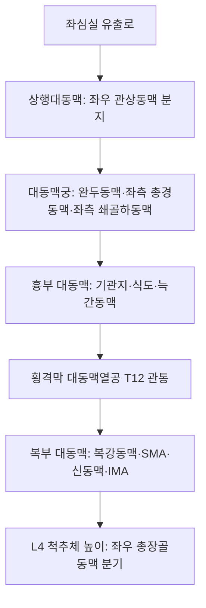

# 대동맥 (Aorta: Anatomy, Hemodynamics & Clinical Interventions)

> **핵심 임상 요약 (Key Clinical Summary)**:
> - **해부학적 기원 및 주행**: 좌심실에서 기시하여 상행대동맥 $
ightarrow$ 대동맥궁 $
ightarrow$ 흉부 하행대동맥을 거쳐 횡격막 대동맥열공(T12)을 통과한 뒤, 복부 대동맥(Abdominal aorta)으로서 척추체 전면을 주행하다 L4 높이에서 양측 [[총장골동맥]]으로 분기한다.
> - **윈드케셀 효과(Windkessel Effect)**: 심실 수축기 혈액을 탄성 저장했다가 확장기에 전신으로 지속 관류시키는 완충 작용을 수행하며, 동맥경화 시 맥압이 증가하고 말초 혈관 손상이 가속화된다.
> - **복부 대동맥류(AAA) 감별과 레드플래그**: 배꼽 주변에서 박동성 종괴가 촉진되고 원인 불명의 급격한 요배통이 발생할 경우 대동맥류 파열 위험을 즉시 의심하고 응급 전원해야 한다.
> - **복벽 자침의 안전 심도**: [[중완]](CV12), [[하완]](CV10), [[기해]](CV6) 등 복부 정중선 혈자리 자침 시 환자의 체간 두께와 초음파 계측을 바탕으로 대동맥 벽 손상을 철저히 배제한다.
> - **한의 통합 심혈관 관리**: 복대동맥 주변 복강신경총 이완 추나와 활혈거어 한약([[단삼보심탕]], [[보양환오탕]])을 병용하여 전신 동맥 탄성도를 보존한다.

---

## 1. 해부학적 기원·주행 경로 및 분지 체계 (Anatomical Pathway & Branches)
대동맥(Aorta)은 인체 순환계의 중심 간선 도관이다.

- **복부 대동맥의 분지 (Abdominal Branches)**:
  - 장기 관류 내장 분지: 복강동맥(Celiac trunk, T12), 상장간막동맥([[SMA]], L1), 신동맥(Renal artery, L1-L2), 하장간막동맥([[IMA]], L3).
  - 체벽 관류 분지: 요동맥(Lumbar arteries, L1-L4 분절별 주행), 정중천골동맥(Median sacral artery).

---

## 2. 혈류역학·관류 영역 및 주변 근막·근육 연계 (Hemodynamics & Perfusion)
- **혈류역학 및 탄성 역학**:
  - 직경은 흉부에서 약 25mm, 복부에서 약 18~20mm로 원위부로 갈수록 감소한다.
  - 높은 엘라스틴 섬유 함량으로 혈압 충격을 흡수하며, 맥파전달속도(Pulse Wave Velocity, PWV)는 혈관 노화의 핵심 척도이다.
- **척추 및 복부 근육과의 해부학적 인접성**:
  - 요추 척추체 전외측면에 밀착 주행하며, 우측에는 [[하대정맥]](IVC), 양측 외측에는 [[장요근]]과 교감신경간이 주행한다.
  - 요추 전만각의 변화나 추체 골극(Osteophyte) 형성은 대동맥 후벽에 물리적 자극을 줄 수 있다.

---

## 3. 혈관성 박동 촉진·청진 및 이학적 검사 (Physical Examination & Pulsation)
- **복부 박동 촉진 (Abdominal Palpation)**:
  - 배꼽 상방 2~3cm, 정중선 약간 좌측에서 양손을 가볍게 대고 복부 대동맥의 폭을 측정한다.
  - 정상 성인에서 촉진되는 대동맥 폭은 2.5cm 이하이며, 3.0cm 이상으로 넓게 벌어지며 외측 팽창성 박동(Expansile pulsation)이 감지되면 복부 대동맥류(AAA)를 강하게 시사한다.
- **혈관 잡음 청진**:
  - 심와부와 양측 측복부(신동맥 부위)에서 수축기 잡음을 청진하여 신동맥 협착 및 죽상경화증을 선별한다.

---

## 4. 초음파 해부학(Sonoanatomy) 및 도플러 혈류 랜드마크 (Ultrasound & Doppler)
초음파는 복부 대동맥류 선별의 1차 표준 영상 검사이다.

- **초음파 영상 특성**:
  - 횡단 스캔에서 척추체 음영(Vertebral body shadow) 직전방, 하대정맥의 좌측에 두껍고 고에코인 벽을 가진 박동성 원형 혈관으로 관찰된다.
  - 내경을 외벽-외벽(Outer-to-outer) 기준으로 측정하여 30mm 이상일 때 동맥류로 진단한다.
  - 도플러 상 수축기 급상승, 초기 확장기 역류, 후기 확장기 전방 혈류를 보이는 전형적인 고저항성 삼상 파형(Triphasic waveform)을 나타낸다.

---

## 5. ⭐ 원장님 심층 임상 고찰 및 원본 필기 (Clinical Pearls & Melt-In)
- **임상 한의사를 위한 대동맥류 레드플래그**:
  - 65세 이상 고령자, 흡연력, 고혈압 병력이 있는 환자가 과거력 없는 심한 요통이나 둔부통을 호소하며 내원할 때, 척추 질환으로 예단하기 전 반드시 복부 대동맥 박동을 촉진해야 한다.
  - 박동성 복부 종괴와 함께 저혈압, 실신 징후가 동반되면 대동맥류 절박 파열 상태이므로 즉시 119 구급대를 호출해야 한다.
- **복부 침구 시술의 안전 수기**:
  - [[중완]](CV12), [[수분]](CV9), [[기해]](CV6) 등 복부 정중선 자침 시 마른 체형 환자에서는 복벽 두께가 2~3cm에 불과할 수 있으므로, 40mm 이상의 장침 직자를 엄금하고 15~25mm 사자 또는 횡자를 적용한다.

---

## 6. 관련 임상 질환 및 허혈·압박·혈전 증후군 (Pathology & Entrapment)
- **복부 대동맥류 (Abdominal Aortic Aneurysm, AAA)**:
  - 동맥벽 중막의 탄성 섬유 파괴로 직경이 50% 이상 영구 확장되는 질환으로, 5.5cm 이상 시 파열 위험이 급증한다.
- **대동맥 박리 (Aortic Dissection)**:
  - 내막 파열로 중막이 찢어지며 흉배부로 뻗치는 극심한 칼로 찢는 듯한 통증(Tearing pain)이 특징이다.
- **대동맥폐색증 (Leriche 증후군)**:
  - 복대동맥 분기부의 죽상경화성 완전 폐색으로 둔부 파행, 대퇴맥박 소실, 발기부전 3대 증상을 유발한다.

---

## 7. 한의 통합 혈관·신경 치료 프로토콜 (추나·초음파 약침·침구·한약)
- **복강 혈류 순환 추나요법**:
  - 횡격막 호흡 유도와 복부 장간막 이완 수기(Visceral manipulation)를 통해 대동맥열공 부위의 압박을 해소하고 하지 말초 순환을 촉진한다.
- **배수혈 및 자율신경 조절 침구**:
  - 흉추 배수혈인 [[궐음수]](BL14), [[심수]](BL15), [[간수]](BL18)에 온침 및 전침을 적용하여 심장 혈관 교감신경 긴장도를 낮춘다.
- **혈관 내피 보호 한약**:
  - 죽상경화반 안정화와 동맥 탄성 보존을 위해 [[단삼]], [[삼칠근]], [[작약감초탕]]을 합방하여 처방한다.

---

## 8. 실존 임상 연구 논문 요약 (Evidence-Based Research)

- Ramesh R et al. (2026). Guideline-based screening for abdominal aortic aneurysms is significantly underperformed and possibly impacted by medical comorbidities. *J Vasc Surg*. 83(3):953-960.e2. PMID: 41167381
  - [연구 요약] 복부 대동맥류 초음파 선별 가이드라인의 임상 준수 현황과 만성 질환 동반 환자에서의 선별 초음파 조기 발견 유효성 규명.

- Patel N et al. (2023). Identification and characterization of new candidates for abdominal aortic aneurysm screening in patients outside of current accepted guidelines. *J Vasc Surg*. 78(1):89-95.e2. PMID: 36893948
  - [연구 요약] 전통적 위험인자 외 요통 및 말초동맥 질환 환자에서 복부 대동맥류 초음파 스크리닝의 진단적 확대 필요성 입증.
