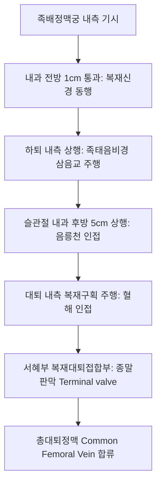

# 대복재정맥 (Great Saphenous Vein: Anatomy, Hemodynamics & Clinical Interventions)

> **핵심 임상 요약 (Key Clinical Summary)**:
> - **해부학적 기원 및 주행**: 족배정맥궁 내측에서 시작하여 내과(Medial malleolus) 전방 1cm를 지나 하퇴와 대퇴 내측면을 상행한 뒤, 서혜인대 하방의 난원와(Fossa ovalis)에서 대퇴정맥으로 합류하는 인체 최장의 표재정맥이다.
> - **복재구획과 이집트의 눈(Egyptian Eye)**: 천근막과 심근막 사이에 형성된 독립된 '복재구획(Saphenous compartment)' 내에 주행하여 초음파 횡단면에서 전형적인 타원형 안구 형태의 랜드마크를 형성한다.
> - **하지정맥류(Varicose Veins)의 주범**: 복재대퇴접합부([[SFJ]]) 종말판막 부전으로 혈액이 역류(역류시간 > 0.5초)할 때 하지 정맥 고혈압, 부종, 중압감, 피부 착색 및 궤양을 유발한다.
> - **복재신경(Saphenous Nerve)과의 밀접한 동행**: 하퇴 원위부와 족관절 내측에서 복재신경과 바로 인접하여 주행하므로 침도, 사혈, 정맥 시술 시 감각 이상 및 신경 손상을 철저히 예방해야 한다.
> - **한의 경락 및 치료 연계**: 족태음비경([[삼음교]], [[음릉천]], [[혈해]]) 주행로와 완벽히 궤를 같이하며, 종아리 근육펌프([[비복근]], [[가자미근]]) 이완 추나와 활혈거어 약침으로 정맥 순환을 회복시킨다.

---

## 1. 해부학적 기원·주행 경로 및 분지 체계 (Anatomical Pathway & Branches)
대복재정맥(Great Saphenous Vein, GSV)은 하지 정맥 질환의 80% 이상과 직결되는 핵심 도관이다.

- **주요 분지 및 결합 정맥**:
  - 전/후 부복재정맥(Anterior/Posterior accessory saphenous veins).
  - 서혜부 3대 분지: 천복벽정맥(Superficial epigastric), 천장골회선정맥(Superficial circumflex iliac), 외음부정맥(External pudendal).
  - 관통정맥(Perforator veins): 헌터 관통정맥(Hunterian), 도드 관통정맥(Dodd's), 보이드 관통정맥(Boyd's), 콕켓 관통정맥(Cockett's)을 통해 심부 대퇴정맥계와 연통한다.

---

## 2. 혈류역학·관류 영역 및 주변 근막·근육 연계 (Hemodynamics & Perfusion)
- **하지 정맥 환류 메커니즘**:
  - 중력을 거슬러 심장으로 올라가기 위해 정맥 내 10~20개의 일방통행성 이첨판막과 '제2의 심장'이라 불리는 종아리 근육펌프(Calf muscle pump)의 압축력에 전적으로 의존한다.
- **복재구획(Saphenous Compartment)의 역학적 의의**:
  - 근막 사이에 위치하여 정상 상태에서는 과도한 팽창이 억제되지만, 결합조직 탄성이 약화되거나 판막이 망가지면 지류 정맥(Tributary)으로 혈액이 넘쳐나 피하 혈관 돌출을 일으킨다.

---

## 3. 혈관성 박동 촉진·청진 및 이학적 검사 (Physical Examination & Pulsation)
- **트렌델렌버그 검사 (Trendelenburg Test)**:
  - 환자를 눕혀 하지를 거상한 뒤 서혜부 복재대퇴접합부를 압박하고 일어서게 하여, 압박 해제 시 혈액이 위에서 아래로 급격히 쏟아져 내리면 SFJ 판막 부전으로 확진한다.
- **타진 검사 (Schwartz Test)**:
  - 하퇴 정맥류를 가볍게 두드릴 때 서혜부 GSV에서 충격파가 역행성으로 감지되면 판막 부전을 시사한다.

---

## 4. 초음파 해부학(Sonoanatomy) 및 도플러 혈류 랜드마크 (Ultrasound & Doppler)
듀플렉스 혈관 초음파는 정맥 역류를 진단하는 절대적 표준 검사이다.

- **이집트의 눈 (Egyptian Eye) 징후**:
  - 대퇴부 횡단 스캔 시 천근막과 심근막 사이에 둘러싸인 GSV가 눈 모양을 나타낸다.
- **도플러 역류 기준**:
  - 환자를 기립시킨 상태에서 원위부 종아리를 쥐어짰다 놓았을 때(Augmentation), 역류 혈류(Retrograde flow) 지속 시간이 **0.5초 이상**이면 표재정맥 판막 부전(Venous reflux)으로 판정한다.

---

## 5. ⭐ 원장님 심층 임상 고찰 및 원본 필기 (Clinical Pearls & Melt-In)
- **족관절 내측 사혈 시 복재신경 손상 경계**:
  - 내과 전방의 대복재정맥 주행부는 한의학에서 습부항 사혈을 다용하는 부위이다.
  - 그러나 이 부위는 [[복재신경]](Saphenous nerve)의 말초 감각지가 정맥벽에 직접 부착되어 주행하므로, 무분별한 심부 자침이나 삼릉침 난자 시 족배 내측의 난치성 신경병증성 작열통을 유발할 수 있다.
- **경락 주행과 만성 정맥부전**:
  - 하지정맥류 및 림프 부종 환자의 90%는 [[족태음비경]] 라인([[삼음교]], [[지기]], [[음릉천]])을 따라 중압감과 산통(Aching)을 호소한다.
  - 비주운화(脾主運化), 비통혈(脾統血) 이론에 입각하여 비장 기능을 강화하고 수습을 배출시키는 치료가 필수적이다.

---

## 6. 관련 임상 질환 및 허혈·압박·혈전 증후군 (Pathology & Entrapment)
- **하지정맥류 및 만성 정맥부전증 (CVI)**:
  - CEAP 분류 C1(모세혈관확장)에서 C6(활동성 정맥성 궤양)까지 진행하며, 울혈성 피부염과 갈색 지방피부경화증(Lipodermatosclerosis)을 동반한다.
- **표재정맥 혈전염 (Superficial Thrombophlebitis)**:
  - 정맥 주행을 따라 단단하고 압통이 있는 붉은 삭상 결절(Cord-like induration)이 형성된다.

---

## 7. 한의 통합 혈관·신경 치료 프로토콜 (추나·초음파 약침·침구·한약)
- **종아리 펌프 회복 추나 및 MET**:
  - [[비복근]]과 [[가자미근]]의 발통점을 이완하고 족관절 배굴(Dorsiflexion) 수동 스트레칭을 통해 정맥 환류 효율을 40% 이상 증진시킨다.
- **부종 완화 전침 및 약침**:
  - [[음릉천]](SP9), [[족삼리]](ST36), [[승산]](BL57)에 2Hz 저주파 전침을 시술하여 근육의 주기적 수축을 유도한다.
  - 정맥벽 염증 완화를 위해 [[황련해독탕]] 또는 [[중성어혈약침]]을 주변 근막에 시술한다.
- **정맥판막 보존 한약 처방**:
  - 정맥벽 콜라겐 합성을 돕고 부종을 제거하기 위해 [[오령산]], [[방기황기탕]], [[보중익기탕]]을 가감 처방한다.

---

## 8. 실존 임상 연구 논문 요약 (Evidence-Based Research)

- Cheng Q et al. (2026). Comparing the Efficacy of Mechanochemical Ablation Versus Radiofrequency Ablation for Treating Great Saphenous Vein Incompetence: A Meta-Analysis. *Ann Vasc Surg*. 132:622-635. PMID: 42468801
  - [연구 요약] 대복재정맥 판막 부전 환자에서 기계화학적 폐쇄술과 고주파 혈관내 열절제술의 정맥 폐색률, 신경 손상 빈도 및 장기 임상 치료 효과 메타분석.

- Fan Y et al. (2026). Modification of endothermal heat-induced thrombosis follow-up strategy using a risk stratification model after endovenous thermal ablation. *Phlebology*. . PMID: 42784448
  - [연구 요약] 대복재정맥 열폐색술 후 발생하는 열유도성 혈전증(EHIT)의 위험 인자 분석 및 혈관 초음파 추적 관찰 임상 모델 제시.
