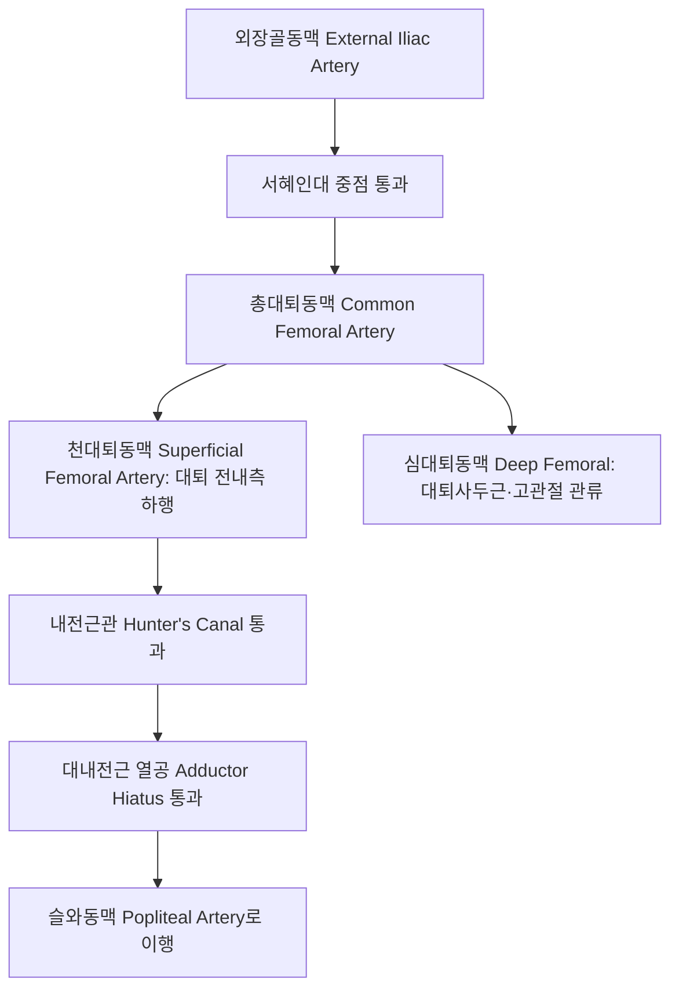

# 대퇴동맥 (Femoral Artery: Anatomy, Hemodynamics & Clinical Interventions)

> **핵심 임상 요약 (Key Clinical Summary)**:
> - **해부학적 기원 및 대퇴삼각 주행**: 외장골동맥이 서혜인대(Inguinal ligament) 중점을 통과하며 총대퇴동맥(CFA)으로 시작되어, 대퇴삼각(Femoral triangle)을 거쳐 천대퇴동맥(SFA)과 심대퇴동맥(Profunda femoris)으로 분지한 뒤 내전근열공(Adductor hiatus)을 지나 [[슬와동맥]]으로 이행한다.
> - **NAVEL 신경혈관 배열**: 서혜부에서 외측에서 내측 순서로 대퇴신경([[대퇴신경|Nerve]]) $
ightarrow$ 대퇴동맥(Artery) $
ightarrow$ 대퇴정맥(Vein) $
ightarrow$ 빈공간(Empty space) $
ightarrow$ 림프관(Lymphatics)으로 정렬된다.
> - **하지 동맥 관류의 절대 본간**: 하지 전체 산소 공급의 주 도관으로, 죽상경화성 말초동맥질환([[PAD]]) 시 보행 시 둔부·대퇴부·종아리 파행(Claudication)을 유발하는 호발 부위이다.
> - **서혜부 자침 시 혈관 손상 회피**: [[충문]](SP12), [[급맥]](LR12), [[기충]](ST30) 자침 시 박동을 명확히 촉진하고 대퇴동맥초를 확인하여 동맥 천자 및 가성동맥류 형성을 원천 차단한다.
> - **한의 통합 치료**: 대퇴사두근 및 내전근군 이완을 통해 헌터관(Hunter's canal)의 혈관 포착을 해소하고, 활혈거어 한약으로 하지 말초 미세순환을 재건한다.

---

## 1. 해부학적 기원·주행 경로 및 분지 체계 (Anatomical Pathway & Branches)
대퇴동맥(Femoral Artery, FA)은 하지 전체의 동맥 순환을 책임지는 대간선이다.

- **대퇴삼각 (Femoral Triangle, Scarpa's triangle)의 경계**:
  - 상연: 서혜인대 (Inguinal ligament).
  - 외측연: [[봉공근]] (Sartorius) 내측연.
  - 내측연: [[장내전근]] (Adductor longus) 내측연.
  - 바닥: [[장요근]] 및 [[치골근]] (Pectineus).
- **주요 분지 체계**:
  - 표재 분지: 천복벽동맥, 천장골회선동맥, 외음부동맥.
  - 심대퇴동맥 분지: 외측대퇴회선동맥(대퇴골두 무혈성 괴사 예방에 결정적), 내측대퇴회선동맥, 4개의 관통동맥(Perforating arteries).

---

## 2. 혈류역학·관류 영역 및 주변 근막·근육 연계 (Hemodynamics & Perfusion)
- **혈류역학적 파형**:
  - 말초 혈관 저항이 높은 안정 시 하지 근육의 특성을 반영하여 날카로운 수축기 피크, 초기 확장기 역류, 후기 확장기 전방 혈류가 뚜렷한 전형적 3상성(Triphasic) 고저항 파형을 보인다.
- **내전근관(Hunter's Canal)의 근막성 포착**:
  - 천대퇴동맥은 대퇴 중하부에서 봉공근 심부, 광근내전근건막(Vasto-adductor membrane) 아래의 좁은 내전근관을 통과한다.
  - 대퇴사두근과 내전근의 만성 과긴장은 이 관을 압박하여 하지 허혈 증상을 악화시킬 수 있다.

---

## 3. 혈관성 박동 촉진·청진 및 이학적 검사 (Physical Examination & Pulsation)
- **박동 촉진 (Femoral Pulse)**:
  - 전상장골극([[ASIS]])과 치골결합(Pubic symphysis)을 잇는 선의 정중점(Midinguinal point) 직하방에서 촉지한다.
  - 양측 대퇴동맥 박동의 강도를 대조하여 복부 대동맥류나 대동맥 축착증(Coarctation)을 선별한다.
- **발목-상완 지수 (Ankle-Brachial Index, ABI)**:
  - 상완동맥 수축기 혈압 대비 족배동맥/후경골동맥 혈압 비를 측정하여 0.90 이하일 때 대퇴-슬와동맥계의 유의미한 협착(PAD)으로 진단한다.

---

## 4. 초음파 해부학(Sonoanatomy) 및 도플러 혈류 랜드마크 (Ultrasound & Doppler)
초음파는 대퇴혈관의 해부학적 변이 확인과 카테터 합병증 감별의 핵심 도구이다.

- **초음파 영상 특성**:
  - 서혜부 횡단 스캔 시 대퇴골두(Femoral head) 전방에서 박동성의 원형 무에코 구조로 관찰된다.
  - 정맥은 동맥의 내측에 위치하며 가벼운 탐촉자 압박에 완전히 납작해지는 반면 동맥은 원형을 유지한다.
- **도플러 파형 변화**:
  - 협착 부위 통과 시 최고수축기속도(PSV)가 정상(100cm/s 내외)의 2배 이상으로 급증하며, 협착 원위부에서는 단상성(Monophasic) 완만 파형(Tardus-parvus)으로 변형된다.

---

## 5. ⭐ 원장님 심층 임상 고찰 및 원본 필기 (Clinical Pearls & Melt-In)
- **서혜부 침구 시술의 안전 거리 확보**:
  - [[충문]](SP12)과 [[기충]](ST30) 자침 시 대퇴동맥 맥동부 외측 최소 1.0~1.5cm 이상의 안전 거리를 확보하고, 수직 직자보다는 혈관에서 멀어지는 방향으로 사침한다.
  - 혈관을 오자할 경우 후복막강 혈종(Retroperitoneal hematoma)이라는 치명적 합병증이 발생할 수 있으므로, 의심 징후 발생 시 즉시 압박 지혈 및 전원한다.
- **가성동맥류(Pseudoaneurysm) 감별**:
  - 혈관 중재 시술이나 외상 후 서혜부에 박동성 통증성 종괴가 만져지고 초음파 컬러 도플러 상 태극 문양(Yin-Yang sign)의 소용돌이 혈류가 관찰되면 가성동맥류이므로 침구 치료를 절대 금한다.

---

## 6. 관련 임상 질환 및 허혈·압박·혈전 증후군 (Pathology & Entrapment)
- **말초동맥 폐색성 질환 (PAD)**:
  - 천대퇴동맥 내전근열공 통과 부위는 동맥경화성 협착의 최다 호발 부위로, 보행 시 종아리가 터질 듯 아파 쉬어가야 하는 간헐성 파행을 유발한다.
- **급성 대퇴동맥 색전증 (Acute Femoral Embolism)**:
  - 심인성 색전 등으로 대퇴동맥이 급격히 막히면 하지의 극심한 통증(Pain), 창백(Pallor), 맥박소실(Pulselessness), 감각이상(Paresthesia), 마비(Paralysis)의 5P 징후가 나타난다.

---

## 7. 한의 통합 혈관·신경 치료 프로토콜 (추나·초음파 약침·침구·한약)
- **내전근관 감압 추나 치료**:
  - [[장내전근]], [[대내전근]], [[봉공근]]에 대해 근에너지기법([[MET]])과 허혈성 압박을 적용하여 헌터관 내의 혈관 압박을 완화한다.
- **말초 혈류 촉진 자침 요법**:
  - [[족삼리]](ST36), [[양릉천]](GB34), [[태충]](LR3) 자침을 통해 하지 미세동맥 확장 및 측부순환 형성을 유도한다.
- **혈관 확장 및 측부순환 활성화 한약**:
  - 만성 하지 허혈 환자에게 [[당귀사역탕]], [[보양환오탕]], [[계지가출부탕]]을 투여하여 혈관 내피세포 기능을 증진시키고 파행 거리를 연장한다.

---

## 8. 실존 임상 연구 논문 요약 (Evidence-Based Research)

- Haraguchi K et al. (2026). Immediate Ultrasound Confirmation With Rescue Compression for Femoral Hemostasis After Endovascular Therapy for Lower Extremity Artery Disease. *J Endovasc Ther*. . PMID: 42587375
  - [연구 요약] 하지 동맥 질환 혈관중재술 후 대퇴동맥 지혈 성공률과 가성동맥류 예방을 위한 즉각적 초음파 유도 지혈 프로토콜의 임상적 유용성 규명.

- Roussel T et al. (2026). Comparison of Two Percutaneous Femoral Closure Strategies During Transcatheter Aortic Valve Implantation. *Catheter Cardiovasc Interv*. 108(5):1777-1783. PMID: 42677962
  - [연구 요약] 대퇴동맥 경피적 폐쇄 기구 적용에 따른 출혈성 합병증 빈도 및 혈관 내강 보존율을 다기관 임상 연구로 비교 평가.
