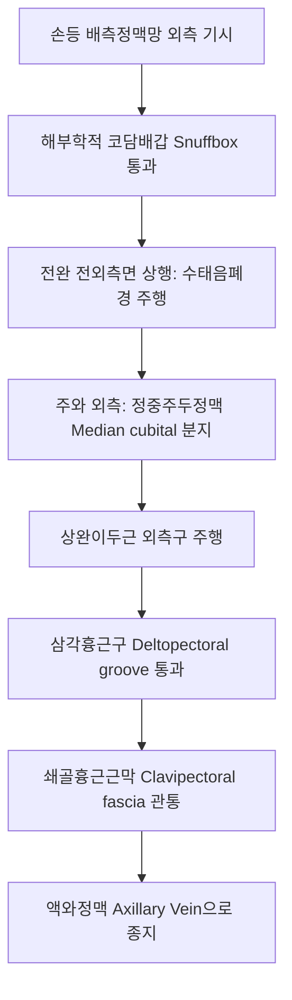

# 두정맥 (Cephalic Vein: Anatomy, Hemodynamics & Clinical Interventions)

> **핵심 임상 요약 (Key Clinical Summary)**:
> - **해부학적 기원 및 주행**: 손등의 배측정맥망 요측(해부학적 코담배갑)에서 기시하여 전완 외측면을 상행한 뒤, 상완이두근 외측구를 지나 대흉근과 삼각근 사이의 삼각흉근구(Deltopectoral groove)를 통과하여 쇄골흉근근막을 관통하고 [[액와정맥]]으로 합류한다.
> - **혈액투석 동정맥루(AVF)의 골든 도관**: 요골동맥과 두정맥을 문합하는 브레시아-치미노(Brescia-Cimino) 동정맥루의 핵심 혈관으로 말기 신부전 환자의 생명선 역할을 전담한다.
> - **외측전완피신경(LABCN)과의 동행**: 주관절 부위에서 외측전완피신경과 밀접하게 접촉 주행하므로 정맥 천자, 침도 및 사혈 시 신경 손상(전완 요측 방사통)을 방지해야 한다.
> - **한의 경락 궤적**: [[수태음폐경]]([[척택]], [[공최]], [[열결]])의 유주와 표재성으로 완벽히 일치하여 폐계 질환 및 상지 통증 치료의 핵심 혈관 지표이다.
> - **상지 림프·정맥 순환 추나**: 삼각흉근구 및 쇄골하근 이완 수기를 통해 두정맥 유출로의 물리적 압박을 해소하고 상지 부종을 개선한다.

---

## 1. 해부학적 기원·주행 경로 및 분지 체계 (Anatomical Pathway & Branches)
두정맥(Cephalic Vein)은 상지 외측의 주요 표재정맥 배동관이다.

- **주관절에서의 문합**:
  - 주관절 주와(Cubital fossa)에서 정중주두정맥(Median cubital vein)을 내어주어 척측의 귀정맥(Basilic vein)과 연결되며, 이는 정맥 채혈의 최다 호발 부위가 된다.
- **삼각흉근삼각 (Deltopectoral Triangle) 주행**:
  - [[대흉근]] 쇄골두와 [[삼각근]] 전면 사이의 고랑을 지나며 흉봉동맥(Thoracoacromial artery)의 삼각근지와 나란히 주행한다.

---

## 2. 혈류역학·관류 영역 및 주변 근막·근육 연계 (Hemodynamics & Perfusion)
- **혈류역학적 특성**:
  - 손과 전완 요측부의 피하 조직과 피부에서 정맥혈을 수합한다.
  - 심부정맥과 달리 근육 내 압박을 덜 받지만, 삼각흉근구와 쇄골하 근막 통과부에서 외인성 압박을 받기 쉽다.
- **주변 근막과의 관계**:
  - 전완부에서는 전완 근막(Antebrachial fascia) 표재층에 위치하다가, 상완부 상단에서 쇄골흉근근막을 뚫고 심부로 진입한다.

---

## 3. 혈관성 박동 촉진·청진 및 이학적 검사 (Physical Examination & Pulsation)
- **표재 정맥 관찰 및 정맥 천자 평가**:
  - 상완에 토니켓(압박대)을 적용하거나 주먹을 쥐었다 폈다 할 때 전완 외측면에서 팽창하는 두정맥의 탄력성과 개통성을 확인한다.
- **동정맥루(AVF) 진찰**:
  - 동정맥루가 형성된 두정맥에서는 진동감(Thrill)이 촉진되고 지속성 기계적 혈관 잡음(Bruit)이 청진되어야 정상 개통 상태를 의미한다.

---

## 4. 초음파 해부학(Sonoanatomy) 및 도플러 혈류 랜드마크 (Ultrasound & Doppler)
초음파는 동정맥루 성숙도 평가와 정맥 혈전증 진단의 필수 수단이다.

- **초음파 영상 특성**:
  - 피하 지방층 내에서 원형의 박동 없는 얇은 벽 구조물로 관찰되며, 가벼운 탐촉자 압박에 완전히 허탈된다.
  - AVF 수술 전 평가 시 두정맥 내경이 2.5mm 이상, 혈관 확장능이 양호해야 수술 성공률이 높다.

---

## 5. ⭐ 원장님 심층 임상 고찰 및 원본 필기 (Clinical Pearls & Melt-In)
- **정맥 채혈 및 침 치료 시 외측전완피신경 손상 방지**:
  - 주관절 외측에서 두정맥 주변에 침을 놓거나 사혈을 시행할 때, 바로 아래 주행하는 [[외측전완피신경]](LABCN)을 손상시키지 않도록 주의해야 한다.
  - 환자가 "엄지손가락 쪽으로 전기가 찌릿하게 통한다"고 호소하면 즉시 발침하거나 자침 각도를 조정해야 난치성 작열통(CRPS 전구 증상)을 방지할 수 있다.
- **상지 부종 환자의 삼각흉근구 이완**:
  - 유방암 림프절 절제술 후 또는 쇄골 골절 후 상지 부종이 있는 환자에서 삼각흉근구 부위의 유착을 도침이나 근막 이완으로 풀어주면 두정맥의 심부 유출이 개선된다.

---

## 6. 관련 임상 질환 및 허혈·압박·혈전 증후군 (Pathology & Entrapment)
- **표재성 혈전정맥염 (Superficial Thrombophlebitis)**:
  - 잦은 링거 주사나 카테터 삽입으로 혈관벽에 염증과 혈전이 생겨 붉고 아픈 끈 모양 경결을 형성한다.
- **동정맥루 협착 및 기능부전 (AVF Stenosis)**:
  - 혈류 속도 증가로 인한 내막 비후로 천자 부위나 유출로가 좁아져 투석 효율이 급감한다.

---

## 7. 한의 통합 혈관·신경 치료 프로토콜 (추나·초음파 약침·침구·한약)
- **수태음폐경 연계 자침 요법**:
  - [[척택]](LU5), [[공최]](LU6), [[열결]](LU7)을 배혈하여 상지 외측 혈류 정체를 해소하고 근육 경결을 이완한다.
- **삼각흉근근막 도침 박리술**:
  - [[중부]](LU1), [[운문]](LU2) 외측의 쇄골흉근근막 유착 부위에 초음파 가이드 하 미세 침도를 적용하여 두정맥 교압을 안전하게 해소한다.
- **활혈거어 소종 한약 처방**:
  - 정맥염증 완화와 부종 배출을 위해 [[당귀수산]], [[대황목단피탕]], [[오약순기산]]을 투여한다.

---

## 8. 실존 임상 연구 논문 요약 (Evidence-Based Research)

- Wen J et al. (2026). Ultrasound-guided selective nerve block promotes perioperative vascular remodeling and early maturation of radiocephalic arteriovenous fistulas. *J Vasc Surg*. . PMID: 42951048
  - [연구 요약] 요골-두정맥 동정맥루 조성술 환자에서 초음파 유도 신경 차단이 두정맥 혈관 리모델링 촉진 및 조기 성숙도에 미치는 임상 효과 규명.

- Zi Y et al. (2026). Percutaneous extra-anatomical bypass stenting for AVF elbow perforating vein stenosis with venous hypertension. *J Vasc Access*. . PMID: 42811660
  - [연구 요약] 두정맥 동정맥루 주관절 협착 및 정맥성 고혈압 환자에서 경피적 혈관 스텐트 중재술의 혈류역학적 개선 성과 보고.
