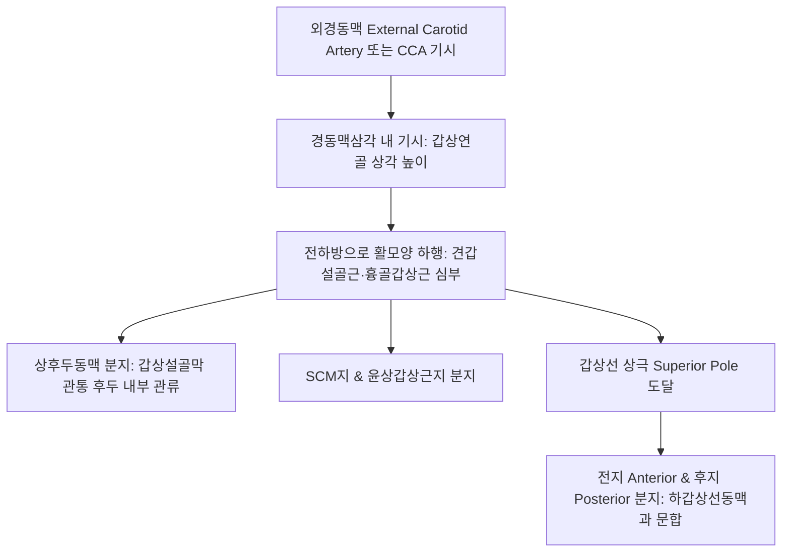

# 상갑상선동맥 (Superior Thyroid Artery: Anatomy, Hemodynamics & Clinical Interventions)

> **핵심 임상 요약 (Key Clinical Summary)**:
> - **해부학적 기원 및 기시 변이**: 교과서적으로 [[외경동맥]]의 첫 번째 전방 분지이지만, 5,488예 체계적 고찰에서 20~30%는 [[총경동맥]] 분기부 또는 총경동맥 자체에서 기시하는 빈번한 해부학적 변이를 나타낸다.
> - **상후두신경 외측지(EBSLN)와의 밀접한 인접**: 갑상선 상극(Superior pole) 부근에서 상후두신경 외측지와 나란히 주행하므로, 침도·절제·색전 시 신경 손상(윤상갑상근 마비로 인한 고음 발성 장애)을 철저히 예방해야 한다.
> - **갑상선 미세혈류 관류**: 상후두동맥, 흉쇄유돌근지, 윤상갑상근지, 전/후 갑상선지로 분지하여 갑상선 상부 1/2과 후두 연골부의 영양을 전담한다.
> - **초음파 지옥불(Inferno) 징후**: 그레이브스병([[갑상선기능항진증]]) 시 상갑상선동맥의 수축기 최고속도(PSV > 50~70cm/s)와 혈류량이 폭발적으로 증가하여 도플러 상 현란한 혈류 신호가 관찰된다.
> - **경부 전면 침구 안전 가이드**: [[인영]](ST9), [[수돌]](ST10), [[염천]](CV23) 자침 시 갑상연골 상각 외측의 맥동을 촉진하고 혈관을 회피하여 혈종으로 인한 기도 폐색을 방지한다.

---

## 1. 해부학적 기원·주행 경로 및 분지 체계 (Anatomical Pathway & Branches)
상갑상선동맥(Superior Thyroid Artery, STA)은 경부 전면 내분비 기관의 핵심 영양 혈관이다.

- **주요 분지 체계**:
  - 상후두동맥(Superior laryngeal artery): 상후두신경 내측지와 함께 갑상설골막을 뚫고 들어가 후두 점막을 관류한다.
  - 흉쇄유돌근지(SCM branch): 외측으로 주행하여 SCM 중간부를 관류한다.
  - 윤상갑상근지(Cricothyroid branch): 윤상갑상막 표면을 가로지르며 반대측 동맥과 문합한다.
  - 갑상선 전지 및 후지: 갑상선 실질 표면에서 [[하갑상선동맥]] 분지와 풍부한 미세 혈관망을 형성한다.

---

## 2. 혈류역학·관류 영역 및 주변 근막·근육 연계 (Hemodynamics & Perfusion)
- **혈류역학적 특성**:
  - 내분비 실질을 관류하므로 정상 상태에서도 비교적 저저항성 파형을 보이며, 평균 수축기 속도는 20~40 cm/s 범위이다.
- **주변 근막과의 관계**:
  - 기관전근막(Pretracheal fascia) 내에 위치하며, 설골하근육군([[흉골설골근]], [[흉골갑상근]])에 의해 전방에서 보호된다.
  - 연하 운동 시 갑상선과 함께 상하로 1~2cm 가동성을 보인다.

---

## 3. 혈관성 박동 촉진·청진 및 이학적 검사 (Physical Examination & Pulsation)
- **박동 촉진**:
  - 설골 대각(Greater horn)과 갑상연골 상각 사이의 외측 오목한 부위에서 박동을 가볍게 촉지할 수 있다.
- **갑상선 혈관 잡음 청진**:
  - 갑상선 비대 환자에서 청진기를 갑상선 상극 부위에 대었을 때 지속성 잡음(Thyroid bruit)이 청진되면 바세도우병(그레이브스병)의 활동성 혈류 증가를 의미한다.

---

## 4. 초음파 해부학(Sonoanatomy) 및 도플러 혈류 랜드마크 (Ultrasound & Doppler)
초음파는 갑상선 결절 고주파 절제술 및 기능 평가의 필수 도구이다.

- **초음파 영상 특성**:
  - 갑상선 상극의 횡단 및 종단 스캔에서 갑상선 피질로 진입하는 직경 1.5~2.5mm의 박동성 관상 구조물로 관찰된다.
- **스펙트럴 도플러 진단 기준**:
  - 아급성 갑상선염에서는 혈류 속도가 정상 또는 저하되는 반면, 그레이브스병에서는 수축기 피크 속도(PSV)가 65cm/s 이상으로 현저히 상승하여 두 질환의 결정적 감별 지표가 된다.

---

## 5. ⭐ 원장님 심층 임상 고찰 및 원본 필기 (Clinical Pearls & Melt-In)
- **EBSLN 신경 보존과 고음 발성 장애 예방**:
  - 상갑상선동맥 본간은 상후두신경 외측지([[EBSLN]])와 매우 근접 주행하며, 약 20%에서는 동맥 분지 사이에 신경이 끼여 주행한다(Cernea 분류).
  - 갑상선 상극 부위에 침도나 깊은 자침을 시술할 때 이 신경이 손상되면 [[윤상갑상근]]이 마비되어 성대 긴장도가 떨어지고, 목소리가 잠기며 고음을 낼 수 없게 되므로 각별히 경계해야 한다.
- **경부 전면 자침 시 기도 압박 혈종 방지**:
  - 갑상선은 단위 무게당 혈류량이 신장보다 많은 고관류 장기이다.
  - [[인영]](ST9), [[수돌]](ST10) 자침 시 상갑상선동맥 손상으로 혈종이 발생하면 기관을 압박하여 급성 호흡 곤란을 유발할 수 있으므로, 반드시 맥동을 손끝으로 외측으로 밀어내고 자침한다.

---

## 6. 관련 임상 질환 및 허혈·압박·혈전 증후군 (Pathology & Entrapment)
- **갑상선기능항진증 (그레이브스병)**:
  - 상갑상선동맥 혈류량이 3~5배 이상 급증하며 '갑상선 지옥불(Thyroid inferno)' 징후를 나타낸다.
- **갑상선 결절 및 선종 (Thyroid Adenoma)**:
  - 결절 주변으로 상갑상선동맥의 피막 혈류(Rim vascularity)가 발달한다.

---

## 7. 한의 통합 혈관·신경 치료 프로토콜 (추나·초음파 약침·침구·한약)
- **경부 전면 설골하근막 이완 추나**:
  - 흉골설골근, 흉골갑상근, 갑상설골근에 대해 부드러운 근막 이완술을 적용하여 갑상선 상극의 혈관 압박을 해소한다.
- **자율신경 및 내분비 조절 자침**:
  - [[인영]](ST9)의 안전한 표재 자침과 함께 [[천돌]](CV22), [[내관]](PC6), [[태충]](LR3)을 배혈하여 심계항진과 갑상선 기능 이상을 조절한다.
- **청간사화 연견산결 한약 처방**:
  - 갑상선 종대와 혈관 충혈을 가라앉히기 위해 [[안심제번탕]], [[시호가용골모려탕]], [[소요산]] 가미방을 처방한다.

---

## 8. 실존 임상 연구 논문 요약 (Evidence-Based Research)

- Poutoglidis A et al. (2023). Is the origin of the superior thyroid artery consistent? A systematic review of 5488 specimens. *Am J Otolaryngol*. 44(2):103823. PMID: 37190996
  - [연구 요약] 5,488예의 사체 및 수술 검체를 체계적으로 분석하여 상갑상선동맥의 외경동맥 기시율(76%) 및 총경동맥/분기부 기시 변이율(24%)을 규명하고 임상 수술 안전 기준 제시.

- Gaydarski L et al. (2023). A Rare Case of Thyroidea Ima Arising From the Internal Thoracic Artery and Reaching Up to the Parathyroid Gland. *Cureus*. 15(11):e49551. PMID: 38156195
  - [연구 요약] 갑상선 상극 및 하극 부위의 희귀 혈관 기시 변이와 경부 중재 시술 시 출혈 예방을 위한 해부학적 고찰.
