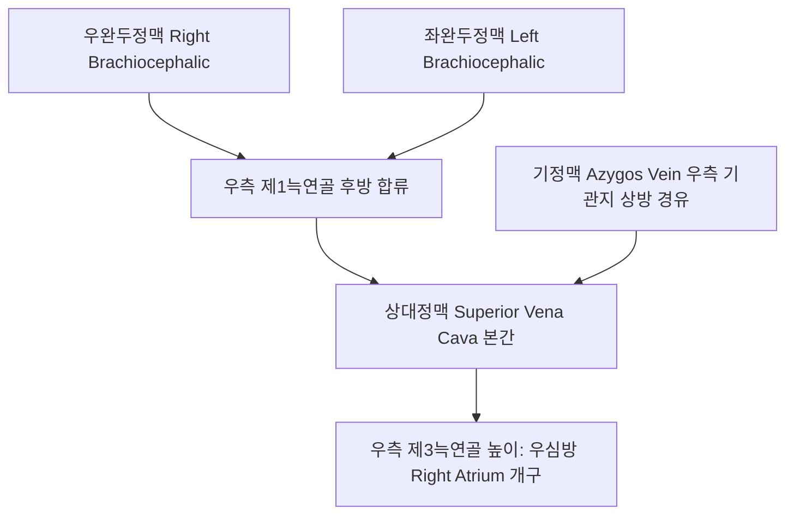

# 상대정맥 (Superior Vena Cava: Anatomy, Hemodynamics & Clinical Interventions)

> **핵심 임상 요약 (Key Clinical Summary)**:
> - **해부학적 기원 및 주행**: 좌우 [[완두정맥]](Brachiocephalic veins)이 우측 제1늑연골 후방에서 합류하여 형성되며, 전종격동 우측을 따라 수직 하행하여 우측 제3늑연골 높이에서 우심방으로 개구한다.
> - **상반신 정맥 환류의 총본산**: 두경부, 상지, [[흉곽]]의 모든 무산소 혈액을 심장으로 환류시키는 직경 약 2cm의 대간선 정맥으로 내부에 판막이 존재하지 않는다.
> - **상대정맥 증후군(SVC Syndrome)의 레드플래그**: 종격동 종양, [[폐암]], 림프종 등에 의해 외인성으로 압박되면 안면·경부·상지 부종, 결막 충혈, 흉벽 표재정맥 노장, 호흡곤란을 유발하는 종양학적 응급 질환이며 [[호흡곤란]]을 유발한다.
> - **경정맥 분노(JVD)와의 감별**: 양측 경정맥이 비정상적으로 팽창하고 호흡이나 체위 변화에도 박동이 소실될 때 중심정맥 유출 장애 및 [[심부전]]을 강하게 의심해야 한다.
> - **한의 임상 안전과 연계**: 흉곽 상구 및 전종격동 압박 질환의 조기 선별과, 흉곽출구 증후군 환자에서 상지 정맥 울혈을 완화하는 [[흉쇄관절]] 및 [[늑골]] [[추나요법]] 수기를 병용한다.

---

## 1. 해부학적 기원·주행 경로 및 분지 체계 (Anatomical Pathway & Branches)
[[상대정맥]](Superior Vena Cava, SVC)은 상반신 정맥혈이 우심방으로 들어가는 최종 통로이다.

- **해부학적 인접 구조물**:
  - 전방: 흉선 잔류 조직, 내흉혈관, [[흉골]]병.
  - 후방: 우측 폐동맥, 우측 기관지, 우측 폐정맥.
  - 내측: 상행[[대동맥]](Ascending aorta).
  - 외측: 우측 [[횡격신경]](Phrenic nerve), 심막횡격혈관, 우측 늑막.

---

## 2. 혈류역학·관류 영역 및 주변 근막·근육 연계 (Hemodynamics & Perfusion)
- **혈류역학적 특성**:
  - 심장 정맥 환류량의 약 35%를 담당하며, 평균 정맥압은 2~6 mmHg로 매우 낮다.
  - 판막이 없으므로 우심방 압력 변화가 내경정맥과 뇌정맥동으로 직접 전달된다.
- **측부 순환 경로 (Collateral Pathways)**:
  - SVC 폐색 시 혈액은 [[기정맥]]계(Azygos/Hemiazygos), 내흉정맥계(Internal thoracic), 척추정맥총(Vertebral venous plexus), 복벽표재정맥계를 통해 우회하여 [[하대정맥]](IVC)으로 유입된다.

---

## 3. 혈관성 박동 촉진·청진 및 이학적 검사 (Physical Examination & Pulsation)
- **펨버턴 징후 (Pemberton's Sign)**:
  - 환자에게 양팔을 귀에 닿도록 1분간 높이 들게 했을 때(Pemberton maneuver), 흉곽 상구 입구 협착으로 안면 홍조, 청색증, 호흡곤란, 경정맥 팽창이 유발되면 양성으로 판정한다.
- **흉벽 정맥 노장 관찰**:
  - 흉부 전면과 복벽에 지렁이처럼 불거져 나오는 표재성 측부 정맥망의 주행 방향을 확인한다.

---

## 4. 초음파 해부학(Sonoanatomy) 및 도플러 혈류 랜드마크 (Ultrasound & Doppler)
초음파와 CT 조영술은 SVC 병변의 위치와 혈전 유무를 확인하는 핵심 검사이다.

- **심초음파 및 쇄골상와 스캔**:
  - 흉골상와(Suprasternal notch) 접근법에서 대동맥궁 우측의 무에코 관상 구조물로 관찰된다.
  - 도플러 상 심실 수축기와 확장기에 일치하는 2봉성 심방 유입 혈류(S파, D파)가 관찰된다.

---

## 5. ⭐ 원장님 심층 임상 고찰 및 원본 필기 (Clinical Pearls & Melt-In)
- **얼굴과 목이 붓는 환자의 감별 진단**:
  - 중년 이상 환자가 "최근 와이셔츠 깃이 꽉 끼고 아침마다 얼굴과 눈이 붓는다"며 내원했을 때, 신장 질환이나 단순 부종으로 치부해서는 안 된다.
  - 양측 팔을 들어 올리게 하여 펨버턴 징후를 확인하고, 흉벽에 푸른 정맥이 도드라져 있으면 종격동 질환(상대정맥 증후군)을 강하게 의심하고 즉시 상급 병원 흉부 CT를 의뢰해야 한다.
- **상지 침 치료 시 정맥 울혈 환자 주의**:
  - SVC 협착 환자는 상지 정맥압이 비정상적으로 높아 침을 놓았을 때 출혈이 멈추지 않고 피하 혈종이 쉽게 생기므로 과도한 강자극을 금한다.

---

## 6. 관련 임상 질환 및 허혈·압박·혈전 증후군 (Pathology & Entrapment)
- **상대정맥 증후군 (SVC Syndrome)**:
  - 악성 종양(소세포폐암, 비호지킨림프종)에 의한 외인성 압박(80%) 또는 중심정맥 카테터/인공심박동기 도관에 의한 혈전성 폐색(20%)으로 발생한다.
- **상대정맥 혈전증 (SVC Thrombosis)**:
  - 카테터 장기 유치 환자에서 혈전이 발생하여 급성 뇌부종 및 기도 부종을 초래할 수 있다.

---

## 7. 한의 통합 혈관·신경 치료 프로토콜 (추나·초음파 약침·침구·한약)
- **흉곽 상구 감압 추나 치료**:
  - 제1[[늑골]] 기능부전, [[쇄골]]하근 단축, [[흉쇄관절]] 아탈구를 교정하여 흉곽 상구의 정맥 유출 경로 공간을 확보한다.
- **흉곽 림프 순환 촉진 침구**:
  - [[단중]](CV17), [[중부]](LU1), [[결분]](ST12) 주변 흉근막을 완만하게 자침하여 흉강 내압을 완화한다.
- **화담산결 활혈 한약**:
  - 종격동 울혈 및 체액 저류 완화를 위해 [[도홍사물탕]], [[오령산]], [[반하후박탕]]을 변증 처방한다.

---

## 8. 실존 임상 연구 논문 요약 (Evidence-Based Research)

- Ozawa M et al. (2026). Patient characteristics and the safety of stent placement for malignant vena cava syndrome in Japan: a nationwide analysis. *Support Care Cancer*. 34(11):. PMID: 42902092
  - [연구 요약] 악성 상대정맥 증후군 환자에서 혈관내 스텐트 삽입술의 즉각적 증상 완화 효과, 혈류역학적 개통성 및 안전성 전국 단위 코호트 분석.

- Yang L et al. (2026). Acute superior vena cava collapse after thymic carcinoma resection and failed pericardial bypass rescued by endovascular stenting: a case report. *BMC Surg*. 26(1):. PMID: 41943044
  - [연구 요약] 흉선 종양 절제술 후 발생한 상대정맥 허탈 및 혈류 장애의 초음파 영상 감별 및 혈관 중재적 구조 증례 보고.
