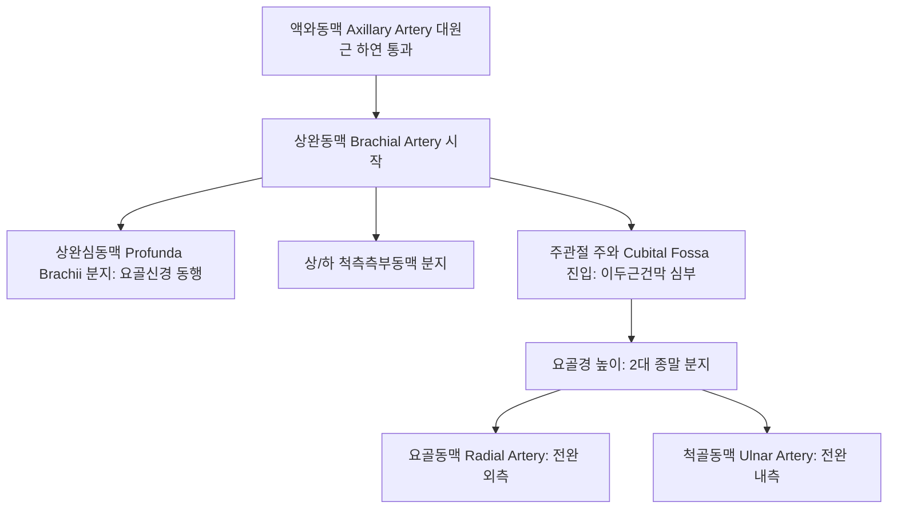

# 상완동맥 (Brachial Artery: Anatomy, Hemodynamics & Clinical Interventions)

> **핵심 임상 요약 (Key Clinical Summary)**:
> - **해부학적 기원 및 주행**: [[대원근]] 하연에서 액와동맥의 연속으로 시작하여, 상완이두근 내측구를 따라 [[정중신경]]과 밀접하게 동행 하행한 뒤 주관절 주와(Cubital fossa)에서 요골경 높이에서 [[요골동맥]]과 [[척골동맥]]으로 분기한다.
> - **상완심동맥(Profunda Brachii)과 요골신경**: 상완 상부에서 분지하는 상완심동맥은 [[요골신경]]과 함께 요골신경관(Radial groove)을 통과하여 상완삼두근을 관류하고 주관절 측부동맥망을 형성한다.
> - **표준 혈압 측정의 기준 혈관**: 청진기를 주와 내측에 대고 코로트코프음(Korotkoff sounds)을 청진하여 수축기 및 확장기 혈압을 결정하는 전신 혈관의 대표 지표이다.
> - **혈류 매개 확장능(FMD)의 임상 지표**: 허혈 후 반응성 충혈 시 방출되는 일산화질소(NO)에 의한 상완동맥 직경 확장 비율은 전신 내피세포 기능부전(Endothelial dysfunction)의 골든 스탠다드 평가법이다.
> - **주와부 침구 및 IASTM 안전 가이드**: [[곡택]](PC3), [[소해]](HT3) 자침 시 상완동맥 박동을 반드시 촉진하여 정중신경-상완동맥 다발 손상을 방지하고, 소아 상완골 과상골절 후 폭크만 허혈성 구축([[Volkmann's ischemic contracture]])을 철저히 감별한다.

---

## 1. 해부학적 기원·주행 경로 및 분지 체계 (Anatomical Pathway & Branches)
상완동맥(Brachial Artery, BA)은 상완과 전완, 손 전체의 주 관류 동맥이다.

- **주와(Cubital Fossa) 내 3차원 해부학적 관계**:
  - 외측에서 내측 순서: 상완이두근건(Biceps tendon) $
ightarrow$ **상완동맥** $
ightarrow$ 정중신경(Median nerve) (TAN 순서: Tendon, Artery, Nerve).
  - 상완동맥은 표재성으로 덮고 있는 두꺼운 이두근건막(Bicipital aponeurosis, Lacertus fibrosus)에 의해 보호된다.

---

## 2. 혈류역학·관류 영역 및 주변 근막·근육 연계 (Hemodynamics & Perfusion)
- **혈류역학적 특성**:
  - 전형적인 고저항성 삼상 파형(Triphasic waveform)을 보이며, 정상 수축기 피크 속도는 50~100 cm/s이다.
  - 전완 운동이나 온열 자극 시 말초 저항이 감소하여 이상성(Biphasic) 또는 저저항성 파형으로 가역적 전환된다.
- **주변 근육과의 역학적 연계**:
  - 전방에는 [[상완이두근]], 후방에는 [[상완오훼근]]과 상완근이 위치한다.
  - 상완 내측 근간중격(Medial intermuscular septum)을 따라 주행하므로 상완근막의 긴장에 민감하다.

---

## 3. 혈관성 박동 촉진·청진 및 이학적 검사 (Physical Examination & Pulsation)
- **박동 촉진 (Brachial Pulse)**:
  - 주관절 주름 상방 1~2cm, 상완이두근건 바로 내측에서 시술자의 검지와 중지로 부드럽게 압박하여 맥박을 확인한다.
- **혈류 매개 확장능 (Flow-Mediated Dilation, FMD)**:
  - 전완에 혈압 커프를 감고 200mmHg로 5분간 가압하여 허혈을 유발한 뒤 급속 감압한다.
  - 감압 60초 후 초음파로 상완동맥 내경 확장을 측정하며, 정상 확장은 7~10% 이상, 5% 미만 시 내피세포 기능 저하로 판정한다.

---

## 4. 초음파 해부학(Sonoanatomy) 및 도플러 혈류 랜드마크 (Ultrasound & Doppler)
- **초음파 영상 특성**:
  - 주와 횡단 스캔 시 이두근건 내측, 정중신경 외측에서 박동성의 원형 무에코 내강으로 명확히 식별된다.
  - 양측에 동행정맥(Venae comitantes)을 거느리고 있다.
- **압박 검사**:
  - 탐촉자로 압박 시 동행정맥은 허탈되지만 상완동맥은 박동을 유지하여 즉각 감별된다.

---

## 5. ⭐ 원장님 심층 임상 고찰 및 원본 필기 (Clinical Pearls & Melt-In)
- **주와부 자침 및 침도 시술 시 신경혈관 보호**:
  - [[곡택]](PC3)은 상완이두근건 척측 연에 위치하여 상완동맥 및 [[정중신경]]과 불과 2~3mm 거리이다.
  - 자침 전 반드시 동맥 박동을 확인하고, 박동 부위에서 약간 내측이나 외측으로 경사지게 자침하여 혈관벽 관통에 따른 심부 혈종을 예방해야 한다.
- **소아 팔꿈치 손상과 폭크만 허혈성 구축**:
  - 소아가 팔을 짚고 넘어진 후 팔꿈치 통증과 종창을 호소할 때 [[상완골 과상골절]](Supracondylar fracture)을 의심해야 한다.
  - 골절편이 상완동맥을 압박하여 요골맥박이 소실되고 손가락이 창백해지면 6시간 이내에 전완 굴근의 괴사와 비가역적 구축([[Volkmann 구축]])이 오므로 지체 없이 응급 정형외과로 전원해야 한다.

---

## 6. 관련 임상 질환 및 허혈·압박·혈전 증후군 (Pathology & Entrapment)
- **상완동맥 가성동맥류 (Pseudoaneurysm)**:
  - 주관절 천자 손상이나 카테터 삽입 후 발생한다.
- **스트라더스 인대 증후군 (Ligament of Struthers Entrapment)**:
  - 상완골 내과 상방 돌기(Supracondylar process)와 내과를 잇는 섬유성 인대 아래로 상완동맥과 정중신경이 통과하면서 압박받아 전완 통증과 파행을 유발한다.

---

## 7. 한의 통합 혈관·신경 치료 프로토콜 (추나·초음파 약침·침구·한약)
- **상완 이두근막 및 회외근 이완 추나**:
  - 이두근건막(Lacertus fibrosus)과 원회내근의 과긴장을 IASTM 및 횡마찰 마사지로 이완하여 주와부 혈류 통로를 개방한다.
- **상지 말초 순환 침구 치료**:
  - [[곡지]](LI11), [[수삼리]](LI10), [[합곡]](LI4)에 전침(2~10Hz)을 시술하여 상완동맥 하류 혈관 확장을 유도한다.
- **혈관 내피세포 기능 활성화 한약**:
  - 일산화질소(NO) 생성을 촉진하고 혈관 탄성을 회복하기 위해 [[갈근탕]], [[사물탕]], [[단삼]]을 처방한다.

---

## 8. 실존 임상 연구 논문 요약 (Evidence-Based Research)

- Abreu JA et al. (2026). Test-retest reliability and minimal detectable change of pulse wave velocity and flow-mediated dilation in paretic and non-paretic limbs of older adults post-stroke. *Physiol Rep*. 14(20):e71138. PMID: 42897953
  - [연구 요약] 뇌졸중 후 상완동맥 혈류 매개 확장능(FMD)과 맥파전달속도 측정의 신뢰도 및 상지 혈관 내피세포 기능 평가 유효성 입증.

- de Araújo Alves CC et al. (2026). Persistent endothelial dysfunction is associated with exercise intolerance in adults despite preserved myocardial work 3years after SARS-CoV-2 infection. *Physiol Rep*. 14(19):e71103. PMID: 42810981
  - [연구 요약] 상완동맥 FMD 초음파 평가를 통한 전신 미세혈관 내피세포 기능부전 및 운동 불내성 상관관계 규명.
