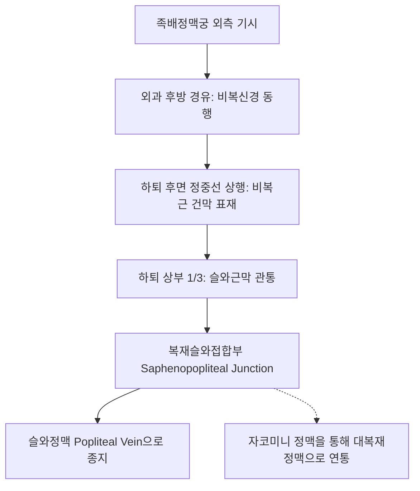

# 소복재정맥 (Small Saphenous Vein: Anatomy, Hemodynamics & Clinical Interventions)

> **핵심 임상 요약 (Key Clinical Summary)**:
> - **해부학적 기원 및 주행**: 족배정맥궁 외측에서 시작하여 외과(Lateral malleolus) 후방을 돌아 하퇴 후면 정중선(비복근 양두 사이)을 수직 상행한 뒤, 슬와(Popliteal fossa)에서 슬와근막을 뚫고 [[슬와정맥]]으로 합류한다.
> - **비복신경(Sural Nerve)과의 밀접한 주행**: 하퇴 중간부터 족관절 외측까지 비복신경과 바짝 밀착하여 동행하므로, 족관절 사혈 및 정맥류 시술 시 신경 손상(발 외측 감각 마비)을 엄격히 방지해야 한다.
> - **복재슬와접합부(SPJ) 판막 부전**: 슬와 주름 상방 2~4cm 지점의 SPJ 판막이 망가지면 종아리 후면의 지렁이 같은 정맥류, 야간 장딴지 경련(Night cramps), 피로감을 유발한다.
> - **족태양방광경 유주와의 일치**: [[곤륜]](BL60), [[승산]](BL57), [[위중]](BL40)의 해부학적 궤적과 완벽히 겹치며, 방광경 습부항 및 침 치료 시 핵심 혈관 지표이다.
> - **한의 통합 치료**: 비복근·가자미근 스트레칭 추나와 하퇴 후면 부종 완화 침구 및 활혈 소종 한약을 적용하여 정맥류 역류를 완화한다.

---

## 1. 해부학적 기원·주행 경로 및 분지 체계 (Anatomical Pathway & Branches)
소복재정맥(Small Saphenous Vein, SSV)은 하퇴 후면의 주요 표재 정맥이다.

- **복재슬와접합부 (SPJ)의 해부학적 변이**:
  - 교과서적인 슬와정맥 합류(60~70%) 외에도, 슬와정맥보다 높은 대퇴 후면에서 심부정맥과 합류하거나, 자코미니 정맥(Vein of Giacomini)을 통해 [[대복재정맥]]으로 연통하는 변이가 30%에 달한다.
- **근막 구획 (Interfascial Compartment)**:
  - 비복근 양측 근복 사이의 얕은 고랑에서 근막간 구획 내에 안정적으로 위치한다.

---

## 2. 혈류역학·관류 영역 및 주변 근막·근육 연계 (Hemodynamics & Perfusion)
- **혈류역학적 특성**:
  - 족부 외측과 하퇴 후면 피부 및 피하조직의 혈액을 수합한다.
  - 9~12개의 판막을 구비하여 보행 시 비복근 수축 압력에 의해 혈액을 슬와정맥으로 뿜어 올린다.
- **주변 근육과의 역학적 연계**:
  - [[비복근]]과 [[가자미근]]의 근막 표면에 밀착되어 주행하므로, 종아리 근육의 쥐(Cramp)나 만성 단축은 정맥벽을 기계적으로 압박한다.

---

## 3. 혈관성 박동 촉진·청진 및 이학적 검사 (Physical Examination & Pulsation)
- **종아리 후면 정맥류 시진 및 촉진**:
  - 기립위에서 장딴지 후면에 돌출되는 구불구불한 혈관 결절을 관찰한다.
- **수동 배굴 유발 검사**:
  - 족관절을 급격히 배굴시킬 때 종아리 통증이 유발되면 심부정맥혈전증([[DVT]])(Homan's sign)과 감별해야 한다.

---

## 4. 초음파 해부학(Sonoanatomy) 및 도플러 혈류 랜드마크 (Ultrasound & Doppler)
- **초음파 영상 특성**:
  - 하퇴 후면 횡단면에서 비복근 내측두와 외측두 사이 근막 구획 내에 위치한 타원형 무에코 혈관으로 관찰된다.
  - 바로 외측 또는 후방에 작은 고에코 점 형태로 동행하는 [[비복신경]](Sural nerve)을 식별할 수 있다.
- **역류 진단 기준**:
  - 발목 압박 후 해제 시 SPJ 및 소복재정맥 본간에서 0.5초 이상의 역류 혈류가 관찰되면 판막 부전으로 확진한다.

---

## 5. ⭐ 원장님 심층 임상 고찰 및 원본 필기 (Clinical Pearls & Melt-In)
- **곤륜혈 및 승산혈 사혈 시 비복신경 보존**:
  - [[곤륜]](BL60)과 [[승산]](BL57) 부위는 만성 요통 및 하지 방사통 환자에서 습부항 사혈요법을 빈번히 시행하는 곳이다.
  - 소복재정맥과 비복신경은 족관절 외과 상방에서 교차 밀착하므로, 삼릉침으로 깊게 난자하면 신경 손상에 의한 발 외측 저림과 이상 감각을 초래할 수 있으므로 피하 표재층에 국한하여 섬세하게 시술해야 한다.
- **야간 비복근 경련과 정맥 부전**:
  - 밤마다 종아리에 쥐가 나서 깨는 환자는 단순 전해질 부족이나 디스크 신경근 압박 외에도 소복재정맥 판막 부전으로 인한 정맥 울혈을 반드시 감별해야 한다.

---

## 6. 관련 임상 질환 및 허혈·압박·혈전 증후군 (Pathology & Entrapment)
- **소복재정맥 역류성 하지정맥류**:
  - 하퇴 후면 및 외과 주변에 정맥류를 형성하며 족관절 주위 색소 침착과 피부 궤양을 유발한다.
- **비복신경 포착 증후군 (Sural Nerve Entrapment)**:
  - 확장된 소복재정맥이나 섬유화된 근막에 의해 비복신경이 압박되어 발 외측연의 작열통과 감각 이상을 초래한다.

---

## 7. 한의 통합 혈관·신경 치료 프로토콜 (추나·초음파 약침·침구·한약)
- **비복근-아킬레스건 근막 추나 요법**:
  - 족관절 수동 배굴 스트레칭과 하퇴 삼두근 이완을 통해 정맥 펌프 기능을 정상화한다.
- **방광경 혈자리 침구 치료**:
  - [[위중]](BL40), [[승산]](BL57), [[승간]](BL56), [[곤륜]](BL60)에 자침하여 하퇴 후면 근막 장력을 완화하고 정맥 울혈을 해소한다.
- **활혈거어 거습 한약 처방**:
  - 하지 무력감과 경련을 완화하기 위해 [[작약감초탕]], [[당귀사역가오수유생강탕]], [[우차신기환]]을 처방한다.

---

## 8. 실존 임상 연구 논문 요약 (Evidence-Based Research)

- Kubat E et al. (2020). Comparison of different approaches to small saphenous vein reflux treatment: a retrospective study in two centers. *Sao Paulo Med J*. 138(2):98-105. PMID: 32491084
  - [연구 요약] 소복재정맥 역류 환자에서 혈관내 고주파 절제술과 외과적 결찰술의 정맥 폐색률 및 비복신경 손상 합병증 빈도 비교 분석.

- de Souza FCB et al. (2021). Evaluation of endolaser thermoablation of the small saphenous vein under local anesthesia. *J Vasc Bras*. 20:e20200215. PMID: 34394206
  - [연구 요약] 국소마취 하 소복재정맥 혈관내 레이저 열폐쇄술의 임상 치료 성적과 초음파 유도 안전성 평가.
