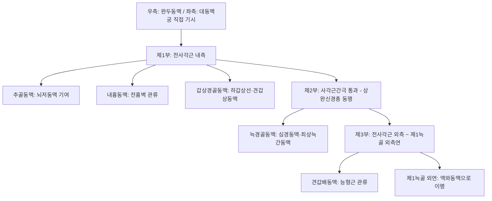

# 쇄골하동맥 (Subclavian Artery: Anatomy, Hemodynamics & Clinical Interventions)

> **핵심 임상 요약 (Key Clinical Summary)**:
> - **해부학적 기원 및 3대 분절**: 우측은 [[완두동맥]]에서, 좌측은 대동맥궁에서 직접 기시하며, 전사각근(Scalenus anterior)을 기준으로 내측(제1부), 후방 사각근간극(제2부), 외측(제3부)으로 구분된 뒤 제1늑골 외연에서 [[액와동맥]]으로 이행한다.
> - **주요 핵심 분지**: 제1부에서 [[추골동맥]](Vertebral artery, 뇌저 순환), [[내흉동맥]](Internal thoracic), 갑상경골동맥이 분지하여 뇌, 흉벽, 갑상선 및 경부 근육을 관류한다.
> - **흉곽출구 증후군(TOS)의 주 혈관**: 사각근간극(Scalene triangle)과 늑쇄공간(Costoclavicular space)에서 [[상완신경총]]과 함께 주행하므로 경늑골, [[전사각근]] 비후, [[쇄골]] 골절 변형 시 혈관성 [[흉곽출구 증후군]]을 유발한다.
> - **쇄골하동맥 도혈 증후군 (Subclavian Steal Syndrome)**: 쇄골하동맥 기시부 협착 시 동측 상지 운동 시 추골동맥 혈류가 뇌에서 팔로 거꾸로 역류하여 [[어지럼증]], 실신, [[운동실조]]를 일으킨다.
> - **쇄골상와 자침 안전 가이드**: [[결분]](ST12), [[기사]](ST11) 자침 시 기흉과 함께 쇄골하동맥 천자 위험이 극히 높으므로 직자를 절대 엄금하고 횡자 또는 초음파 유도하 안전 시술을 시행한다.

---

## 1. 해부학적 기원·주행 경로 및 분지 체계 (Anatomical Pathway & Branches)
쇄골하동맥(Subclavian Artery, SCA)은 뇌 후방 순환과 상지 전체를 연결하는 대동맥이다.

- **사각근간극 (Scalene Triangle)의 경계**:
  - 전방: [[전사각근]].
  - 후방: [[중사각근]].
  - 바닥: 제1[[늑골]] 상면.
  - 통과 구조물: 쇄골하동맥 제2부 및 상완신경총 줄기(Trunks). (쇄골하정맥은 전사각근 전방을 통과하므로 이 간극을 지나지 않는다).

---

## 2. 혈류역학·관류 영역 및 주변 근막·근육 연계 (Hemodynamics & Perfusion)
- **혈류역학적 특성**:
  - 상지 근육계로 향하는 전형적인 고저항성 삼상 파형을 나타낸다.
  - [[추골동맥]] 분기 이전 부위가 협착되면 확장기 역전류가 심화된다.
- **주변 근육 및 골격과의 역학적 연계**:
  - 쇄골과 제1늑골 사이의 늑쇄공간을 통과할 때, [[라운드숄더]]나 상지 하강 자세에서 압박을 받는다.

---

## 3. 혈관성 박동 촉진·청진 및 이학적 검사 (Physical Examination & Pulsation)
- **박동 촉진 (Subclavian Pulse)**:
  - 쇄골 중앙부 바로 상방, 전사각근 외측연 쇄골상와에서 제1늑골 방향으로 하방 압박하여 촉지한다.
- **애드슨 검사 (Adson Test)**:
  - 환자의 요골맥박을 촉진하면서 경부를 검사측으로 회전하고 신전한 채 숨을 깊게 들이쉬게 했을 때, 요골맥박이 소실되거나 현저히 감소하면 전사각근 증후군(TOS)으로 판정한다.
- **라이트 검사 (Wright Test) & 에덴 검사 (Eden Test)**:
  - 상지 [[외전]] 및 군인 자세(어깨 후하방 당김)에서 맥박 소실 여부를 확인한다.

---

## 4. 초음파 해부학(Sonoanatomy) 및 도플러 혈류 랜드마크 (Ultrasound & Doppler)
- **쇄골상와 초음파 영상**:
  - 쇄골 바로 위에서 횡단 스캔 시 제1늑골의 고에코 골성 음영 위에 둥근 박동성 쇄골하동맥이 위치하고, 바로 외측에 포도송이 모양의 [[상완신경총]] 신경근/줄기들이 관찰된다.
- **쇄골하동맥 도혈 징후 확인**:
  - 도플러 검사 상 추골동맥 혈류가 두개골 쪽이 아닌 쇄골하동맥 쪽으로 완전히 역류(Retrograde flow)하는 '도혈 현상(Steal phenomenon)'을 실시간 포착한다.

---

## 5. ⭐ 원장님 심층 임상 고찰 및 원본 필기 (Clinical Pearls & Melt-In)
- **결분혈 자침의 절대적 금기 수기**:
  - [[결분]](ST12)은 쇄골상와 중앙에 위치하며 바로 아래에 쇄골하동맥과 폐첨부(Lung apex)가 위치한다.
  - 깊이 직자하면 쇄골하동맥 천자로 인한 대량 흉강내 혈종(Hemothorax)이나 긴장성 기흉(Pneumothorax)이라는 치명적 의료사고가 발생하므로, 반드시 쇄골을 타고 외측으로 횡자하거나 10~15mm 이내로 천자해야 한다.
- **양측 상지 혈압 차이와 쇄골하동맥 협착**:
  - 양팔의 수축기 혈압 차이가 15~20mmHg 이상이면 압력이 낮은 쪽의 쇄골하동맥 협착을 의심해야 한다.
  - 팔을 쓸 때 어지럽거나 눈앞이 캄캄해지는 증상이 동반되면 쇄골하동맥 도혈 증후군을 확진할 수 있다.

---

## 6. 관련 임상 질환 및 허혈·압박·혈전 증후군 (Pathology & Entrapment)
- **혈관성 흉곽출구 증후군 (Arterial TOS)**:
  - 쇄골하동맥이 만성 압박되어 혈관 협착, 협착 후 확장(Post-stenotic dilatation), 혈전 형성 및 상지 원위부 색전증을 유발한다.
- **쇄골하동맥 도혈 증후군 (Subclavian Steal Syndrome)**:
  - 죽상경화성 협착으로 인해 팔을 움직일 때 뇌저 혈류가 역류하여 일과성 허혈발작을 일으킨다.

---

## 7. 한의 통합 혈관·신경 치료 프로토콜 (추나·초음파 약침·침구·한약)
- **사각근 및 제1늑골 교정 추나**:
  - [[전사각근]]과 [[중사각근]]의 단축을 근에너지기법(MET)으로 이완하고, 제1[[늑골]] 하강 교정 수기를 적용하여 사각근간극을 물리적으로 넓힌다.
- **쇄골하 공간 침구 요법**:
  - 사각근 부착부인 [[경추]] 횡돌기 전결절(C3-C6) 부위에 초음파 가이드 하 안전하게 약침을 시술하여 사각근 긴장을 해소한다.
- **혈관 확장 및 기혈 순환 한약**:
  - 상지 저림과 냉감을 완화하기 위해 [[황기계지오물탕]], [[오약순기산]], [[당귀사역탕]]을 처방한다.

---

## 8. 실존 임상 연구 논문 요약 (Evidence-Based Research)

- Noureddine R et al. (2026). Clinical and anatomical correlates of significant subclavian artery stenosis in thoracic outlet syndrome: Insights from dynamic CT angiography. *Eur J Radiol*. 205:113286. PMID: 42837772
  - [연구 요약] 흉곽출구 증후군 환자에서 상지 거상 동적 혈관 조영 CT를 통한 쇄골하동맥 협착의 해부학적 기전 및 혈류역학적 임상 진단 지표 규명.

- Usachev DY et al. (2025). Combined extravasal compression of the right subclavian artery caused by stellate ganglion schwannoma and additional rudimentary cervical rib. Clinical case and literature review. *Zh Vopr Neirokhir Im N N Burdenko*. 89(2):72-82. PMID: 40183619
  - [연구 요약] 경늑골 및 성상신경절 종양에 의한 우측 쇄골하동맥의 복합 외인성 압박과 혈류 장애의 수술적 감압 및 신경보존 임상 보고.
