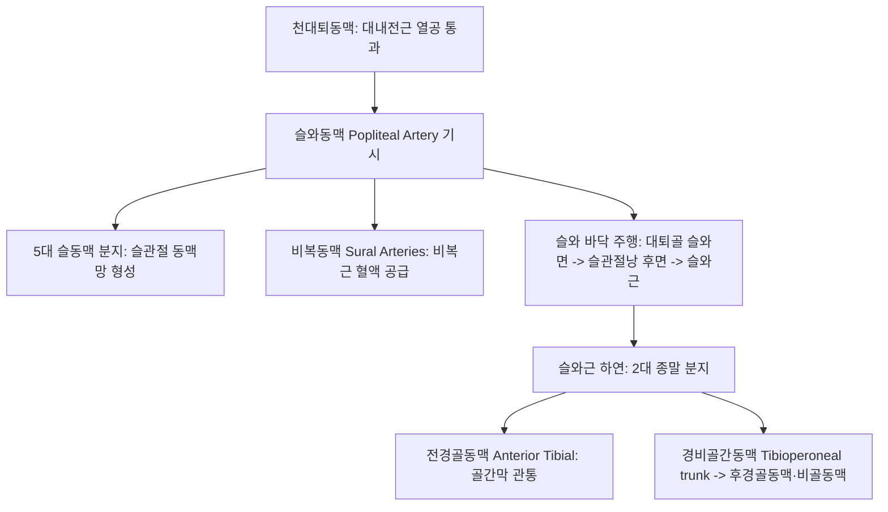

# 슬와동맥 (Popliteal Artery: Anatomy, Hemodynamics & Clinical Interventions)

> **핵심 임상 요약 (Key Clinical Summary)**:
> - **해부학적 기원 및 슬와 주행**: 대퇴골 대내전근 열공(Adductor hiatus)에서 대퇴동맥의 연속으로 시작하여, 오금(Popliteal fossa) 깊숙한 바닥을 통과한 뒤 비골두 원위부 슬와근(Popliteus) 하연에서 [[전경골동맥]]과 [[후경골동맥]]으로 분기한다.
> - **신경혈관 다발의 심도 관계 (A-V-N)**: 슬와부에서 심부에서 표재 순서로 **동맥(Artery, 가장 깊음)** $
ightarrow$ 슬와정맥(Vein, 중간) $
ightarrow$ 경골신경([[경골신경|Tibial nerve]], 가장 얕음) 순서로 3차원 적층 배열된다.
> - **슬관절 동맥망(Genicular Anastomosis)**: 5개의 슬동맥(상내/외측, 중, 하내/외측 슬동맥)을 분지하여 슬관절을 완전히 굴곡시켜 주동맥이 일시 압박되더라도 무릎 관절과 하퇴로 혈류가 우회 순환하도록 보장한다.
> - **슬와동맥 포착 증후군 (PAES)**: 비복근 내측두의 비정상적 주행 변이로 인해 젊은 운동선수에서 발목 저측굴곡 시 슬와동맥이 압박되어 종아리 파행과 급성 혈전증을 유발하는 질환이다.
> - **오금 부위 자침 안전 원칙**: [[위중]](BL40), [[위양]](BL39), [[음곡]](KI10) 자침 시 슬와동맥이 가장 심부에 위치하므로 30mm 이상의 무분별한 심부 직자를 금하고, 베이커 낭종 파열이나 슬와동맥류 감별 후 안전하게 시술한다.

---

## 1. 해부학적 기원·주행 경로 및 분지 체계 (Anatomical Pathway & Branches)
슬와동맥(Popliteal Artery, PA)은 무릎 관절과 종아리, 발 전체로 혈액을 보내는 무릎 뒤편의 핵심 동맥이다.

- **슬와(Popliteal Fossa)의 경계와 동맥 주행**:
  - 상외측: [[대퇴이두근]].
  - 상내측: [[반골근]] 및 [[반막양근]].
  - 하외측: [[비복근]] 외측두 및 [[족저근]].
  - 하내측: [[비복근]] 내측두.
  - 슬와동맥은 이 다이아몬드형 공간의 가장 깊은 바닥면(대퇴골 슬와면과 후방 관절낭)에 밀착되어 주행한다.

---

## 2. 혈류역학·관류 영역 및 주변 근막·근육 연계 (Hemodynamics & Perfusion)
- **혈류역학적 특성**:
  - 하지 말초 혈관의 전형적인 고저항성 삼상 파형(Triphasic)을 나타내며, 수축기 피크 속도는 약 60~90 cm/s이다.
- **슬관절 굴곡과 측부 순환**:
  - 무릎을 90도 이상 깊게 굽힐 때 슬와동맥 본간은 심하게 꺾이거나 압박을 받지만, 5개의 슬동맥망을 통해 관류가 끊기지 않고 유지된다.

---

## 3. 혈관성 박동 촉진·청진 및 이학적 검사 (Physical Examination & Pulsation)
- **박동 촉진 (Popliteal Pulse)**:
  - 환자를 복와위로 눕히고 무릎을 30~45도 가볍게 굴곡시켜 슬와근막을 이완시킨 상태에서, 시술자의 양손 엄지를 무릎 전면에 대고 나머지 손가락들을 오금 깊숙이 찔러 넣어 대퇴골 원위부 후면에 동맥을 압박하며 촉지한다.
  - 슬와동맥은 심부에 위치하므로 진찰하기 가장 까다로운 말초 맥박이다.
- **도발 검사 (Provocation Test for PAES)**:
  - 족관절을 강하게 저측굴곡(Plantarflexion)하거나 능동 저항 배굴시킬 때 족배동맥 맥박이 소실되면 슬와동맥 포착 증후군(PAES)을 강하게 의심한다.

---

## 4. 초음파 해부학(Sonoanatomy) 및 도플러 혈류 랜드마크 (Ultrasound & Doppler)
초음파는 슬와동맥류와 포착 증후군, 베이커 낭종 감별의 절대적 검사이다.

- **초음파 영상 특성**:
  - 오금 횡단 스캔 시 가장 깊은 골성 바닥(대퇴골/경골) 바로 위에 둥근 박동성 동맥이 위치하고, 그 바로 위에 탐촉자 압박에 납작해지는 슬와정맥, 표재층에 타원형 고에코의 [[경골신경]]이 차례로 적층 관찰된다.
- **슬와동맥류 (Popliteal Aneurysm) 진단**:
  - 직경이 20mm(2.0cm) 이상으로 확장되면 슬와동맥류로 진단하며, 내강의 벽측 혈전(Mural thrombus) 유무를 도플러로 확인한다.

---

## 5. ⭐ 원장님 심층 임상 고찰 및 원본 필기 (Clinical Pearls & Melt-In)
- **위중혈 자침 시 심부 혈관 신경 회피**:
  - [[위중]](BL40)은 슬와 가로주름 정중앙에 위치하며, 바로 심부에 슬와정맥과 슬와동맥이 주행한다.
  - 심도 20~25mm를 초과하여 강자극 직침하면 혈관벽을 관통하여 오금 부위에 거대한 혈종이 생기거나 경골신경 손상으로 발바닥 마비가 발생할 수 있다.
  - 따라서 위중혈은 직자 시 10~15mm 이내로 가볍게 자침하거나, 사혈 시에는 표재 정맥 분지만을 점자출혈해야 한다.
- **젊은 운동선수의 종아리 통증과 PAES**:
  - 달리기 선수나 군인이 종아리 통증과 파행을 호소할 때 단순 비복근 염좌나 신스프린트로 치부하지 말고, 발목을 폈을 때 발등 맥박이 사라지는지 확인하여 슬와동맥 포착 증후군을 감별해야 한다.

---

## 6. 관련 임상 질환 및 허혈·압박·혈전 증후군 (Pathology & Entrapment)
- **슬와동맥 포착 증후군 (Popliteal Artery Entrapment Syndrome, PAES)**:
  - 선천적으로 비복근 내측두가 외측에서 기시하거나 비정상적인 섬유 띠가 동맥을 감싸 발생한다.
- **슬와동맥류 (Popliteal Artery Aneurysm)**:
  - 말초 동맥류 중 가장 흔하며(약 70%), 파열되기보다는 혈전이 떨어져 나가 발가락 괴사(Blue toe syndrome)를 유발하므로 조기 수술적 결찰/우회술이 필요하다.
- **베이커 낭종 압박 (Baker's Cyst Compression)**:
  - 반막양근-비복근 점액낭이 비대해져 슬와혈관을 압박함으로써 하지 부종과 심부정맥혈전증 유사 증상을 초래한다.

---

## 7. 한의 통합 혈관·신경 치료 프로토콜 (추나·초음파 약침·침구·한약)
- **슬와근 및 슬관절 후방 관절낭 이완 추나**:
  - [[슬와근]], 족저근, 비복근 기시부의 단축을 MET와 관절 가동술로 해소하여 슬와 바닥의 동맥 주행로를 확보한다.
- **슬관절 측부 혈류 활성화 자침**:
  - [[음곡]](KI10), [[곡천]](LR8), [[위양]](BL39), [[슬양관]](GB33)에 침 치료를 시행하여 5대 슬동맥망의 미세 순환을 촉진한다.
- **활혈온경 통락 한약 처방**:
  - 오금 혈관 연축을 풀고 하지 말초 온기를 회복하기 위해 [[당귀사역가오수유생강탕]], [[독활기생탕]], [[우슬]] 배합 처방을 투여한다.

---

## 8. 실존 임상 연구 논문 요약 (Evidence-Based Research)

- Behrens A et al. (2026). [Popliteal artery entrapment syndrome]. *Chirurgie (Heidelb)*. 97(11):928-936. PMID: 42747480
  - [연구 요약] 슬와동맥 포착 증후군의 임상 병기 분류, 동적 혈관 초음파 및 MRI 진단 프로토콜, 외과적 감압술 치료 지침 체계적 고찰.

- Ren Y et al. (2026). Popliteal artery aneurysm with popliteal artery entrapment syndrome: a case report and literature review. *Front Surg*. 13:1795551. PMID: 41982376
  - [연구 요약] 슬와동맥 포착 증후군에 병발한 슬와동맥류의 복합 발생 기전 분석 및 혈관내 수술 치료 증례 보고.
