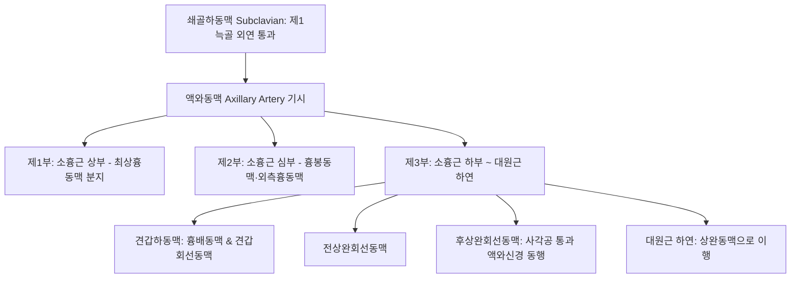

# 액와동맥 (Axillary Artery: Anatomy, Hemodynamics & Clinical Interventions)

> **핵심 임상 요약 (Key Clinical Summary)**:
> - **해부학적 기원 및 3대 분절**: 제1늑골 외측연에서 [[쇄골하동맥]]의 연속으로 시작하여, [[소흉근]](Pectoralis minor)을 기준으로 상부(제1부), 심부(제2부), 하부(제3부)로 구분된 뒤 [[대원근]] 하연에서 [[상완동맥]]으로 이행한다.
> - **상완신경총 신경속과의 3차원 포개짐**: 제2부 액와동맥을 중심으로 상완신경총의 외측속, 내측속, 후속이 동맥을 삼면에서 감싸며, 전방에서 [[정중신경]]의 두 갈래가 결합하여 혈관 신경 다발(Neurovascular bundle)을 이룬다.
> - **주요 분지 체계**: 제1부에서 최상흉동맥, 제2부에서 흉봉동맥과 외측흉동맥, 제3부에서 견갑하동맥과 전/후 상완회선동맥(Circumflex humeral)을 분지하여 견관절 동맥망을 형성한다.
> - **과외전 증후군(Hyperabduction Syndrome)**: 팔을 90도 이상 외전 및 외회전할 때 소흉근 건막 아래에서 액와동맥이 기계적으로 꺾이고 압박되어 상지 파행과 저림을 유발한다.
> - **견관절 자침 안전 가이드**: [[극천]](HT1), [[견정]](SI9), [[중부]](LU1) 자침 시 액와동맥 박동을 반드시 촉진하여 상완골 골절 및 견관절 탈구 후 가성동맥류 형성을 방지하고 소흉근 이완 추나를 적용한다.

---

## 1. 해부학적 기원·주행 경로 및 분지 체계 (Anatomical Pathway & Branches)
액와동맥(Axillary Artery)은 흉곽에서 상지로 진입하는 어깨 영역의 주 간선 동맥이다.

- **상완신경총과의 위치 관계**:
  - 제1부: 상완신경총 줄기들이 동맥의 외측에 위치한다.
  - 제2부: 외측속(Lateral cord)은 외측, 내측속(Medial cord)은 내측, 후속(Posterior cord)은 후방에 위치한다.
  - 제3부: 후상완회선동맥은 [[액와신경]](Axillary nerve)과 함께 사각공(Quadrilateral space)을 통과하여 상완골 외과경을 회전한다.

---

## 2. 혈류역학·관류 영역 및 주변 근막·근육 연계 (Hemodynamics & Perfusion)
- **혈류역학적 파형**:
  - 안정 시 상지 근육계의 높은 저항을 반영하여 날카로운 수축기 피크와 초기 확장기 역전류를 보이는 전형적 고저항성 삼상 파형(Triphasic)을 나타낸다.
- **주변 근막과의 역학적 연계**:
  - 액와초(Axillary sheath)라는 쇄골흉근근막의 연장체 내에 신경총과 함께 매몰되어 주행한다.
  - [[소흉근]]과 [[오훼완근]]의 과긴장은 액와초를 하방으로 압박하여 상지 정맥 및 동맥 환류 장애를 촉발한다.

---

## 3. 혈관성 박동 촉진·청진 및 이학적 검사 (Physical Examination & Pulsation)
- **박동 촉진 (Axillary Pulse)**:
  - 환자의 팔을 가볍게 외전시킨 상태에서 겨드랑이 중심와(Apex of axilla) 상완골 내측면을 향해 깊숙이 손가락을 밀어 넣어 박동을 촉지한다.
- **라이트 과외전 검사 (Wright's Hyperabduction Test)**:
  - 환자의 상지를 180도 외전 및 외회전시키면서 요골맥박을 촉진하며, 맥박이 소실되거나 감소하면 소흉근 증후군(Pectoralis minor syndrome)으로 판정한다.

---

## 4. 초음파 해부학(Sonoanatomy) 및 도플러 혈류 랜드마크 (Ultrasound & Doppler)
초음파는 상완신경총 신경차단술 및 오훼돌기 주변 중재 시술 시 혈관 손상을 방지하는 필수 도구이다.

- **초음파 영상 특성**:
  - 쇄골하 오훼돌기 내측 횡단 스캔 시 소흉근 심부에서 박동하는 둥근 무에코 구조물로 관찰된다.
  - 내측에 위치한 [[액와정맥]]은 호흡에 따라 직경이 변하며 가벼운 압박에 납작해진다.
  - 액와동맥 주위를 둘러싸고 있는 고에코 결절형 신경속들(상완신경총)을 명확히 구분할 수 있다.

---

## 5. ⭐ 원장님 심층 임상 고찰 및 원본 필기 (Clinical Pearls & Melt-In)
- **극천혈 자침 시 신경혈관 손상 방지**:
  - [[극천]](HT1)은 겨드랑이 오목한 중앙에 위치하며 액와동맥 맥동의 바로 내측에 해당한다.
  - 맥동을 손끝으로 외측으로 가볍게 밀어내고, 직자 깊이를 15~20mm 이내로 제한해야 액와동맥 관통 및 액와혈종 형성을 원천 차단할 수 있다.
- **야구 투수·배구 선수의 상지 허혈과 가성동맥류**:
  - 머리 위로 팔을 반복해서 휘두르는 투수나 엘리트 오버헤드 운동선수에서 액와동맥이 소흉근과 상완골두 사이에서 반복 마찰되어 가성동맥류나 박리가 발생할 수 있다.
  - 손끝 저림과 창백, 손가락 파행을 호소하면 단순 근막통으로 보지 말고 혈관 도플러 초음파를 확인해야 한다.

---

## 6. 관련 임상 질환 및 허혈·압박·혈전 증후군 (Pathology & Entrapment)
- **혈관성 흉곽출구 증후군 (소흉근 증후군)**:
  - 오훼돌기 아래에서 과외전 시 액와동맥이 눌려 손 전체의 냉감과 청색증, 맥박 약화를 유발한다.
- **사각공 증후군 (Quadrilateral Space Syndrome)**:
  - 사각공 내에서 후상완회선동맥과 액와신경이 압박되어 [[삼각근]] 위축과 어깨 후면 통증을 초래한다.

---

## 7. 한의 통합 혈관·신경 치료 프로토콜 (추나·초음파 약침·침구·한약)
- **소흉근 및 대흉근 이완 추나요법**:
  - 오훼돌기 부착부의 소흉근 건막을 횡마찰 수기 및 MET로 신장시켜 액와 혈관 통로의 단면적을 넓힌다.
- **상지 혈행 개선 침구 치료**:
  - [[견우]](LI15), [[견료]](TE14), [[노회]](TE13), [[비노]](LI14)에 자침하여 삼각근하 혈관망 순환을 촉진한다.
- **활혈온경 한약 요법**:
  - 어깨 주변 혈관 연축과 상지 냉감을 개선하기 위해 [[오적산]], [[계지탕]], [[당귀사역탕]]을 처방한다.

---

## 8. 실존 임상 연구 논문 요약 (Evidence-Based Research)

- Tiwari S et al. (2026). Upper-Limb Ischemia Due to Distal Embolization from a Dissecting Axillary Artery Pseudoaneurysm in an Elite Overhead Athlete: A Case Report. *Vasc Specialist Int*. 42:38. PMID: 42806571
  - [연구 요약] 오버헤드 엘리트 운동선수에서 반복적 견관절 과외전으로 발생한 액와동맥 박리성 가성동맥류 및 원위부 색전증의 초음파 진단과 외과적 혈관 재건술 증례 보고.

- Mitsuzawa S et al. (2024). Axillary Artery Injury Associated with Dislocated or Displaced Proximal Humeral Fracture: A Report of 3 Cases. *JBJS Case Connect*. 14(3):. PMID: 39146441
  - [연구 요약] 상완골 근위부 골절 및 견관절 탈구 시 동반되는 액와동맥 파열과 신경 손상의 임상적 조기 진단 및 혈류 평가 프로토콜 고찰.
