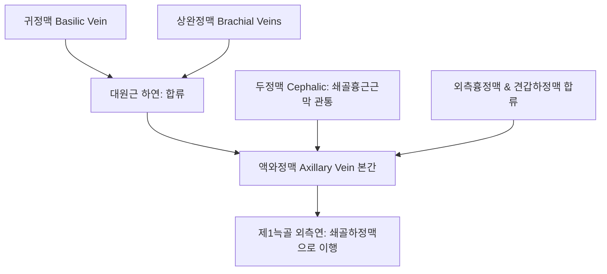

# 액와정맥 (Axillary Vein: Anatomy, Hemodynamics & Clinical Interventions)

> **핵심 임상 요약 (Key Clinical Summary)**:
> - **해부학적 기원 및 주행**: [[대원근]] 하연에서 상완정맥(Brachial veins)과 귀정맥(Basilic vein)이 합류하여 시작되어, [[액와동맥]]의 전내측을 따라 상행한 뒤 제1늑골 외측연에서 [[쇄골하정맥]]으로 이행한다.
> - **상지 심부 정맥 환류의 주관문**: 상지 전체의 심부 정맥혈과 [[두정맥]](Cephalic vein, 쇄골흉근근막 관통 유입)의 표재 정맥혈을 수합하여 흉곽으로 전달하는 대형 정맥이다.
> - **파젯-슈뢰터 증후군(Paget-Schroetter Syndrome)**: 젊은 운동선수나 육체 노동자가 과도한 상지 반복 운동 후 액와-쇄골하정맥에 급성 [[심부정맥혈전증]](노력성 혈전증)이 발생하여 팔이 붓고 청색증이 나타나는 응급 질환이다.
> - **초음파 유도 중심정맥 천자 랜드마크**: 쇄골하 정맥 천자 시 기흉 위험을 줄이기 위해 제1늑골 외측의 액와정맥을 초음파로 직접 보면서 천자하는 안전 접근법이 표준화되어 있다.
> - **한의 임상 및 림프 배액 연계**: 유방암 수술이나 림프절 절제 후 발생하는 상지 [[림프부종]] 환자에서 액와 림프 순환을 돕는 부드러운 경근 [[추나요법|추나]]와 극천혈 주변 혈종 방지 안전 수기를 적용한다.

---

## 1. 해부학적 기원·주행 경로 및 분지 체계 (Anatomical Pathway & Branches)
액와정맥(Axillary Vein)은 상지의 정맥혈을 쇄골하정맥으로 인도하는 통로이다.

- **액와동맥과의 3차원 위치 관계**:
  - 액와정맥은 액와동맥의 전내측(Anteromedial)에 위치하며, 직경이 동맥보다 크고 벽이 얇다.
  - 내측피부신경들이 정맥과 동맥 사이를 지나간다.

---

## 2. 혈류역학·관류 영역 및 주변 근막·근육 연계 (Hemodynamics & Perfusion)
- **혈류역학적 특성**:
  - 호흡 주기와 상지 근육 수축에 따라 혈류 속도가 크게 변동한다.
  - 늑쇄공간과 쇄골흉근근막 통과 부위에서 흉곽 운동에 따른 외인성 압박을 받는다.
- **주변 근막과의 관계**:
  - 액와초 내에서 결합조직에 의해 둘러싸여 있으며, 상지를 외전시킬 때 팽팽하게 신장된다.

---

## 3. 혈관성 박동 촉진·청진 및 이학적 검사 (Physical Examination & Pulsation)
- **상지 정맥 울혈 시진 (Visual Inspection)**:
  - 양측 팔의 둘레를 계측하고, 환측 팔의 종창, 청색증, 손등 표재 정맥의 팽창 여부를 확인한다.
- **측부 순환 정맥망 관찰 (Urschel's Sign)**:
  - 어깨 전면과 흉벽 상부에 확장된 표재성 측부 정맥망이 관찰되면 만성 액와-쇄골하정맥 폐색을 강력히 시사한다.

---

## 4. 초음파 해부학(Sonoanatomy) 및 도플러 혈류 랜드마크 (Ultrasound & Doppler)
[[초음파]]는 상지 심부정맥혈전증(DVT)을 선별하는 1차 검사이다.

- **초음파 영상 특성**:
  - 쇄골하 스캔 시 박동하는 액와동맥의 내측에서 타원형의 무에코 내강으로 관찰된다.
  - 탐촉자로 수직 압박 시 내강이 완전히 맞붙어야(Full compressibility) 정상이며, 혈전이 있으면 압박되지 않고 내부 에코가 관찰된다.
- **도플러 파형**:
  - 정상적인 호흡성 혈류 변동(Phasicity)과 원위부 압박 시 혈류 급증(Augmentation)이 나타나야 한다.

---

## 5. ⭐ 원장님 심층 임상 고찰 및 원본 필기 (Clinical Pearls & Melt-In)
- **액와부 자침 시 정맥혈종 및 감염 예방**:
  - [[극천]](HT1) 혈자리는 액와정맥과 불과 수 밀리미터 거리이다.
  - 액와 정맥혈관총은 압력이 낮고 벽이 얇아 관통 시 피하 출혈이 광범위하게 퍼지기 쉬우므로, 침을 깊게 찌르지 말고 발침 후 3분 이상 압박 지혈한다.
  - 액와부는 땀샘과 피지선이 밀집되어 감염 위험이 높으므로 엄격한 알코올 소독이 필수적이다.
- **젊은 운동선수의 급성 팔 부종(파젯-슈뢰터 증후군)**:
  - 헬스, 수영, 투구 동작 후 갑자기 한쪽 팔 전체가 붓고 무거워지며 피부가 푸르스름하게 변하는 경우, 근육통으로 오진하고 강한 마사지를 가하면 혈전이 폐로 날아가 [[폐색전증]]을 유발할 수 있으므로 즉시 응급 초음파/CT를 의뢰해야 한다.

---

## 6. 관련 임상 질환 및 허혈·압박·혈전 증후군 (Pathology & Entrapment)
- **파젯-슈뢰터 증후군 (Paget-Schroetter Syndrome)**:
  - 늑쇄공간에서 액와-쇄골하정맥이 쇄골과 [[제1늑골]] 사이에서 만성 압박을 받아 혈관내피 손상과 혈전이 형성되는 노력성 DVT이며 [[흉곽출구 증후군]]과 밀접하다.
- **상지 림프정맥 부종 (Lymphedema)**:
  - 유방암 림프절 곽청술 후 정맥 및 림프 유출 장애로 비가역적 상지 종창이 발생한다.

---

## 7. 한의 통합 혈관·신경 치료 프로토콜 (추나·초음파 약침·침구·한약)
- **흉곽 림프 정맥 배액 수기요법**:
  - 쇄골상와와 액와부의 근막 긴장을 [[도침]]과 수기로 부드럽게 이완하여 상지 정맥혈 환류를 촉진한다.
- **상지 정맥 울혈 침구 요법**:
  - [[곡지]](LI11), [[수삼리]](LI10), [[외관]](TE5) 자침 및 [[약침]]을 통해 상지 근육 펌프 작용을 활성화한다.
- **활혈화어 이수 한약 처방**:
  - 림프 정맥 순환을 회복하고 부종을 소퇴시키기 위해 [[오령산]], [[방기황기탕]], [[당귀수산]]을 병용 투여한다.

---

## 8. 실존 임상 연구 논문 요약 (Evidence-Based Research)

- Tebaig B et al. (2026). Paget-Schroetter Syndrome With Focal Subclavian Arterial Stenosis Following Repetitive Overhead Activity: A Case Report. *Cureus*. 18(10):e117355. PMID: 42968971
  - [연구 요약] 반복적 오버헤드 운동 후 발생한 액와-쇄골하정맥의 파젯-슈뢰터 증후군 및 동맥 협착 동반 증례의 혈관 초음파 감별 및 항응고 중재 프로토콜.

- VadlamudiChandrashekar M et al. (2026). Effort-Related Upper Extremity Deep Vein Thrombosis: A Case Series of Three Patients With Paget-Schroetter Syndrome Managed in Acute Care Settings. *Cureus*. 18(9):e115886. PMID: 42846903
  - [연구 요약] 상지 과사용에 따른 액와정맥 심부정맥혈전증 3례의 급성기 진단 지표와 카테터 혈전용해술 임상 경과 분석.
