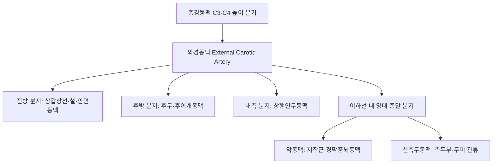

# 외경동맥 (External Carotid Artery: Anatomy, Hemodynamics & Clinical Interventions)

> **핵심 임상 요약 (Key Clinical Summary)**:
> - **해부학적 기원 및 8대 분지**: [[총경동맥]]에서 C3-C4 높이(갑상연골 상연)에서 분기하여, 경부에서 분지가 전혀 없는 [[내경동맥]]과 달리 경부와 안면에서 8개의 주요 분지(상갑상선·설·안면·상행인두·후두·후이개·악·천측두동맥)를 뻗어 두경부 외측 전체를 관류한다.
> - **측부 순환의 보고**: 뇌경색이나 내경동맥 폐색 시 안동맥(Ophthalmic artery)과의 역행성 문합을 통해 윌리스 환으로 뇌혈류를 공급하는 결정적인 우회로(Collateral) 역할을 담당한다.
> - **혈류역학적 특성**: 근육과 피부를 관류하므로 확장기 혈류가 낮고 저항이 높은 전형적인 고저항성 혈관 파형(High-resistance waveform)을 나타낸다.
> - **안면 및 턱관절 자침 안전 랜드마크**: [[하관]](ST7), [[협거]](ST6), [[이문]](TE21), [[태양]](EX-HN5) 자침 시 악동맥과 천측두동맥 박동을 확인하여 혈종 형성을 방지한다.
> - **측두동맥염(Giant Cell Arteritis) 감별**: 50세 이상에서 편측 측두통, 천측두동맥의 삭상 비후 및 압통, 시력 저하가 발생할 경우 실명 위험이 있는 측두동맥염을 의심하고 응급 처치한다.

---

## 1. 해부학적 기원·주행 경로 및 분지 체계 (Anatomical Pathway & Branches)
외경동맥(External Carotid Artery, ECA)은 안면과 두피, 경부 외측을 영양하는 혈관망의 본간이다.

- **이하선(Parotid Gland) 통과**:
  - 하악지 후방에서 이하선 실질 내부를 관통하며, 하악후정맥 및 [[안면신경]](Facial nerve)과 밀접하게 교차한다.
- **주요 분지 체계 요약**:
  - [[안면동맥]](Facial artery): 하악골 하연을 돌아 입꼬리와 비익을 거쳐 내안각으로 주행.
  - 악동맥(Maxillary artery): 측두하와를 지나 악안면 심부와 경막(중경막동맥)을 관류.
  - 천측두동맥(Superficial temporal artery): 이개 전방을 지나 측두부 두피로 주행.

---

## 2. 혈류역학·관류 영역 및 주변 근막·근육 연계 (Hemodynamics & Perfusion)
- **혈류역학적 파형**:
  - 높은 말초 저항을 반영하여 날카로운 수축기 파형과 얕은 확장기 혈류를 보인다.
  - 저항지수(RI)는 0.75~0.85 범위로 내경동맥(0.55~0.70)보다 현저히 높다.
- **측두근 및 저작근막 연계**:
  - 천측두동맥과 악동맥은 [[교근]], [[측두근]], 익상근에 풍부한 혈액을 공급하므로 저작근의 만성 긴장은 혈관 연축을 유발할 수 있다.

---

## 3. 혈관성 박동 촉진·청진 및 이학적 검사 (Physical Examination & Pulsation)
- **안면동맥 박동 촉진**:
  - 교근 전연, 하악골 하연의 오목한 부위([[대영]] ST5 혈 부위)에서 쉽게 촉지된다.
- **천측두동맥 박동 촉진**:
  - 이주(Tragus) 바로 전방, 관골궁 상방([[이문]] TE21 전방)에서 표재성 맥박을 확인한다.
- **측두동맥염 징후 검사**:
  - 측두동맥 주행을 따라 압통, 단단한 결절감, 박동 소실 여부를 확인한다.

---

## 4. 초음파 해부학(Sonoanatomy) 및 도플러 혈류 랜드마크 (Ultrasound & Doppler)
초음파는 내경동맥과 외경동맥을 감별하는 핵심 표준 도구이다.

- **내경동맥과의 초음파 감별 포인트**:
  - 위치: 대개 외경동맥이 전내측에 위치한다.
  - 구경: 외경동맥의 내경이 내경동맥보다 다소 작다.
  - 분지 확인: 분기부 직상방에서 상갑상선동맥 등 경부 분지가 관찰되면 외경동맥이다.
  - 측두동맥 톡톡 두드리기(Temporal Tap): 천측두동맥을 손가락으로 두드릴 때 도플러 혈류 신호에 진동성 톱니 파형이 나타나면 외경동맥으로 확진한다.

---

## 5. ⭐ 원장님 심층 임상 고찰 및 원본 필기 (Clinical Pearls & Melt-In)
- **턱관절 및 측두부 자침 시 혈종 방지**:
  - [[하관]](ST7)과 [[청궁]](SI19) 자침 시 악동맥 분지와 천측두동맥이 근접해 있으므로, 개구 상태에서 턱관절 간극을 확보하고 천천히 진침해야 한다.
  - 혈관을 찌를 경우 안면 피하에 거대한 혈종이 생겨 개구 장애가 악화될 수 있으므로 발침 후 충분히 압박한다.
- **측두동맥염의 조기 진단**:
  - 고령 환자가 편측 측두부 두통과 함께 음식을 씹을 때 턱이 아픈 파행(Jaw claudication)을 호소하고 혈침속도(ESR)가 급상승해 있다면 측두동맥염을 즉시 의심해야 한다. 스테로이드 응급 투여가 늦어지면 중심망막동맥 폐색으로 실명할 수 있다.

---

## 6. 관련 임상 질환 및 허혈·압박·혈전 증후군 (Pathology & Entrapment)
- **측두동맥염 (Giant Cell Arteritis)**:
  - 대형 및 중형 동맥을 침범하는 육아종성 혈관염으로 두통, 시력 장애, 류마티스성 다발근통을 동반한다.
- **경동맥-해면정맥동 누공 (CCF)**:
  - 외경동맥 분지와 해면정맥동 사이의 비정상적 혈관 문합으로 박동성 안구돌출, 결막 부종, 안구 잡음을 유발한다.

---

## 7. 한의 통합 혈관·신경 치료 프로토콜 (추나·초음파 약침·침구·한약)
- **턱관절 및 악관절 추나요법**:
  - 하악골 과두 가동술과 익상근 근막 이완을 통해 악동맥의 혈류 저항을 완화한다.
- **안면부 혈류 개선 침구 요법**:
  - [[태양]](EX-HN5), [[사죽공]](TE23), [[협거]](ST6)에 자침하여 삼차신경-혈관 반사를 통한 미세 순환 개선을 유도한다.
- **청열양혈 소종 한약 처방**:
  - 혈관염증과 두통 완화를 위해 [[청상견통탕]], [[황련해독탕]], [[형개연교탕]]을 처방한다.

---

## 8. 실존 임상 연구 논문 요약 (Evidence-Based Research)

- Dinc V et al. (2026). Left anterior laryngeal loop of the common carotid artery in a cluster of bilateral cervicothoracic vascular variants: a case report. *Surg Radiol Anat*. 48(1):. PMID: 42955108
  - [연구 요약] 외경동맥 및 총경동맥의 경부 혈관 주행 루프 변이와 두경부 중재술 시 혈관 손상 예방을 위한 영상 해부학적 고찰.

- Patel NV et al. (2020). Vascularized Temporoparietal Fascial Flap: A Novel Surgical Technique to Bypass the Blood-Brain Barrier in Glioblastoma. *World Neurosurg*. 143:38-45. PMID: 32712410
  - [연구 요약] 외경동맥의 종말 분지인 천측두동맥 혈관경을 활용한 측두근막 피판 형성술 및 안면-측두 혈관망의 임상 수술적 유용성 분석.
