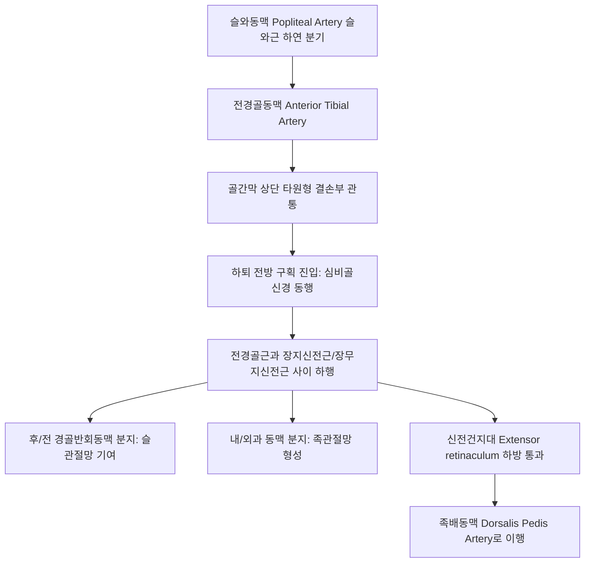

# 전경골동맥 (Anterior Tibial Artery: Anatomy, Hemodynamics & Clinical Interventions)

> **핵심 임상 요약 (Key Clinical Summary)**:
> - **해부학적 기원 및 골간막 관통**: 슬와근 하연에서 [[슬와동맥]]에서 기시하여, 하퇴 골간막(Interosseous membrane) 상단 결손부를 관통하여 전방 구획으로 진입한 뒤 [[심비골신경]]과 함께 하퇴 전면을 하행한다.
> - **하퇴 전방 구획 증후군(Compartment Syndrome)의 중심 혈관**: 단단한 골막과 근막으로 둘러싸인 전방 구획 내에 위치하므로, 경골 골절이나 외상 후 내압 상승 시 혈관이 조기에 폐색되어 비가역적 근육 괴사와 족하수(Foot drop)를 초래한다.
> - **신경 동행 관계**: [[전경골근]](Tibialis anterior)과 장무지신전근 사이에서 심비골신경과 나란히 주행하며, 발목 신전건지대를 지나 [[족배동맥]]으로 이행한다.
> - **족양명위경 주행 궤적**: [[족삼리]](ST36), [[상거허]](ST37), [[조구]](ST38), [[하거허]](ST39), [[해계]](ST41)의 해부학적 심부 궤적과 일치하여 위경 자침 시 핵심 지표 혈관이다.
> - **한의 임상 안전과 연계**: 족삼리 침도 및 심부 자침 시 전경골동맥 관통을 방지하고, 전경골근 근막 이완 추나로 전방 구획 내압을 완화한다.

---

## 1. 해부학적 기원·주행 경로 및 분지 체계 (Anatomical Pathway & Branches)
전경골동맥(Anterior Tibial Artery, ATA)은 하퇴 전방 신전근군과 족배부의 주 혈관이다.

- **골간막 관통부의 임상 의의**:
  - 골간막 상단 틈새를 직각으로 꺾이며 통과하므로 경골 근위부 골절 시 전단 손상을 받기 쉽다.
- **주요 분지**:
  - 후/전 경골반회동맥, 근지(전방 구획 근육 공급), 전내과동맥, 전외과동맥.

---

## 2. 혈류역학·관류 영역 및 주변 근막·근육 연계 (Hemodynamics & Perfusion)
- **혈류역학적 특성**:
  - 하지 말초 근육계의 고저항성 삼상 파형(Triphasic)을 나타낸다.
  - 전방 구획 내압이 30mmHg 이상으로 상승하면 모세혈관 관류압을 초과하여 동맥혈 흐름이 급감한다.
- **주변 근막과의 관계**:
  - 경골 외측면, 비골, 골간막, 하퇴 전방 근막으로 둘러싸인 신축성 없는 폐쇄 구획 내에 갇혀 있다.

---

## 3. 혈관성 박동 촉진·청진 및 이학적 검사 (Physical Examination & Pulsation)
- **하퇴 원위부 박동 촉진**:
  - 족관절 전면 중앙, 전경골근건과 장무지신전근건 사이에서 전경골동맥 원위부 박동을 촉지한다.
- **구획 증후군 선별 검사 (5P 징후)**:
  - 전방 구획의 극심한 통증(Pain), 근육 압통 및 긴장, 발가락 수동 굴곡 시 악화되는 통증, 제1-2 족지 간 감각 저하([[심비골신경]] 손상), 족배동맥 맥박 소실(Pulselessness)을 확인한다.

---

## 4. 초음파 해부학(Sonoanatomy) 및 도플러 혈류 랜드마크 (Ultrasound & Doppler)
초음파는 전방 구획의 근육 부종 및 혈관 개통성을 평가하는 필수 도구이다.

- **초음파 영상 특성**:
  - 하퇴 전면 횡단 스캔 시 골간막(Interosseous membrane)의 밝은 고에코 선 바로 위, 전경골근과 장무지신전근 사이에서 둥근 박동성 동맥과 동행정맥, 심비골신경이 복합체를 이룬다.
- **도플러 파형 평가**:
  - 정상적인 수축기 고속 전방류와 확장기 역전파를 확인하며, 구획 내압 상승 시 확장기 혈류 역전이 심화되거나 혈류가 소실된다.

---

## 5. ⭐ 원장님 심층 임상 고찰 및 원본 필기 (Clinical Pearls & Melt-In)
- **족삼리혈 자침 시 심비골신경 및 전경골동맥 보호**:
  - [[족삼리]](ST36)는 경골 조면 외측 1촌 부위로, 심도 25~30mm 이상 깊이 직자하면 전경골근을 관통하여 골간막 전면의 전경골동맥과 심비골신경에 도달한다.
  - 굵은 호침이나 도침으로 강자극을 주다 혈관을 손상시키면 구획 내 출혈로 전방 구획 증후군을 유발할 수 있으므로, 15~20mm 깊이로 전경골근 근복 내에 침첨을 유지해야 한다.
- **러너의 정강이 통증(신스프린트)과 만성 구획 증후군 감별**:
  - 마라톤 선수나 달리기 애호가가 정강이 전외측 통증을 호소할 때, 골막염(신스프린트)뿐 아니라 운동 시에만 전경골동맥이 압박받는 만성 노작성 구획 증후군(CECS)을 감별해야 한다.

---

## 6. 관련 임상 질환 및 허혈·압박·혈전 증후군 (Pathology & Entrapment)
- **급성 전방 구획 증후군 (Acute Anterior Compartment Syndrome)**:
  - 경골 골절, 심한 타박 후 근막 절개술(Fasciotomy)이 6시간 이내에 이루어지지 않으면 전경골근 괴사 및 영구적 족하수를 남긴다.
- **전경골동맥 가성동맥류**:
  - 경골 수내정 고정술이나 발목 관절경 시술 후 손상으로 발생한다.

---

## 7. 한의 통합 혈관·신경 치료 프로토콜 (추나·초음파 약침·침구·한약)
- **전방 구획 근막 이완 추나요법**:
  - 전경골근과 장지신전근 사이에 IASTM 글라이딩 및 근막 롤링 기법을 적용하여 구획 내 긴장을 완화한다.
- **족양명위경 혈자리 자침 요법**:
  - [[상거허]](ST37), [[조구]](ST38), [[해계]](ST41)를 취혈하여 하퇴 전방 혈류 순환을 촉진한다.
- **활혈소종 거어 한약 처방**:
  - 외상성 부종과 미세순환 장애를 개선하기 위해 [[당귀수산]], [[복령택사탕]], [[도인승기탕]]을 처방한다.

---

## 8. 실존 임상 연구 논문 요약 (Evidence-Based Research)

- Patel M et al. (2026). Charting Variant Vascular Pathways in Musculoskeletal Imaging: Clinical and Surgical Implications. *Radiographics*. 46(3):e250073. PMID: 41712440
  - [연구 요약] 하퇴 및 전경골동맥의 골간막 관통부 해부학적 주행 변이와 근골격계 수술 및 중재 시술 시 혈관 손상 예방을 위한 영상 분석.

- Sinjeri D et al. (2026). Posterior tibial artery pseudoaneurysm after titanium elastic nailing for tibial shaft fracture in a 7-year-old boy. *Acta Chir Belg*. 126(1):15-17. PMID: 41404826
  - [연구 요약] 경골 간부 골절 및 정형외과적 고정술 후 발생하는 하퇴 간선 동맥(전/후경골동맥) 손상 및 가성동맥류의 초음파 감별 증례 고찰.
