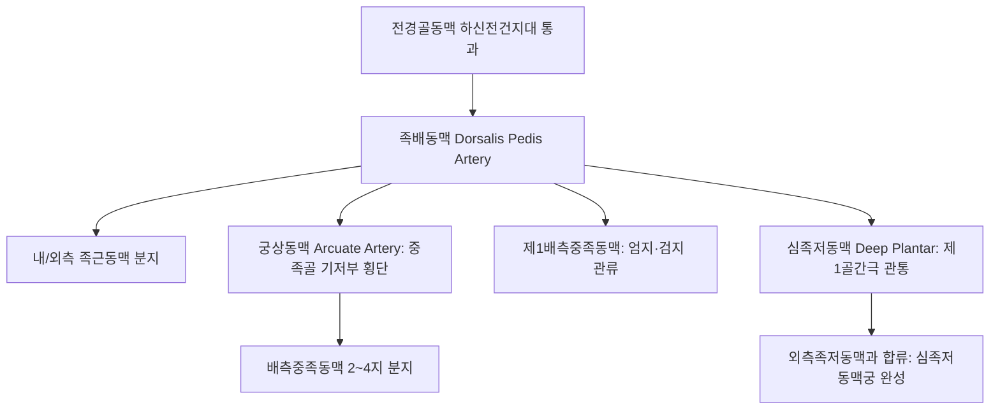

# 족배동맥 (Dorsalis Pedis Artery: Anatomy, Hemodynamics & Clinical Interventions)

> **핵심 임상 요약 (Key Clinical Summary)**:
> - **해부학적 기원 및 주행**: [[전경골동맥]]이 발목 관절의 하신전건지대(Inferior extensor retinaculum) 하연을 통과하며 족배동맥으로 전환되어, 장무지신전근건(EHL) 외측을 따라 제1, 2 중족골 기저부 사이를 향해 주행한다.
> - **종말 분지 및 족저동맥궁 문합**: 제1배측중족동맥과 심족저동맥(Deep plantar artery)으로 분지하며, 심족저동맥은 제1골간극을 관통하여 발바닥으로 내려가 외측족저동맥과 문합하여 족저동맥궁(Plantar arch)을 완성한다.
> - **말초동맥 질환(PAD) 및 당뇨발 선별의 핵심 맥동**: 인체 최원위부에서 가장 쉽게 촉진되는 동맥으로, 맥박 소실은 말초혈관 폐색 및 당뇨병성 족부 궤양의 조기 경고 징후이다.
> - **발목-상완 지수(ABI) 측정 기준**: 족배동맥 수축기 혈압은 도플러를 이용한 ABI 측정의 절대 표준으로, 0.90 미만 시 하지 동맥 질환을 확진한다.
> - **족배부 침구 시술 안전 가이드**: [[충양]](ST42), [[태충]](LR3), [[함곡]](ST43) 자침 시 동맥 박동을 반드시 촉진하여 혈관벽 손상을 회피하고 당뇨 환자의 족부 침 치료 시 철저히 멸균 관리한다.

---

## 1. 해부학적 기원·주행 경로 및 분지 체계 (Anatomical Pathway & Branches)
족배동맥(Dorsalis Pedis Artery, DPA)은 발등과 발가락 전체의 주 영양 동맥이다.

- **해부학적 결손 변이 (Agenesis/Absence)**:
  - 정상인의 약 8~12%에서는 선천적으로 족배동맥이 결손되거나 매우 왜소하며, 비골동맥의 관통지(Perforating peroneal artery)가 발등 순환을 대신한다.

---

## 2. 혈류역학·관류 영역 및 주변 근막·근육 연계 (Hemodynamics & Perfusion)
- **혈류역학적 파형**:
  - 인체 말초 최원위부로서 혈관 저항이 매우 높아 정상 상태에서 뚜렷한 삼상 파형(Triphasic)을 나타낸다.
  - 당뇨병성 중막석회화증(Mönckeberg sclerosis) 환자에서는 혈관벽이 딱딱해져 비압축성 혈관(ABI > 1.40) 소견을 보인다.
- **주변 힘줄과의 해부학적 관계**:
  - 내측에는 [[장무지신전근]](EHL) 건이, 외측에는 [[단무지신전근]](EHB) 및 장지신전근건이 밀착 주행한다.

---

## 3. 혈관성 박동 촉진·청진 및 이학적 검사 (Physical Examination & Pulsation)
- **족배동맥 박동 촉진 (Palpation)**:
  - 환자의 발목을 가볍게 이완시킨 상태에서, 제1-2 중족골 기저부 사이(장무지신전근건 외측 고랑)에 시술자의 검지와 중지를 부드럽게 얹어 맥박을 촉지한다.
  - 과도하게 강하게 누르면 동맥이 뼈에 눌려 맥박이 인위적으로 소실되므로 가벼운 접촉이 원칙이다.
- **도플러 맥박 청진**:
  - 손가락으로 맥박이 만져지지 않을 경우 핸드헬드 혈관 도플러(Handheld Doppler)로 박동음을 확인한다.

---

## 4. 초음파 해부학(Sonoanatomy) 및 도플러 혈류 랜드마크 (Ultrasound & Doppler)
초음파는 당뇨발 궤양의 미세혈류 평가와 말초동맥 폐색을 진단하는 핵심 도구이다.

- **초음파 영상 특성**:
  - 중족골 골간 스캔 시 피하 2~4mm 깊이에서 원형의 박동성 무에코 혈관으로 관찰된다.
  - 내경은 정상 성인에서 약 1.8~2.5mm이다.
- **스펙트럴 도플러 평가**:
  - 죽상경화증 진행 시 삼상 파형이 이상성(Biphasic)을 거쳐 단상성(Monophasic) 완만 파형으로 퇴화한다.

---

## 5. ⭐ 원장님 심층 임상 고찰 및 원본 필기 (Clinical Pearls & Melt-In)
- **충양혈 및 태충혈 자침 시 혈관 손상 회피**:
  - [[충양]](ST42)은 족배동맥 맥동처 바로 위에 위치한 위경의 원혈이다.
  - 충양혈과 [[태충]](LR3) 자침 시 동맥 벽을 직접 찌르면 발등 피하에 광범위한 청자색 혈종이 형성되어 보행 시 심한 통증을 유발한다.
  - 따라서 손끝으로 박동을 느껴 동맥의 외측 또는 내측 가장자리로 비껴서 안전하게 사침해야 한다.
- **당뇨병 환자의 발 시진과 맥박 확인 의무**:
  - 당뇨 환자가 발가락 저림, 냉감, 상처를 호소할 때 침 치료 전 반드시 족배동맥과 [[후경골동맥]] 맥박을 확인해야 한다.
  - 맥박이 전혀 만져지지 않고 발이 차가우면 [[당뇨병]]성 말초혈관질환으로 상처가 괴사될 위험이 높으므로 감염성 침 치료를 피하고 즉시 혈관외과로 의뢰한다.

---

## 6. 관련 임상 질환 및 허혈·압박·혈전 증후군 (Pathology & Entrapment)
- **폐색성 혈전혈관염 (버거병, Buerger's Disease)**:
  - 젊은 남성 흡연자에서 족배동맥 및 족저동맥의 비죽상경화성 분절성 염증으로 발가락 허혈과 궤양을 초래한다.
- **족배동맥 가성동맥류**:
  - 신발 끈 압박, 발등 타박상, 족관절 수술 후 발생한다.

---

## 7. 한의 통합 혈관·신경 치료 프로토콜 (추나·초음파 약침·침구·한약)
- **족부 족근관 및 신전건지대 이완 추나**:
  - 하신전건지대와 족배 근막을 부드럽게 이완하여 족배동맥의 기계적 압박을 해소한다.
- **말초 혈관 확장 침구 요법**:
  - [[태충]](LR3), [[삼음교]](SP6), [[족삼리]](ST36)에 전침(2Hz)을 시술하여 하지 미세혈관 확장과 측부 혈류를 촉진한다.
- **온경산한 활혈통락 한약 처방**:
  - 족부 냉감과 말초 허혈 개선을 위해 [[당귀사역가오수유생강탕]], [[계지복령환]], [[사물탕]] 가미방을 처방한다.

---

## 8. 실존 임상 연구 논문 요약 (Evidence-Based Research)

- Nakamine R et al. (2026). Palpation versus handheld Doppler for identifying lowerlimb peripheral arteries: Timeefficiency and reliability in healthy adults. *Clin Physiol Funct Imaging*. 46(1):e70039. PMID: 41334968
  - [연구 요약] 족배동맥 및 후경골동맥의 촉진법과 핸드헬드 도플러 검사의 검사자 간 신뢰도, 소요 시간 및 진단 일치도 임상 비교 연구.

- Herráiz-Adillo A et al. (2018). Physical examination to screen for peripheral artery disease in a defined Primary Care population: A diagnostic accuracy study. *Int J Clin Pract*. 72(11):e13253. PMID: 30222240
  - [연구 요약] 1차 진료 환경에서 족배동맥 및 후경골동맥 맥박 소실 소견의 말초동맥 폐색 질환 선별 진단 정확도 체계적 검증.
