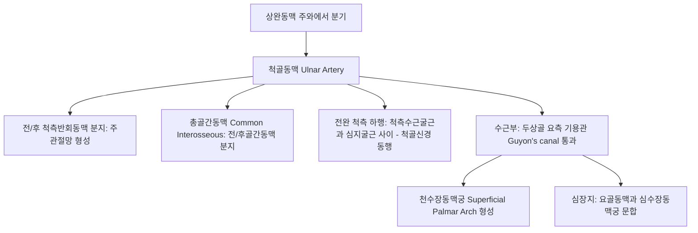

# 척골동맥 (Ulnar Artery: Anatomy, Hemodynamics & Clinical Interventions)

> **핵심 임상 요약 (Key Clinical Summary)**:
> - **해부학적 기원 및 주행**: 주와에서 [[상완동맥]]의 내측 종말 분지로 시작하여, [[원회내근]]과 심지굴근 심부를 비스듬히 가로지른 뒤 전완 척측을 하행하여 [[척골신경]]과 합류하고 [[기용관]](Guyon's canal)을 통과하여 손바닥으로 진입한다.
> - **천수장동맥궁(Superficial Palmar Arch)의 주도관**: 손바닥의 천수장동맥궁을 주도적으로 형성하여 제2~5 수지 동맥을 분지함으로써 손가락 혈류의 60~70% 이상을 공급한다.
> - **알렌 검사(Allen's Test)와 측부 순환**: 요골동맥 천자나 카테터 삽입 전 척골동맥의 개통성과 손바닥 동맥궁의 측부 순환 유효성을 평가하는 필수 이학적 검사이다.
> - **가설망치 증후군(Hypothenar Hammer Syndrome)**: 손바닥 소어제(Hypothenar) 부위로 단단한 물건을 반복적으로 두드릴 때 유구골 갈고리(Hook of hamate) 위를 지나는 척골동맥이 손상되어 동맥류나 혈전증을 유발한다.
> - **수소음심경 자침 안전 가이드**: [[신문]](HT7), [[음극]](HT6), [[통리]](HT5), [[소해]](HT3) 자침 시 척측수근굴근건 요측의 척골동맥 박동을 촉진하고 신경혈관 다발 손상을 방지한다.

---

## 1. 해부학적 기원·주행 경로 및 분지 체계 (Anatomical Pathway & Branches)
척골동맥(Ulnar Artery)은 전완 내측과 손바닥의 주 관류 동맥이다.

- **기용관(Guyon's Canal) 통과 랜드마크**:
  - 내측: 두상골(Pisiform).
  - 외측: 유구골 구(Hook of hamate).
  - 천장: 수근장측인대(Volar carpal ligament).
  - 관 내부에서 척골동맥은 [[척골신경]](Ulnar nerve)의 외측에 위치한다.

---

## 2. 혈류역학·관류 영역 및 주변 근막·근육 연계 (Hemodynamics & Perfusion)
- **혈류역학적 특성**:
  - 안정 시 손가락 피부와 근육의 높은 혈관 저항을 반영하여 삼상 파형을 보인다.
  - 온열 자극이나 악력 운동 시 저저항 이상성 혈류로 전환된다.
- **유구골 갈고리와의 마찰 위험**:
  - 척골동맥이 기용관을 빠져나와 손바닥으로 진입할 때 유구골 갈고리의 뼈 돌기 위를 표재성으로 지나므로 외상에 극히 취약하다.

---

## 3. 혈관성 박동 촉진·청진 및 이학적 검사 (Physical Examination & Pulsation)
- **척골동맥 박동 촉진**:
  - 손목 손바닥 주름 상방 1~2cm, 척측수근굴근건(FCU)의 바로 외측(요측) 고랑에서 촉지한다.
- **알렌 검사 (Modified Allen's Test)**:
  - 환자에게 주먹을 30초간 꽉 쥐게 한 뒤 시술자가 요골동맥과 척골동맥을 동시에 강하게 압박한다.
  - 손바닥이 하얗게 탈혈된 상태에서 척골동맥의 압박만 해제했을 때, 손바닥 전체가 **5초(최대 7~10초) 이내에 붉게 재관류**되어야 척골동맥 개통성 정상으로 판정한다.

---

## 4. 초음파 해부학(Sonoanatomy) 및 도플러 혈류 랜드마크 (Ultrasound & Doppler)
초음파는 가설망치 증후군과 척골동맥 혈전증을 진단하는 표준 영상 검사이다.

- **초음파 영상 특성**:
  - 손목 횡단 스캔 시 두상골과 유구골 갈고리 사이에서 둥근 박동성 동맥과 그 내측에 위치한 타원형 고에코의 척골신경이 뚜렷이 관찰된다.
- **도플러 파형 평가**:
  - 혈전 형성 부위에서는 내강 에코 충만 및 혈류 신호 결손이 관찰되며, 근위부에서 저항이 급증한다.

---

## 5. ⭐ 원장님 심층 임상 고찰 및 원본 필기 (Clinical Pearls & Melt-In)
- **신문혈 자침 시 척골신경혈관 보호**:
  - [[신문]](HT7)은 두상골 요측 함요처, 척측수근굴근건 외측 연에 위치한다.
  - 침을 너무 외측으로 기울이거나 깊이 자침하면 척골동맥과 척골신경을 자극하여 넷째·다섯째 손가락으로 찌릿한 방사통이 생기거나 혈종이 발생한다.
  - 건의 바로 외측 경계에서 직자하되 심도를 5~10mm로 조절해야 한다.
- **직업성 수부 통증과 가설망치 증후군**:
  - 정비공, 목수, 배구 선수 등이 손바닥 새끼손가락 쪽으로 물건을 치는 습관이 있는 경우, 제4-5수지의 저림과 냉감을 단순 목디스크나 주관증후군으로 오진하지 말고 척골동맥 혈전증을 의심해야 한다.

---

## 6. 관련 임상 질환 및 허혈·압박·혈전 증후군 (Pathology & Entrapment)
- **가설망치 증후군 (Hypothenar Hammer Syndrome, HHS)**:
  - 유구골 구 부위 척골동맥의 만성 타박으로 내막 손상, 동맥류 형성, 혈전성 폐색 및 원위부 수지 허혈을 초래한다.
- **기용관 증후군 (Guyon's Canal Syndrome)**:
  - 결절종, 골절, 혈전 등에 의해 기용관 내에서 척골신경과 척골동맥이 동반 압박받는 질환이다.

---

## 7. 한의 통합 혈관·신경 치료 프로토콜 (추나·초음파 약침·침구·한약)
- **전완 굴근군 및 척측수근굴근 이완 추나**:
  - 전완 내측 근막을 IASTM으로 이완하고 기용관 주변의 굴근건지대 유착을 부드럽게 신장한다.
- **수소음심경 혈자리 자침 요법**:
  - [[소해]](HT3), [[통리]](HT5), [[후계]](SI3)를 배혈하여 전완 척측 혈류 순환을 회복시킨다.
- **활혈거어 통락 한약 처방**:
  - 수지 말초 허혈과 혈전증 예방을 위해 [[보양환오탕]], [[당귀사역탕]], [[단삼]] 제제를 처방한다.

---

## 8. 실존 임상 연구 논문 요약 (Evidence-Based Research)

- Wang Y et al. (2026). Case Report: HHS-spectrum distal palmar arterial thrombosis in a volleyball athlete with provocative-position thoracic outlet narrowing. *Front Cardiovasc Med*. 13:1798334. PMID: 42039349
  - [연구 요약] 배구 선수에서 흉곽출구 압박과 반복적 손바닥 타박이 복합 작용하여 발생한 척골동맥 가설망치 증후군 혈전증의 도플러 초음파 진단 및 치료 증례.

- Piessat C et al. (2023). Hypothenar hammer syndrome: outcomes after ulnar artery reconstruction with autologous vein graft. *Hand Surg Rehabil*. 42(3):203-207. PMID: 36893887
  - [연구 요약] 가설망치 증후군 환자에서 자가 정맥 이식을 통한 척골동맥 재건술의 장기 개통률 및 수지 허혈 증상 회복 성과 분석.
