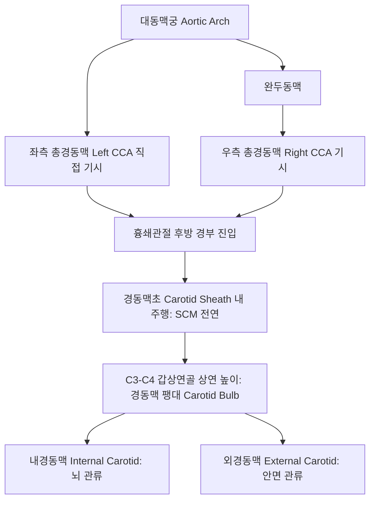

# 총경동맥 (Common Carotid Artery: Anatomy, Hemodynamics & Clinical Interventions)

> **핵심 임상 요약 (Key Clinical Summary)**:
> - **해부학적 기원 및 분기**: 우측은 완두동맥에서, 좌측은 대동맥궁에서 직접 기시하여 흉쇄관절 후방을 지나 [[흉쇄유돌근]] 전연 심부, 경동맥초(Carotid sheath) 내에서 수직 상행한 뒤 C3-C4(갑상연골 상연) 높이에서 [[내경동맥]]과 [[외경동맥]]으로 분기한다.
> - **경동맥 팽대와 신경수용기**: 분기부에 위치한 경동맥동(Carotid sinus)은 혈압을 감지하는 압수용기([[10. 미주신경|미주신경]] 및 설인신경 매개)이며, 후방의 경동맥소체(Carotid body)는 혈액 화학수용기(산소분압 감지)로 자율신경계 조절의 중추이다.
> - **인영혈 자침의 절대 안전 원칙**: [[인영]](ST9) 자침 시 총경동맥 맥동을 반드시 촉진하여 1.5~2cm 안전 거리를 확보하고, 양측 동시 압박을 절대 금하여 경동맥동 반사(Carotid sinus reflex)에 의한 급성 서맥과 실신을 예방한다.
> - **경추 추나요법 혈관 안전 원칙**: 상부 경추 교정 시 과도한 회전과 신전 결합 조작을 피하고, 5D/3N(Dizziness, Drop attack, Diplopia, Dysarthria, Dysphagia / Nausea, Numbness, Nystagmus) 징후를 면밀히 모니터링한다.
> - **초음파 내중막 두께(IMT) 평가**: 총경동맥의 내중막 두께(IMT)는 전신 동맥경화와 심뇌혈관 질환 위험도를 정밀 예측하는 골든 스탠다드 생물학적 지표이다.

---

## 1. 해부학적 기원·주행 경로 및 분지 체계 (Anatomical Pathway & Branches)
총경동맥(Common Carotid Artery, CCA)은 두경부 전체 혈액 공급의 주 간선이다.

- **경동맥초(Carotid Sheath) 내 3차원 위치 관계**:
  - 내측: 총경동맥 (CCA).
  - 외측: [[내경정맥]] (IJV).
  - 후방 고랑: [[10. 미주신경]] (Vagus nerve, CN X).
  - 전방: 설하신경 고리(Ansa cervicalis).
  - 경부 주행 중에는 아무런 분지를 내지 않고 오직 C3-C4 분기부에서만 갈라진다.

---

## 2. 혈류역학·관류 영역 및 주변 근막·근육 연계 (Hemodynamics & Perfusion)
- **혈류역학적 파형 특성**:
  - 내경동맥의 저저항 파형과 외경동맥의 고저항 파형이 복합된 중간 저항성(Intermediate-resistance) 파형을 보인다.
  - 평균 수축기 피크 속도(PSV)는 60~100 cm/s이며, 분기부 팽대(Bulb)에서는 생리적 와류(Flow separation)가 발생하여 죽상경화반이 가장 흔히 침착된다.
- **주변 근육 및 랜드마크**:
  - C6 횡돌기 전결절인 **샤세냑 결절(Chassaignac tubercle)** 전방을 지나며, 이 결절은 응급 지혈 시 총경동맥을 뼈에 대고 압박하는 해부학적 지표가 된다.

---

## 3. 혈관성 박동 촉진·청진 및 이학적 검사 (Physical Examination & Pulsation)
- **경동맥 박동 촉진**:
  - 갑상연골과 [[흉쇄유돌근]] 전연 사이의 홈에서 검지와 중지로 부드럽게 촉지한다.
  - 양측을 동시에 누르면 뇌허혈과 심정지를 초래할 수 있으므로 반드시 편측씩만 시행한다.
- **경동맥 잡음(Carotid Bruit) 청진**:
  - 분기부(하악각 하방)에 청진기를 대고 수축기 잡음을 확인하여 혈류 협착을 선별한다.

---

## 4. 초음파 해부학(Sonoanatomy) 및 도플러 혈류 랜드마크 (Ultrasound & Doppler)
초음파는 총경동맥 내중막 두께(IMT)와 죽상경화반을 계측하는 필수 영상 도구이다.

- **초음파 영상 특성**:
  - 횡단 스캔 시 원형의 두꺼운 박동성 무에코 관상 구조물로 관찰되며, 외측에 호흡에 따라 찌그러지는 내경정맥이 위치한다.
  - 성상신경절 차단술([[SGB]]) 시 프로브를 C6 횡돌기에 대고 총경동맥을 안전하게 내측으로 피인식한다.
- **내중막 두께 (Intima-Media Thickness, IMT)**:
  - 분기부 하방 1cm 원위부 후벽에서 측정하며, 정상치는 0.8mm 이하, 1.0mm 이상 시 죽상경화증, 1.5mm 이상 시 플라크(Plaque)로 정의한다.

---

## 5. ⭐ 원장님 심층 임상 고찰 및 원본 필기 (Clinical Pearls & Melt-In)
- **인영혈(ST9) 자침 시 안전 거리 확보 원칙**:
  - 인영혈은 총경동맥 맥동처 바로 옆에 위치하므로, 자침 전 반드시 검지로 박동을 확인하고 혈관 외측 또는 내측으로 **1.5~2.0cm의 안전 마진**을 확보한 뒤 자침해야 한다.
  - 박동처를 직접 관통하는 행위는 절대 엄금하며, 얇은 침(0.20~0.25mm)을 사용하되 심도를 15mm 이내로 조절한다.
- **경부 출혈 시 압박 지혈(Pressure Hemostasis)과 기도 확보**:
  - 경동맥 손상이나 천자 후 혈종이 형성될 경우, 혈종이 심부 기관을 압박하여 급성 질식을 초래할 수 있으므로 **"기도 확보(Airway)가 최우선"**이다.
  - 출혈 발생 시 C6 샤세냑 결절을 향해 후방으로 단단히 손가락 압박을 가하고 환자의 호흡 곤란 징후를 즉시 모니터링해야 한다.
- **경동맥동 반사(Carotid Sinus Reflex) 경계**:
  - 경동맥 분기부의 경동맥동을 과도하게 마사지하거나 강자극하면 미주신경 흥분으로 심각한 서맥, 저혈압, 아담스-스톡스 증후군(Adams-Stokes) 실신이 발생하므로 주의한다.
- **경추 추나요법 혈관 안전 원칙**:
  - 경추 조작 시 과도한 과회전 및 신전 결합 조작을 배제하고, 어지럼증(Dizziness), 실신(Drop attack), 복시(Diplopia), 구음장애(Dysarthria), 연하곤란(Dysphagia) 등 **5D/3N 신경학적 증상**을 철저히 확인해야 한다.
- **경동맥 소체 종양(Carotid Body Tumor) 감별**:
  - 경부 측면의 무통성 박동성 종괴가 좌우로는 움직이지만 상하로는 움직이지 않는 퐁텐 징후(Fontaine sign)를 보이면 경동맥 분기부 종양이므로 침 자침을 금하고 영상 의뢰한다.

---

## 6. 관련 임상 질환 및 허혈·압박·혈전 증후군 (Pathology & Entrapment)
- **총경동맥 죽상경화성 협착증**:
  - 내막 비후 및 플라크 파열로 혈전이 뇌로 유입되어 일과성 뇌허혈발작([[TIA]]) 및 [[뇌경색]]을 초래한다.
- **타카야수 동맥염 (Takayasu Arteritis)**:
  - 대동맥궁과 총경동맥 기시부를 침범하는 만성 육아종성 대혈관염으로 젊은 여성에서 맥박 소실(Pulseless disease)을 유발한다.

---

## 7. 한의 통합 혈관·신경 치료 프로토콜 (추나·초음파 약침·침구·한약)
- **경부 심부 근막 완화 추나**:
  - 흉쇄유돌근과 설골하근육군의 단축을 부드럽게 이완하여 경동맥초의 가동성을 복원한다.
- **혈압 및 자율신경 조절 침구 치료**:
  - [[인영]](ST9)의 정밀 표재 자침과 함께 [[곡지]](LI11), [[족삼리]](ST36), [[태충]](LR3)을 배혈하여 혈압 강하 및 뇌혈관 반응성을 향상시킨다.
- **활혈거어 강압 한약 처방**:
  - 동맥경화반 안정화와 뇌혈류 개선을 위해 [[보양환오탕]], [[천마구등음]], [[단삼]] 제제를 변증 투여한다.

---

## 8. 실존 임상 연구 논문 요약 (Evidence-Based Research)

- Batubara CA et al. (2026). How type 2 diabetes mellitus shapes carotid artery changes in hemorrhagic and ischemic stroke patients: a comparative analysis of carotid intima-media thickness and pulsatility index. *Pan Afr Med J*. 53:37. PMID: 42153164
  - [연구 요약] 당뇨병 및 뇌졸중 환자에서 총경동맥 내중막 두께(IMT)와 박동성 지수의 변화를 초음파로 비교 분석하여 혈관 리모델링 특성 규명.

- Ellis H et al. (2022). The common carotid artery. *J Perioper Pract*. 32(9):239-240. PMID: 35762282
  - [연구 요약] 총경동맥의 해부학적 기원, 주행 경로, 경동맥초 내 인접 구조물 및 외과적 결찰/손상 시 지혈 원칙에 대한 정밀 해부학적 고찰.
