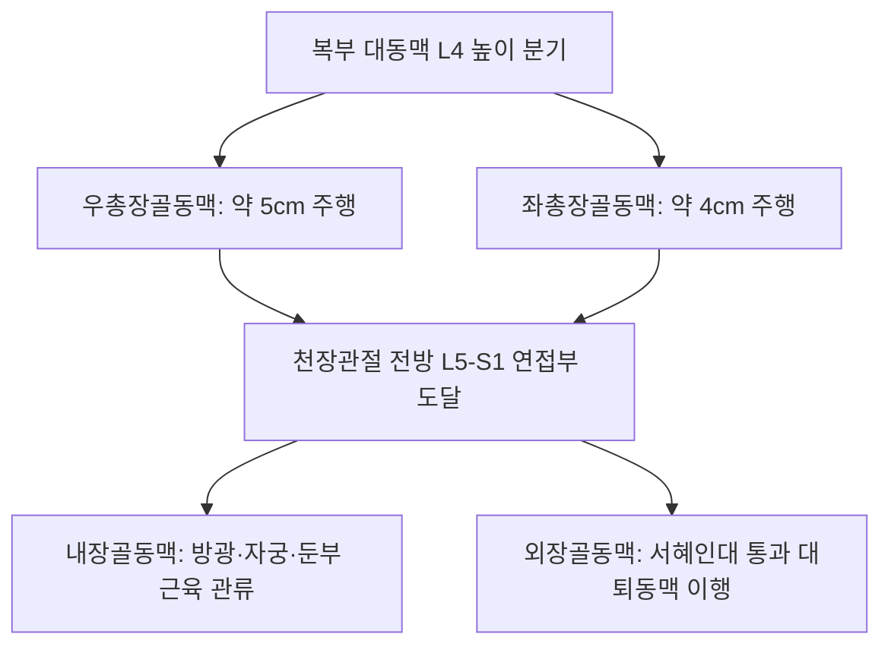

# 총장골동맥 (Common Iliac Artery: Anatomy, Hemodynamics & Clinical Interventions)

> **핵심 임상 요약 (Key Clinical Summary)**:
> - **해부학적 기원 및 골반 분기**: 복부 [[대동맥]]이 L4 척추체 높이(배꼽 높이)에서 좌우 총장골동맥으로 분기하여, 천장관절(L5-S1) 전방에서 골반 장기를 관류하는 [[내장골동맥]](Internal iliac)과 하지로 향하는 [[외장골동맥]](External iliac)으로 갈라진다.
> - **메이-터너 증후군(May-Thurner Syndrome)의 기전**: 우측 총장골동맥이 좌측 총장골정맥의 앞을 가로지르면서 요추 추체와의 사이에서 정맥을 기계적으로 압박하여 좌측 하지에 심부정맥혈전증(DVT)과 만성 정맥 울혈을 호발시킨다.
> - **총장골동맥류(CIAA)와 좌골신경통 유사 증상**: 동맥류가 확장되어 [[요천추 신경총]](Lumbosacral plexus)을 후방에서 압박할 경우 디스크 질환과 유사한 둔부통 및 하지 방사통을 유발하므로 혈관성 원인을 감별해야 한다.
> - **하복부 및 골반강 자침 안전 가이드**: [[관원]](CV4), [[수도]](ST28), [[귀래]](ST29) 등 하복부 심부 자침 시 장골혈관 주행로를 인지하고 무리한 장침 직자를 배제한다.
> - **골반대 추나 및 혈행 개선**: 골반 변위 교정과 [[장요근]] 이완을 통해 총장골동맥 주변의 물리적 장력을 해소하고 하지 관류 효율을 극대화한다.

---

## 1. 해부학적 기원·주행 경로 및 분지 체계 (Anatomical Pathway & Branches)
총장골동맥(Common Iliac Artery, CIA)은 체간에서 골반과 하지로 혈류를 전달하는 분기 도관이다.

- **해부학적 인접 구조물**:
  - 후방: L4-L5 척추체, 대요근 내측연, 요천추신경간(Lumbosacral trunk).
  - 정맥 관계: 우측 총장골정맥은 우측 동맥 후방에, 좌측 총장골정맥은 우측 동맥 후방을 대각선으로 가로지른다.
  - 전방: 요관(Ureter)이 총장골동맥의 분기부 전면을 교차하여 골반강으로 내려간다.

---

## 2. 혈류역학·관류 영역 및 주변 근막·근육 연계 (Hemodynamics & Perfusion)
- **혈류역학적 파형**:
  - 하지 말초 혈관상으로 이어지는 고저항성 삼상 파형(Triphasic)을 나타낸다.
  - 내경은 약 10~12mm 범위이다.
- **장요근 근막과의 역학적 연계**:
  - [[장요근]](Psoas major)의 내측 연을 따라 밀착 주행하므로, 장요근의 만성 경결이나 장골근막의 섬유화는 혈관 외막에 장력을 전달한다.

---

## 3. 혈관성 박동 촉진·청진 및 이학적 검사 (Physical Examination & Pulsation)
- **하복부 박동 촉진**:
  - 배꼽과 서혜인대 중점을 연결하는 선의 상부 1/3 지점에서 깊숙이 촉지할 수 있으나 비만 환자에서는 확인이 어렵다.
- **혈관 잡음 청진**:
  - 하복부 및 양측 장골와에서 수축기 잡음을 청진하여 장골동맥 협착을 선별한다.

---

## 4. 초음파 해부학(Sonoanatomy) 및 도플러 혈류 랜드마크 (Ultrasound & Doppler)
초음파는 장골동맥류와 메이-터너 증후군을 선별하는 비침습적 도구이다.

- **초음파 영상 특성**:
  - 하복부 횡단 스캔 시 복대동맥 분기부 아래에서 두 개의 둥근 박동성 동맥이 요추체 전외측에 나란히 관찰된다.
  - 우측 총장골동맥 아래에서 좌측 총장골정맥이 눌리는 형태학적 압박 부위를 도플러로 확인한다.

---

## 5. ⭐ 원장님 심층 임상 고찰 및 원본 필기 (Clinical Pearls & Melt-In)
- **좌골신경통 유사 증상과 장골동맥류 감별**:
  - 디스크 파열 소견이 뚜렷하지 않은 고령 환자가 엉치 통증과 함께 다리 전체가 저리고 무겁다고 호소할 때, 골반강 내 총장골동맥류나 내장골동맥류가 요천추 신경총을 압박하고 있지 않은지 감별해야 한다.
- **골반 룸바롤 시 복강 대혈관 보호**:
  - 골반 룸바롤 조작 시 환자의 하복부를 과도하게 압박하거나 비틀면 죽상경화가 심한 장골동맥벽에 전단 손상을 줄 수 있으므로, 상체 비틀림을 배제하고 대퇴골-PSIS 직선 벡터로만 힘을 전달해야 한다.

---

## 6. 관련 임상 질환 및 허혈·압박·혈전 증후군 (Pathology & Entrapment)
- **메이-터너 증후군 (May-Thurner Syndrome)**:
  - 우측 총장골동맥의 박동성 기계적 압박으로 좌측 총장골정맥 내에 혈전이 생겨 좌측 하지 전체가 심하게 붓고 통증이 발생한다.
- **총장골동맥류 (Common Iliac Artery Aneurysm)**:
  - 직경이 1.5~2.0cm 이상으로 확장되며, 파열 시 대량 복강내 출혈을 유발한다.

---

## 7. 한의 통합 혈관·신경 치료 프로토콜 (추나·초음파 약침·침구·한약)
- **골반강 감압 장요근 추나요법**:
  - 장요근 이완 수기와 골반 전후방 회전 교정을 통해 골반 입구 혈관 통로의 단면적을 넓힌다.
- **골반 혈류 촉진 침구 요법**:
  - [[기해]](CV6), [[관원]](CV4), [[차료]](BL32), [[지실]](BL52)을 취혈하여 골반강 내 부교감신경을 활성화하고 혈관 확장을 유도한다.
- **활혈거어 통락 한약 처방**:
  - 골반 울혈 증후군과 정맥혈전증 예방을 위해 [[혈부축어탕]], [[계지복령환]], [[당귀작약산]]을 처방한다.

---

## 8. 실존 임상 연구 논문 요약 (Evidence-Based Research)

- Park JY et al. (2021). Atypical iliac vein compression in patients with symptomatic May-Thurner syndrome. *Diagn Interv Radiol*. 27(3):372-377. PMID: 34003124
  - [연구 요약] 우측 총장골동맥에 의한 좌측 총장골정맥 압박의 다양한 해부학적 변이 및 메이-터너 증후군 환자의 영상 진단 기준 분석.

- Vijayvergiya R et al. (2021). Endovascular Repair of a Post-Renal Transplant Internal Iliac Artery Pseudoaneurysm. *Vasc Endovascular Surg*. 55(6):651-653. PMID: 33733924
  - [연구 요약] 골반강 내 장골동맥 분기부 가성동맥류의 혈관내 스텐트 그라프트 중재 시술 및 장골혈관 보존 치료 성과 보고.
