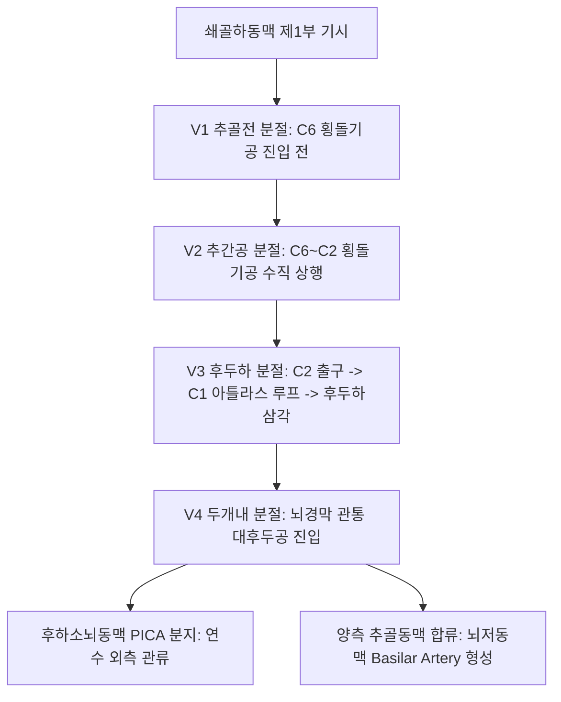

# 추골동맥 (Vertebral Artery: Anatomy, Hemodynamics & Clinical Interventions)

> **핵심 임상 요약 (Key Clinical Summary)**:
> - **해부학적 4대 분절**: [[쇄골하동맥]] 제1부에서 기시(V1) $
ightarrow$ C6~C2 경추 [[횡돌기]]공 통과(V2) $
ightarrow$ C1 환추 횡돌기공 출구에서 대후두공으로 꺾여 들어가는 아틀라스 루프(V3) $
ightarrow$ 두개강 내로 진입하여 [[뇌저동맥]](Basilar artery)으로 합류(V4)하는 뇌 후방 순환의 중심축이다.
> - **아틀라스 루프(V3)의 기계적 취약성**: 환추 후궁의 추골동맥구를 지나며 급격한 3차원 만곡을 이루므로, 경추의 과도한 회전 및 신전 시 환추-축추 관절 사이에서 물리적으로 견인·압박되어 박리(Dissection)가 호발한다.
> - **추골뇌저동맥 부전(VBI)의 5D/3N 징후**: 혈류 장애 시 어지럼증(Dizziness), 실신(Drop attack), 복시(Diplopia), 구음장애(Dysarthria), 연하곤란(Dysphagia) 등 뇌간 및 소뇌 허혈 징후가 나타난다.
> - **경추 추나 시 안전 스크리닝 의무**: 상부 경추 HVLA 교정 전 조지 검사(George's test)나 덱클레인 검사를 시행하여 혈관 위험성을 사전 배제하고, 무리한 회전 스러스트를 엄금한다.
> - **후두하부 침구 시술 안전 가이드**: [[풍지]](GB20), [[천주]](BL10), [[아문]](GV15) 자침 시 V3 분절 및 연수 천자를 방지하기 위해 침첨의 방향을 반대측 안와나 하악각 쪽으로 향하고 과도한 심부 진침을 금한다.

---

## 1. 해부학적 기원·주행 경로 및 분지 체계 (Anatomical Pathway & Branches)
추골동맥(Vertebral Artery, VA)은 소뇌, 뇌간, 후두엽을 관류하는 뇌 후방 순환의 핵심 동맥이다.

- **V3 분절(후두하부)의 특이 주행**:
  - C2 횡돌기공에서 나와 외측으로 꺾인 뒤 C1 횡돌기공을 관통한다.
  - C1 후궁의 추골동맥구(Sulcus arteriae vertebralis)를 타고 내측으로 수평 주행하여 후후두경막을 관통한다.
  - [[후두하삼각]](대후두직근, 상두사근, 하두사근으로 구성)의 바닥을 형성한다.

---

## 2. 혈류역학·관류 영역 및 주변 근막·근육 연계 (Hemodynamics & Perfusion)
- **저저항성 뇌순환 파형**:
  - 뇌실질로 혈액을 공급하므로 확장기에도 풍부한 전방 혈류가 유지되는 저저항 파형(Low resistance)을 보인다.
  - 평균 수축기 피크 속도는 30~60 cm/s이다.
- **후두하근과의 기계적 상호작용**:
  - [[상두사근]], [[하두사근]], [[대후두직근]]의 만성 단축은 V3 분절을 포착하여 경추성 어지럼증(Cervicogenic dizziness)을 유발할 수 있다.

---

## 3. 혈관성 박동 촉진·청진 및 이학적 검사 (Physical Examination & Pulsation)
- **추골동맥 부전 유발 검사 (VBI Provocation Test)**:
  - 환자를 앉히거나 눕힌 상태에서 경부를 최대로 신전시키고 한쪽으로 30초간 회전시킨 뒤 안진, 어지럼증, 메스꺼움, 구음장애가 유발되는지 확인한다.
  - 양성 시 척추 추나 조작을 즉시 배제해야 한다.

---

## 4. 초음파 해부학(Sonoanatomy) 및 도플러 혈류 랜드마크 (Ultrasound & Doppler)
초음파는 V2 및 V3 분절의 개통성과 쇄골하동맥 도혈 증후군을 진단하는 필수 도구이다.

- **초음파 영상 특성**:
  - 경부 측면 종단 스캔 시 경추 횡돌기들의 골성 음영(Acoustic shadow) 사이 횡돌기공 내에서 박동하는 혈관으로 관찰된다.
- **쇄골하동맥 도혈 현상 확인**:
  - 쇄골하동맥 기시부 협착 시 동측 추골동맥 혈류가 뇌에서 팔 방향으로 완전히 거꾸로 흐르는 역전류(Retrograde flow)를 도플러로 확인한다.

---

## 5. ⭐ 원장님 심층 임상 고찰 및 원본 필기 (Clinical Pearls & Melt-In)
- **경추 추나요법 시 추골동맥 안전 대원칙**:
  - 경추 추나 시 경추를 45도 이상 회전시킨 상태에서 강한 충격(Thrust)을 가하면 반대측 V3 분절이 C1-C2 사이에서 강하게 신장되어 동맥 박리가 일어날 수 있다.
  - 따라서 회전력 위주의 조작을 지양하고, 관절 간격을 넓히는 견인과 미세 신전 위주의 안전한 기법을 적용해야 한다.
- **풍지혈 및 천주혈 자침의 안전 각도**:
  - [[풍지]](GB20) 자침 시 침첨을 상내측(코 끝 방향)으로 너무 깊이 찌르면 V3 아틀라스 루프를 관통하여 두개저 혈종을 유발할 수 있다.
  - 반드시 침첨의 방향을 반대측 안와 또는 하악각을 향하게 하고, 자침 깊이를 15~25mm로 제한하여 후두하삼각 심부 혈관을 안전하게 보호해야 한다.

---

## 6. 관련 임상 질환 및 허혈·압박·혈전 증후군 (Pathology & Entrapment)
- **추골동맥 박리 (Vertebral Artery Dissection, VAD)**:
  - 경부 외상이나 급격한 회전 후 후두부의 벼락같은 두통과 함께 연수 외측 증후군(Wallenberg syndrome)을 유발한다.
- **추골동맥 형성부전 (Vertebral Artery Hypoplasia, VAH)**:
  - 인구의 약 10%에서 일측 추골동맥 직경이 2mm 이하로 작아 반대측 혈관에 의존하므로 허혈에 취약하다.

---

## 7. 한의 통합 혈관·신경 치료 프로토콜 (추나·초음파 약침·침구·한약)
- **후두하근막 이완 및 관절 가동 추나**:
  - 상부 경추 견인 및 후두하근군(Suboccipital muscles)의 허혈성 압박 이완을 통해 V3 분절의 미세 혈류를 개선한다.
- **뇌혈류 순환 촉진 침구 요법**:
  - [[백회]](GV20), [[풍지]](GB20), [[천주]](BL10), [[태충]](LR3)을 배혈하여 뇌혈류 유입 저항을 줄인다.
- **통락식풍 한약 처방**:
  - 경추성 두통과 어지럼증 완화를 위해 [[자음건비탕]], [[반하백출천마탕]], [[천궁]] 제제를 처방한다.

---

## 8. 실존 임상 연구 논문 요약 (Evidence-Based Research)

- González-Delatorre A et al. (2026). Ischemic Stroke Associated With Vertebral Artery Occlusion Following Cervical Spine Manipulation in a Young Woman With Underlying Vascular Risk Factors: A Case Report. *Clin Case Rep*. 14(10):e73772. PMID: 42903412
  - [연구 요약] 기저 혈관 위험인자를 보유한 환자에서 경추 도수치료 후 발생한 추골동맥 폐색 및 허혈성 뇌졸중의 영상 진단과 임상적 안전 선별 가이드 증례.

- Lambert C et al. (2026). Educational approaches to the relationship between cervical adjusting and risk of cervical artery dissection; a survey of chiropractic faculty. *Chiropr Man Therap*. 34(1):. PMID: 42687170
  - [연구 요약] 경추 교정 치료와 경동맥/추골동맥 박리 위험도 사이의 임상적 연관성 교육 및 혈관 스크리닝 임상 지침 설문 분석.
