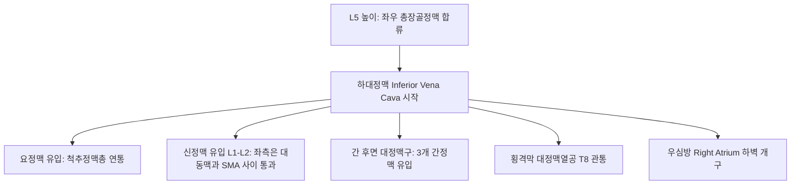

# 하대정맥 (Inferior Vena Cava: Anatomy, Hemodynamics & Clinical Interventions)

> **핵심 임상 요약 (Key Clinical Summary)**:
> - **해부학적 기원 및 주행**: L5 척추체 높이에서 좌우 [[총장골정맥]]이 합류하여 시작되어, 척추체 전면 복부 [[대동맥]]의 우측을 따라 수직 상행한 뒤 간 후면의 대정맥구를 지나 횡격막 대정맥열공(T8)을 통과하여 우심방으로 개구하는 인체 최대 정맥이다.
> - **체액량 평가의 골든 스탠다드**: 호흡 주기에 따른 하대정맥 직경 변화율인 하대정맥 허탈 지수(IVC Collapsibility Index)는 쇼크, 탈수, [[심부전]] 환자의 중심정맥압과 체액 반응성을 비침습적으로 평가하는 핵심 지표이다.
> - **앙와위 저혈압 증후군 (Supine Hypotensive Syndrome)**: 임신 말기 산모가 똑바로 누우면 무거운 자궁이 하대정맥을 압박하여 정맥 환류 급감으로 [[저혈압]], 어지럼증, 태아 서맥이 발생하므로 좌측와위(Left lateral decubitus)를 취해야 한다.
> - **복부 심부 자침 시 대혈관 지표**: 복부 정중선 우측 혈자리([[대거]], [[천추]]) 자침 시 복대동맥 우측에 위치한 하대정맥의 위치를 인지하여 무리한 장침 직자를 엄금한다.
> - **하지 정맥 환류와 횡격막 호흡 추나**: 복강 내압을 낮추고 횡격막 가동성을 회복시키는 추나 수기를 통해 하대정맥으로 유입되는 하지 정맥혈 환류를 촉진한다.

---

## 1. 해부학적 기원·주행 경로 및 분지 체계 (Anatomical Pathway & Branches)
하대정맥(Inferior Vena Cava, IVC)은 횡격막 하방 전신의 정맥혈을 심장으로 돌려보내는 대간선이다.

- **해부학적 인접 장기**:
  - 좌측: 복부 대동맥 (Abdominal aorta).
  - 전방: 십이지장 수평부, 췌장 두부, 간 실질.
  - 후방: 우측 신동맥, 우측 요동맥, 척추체.
  - 내부에는 판막이 전혀 존재하지 않는다.

---

## 2. 혈류역학·관류 영역 및 주변 근막·근육 연계 (Hemodynamics & Perfusion)
- **혈류역학적 특성**:
  - 인체 정맥 환류량의 약 65% 이상을 차지하며, 직경은 약 20~25mm이다.
  - 흉강 내 음압(흡기) 시 직경이 감소하고 혈류가 심장으로 빨려 들어가며, 호기 시나 복압 상승 시 혈관이 팽창한다.
- **횡격막과의 기계적 연동**:
  - 횡격막의 중심건(Central tendon)을 통과하므로 횡격막 수축 시 열공이 확장되어 정맥혈 흡인을 촉진한다.

---

## 3. 혈관성 박동 촉진·청진 및 이학적 검사 (Physical Examination & Pulsation)
- **하복부 및 하지 부종 시진**:
  - 하대정맥 폐색 시 양측 하지 전체의 대칭적 부종과 함께 복벽 전면에 하복부에서 흉곽 방향으로 치솟는 측부 정맥망(Caput medusae 변형)이 관찰된다.

---

## 4. 초음파 해부학(Sonoanatomy) 및 도플러 혈류 랜드마크 (Ultrasound & Doppler)
[[초음파]]는 체액량 상태(Volume status)와 심장 기능을 평가하는 필수 응급 도구이다.

- **초음파 영상 특성**:
  - 심와부 하방 종단 스캔 시 간 실질 뒤편에서 횡격막을 뚫고 우심방으로 유입되는 관상 무에코 구조물로 명확히 관찰된다.
- **하대정맥 허탈 지수 (IVC Collapsibility Index, IVC-CI)**:
  - 자발 호흡 환자에서 `(최대호기직경 - 최대흡기직경) / 최대호기직경 * 100`으로 계산한다.
  - 허탈 지수가 50% 이상이고 직경이 1.5cm 미만이면 탈수 및 체액 부족을, 직경이 2.1cm 이상이고 허탈 지수가 50% 미만이면 체액 과다 및 울혈성 [[심부전]]을 의미한다.

---

## 5. ⭐ 원장님 심층 임상 고찰 및 원본 필기 (Clinical Pearls & Melt-In)
- **임산부 치료 시 좌측와위 원칙**:
  - 임신 중기 이후 산모를 치료실 베드에 똑바로 눕히면 커진 자궁이 요추체 전면의 하대정맥을 완전히 눌러 혈압이 급격히 떨어지고 어지럼증과 식은땀을 흘리게 된다.
  - 따라서 임산부 침구 및 추나 치료 시에는 반드시 왼쪽으로 눕는 좌측와위(Left lateral decubitus)를 유지하거나 상체를 30도 이상 세운 반좌위로 치료해야 한다.
- **복부 침 치료 시 대혈관 손상 방지**:
  - 복부 우측의 [[천추]](ST25), [[대거]](ST27) 자침 시 마른 체형 환자에서 깊이 찌르면 복막을 관통하여 하대정맥 전벽을 손상시킬 수 있으므로 주의해야 한다.

---

## 6. 관련 임상 질환 및 허혈·압박·혈전 증후군 (Pathology & Entrapment)
- **하대정맥 증후군 (IVC Syndrome)**:
  - 신세포암(RCC) 종양 혈전, 후복막 종양 압박, [[심부정맥혈전증]]으로 하대정맥이 막혀 양측 하지 [[부종]]과 복수를 유발한다.
- **버드-키아리 증후군 (Budd-Chiari Syndrome)**:
  - 간정맥이나 하대정맥 상부 폐색으로 인한 간비대, 난치성 복수, 간부전 질환이다.

---

## 7. 한의 통합 혈관·신경 치료 프로토콜 (추나·초음파 약침·침구·한약)
- **복부 내장기 및 횡격막 이완 추나**:
  - [[횡격막]] 호흡 유도와 [[간]]-십이지장 인대 가동술을 통해 하대정맥 통과부의 압박을 해소한다.
- **복부 혈류 촉진 침구 요법**:
  - [[중완]](CV12), [[기해]](CV6), [[족삼리]](ST36), [[음릉천]](SP9)을 배혈하여 복강 장기 혈류를 원활히 한다.
- **이수소종 활혈 한약 처방**:
  - 체액 정체와 하지 울혈 완화를 위해 [[오령산]], [[분심기음]], [[저령탕]]을 처방한다.

---

## 8. 실존 임상 연구 논문 요약 (Evidence-Based Research)

- Büyükta OC et al. (2026). Inferior vena cava peak velocity versus collapsibility index to predict volume status in patients with gastrointestinal bleeding: A pilot study. *Turk J Emerg Med*. 26(4):288-295. PMID: 42965206
  - [연구 요약] 응급 환자에서 하대정맥 최고 혈류 속도와 허탈 지수의 초음파 계측을 통한 비침습적 체액량 평가 및 순환 상태 예측 임상 연구.

- Araghi A et al. (2026). Precision fluid therapy in sepsis: fluid responsiveness vs. fluid tolerance. *Front Med (Lausanne)*. 13:1980813. PMID: 42898682
  - [연구 요약] 하대정맥 직경 초음파 모니터링을 통한 중환자 체액 반응성 및 정맥 울혈성 장기 손상 방지 가이드라인 고찰.
