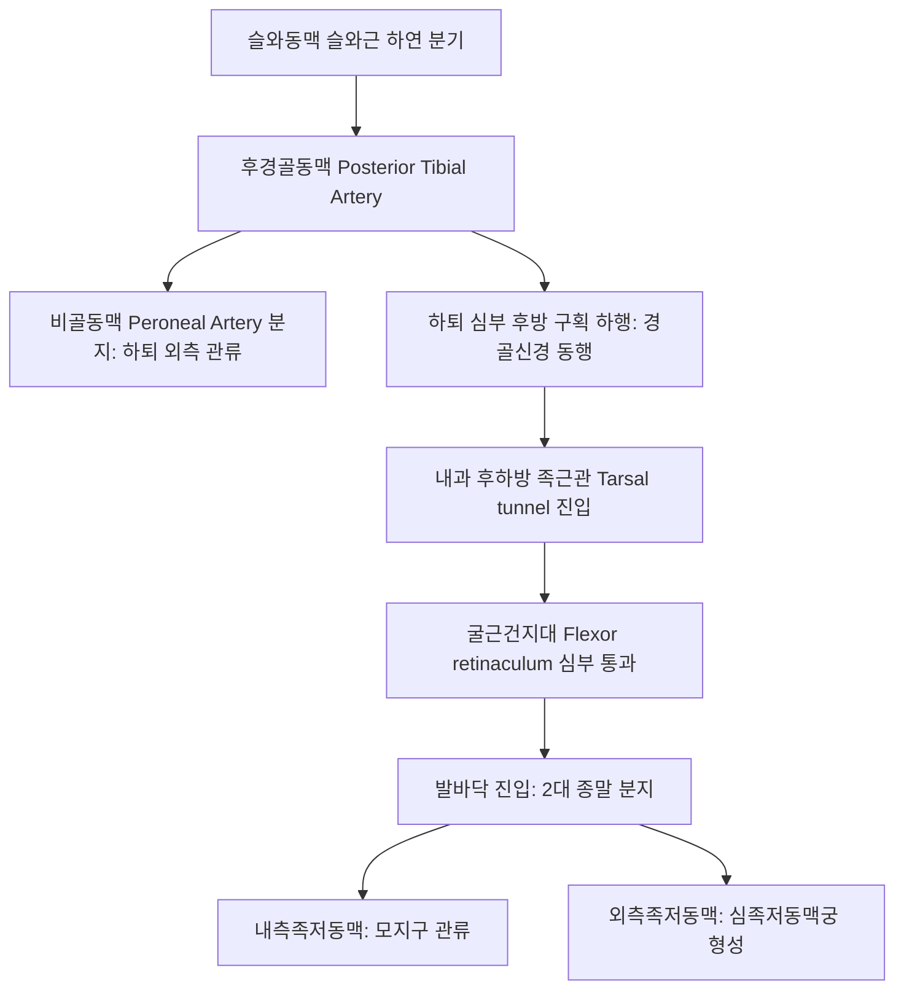

# 후경골동맥 (Posterior Tibial Artery: Anatomy, Hemodynamics & Clinical Interventions)

> **핵심 임상 요약 (Key Clinical Summary)**:
> - **해부학적 기원 및 주행**: [[슬와동맥]]에서 기시하여 하퇴 심부 후방 구획([[가자미근]]과 [[경골후근]] 사이)을 하행하며 비골동맥을 분지한 뒤, 내과(Medial malleolus) 후하방의 족근관(Tarsal tunnel)을 통과하여 족저부로 진입한다.
> - **족근관(Tarsal Tunnel) 내 3차원 적층 배열**: 전방에서 후방 순서로 경골후근건 $
ightarrow$ 장지굴근건 $
ightarrow$ **후경골동맥** $
ightarrow$ 동행정맥 $
ightarrow$ [[경골신경]](Tibial nerve) $
ightarrow$ 장무지굴근건의 'Tom, Dick, And Very Nervous Harry' 법칙으로 정렬된다.
> - **발바닥 전체 혈류의 본산**: 내측족저동맥과 외측족저동맥으로 종지하며, 외측족저동맥은 [[족배동맥]]의 심족저지와 문합하여 심족저동맥궁을 완성하여 발바닥 전체와 족지 혈류를 전담한다.
> - **족근관 증후군(Tarsal Tunnel Syndrome)과 허혈**: 굴근건지대(Flexor retinaculum) 비후로 인해 후경골동맥과 경골신경이 압박되면 발바닥의 작열통, 감각 마비, 야간 통증을 초래한다.
> - **족소음신경 자침 안전 가이드**: [[태계]](KI3), [[수천]](KI5), [[대종]](KI4), [[조해]](KI6) 자침 시 내과 후방의 동맥 맥동을 반드시 촉진하여 혈관 관통 및 혈종을 예방하고 초음파 가이드 하 족근관 도침을 적용한다.

---

## 1. 해부학적 기원·주행 경로 및 분지 체계 (Anatomical Pathway & Branches)
후경골동맥(Posterior Tibial Artery, PTA)은 하퇴 후면 심부와 발바닥 전체의 주 공급 동맥이다.

- **족근관(Tarsal Tunnel) 내 랜드마크**:
  - 내측 복사뼈(내과) 후하방과 종골 내측면 사이의 섬유골성 터널이다.
  - 후경골동맥은 경골신경의 바로 전내측에 밀착되어 주행한다.

---

## 2. 혈류역학·관류 영역 및 주변 근막·근육 연계 (Hemodynamics & Perfusion)
- **혈류역학적 파형**:
  - 하지 말초 혈관의 고저항성 삼상 파형(Triphasic)을 나타낸다.
  - 내경은 약 2.5~3.5mm로 족배동맥보다 굵다.
- **주변 근막과의 관계**:
  - 하퇴에서는 심부 횡근막(Deep transverse fascia) 아래에 위치하며, 족관절에서는 두꺼운 굴근건지대에 싸여 있다.

---

## 3. 혈관성 박동 촉진·청진 및 이학적 검사 (Physical Examination & Pulsation)
- **후경골동맥 박동 촉진 (PTA Pulse)**:
  - 내과 후하방 약 1.5~2cm 지점에서 시술자의 손가락으로 종골 방향으로 부드럽게 압박하여 맥박을 촉지한다.
  - 말초동맥 질환([[PAD]]) 및 당뇨발 선별 시 족배동맥과 함께 양대 필수 촉진처이다.
- **티넬 징후 (Tinel's Sign)**:
  - 족근관 부위를 가볍게 타진할 때 발바닥 전체로 찌릿한 방사통이 재현되면 족근관 증후군으로 판정한다.

---

## 4. 초음파 해부학(Sonoanatomy) 및 도플러 혈류 랜드마크 (Ultrasound & Doppler)
초음파는 족근관 증후군 진단과 안전한 도침 시술의 핵심 수단이다.

- **초음파 영상 특성**:
  - 내과 후방 횡단 스캔 시 골성 음영 위에 장지굴근건과 장무지신전근건 사이에서 둥근 박동성 동맥과 동행정맥, 고에코 벌집 모양의 [[경골신경]]이 나란히 관찰된다.
- **도플러 파형 평가**:
  - 죽상경화성 폐색 시 파형의 수축기 가속 시간이 지연되는 Tardus-parvus 파형이 나타난다.

---

## 5. ⭐ 원장님 심층 임상 고찰 및 원본 필기 (Clinical Pearls & Melt-In)
- **태계혈 및 수천혈 자침 시 신경혈관 다발 보호**:
  - [[태계]](KI3)는 내과 첨단과 아킬레스건 사이의 오목한 부위로, 후경골동맥 맥동의 바로 옆에 위치한다.
  - 맥동을 손가락으로 확인하여 약간 후방(아킬레스건 쪽)으로 10~15mm 가볍게 자침해야 혈관 손상에 의한 발목 심부 혈종을 예방할 수 있다.
- **발바닥 저림과 족근관 증후군 도침 시술**:
  - 족저근막염으로 오진하기 쉬운 족근관 증후군 환자에서 도침으로 굴근건지대를 감압 박리할 때, 반드시 초음파로 후경골동맥과 경골신경의 위치를 실시간 확인하면서 건지대 표재층만을 안전하게 절개해야 한다.

---

## 6. 관련 임상 질환 및 허혈·압박·혈전 증후군 (Pathology & Entrapment)
- **족근관 증후군 (Tarsal Tunnel Syndrome)**:
  - 족근관 내 공간 점유 병변(결절종, 정맥류)이나 회내족 변형으로 후경골동맥과 경골신경이 포착되어 발바닥 감각 저하와 작열통을 유발한다.
- **당뇨병성 하지 허혈증**:
  - 후경골동맥의 미세혈관 폐색으로 발뒤꿈치와 족저부의 난치성 당뇨발 궤양을 초래한다.

---

## 7. 한의 통합 혈관·신경 치료 프로토콜 (추나·초음파 약침·침구·한약)
- **족관절 족근관 감압 추나요법**:
  - 종골 및 거골 가동술과 굴근건지대 이완 수기를 통해 족근관 내 압력을 경감시킨다.
- **족소음신경 혈자리 자침 요법**:
  - [[태계]](KI3), [[조해]](KI6), [[용천]](KI1), [[삼음교]](SP6)를 배혈하여 발바닥 말초 혈류를 촉진한다.
- **보신활혈 통락 한약 처방**:
  - 만성 신경혈관 허혈과 발바닥 통증 완화를 위해 [[육미지황탕]], [[독활기생탕]], [[당귀사역가오수유생강탕]]을 처방한다.

---

## 8. 실존 임상 연구 논문 요약 (Evidence-Based Research)

- Pejkova S et al. (2025). Dellon decompression of the tarsal tunnel: An effective approach to improving blood flow, promoting ulcer healing and recovery of sensibility in diabetic patients. *J Plast Reconstr Aesthet Surg*. 103:48-57. PMID: 39965440
  - [연구 요약] 당뇨병 환자에서 족근관 감압술을 통한 후경골동맥 혈류 개선, 족부 궤양 치유 촉진 및 감각 회복의 임상적 유효성 규명.

- Benimeli-Fenollar M et al. (2025). Ultrasound Assessment of the Tibial Nerve at the Retromalleolar Level: Influence of Anthropometric Characteristics and Clinical Implications. *Clin Pract*. 15(12):. PMID: 41440478
  - [연구 요약] 족근관 부위 후경골동맥 및 경골신경의 초음파 해부학적 계측과 족근관 증후군 진단 지표 표준화 연구.
