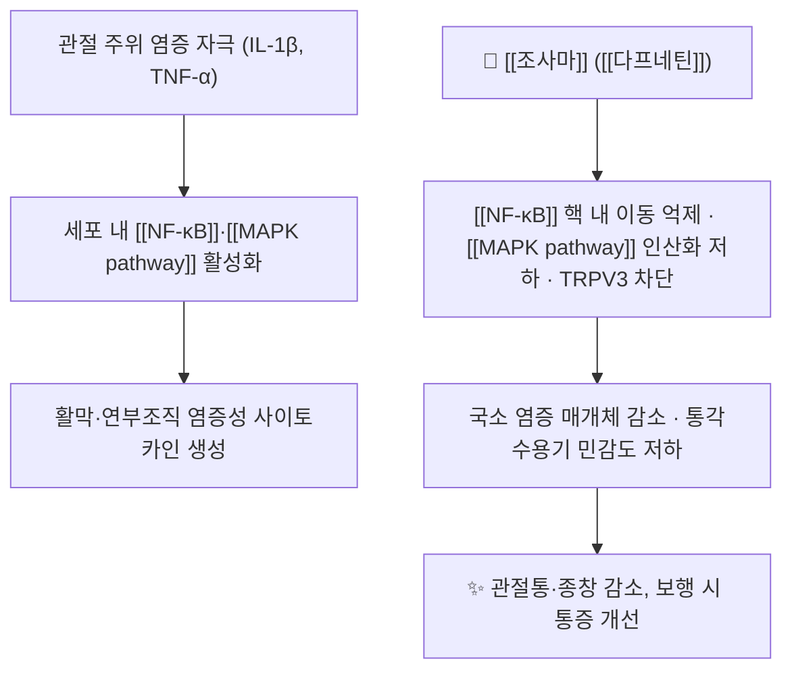

# 🌿 조사마 (祖師麻, Cortex Daphnes / Daphne giraldii)

> **핵심 요약 (Key Summary)**:
> 서향과(Thymelaeaceae) 황서향 Daphne giraldii Nitsche 및 동속식물의 줄기껍질·뿌리껍질로, 辛苦·溫·有小毒의 성미를 지닌 거풍습·활혈지통 약재다.
> 핵심 지표성분인 [[다프네틴]]이 [[NF-κB]]·[[MAPK pathway]] 신호를 억제하고 TRPV3 활성을 낮추어 국소 항염·진통 효과를 낸다.
> 중국에서는 風濕痹痛·관절통에 외용 카타플라스마(흑고약 기질)로 널리 쓰이며, 무릎 골관절염에서 국소 NSAID에 비열등한 근거가 다기관 RCT로 확인됐다([PMID 34025414](https://pubmed.ncbi.nlm.nih.gov/34025414/)).
> ⚠️ 有小毒 — 내복은 소량·단기 원칙이고, 외용 시에도 개방창·습진 병변에는 금기이며 접촉 피부염 발생률이 28.8%였다.

---

## 📌 목차
1. [기본 본초 정보 & 화학 구조 (Pharmacognosy)](#1-기본-본초-정보--화학-구조-pharmacognosy)
2. [핵심 분자약리 기전 & 대사 네트워크](#2-핵심-분자약리-기전--대사-네트워크)
3. [해부생체역학 / 근육·신경 대사 연계](#3-해부생체역학--근육신경-대사-연계)
4. [사상의학 및 체질별 임상 응용 (적응증 vs 금기)](#4-사상의학-및-체질별-임상-응용-적응증-vs-금기)
5. [한의학적 고찰 및 배오 원리](#5-한의학적-고찰-및-배오-원리)
6. [핵심 처방 비교 매트릭스](#6-핵심-처방-비교-매트릭스)
7. [출처 및 학술 참고 문헌 (References)](#7-출처-및-학술-참고-문헌-references)

---

## 1. 기본 본초 정보 & 화학 구조 (Pharmacognosy)

> [!abstract]+ 🧪 핵심 지표성분 3D 분자 구조 (Interactive 3D Viewer)
> <iframe src="https://molecule-viewer-rho.vercel.app/?cid=5280569" width="100%" height="450px" frameborder="0" allow="webgl" style="border-radius: 8px;"></iframe>

![[조사마_01_기원식물.jpg|420]]
> [그림 1: 기원 식물 황서향의 가지·잎·꽃봉오리 — File:Daphne giraldii 01.jpg, Wikimedia Commons, CC BY-SA 3.0]

![[조사마_02_꽃.jpg|420]]
> [그림 2: 황색 꽃의 개화 상태 — File:Daphne giraldii flowers.jpg, Wikimedia Commons, CC BY-SA 3.0]

![[조사마_03_식물학도판.jpg|420]]
> [그림 3: 황서향의 전초와 꽃·열매 확대부를 그린 식물학 도판(석판화) — File:Daphne giraldii 143-8732.jpg, Wikimedia Commons, Public domain]

![[다프네틴_01_구조식.png|420]]
> [그림 4: 지표성분 [[다프네틴]]의 2D 구조식 — PubChem CID 5280569 정본]

| 항목 | 상세 내용 |
| :--- | :--- |
| 기원 식물 | 서향과(Thymelaeaceae) 황서향 *Daphne giraldii* Nitsche 및 동속식물(陝西瑞香 *D. tangutica*, 凹葉瑞香 *D. retusa*)의 줄기껍질·뿌리껍질 |
| 성미 (性味) | 辛·苦, 溫, 有小毒 |
| 귀경 (歸經) | 肝·胃經으로 기재하는 문헌이 많으나 판본에 따라 표기가 갈린다 |
| 효능 (Actions) | 祛風除濕, 活血止痛, 散寒 |
| 주요 성분 | • 지표 성분: [[다프네틴]] (7,8-dihydroxycoumarin, C9H6O4, CID 5280569)<br>• 유효 활성 성분군: [[쿠마린]]류(daphnodorin A~F, daphnin), 플라보노이드, 리그난 |
| PubChem CID | [5280569](https://pubchem.ncbi.nlm.nih.gov/compound/5280569) |
| 약용 부위 | 수피(줄기껍질) — 중국 陝西·甘肅·山西·四川 등지 자생 |

### 약명과 공정서 위치
- 약명 祖師麻는 중국 陝西 지방의 민간 명칭에서 유래한 것으로 전해지며, 유래 설화는 문헌마다 내용이 달라 사실로 단정하지 않는다.
- 대한민국약전·대한민국약전외한약(생약)규격집 수재 여부는 이번 회차에서 확인하지 못했다. 국내 유통 품목의 규격 확인 없이 처방에 넣지 않는다.
- 중국약전에는 祖師麻가 수재되어 있으나, 본 노트는 원문 리뷰(2021년 무릎 골관절염 RCT)에서 확인된 범위와 표준 본초학 지식만 기술한다.

> **[구조적 특징 및 활성]**: [[다프네틴]]은 쿠마린 골격의 7·8번 위치에 수산기가 붙은 카테콜형 구조로, 수산기 두 개가 항산화 활성과 금속 이온 킬레이션의 기반이 된다. 배당체(daphnin)보다 비배당체(아글리콘) 형태가 지용성이 높아 피부 투과에 유리하다.

---

## 2. 핵심 분자약리 기전 & 대사 네트워크



### (1) 표적 수용체 및 신호전달 경로
- [[NF-κB]] 억제: IκB 인산화·분해를 막아 p65의 핵 내 이동을 차단하고, 결과적으로 IL-6·TNF-α·COX-2 전사를 줄인다. [[다프네틴]] 투여 후 비정형(non-canonical) NF-κB 신호가 억제됐다는 동물실험 보고가 있다.
- [[MAPK pathway]] 억제: p38·ERK·JNK 인산화를 낮춰 염증성 사이토카인 폭포를 상류에서 줄인다.
- TRPV3 차단: 각질세포·감각신경의 TRPV3를 선택적으로 억제해 피부 염증과 소양을 줄인다는 2026년 보고가 있다. 외용 제형에서 가려움 완화를 설명하는 근거다.

### (2) 제형이 만드는 물리적 기전
- 전통 흑고약(黑膏藥) 기질은 연단·아마인유·산화연 계열로, 피부에 붙으면 폐쇄성 습포가 되어 수분·온열을 유지한다.
- 이 폐쇄막이 각질층 수화를 유도해 약물 확산을 돕고, 국소 온열이 표재 혈류를 늘린다. 즉 화학적 항염과 물리적 온열·폐쇄 효과가 겹친 구조다.

---

## 3. 해부생체역학 / 근육·신경 대사 연계
- **관절 주위 연부조직**: 무릎의 활막·관절낭·슬개하 지방체에 도포되며, 전신 흡수 없이 국소 농도를 높이는 것이 목표다. 경구 NSAID와 달리 위점막·신장 프로스타글란딘 억제를 피할 수 있다.
- **근육 대사**: 직접적인 근력·근산소화 개선 근거는 없다. 통증 감소로 보행 시 [[대퇴사두근]]의 억제성 근활성(gait avoidance)이 줄어드는 간접 경로만 기대한다.
- **신경 조절**: 말초 통각수용기 민감도 저하와 TRPV3 차단이 국소 작용의 축이며, 중추성 진통 기전은 확인되지 않았다.

---

## 4. 사상의학 및 체질별 임상 응용 (적응증 vs 금기)

```
[✅ 최적 적응증]
• 風寒濕痹 — 관절이 시리고 무거우며 추위에 심해지는 통증
• 만성 무릎 골관절염의 아급성~만성 통증기 (급성 종창·발열기에는 부적합)
• 경구 NSAID를 줄여야 하는 고령자·위장관 출혈 병력자·신기능 저하자의 대체 카드

[⚠️ 신중 투여 및 금기]
• 有小毒 — 내복은 소량·단기, 간기능 저하자·음주자·임부는 금기
• 개방창·습진·감염 병변·화상 피부에는 외용 금지
• 陽熱體質의 급성 염증(발적·열감·종창 뚜렷)에는 溫性 외용제가 맞지 않는다
```

- 태음인의 만성 寒濕痛에는 외용으로 적합하나, 소양인의 濕熱性 관절통에는 [[황백]]·[[진교]] 계열 청열 약재가 우선이다.
- 소음인의 허한성 관절통에는 [[독활]]·[[오가피]] 배오가 무난하며, 조사마는 국소 외용으로 한정한다.

---

## 5. 한의학적 고찰 및 배오 원리

### (1) 효능 구조
- 祛風除濕: 風濕이 관절·근육에 침습해 생긴 동통·중착감을 다스린다.
- 活血止痛: 어혈로 인한 자통·고정통에 작용한다. 跌打損傷 외용에 쓰이는 근거다.
- 散寒: 溫性으로 寒邪를 흩어 흉부·복부의 冷痛에도 응용된다.

### (2) 배오(짝)의 묘미
- [[조사마]] + [[독활]] → 下部 腰膝의 風寒濕痹, 偏枯冷痛
- [[조사마]] + [[위령선]] → 走窜性이 강한 通絡止痛, 關節拘攣
- [[조사마]] + [[진교]] → 寒濕에 熱象이 겹칠 때 寒溫 배합으로 균형
- [[조사마]] + [[계지]] → 溫經通脈, 上肢·肩背 冷痛

### (3) 안전성 고지
- 내복 상한은 문헌별 편차가 크고 小毒 약재이므로, 본 노트는 외용 중심으로만 권고한다. 내복 처방은 원전·규격 확인 후 별도 판단한다.
- 외용 시 흑고약 기질 성분(연단·아마인유) 알레르기 여부를 먼저 확인한다. 시판 제품 라벨의 첩부제·카타플라스마 구분도 함께 확인한다 → [[카타플라스마제]]

---

## 6. 핵심 처방 비교 매트릭스

| 본초 | 기원·부위 | 성미 | 핵심 효능 | 임상 타깃과의 차이 |
| :--- | :--- | :--- | :--- | :--- |
| [[조사마]] | 서향과 수피 | 辛苦 溫 有小毒 | 祛風除濕, 活血止痛 | 관절 국소 외용 중심, 止痛力이 강하고 小毒 주의 |
| [[독활]] | 두릅나무과 뿌리 | 辛苦 微溫 | 祛風濕, 止痛, 解表 | 下部 腰膝·少陰 頭痛, 내복 위주 |
| [[위령선]] | 미나리아재비과 뿌리 | 辛鹹 溫 | 祛風濕, 通絡止痛 | 走窜通絡, 骨刺·拘攣, 胃 자극 주의 |
| [[진교]] | 용담과 뿌리 | 辛苦 平 | 祛風濕, 淸濕熱 | 濕熱痹·關節熱感, 寒濕에는 부적합 |

| 외용 방제·제형 | 구성 | 주치 | 특징 |
| :--- | :--- | :--- | :--- |
| 조사마 카타플라스마 | 조사마 엑스 + 흑고약 기질 | 무릎 골관절염, 關節痛 | 지표성분 [[다프네틴]] 600 µg/매, 24시간 부착 설계 |
| [[인도메타신]] 카타플라스마 | 인도메타신 + 수용성 기질 | 동일 적응증(대조군 제형) | 국내 시판품 존재, 1일 2회 부착 |

---

## 7. 출처 및 학술 참고 문헌 (References)
1. **Cortex Daphnes 연구팀 (2021)**. *Clinical Efficacy of Cortex Daphnes (Zushima) Patch in Patients With Symptomatic Knee Osteoarthritis: A Multicenter Non-Inferiority Randomized Controlled Clinical Trial*. Frontiers in Pharmacology, 12, 646310. [PMID 34025414](https://pubmed.ncbi.nlm.nih.gov/34025414/) · [DOI](https://doi.org/10.3389/fphar.2021.646310)
   - [연구 요약] 중국 8개 기관 264명, 조사마 카타플라스마 vs 인도메타신 카타플라스마 2주. 보행 시 VAS −25.4 mm로 비열등(마진 −5 mm), WOMAC 통증 30% 반응 78.4% vs 64.7%(p=0.022). 피부 자극 28.8% vs 9.8%.
2. **Daphnetin TRPV3 연구 (2026)**. *Daphnetin ameliorates skin inflammation by selectively inhibiting transient receptor potential vanilloid 3 channels*. European Journal of Pharmacology. [PMID 42508711](https://pubmed.ncbi.nlm.nih.gov/42508711/)
   - [연구 요약] [[다프네틴]]이 TRPV3를 선택적으로 억제해 피부 염증·소양을 완화함을 세포·동물 모델에서 확인. 외용 제형의 가려움 완화 기전을 뒷받침한다.
3. **Daphnetin NF-κB 연구 (2026)**. *Daphnetin Alleviates Sepsis-Associated Acute Kidney Injury by Promoting Autophagy and Suppressing Non-canonical NF-κB Signaling*. Current Medicinal Chemistry. [PMID 42764734](https://pubmed.ncbi.nlm.nih.gov/42764734/)
   - [연구 요약] 패혈증 신손상 모델에서 비정형 NF-κB 신호 억제를 확인. 관절 염증이 아닌 신장 모델이므로 골관절염 근거로 직접 인용하지 않는다.
4. **식품의약품안전처**. *대한민국약전 제제총칙 영문본(4. Cataplasmas 정의·제조·보관 요건)*. [PDF](https://www.mfds.go.kr/eng/contents/3.General_requirements_for_Pharmaceutical_Preparations.pdf)
   - [연구 요약] 카타플라스마제의 공정서 정의와 제조·보관 요건. 첩부제·습포제 구분의 규격 근거.
5. **PubChem**. *Daphnetin, CID 5280569*. [링크](https://pubchem.ncbi.nlm.nih.gov/compound/5280569)
   - [연구 요약] 분자식 C9H6O4, 분자량 178.14, CAS 486-35-1, IUPAC 7,8-dihydroxychromen-2-one.

## 함께 보기
- [[다프네틴]] · [[카타플라스마제]] · [[인도메타신]] · [[퇴행성 슬관절염]] · [[NF-κB]] · [[WOMAC]] · [[국소 NSAID]] · [[접촉 피부염]]
- [[2026-10-20_근골격계-사지말초_심층리뷰]] 1번 · [[2026-10-20_근골격계-사지말초_개념학습]]
