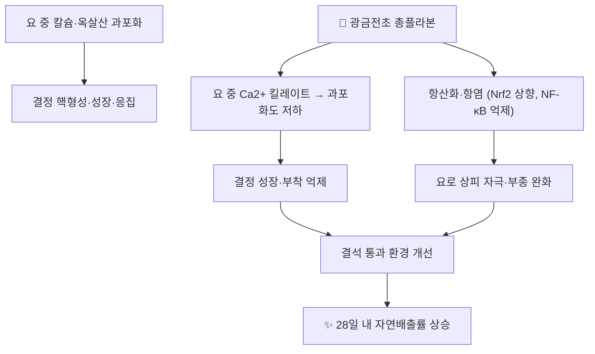

# 🌿 광금전초 (廣金錢草, Desmodium styracifolium)

> **핵심 요약 (Key Summary)**:
> 콩과(Fabaceae) 광금전초(*Desmodium styracifolium* (Osbeck) Merr.)의 전초로, 성미는 감담(甘淡)·량(凉), 귀경은 간·신·방광이다.
> 주 활성부위는 총플라본(TFDS)이며, 비텍신·이소비텍신 같은 C-배당 플라본이 요 중 칼슘 킬레이트와 결정 부착 억제에 관여한다.
> 효능은 청열이습(淸熱利濕)·이수통림(利水通淋)·배석(排石)으로, 석림(石淋)·열림(熱淋)·담낭결석·수종에 쓴다. 국내에서는 [[금전초]]와 혼용되기 쉬우나 기원 식물이 전혀 다르다.

---

## 📌 목차
1. [기본 본초 정보 & 화학 구조 (Pharmacognosy)](#1-기본-본초-정보--화학-구조-pharmacognosy)
2. [핵심 분자약리 기전 & 대사 네트워크](#2-핵심-분자약리-기전--대사-네트워크)
3. [해부생체역학 / 근육·신경 대사 연계](#3-해부생체역학--근육신경-대사-연계)
4. [사상의학 및 체질별 임상 응용 (적응증 vs 금기)](#4-사상의학-및-체질별-임상-응용-적응증-vs-금기)
5. [본초학적 고찰 및 배오 원리](#5-본초학적-고찰-및-배오-원리)
6. [핵심 처방 비교 매트릭스](#6-핵심-처방-비교-매트릭스)
7. [출처 및 학술 참고 문헌 (References)](#7-출처-및-학술-참고-문헌-references)

---

## 1. 기본 본초 정보 & 화학 구조 (Pharmacognosy)

| 항목 | 상세 내용 |
| :--- | :--- |
| **기원 식물** | 콩과(Fabaceae) 광금전초 *Desmodium styracifolium* (Osbeck) Merr.의 전초 |
| **성미 (性味)** | 감(甘)·담(淡), 량(凉) |
| **귀경 (歸經)** | 간(肝)·신(腎)·방광(膀胱) |
| **효능 (Actions)** | 청열이습(淸熱利濕)·이수통림(利水通淋)·배석(排石)·청간담(淸肝膽) |
| **주요 성분** | 총플라본(TFDS) — 비텍신(vitexin), 이소비텍신(isovitexin), 이소오리엔틴 등 C-배당 플라본 중심 |
| **PubChem CID** | 식물 자체는 CID 없음(단일 화합물이 아니다) — 지표성분 비텍신 CID 5280441 |

### 🌿 기원 식물 (Botanical Source)
![[광금전초_01_기원식물.jpg|460]]
> [그림 1: 광금전초(*Desmodium styracifolium*) — 동전 모양의 둥근 소엽과 가장자리 털, 콩과 특유의 홍자색 접형화. 광둥·홍콩 자생 개체 — Wikimedia Commons, CC BY-SA 2.0]

### 🔬 주요 지표물질 화학 구조
![[광금전초_02_비텍신_구조식.png|420]]
> [그림 2: 비텍신(vitexin, apigenin 8-C-glucoside) 2D 구조식 — 플라본 골격 A환 5,7-이수산기, B환 4′-수산기, C-8 위치에 포도당이 탄소-탄소 결합으로 붙은 C-배당체 — PubChem CID 5280441 PNG]

> **[구조적 특징 및 활성]**: 비텍신·이소비텍신은 O-배당체가 아니라 C-배당체라서 위산·장내 글리코시다아제에 잘 잘리지 않는다. 즉 "배당체라서 흡수가 나쁘다"는 일반론이 그대로 적용되지 않고, 장내 미생물 대사와 대장 내 잔류 분획이 활성의 상당 부분을 담당한다. 이 성질 때문에 전혈 농도보다 요 중 농도·요로 상피 노출이 임상 효과와 더 밀접할 수 있다는 해석이 가능하다. 전임상 연구는 이 총플라본 분획을 표준화해 캡슐 제제로 만들었다.

---

## 2. 핵심 분자약리 기전 & 대사 네트워크



### (1) 표적 수용체 및 신호전달 경로
* **요 중 이온 킬레이트**: 플라보노이드의 수산기가 요 중 칼슘 이온과 배위결합해 [[옥살산칼슘]] 과포화도를 낮추는 것이 1차 가설이다. 소변 자체를 매질로 하는 작용이므로 혈중 농도보다 요 중 노출이 중요하다.
* **신조직 신호 조절 (전임상)**: 쥐 신장 모델에서 p38 MAPK 신호와 NF-κB·STAT3·Nrf2·LXRα·FXR 전사인자 조절이 보고됐다. 다만 이는 동물·세포 수준 기전이고, 인체에서 같은 경로가 작동하는지는 검증되지 않았다.
* **항염·항산화**: 결정이 요로 상피를 자극해 생기는 염증·산화 스트레스를 줄여 부종과 통증을 완화하는 경로가 제안된다.

---

## 3. 해부생체역학 / 근육·신경 대사 연계

* **요관 평활근 운동성**: 배출 촉진의 실행 기전은 요관 연동운동과 요관 내압에 달려 있다. 그러나 2026년 3상 시험에서 결석 이동거리는 광금전초군 29.5 mm 대 위약군 29.7 mm로 차이가 없었다(P=.11). 즉 "요관을 더 세게 밀어낸다"는 설명은 이 시험 수준에서는 지지되지 않는다.
* **근육·신경 대사**: 이 본초는 근골격계 근육 대사나 신경전도에 대한 임상 근거가 없다. 해당 항목은 이 노트에서 다루지 않는다.
* **수분·전해질**: 이뇨 작용이 핵심이므로 실제 처방에서는 수분 섭취량과 전해질(특히 칼륨)을 함께 관리해야 한다.

---

## 4. 사상의학 및 체질별 임상 응용 (적응증 vs 금기)

```
[✅ 최적 적응증 (Sweet Spot)]
• 습열축적(濕熱蓄積) 변증 — 요도 작열감·요통·혈뇨 중 2개 이상
• 결석 5~10 mm, 단일, 원위 요관, 경~중등도 수신증, 신기능 정상
• 소변 황탁·냄새, 설태 황니, 구갈이 동반된 실열·담습형

[⚠️ 신중 투여 및 금기 (Caution / Contraindication)]
• 비허(脾虛)·음허(陰虛)로 찬 약에 설사하는 체질 — 온중·보음약 배오 필요
• 임신부, 심한 탈수·전해질 교란, 요로 감염 동반으로 이뇨가 해가 되는 경우
• 1 cm 초과 결석, 근위 요관, 중증 수신증, 감염·패혈증 — 약물만으로 버티면 안 됨
```

* [[태음인]]의 담습·수습 정체형에서 이수 작용이 잘 맞고, [[소음인]]은 이뇨제 성격의 찬 약에 비위가 쉽게 상하므로 [[이진탕]] 계열이나 온중약과 배오해 완만하게 쓴다.
* 국내 진료실에서 가장 흔한 사고는 [[금전초]]와의 혼용이다. 두 약재는 기원 과(科)부터 다르고 표준화 성분도 다르므로, 금전초를 광금전초 "동일 용량"으로 대체하는 환산은 성립하지 않는다.

---

## 5. 상한론, 『약징(藥徵)』 분석 및 배오 원리

### (1) 『[[약징]]』에 나타난 주치와 방치 — 해당 없음
광금전초는 『약징(藥徵)』·『상한론』 계열의 고전 방서에는 등장하지 않는다. 청대 이후 광동·광서 지방 약재로 정리되어 중국약전(ChP)에 廣金錢草로 수재된 생약이다. 대한민국약전외한약(생약)규격집 수재 여부는 이 노트에서 확인하지 못했으므로 단정하지 않는다. 즉 "고전 처방의 주약"이 아니라 "지역 약재에서 출발해 현대 임상시험으로 검증된 본초"라는 위치가 정확하다.

* **배오의 축**:
  * 광금전초 + [[해금사]] → 통림배석의 기본 짝. 이수와 활혈을 함께 도모한다.
  * 광금전초 + [[석위]] → 신·방광 습열과 결석을 겸治하는 고전적 조합.
  * 광금전초 + [[차전자]] → 요로 자극 증상(배뇨통·잔뇨감) 완화.
  * 광금전초 + [[계내금]]·[[해금사]] → 담석·요석의 "삼금(三金)" 구성 개념.

---

## 6. 핵심 처방 비교 매트릭스

| 처방명 | 구성 약재 | 주치 병증 및 임상 타깃 | 특징 및 감별점 |
| :--- | :--- | :--- | :--- |
| 삼금탕 | [[금전초]], [[해금사]], [[계내금]] | 담석·요로결석, 습열 | 결석 배출의 기본 방. 변증 가미가 필수 |
| 사금탕 | [[금전초]], [[해금사]], [[계내금]], [[석위]] | 신결석·요관결석, 혈뇨 동반 | 석위가 더해져 지혈·이수 겸함 |
| [[팔정산]] 가미 | [[목통]], [[차전자]], [[편축]], [[곽향]] 등 | 습열 하초, 배뇨통·잔뇨 | 결석보다 "열림(熱淋) 증상" 중심. 이뇨력이 강해 탈수 주의 |
| [[비해분청음]] 가미 | [[비해]], [[석창포]] 등 | 습탁 하초, 소변 혼탁 | 결석 배출보다 습탁 분리·청탁 대사 교정 |

> 광금전초는 위 처방들의 "금전초" 자리에 대체 투입되는 경우가 많은데, 근거의 층이 다르다는 점을 기억해야 한다. 삼금탕·사금탕 계열의 임상 경험은 주로 [[금전초]](과로황·긴병꽃풀)에 기반하고, 2026년 3상 근거는 광금전초 총플라본 표준화 제제에 대한 것이다.

---

## 7. 출처 및 학술 참고 문헌 (References)

1. **Wang D, Zhang S, Zhao W, et al. (2026)**. *Desmodium styracifolium Total Flavone Capsules for Urolithiasis: A Phase 3 Randomized Clinical Trial*. **JAMA Network Open**, 9(9):e2632874. [PMID 42714908](https://pubmed.ncbi.nlm.nih.gov/42714908/) · doi:10.1001/jamanetworkopen.2026.32874
   - **[연구 요약]**: 요관결석 5~10 mm 성인 606명(3:1)을 28일간 광금전초 총플라본 캡슐 0.6 g 1일 3회 대 위약으로 비교한 이중눈가림 3상 시험. 28일째 배출률 44.6% 대 33.8%(RR 1.32, 95% CI 1.03~1.69), 0.6~1.0 cm 하위군에서 RR 1.53. 14일째 배출률과 결석 이동거리는 차이가 없었고 이상반응은 양군 유사했다.
2. **PubChem CID 5280441 — Vitexin**. [https://pubchem.ncbi.nlm.nih.gov/compound/5280441](https://pubchem.ncbi.nlm.nih.gov/compound/5280441)
   - **[화학 정보]**: 비텍신(apigenin 8-C-glucoside)의 분자식·구조 확인. 본 노트 그림 2의 구조식 출처(PubChem PNG 정본).
3. **Wikimedia Commons — 廣金錢草 Desmodium styracifolium (홍콩 서공 자연교육중심 촬영)**. CC BY-SA 2.0. 본 노트 그림 1 출처.

> 검증 메모 (2026-11-19): PMID 42714908은 NCBI esummary로 제목·저자·저널·권·호·페이지·DOI를 대조했다. 비텍신 CID는 PubChem 명칭 조회로 확인했다.
