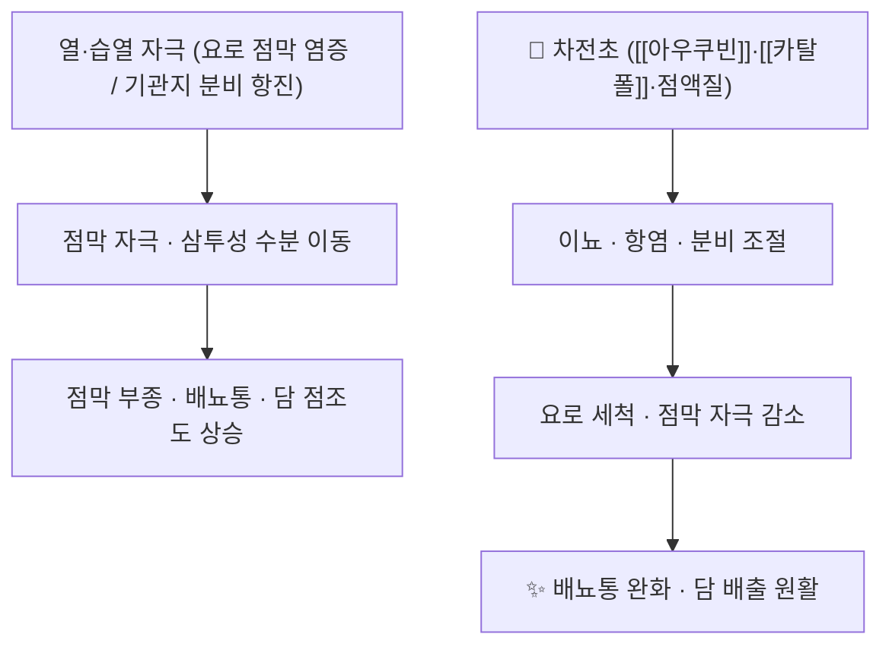

# 🌿 차전초 (車前草, Plantaginis Herba)

> 🖼️ **이미지 미확보** — 기원 식물·생약 원물·지표성분 구조식 3종 슬롯은 이번 회차에 확보하지 못했다. 아래 3D 뷰어(CID 91458)는 PubChem 조회로 확인한 아우쿠빈이다. 사진은 다음 보강에서 학명(*Plantago asiatica*)으로 검색해 수록한다.

> **핵심 요약 (Key Summary)**:
> 질경이과(Plantaginaceae) 질경이(*Plantago asiatica* L.) 또는 동속 근연식물의 전초를 건조한 본초.
> 이리도이드 배당체인 [[아우쿠빈]]·[[카탈폴]]과 점액질이 요로 상피 보호·항염·거담 작용을 매개한다.
> 한의학적으로 청열이뇨(淸熱利尿)·거담(祛痰)·양혈지혈(凉血止血)의 효능으로 열림삽통·담열해수·요혈에 쓴다.

---

> [!abstract]+ 🧪 3D 약리 분자 구조 (Interactive 3D Viewer)
> <iframe src="https://molecule-viewer-rho.vercel.app/?cid=91458" style="width: 100%; height: 600px; border: none; border-radius: 12px; box-shadow: 0 4px 20px rgba(0,0,0,0.15);" allowfullscreen></iframe>

## 📌 목차
1. [기본 본초 정보 & 화학 구조 (Pharmacognosy)](#1-기본-본초-정보--화학-구조-pharmacognosy)
2. [핵심 분자약리 기전 & 대사 네트워크](#2-핵심-분자약리-기전--대사-네트워크)
3. [차전자(車前子)와의 감별 — 부위별 효능 분화](#3-차전자車前子와의-감별--부위별-효능-분화)
4. [사상의학 및 체질별 임상 응용 (적응증 vs 금기)](#4-사상의학-및-체질별-임상-응용-적응증-vs-금기)
5. [배오 원리 및 한의학적 고찰](#5-배오-원리-및-한의학적-고찰)
6. [핵심 처방 비교 매트릭스](#6-핵심-처방-비교-매트릭스)
7. [출처 및 학술 참고 문헌 (References)](#7-출처-및-학술-참고-문헌-references)

---

## 1. 기본 본초 정보 & 화학 구조 (Pharmacognosy)

| 항목 | 내용 |
| :--- | :--- |
| **본초명** | 차전초 (車前草, Plantaginis Herba) |
| **기원 식물** | 질경이과 질경이 *Plantago asiatica* L. 또는 동속 근연식물 |
| **약용 부위** | 개화기~결실기 전초(뿌리 포함)를 채취해 건조 |
| **성미(性味)** | 감(甘), 한(寒) |
| **귀경(歸經)** | 간(肝)·신(腎)·폐(肺)·소장(小腸) |
| **효능·작용** | 청열이뇨(淸熱利尿), 거담(祛痰), 양혈지혈(凉血止血), 청열해독(淸熱解毒) |
| **주치 병증** | 열림삽통(熱淋澀痛), 수종·요소, 담열해수(痰熱咳嗽), 토혈·뉵혈·요혈, 옹종창독 |
| **주요 성분** | [[아우쿠빈]](aucubin, CID 91458), [[카탈폴]](catalpol, CID 91520), 점액질(mucilage), 플라보노이드 |
| **PubChem CID** | [91458](https://pubchem.ncbi.nlm.nih.gov/compound/91458) (아우쿠빈) |

> **[구조적 특징 및 활성]**: 아우쿠빈·카탈폴은 이리도이드 배당체로 물에 잘 녹아 전탕액으로 잘 이행한다. 점액질은 요로·기관지 점막을 덮어 자극을 줄이는 물리적 층을 만든다. 배당체 함량은 채취 시기·건조 조건에 따라 편차가 커서, 제제 간 비교에는 규격 함량 확인이 필요하다.

---

## 2. 핵심 분자약리 기전 & 대사 네트워크



- 이뇨 작용: 수분·전해질 배설을 늘려 요로를 세척하고, 점막 자극 물질의 접촉 시간을 줄인다. 이뇨제와 병용하면 저칼륨·탈수 위험이 겹칠 수 있다.
- 항염: 이리도이드 배당체가 염증 매개체 생성을 억제한다는 시험관 보고가 중심이며, 임상 용량에서의 기여도는 정량되지 않았다.
- 거담·지해: 기관지 분비의 점조도를 낮추고 기침 반사를 완화하는 방향으로 설명된다.
- 지혈: 차전초 특유의 축으로, 열로 인한 토혈·요혈에 배오한다. 차전자에는 이 작용이 약하다.

---

## 3. 차전자(車前子)와의 감별 — 부위별 효능 분화

| 구분 | 차전초 (전초) | 차전자 (씨앗) |
| :--- | :--- | :--- |
| 효능 축 | 청열이뇨 + 거담 + 양혈지혈 + 해독 | 이수통림 + 청폐화담 + 청간명목 |
| 특징적 주치 | 열림삽통, 토혈·요혈, 옹종 | 수종·요소, 습열 설사, 목적종통 |
| 배뇨에 미치는 영향 | 이뇨 with 점막 보호 | 이뇨 작용이 더 강하고 완만 |
| 대변에 미치는 영향 | 설사 조절 보조 | 이소변실대변(利小便實大便) — 묽은 변에 활용 |

- 임상 선택: 배뇨통·혈뇨가 두드러지면 차전초, 부종·소변량 감소가 주소면 차전자. 두 부위를 함께 쓰는 처방도 흔하다.

---

## 4. 사상의학 및 체질별 임상 응용 (적응증 vs 금기)

```
[✅ 최적 적응증 (Sweet Spot)]
• 습열 하초증 — 배뇨통·잔뇨감·짙은 소변, 혀 홍·태황니
• 담열해수 — 끈적한 가래·인통을 동반한 기침
• 열성 출혈 — 토혈·요혈에 다른 청열지혈약과 배오

[⚠️ 신중 투여 및 금기 (Caution / Contraindication)]
• 신허정활(腎虛精滑)·무습열의 빈뇨 — 이뇨로 증상 악화 가능
• 임신부 — 전통 문헌이 신중 투여로 분류, 대량·장기 복용 회피
• 이뇨제·강압제 병용 — 저칼륨·탈수·기립저혈압 감시
• 만성 콩팥병 진행기 — 이뇨 유도가 신부담이 될 수 있어 신기능 확인
```

---

## 5. 배오 원리 및 한의학적 고찰

### (1) 대표 배오

- 차전초 + [[목통]] → 열림의 배뇨통·삽통. 청열이수 축을 겹쳐 요로 자극을 낮춘다.
- 차전초 + [[활석]] → 습열 하초의 소변 혼탁·잔뇨. 삼투성 이수와 점막 보호를 함께 노린다.
- 차전초 + [[측백엽]] → 열성 요혈. 청열지혈 축을 보강한다.
- 차전초 + [[행인]]·[[자완]] → 담열해수의 기침. 거담과 지해를 분담한다.

### (2) 가미 본초로서의 실제 용례

- 2026-11-05 리뷰 1번의 가미곽향정기산은 원방에 [[포공영]]·현초·[[백편두]](편두)·차전초 등을 가미한 13종 구성이었다([PMID 42211410](https://pubmed.ncbi.nlm.nih.gov/42211410/)). 설사형 [[과민성 장 증후군]]에서 차전초를 넣는 것은 "이소변으로 대변을 실하게 한다"는 전통 논리와 습열 축을 겨냥한 배오로 읽힌다.
- 주의: 해당 시험은 개별 생약 용량을 본문에 제시하지 않았고(Supplement 2에만 기재), 차전초 단독의 효과를 분리할 수 없다.

---

## 6. 핵심 처방 비교 매트릭스

| 처방명 | 구성 약재 | 주치 병증 및 임상 타깃 | 특징 및 감별점 |
| :--- | :--- | :--- | :--- |
| [[팔정산]] | [[목통]], [[차전자]], [[편축]], [[대황]], [[산치자]], [[활석]] 등 | 습열 임증 — 배뇨통·빈뇨·요도 작열 | 차전자 중심의 이수통림. 열이 강하면 대황 배오 |
| [[곽향정기산]] | [[곽향]], [[후박]], [[진피]], [[반하]] 등 | 외감 풍한 + 내상 습체 — 구역·설사 | 이수 축이 아니라 화습·이기 축. 차전초는 가미로만 |
| [[오령산]] | [[저령]], [[택사]], [[백출]], [[복령]], [[계지]] | 수종·소변불리 — 담수 | 온성 이수. 열증에는 부적합 |

---

## 7. 출처 및 학술 참고 문헌 (References)

1. Choi Y, Ha NY, Kim AR 등. Efficacy and safety of modified Gwakjeongtang (herbal medicine) for diarrhea-predominant irritable bowel syndrome: A randomized, double-blind, placebo-controlled trial. *Integr Med Res*. 2026;15(3 Part A):101335. [PMID 42211410](https://pubmed.ncbi.nlm.nih.gov/42211410/) · [DOI 10.1016/j.imr.2026.101335](https://doi.org/10.1016/j.imr.2026.101335)
   - [연구 요약] 60명 4주 이중눈가림 위약 대조 시험에서 종합 반응률 55.2% 대 26.7%. 가미방 13종에 차전초가 포함됐으나 개별 용량·단미 효과는 분리되지 않았다.
2. 대한민국약전 제12개정. 의약품각조 — 차전초(Plantaginis Herba) 규격.
   - [공정서 규격] 기원·확인시험·순도시험 기준. 지표성분 규격 함량은 약전 각조를 따른다.
3. PubChem. Aucubin, CID 91458 / Catalpol, CID 91520. [https://pubchem.ncbi.nlm.nih.gov/compound/91458](https://pubchem.ncbi.nlm.nih.gov/compound/91458)
   - [식별자 확인] 2026-11-05 PubChem REST 조회로 CID를 직접 확인했다(명칭 조회 결과 91458·91520).
