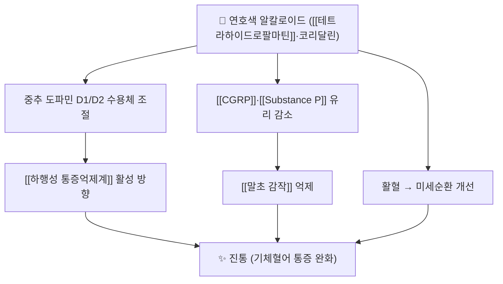

# 🌿 연호색 (延胡索, Corydalis yanhusuo)

> **핵심 요약 (Key Summary)**:
> 🌿 기원·약용부위: 양귀비과 Corydalis yanhusuo의 덩이줄기(塊莖). 辛·苦·溫, 肝·脾經.
> 📍 효능: 활혈(活血)·행기(行氣)·지통(止痛) — 기체(氣滯)와 혈어(血瘀)가 겹친 각종 통증의 요약이다.
> 🎯 지표성분: [[테트라하이드로팔마틴]](tetrahydropalmatine)·코리달린 등 이소퀴놀린 알칼로이드.
> ⚠️ 주의: 임신부에는 원칙적으로 쓰지 않고, 활혈 작용 때문에 출혈 경향·항혈전제 복용자에서 신중히 판단한다.

---

## 1. 기본 본초 정보 & 화학 구조 (Pharmacology & Chemistry)

| 항목 | 상세 정보 |
| :--- | :--- |
| 본초명 | 연호색(延胡索) · 별명 玄胡索 |
| 기원 | 양귀비과(Papaveraceae) Corydalis yanhusuo W.T.Wang의 덩이줄기 |
| 성미·귀경 | 辛·苦·溫 / 肝·脾經 |
| 효능 | 活血, 行氣, 止痛 |
| 주치 | 기체혈어(氣滯血瘀)로 인한 각종 통증 — 흉복통·위통·월경통·타박통·두통 |
| 대표 지표성분 | [[테트라하이드로팔마틴]](CID [72301](https://pubchem.ncbi.nlm.nih.gov/compound/72301)) · 코리달린(CID [101301](https://pubchem.ncbi.nlm.nih.gov/compound/101301)) |
| 약용부위·가공 |醋炙(초산)하면 지통 작용이 강화된다는 전통 가공법이 쓰인다 |

![[연호색_01_지표성분_테트라하이드로팔마틴_구조식.png|320]]
> [그림 1: 연호색의 대표 지표성분 (−)-테트라하이드로팔마틴의 2D 화학 구조식 — PubChem CID 72301 (PubChem PNG 정본)]

> 🖼️ 이미지 미확보 — 기원 식물(C. yanhusuo) 전초·약용 부위(건재 덩이줄기) 실사는 이번 회차에 확보하지 못했다. 볼트 표준(본초 3장: 기원식물·약용부위·지표성분 구조식) 중 구조식 1장만 수록했고, 사유를 남긴다.

---

## 2. 핵심 분자약리 기전 & 진통 네트워크

- [[테트라하이드로팔마틴]]은 도파민 수용체와 상호작용하며 진통·진정 방향으로 작동한다는 전임상 보고가 축적되어 있다. 코리달린 등 다른 알칼로이드와의 조합이 통증 축을 함께 누르는 구조로 설명된다.
- 전임상에서는 연호색 추출물이 모르핀 내성·의존을 억제하는 방향의 연구도 보고되어 있으나, 이는 기전 연구 수준이고 인체 임상 결론이 아니다 → [[오피오이드]]
- 소염·신경병증성 통증 축에서는 [[CGRP]]·[[Substance P]] 같은 신경펩타이드 유리 감소, 염증 매개체 억제 방향이 보고된다.

---

## 3. 해부·생리 연계 / 임상 응용 축

| 임상 축 | 연호색의 위치 |
| :--- | :--- |
| 월경통·골반통 | 활혈행기지통 — [[월경통]] 처방의 다빈도 배오 본초 |
| 위·복부 통증 | 기체 축 완화, [[기능성 소화불량]]·위통 처방에 배오 |
| 근골격 통증 | 타박·어혈 축, [[당귀수산]]·[[보양환오탕]] 계열에 가미 |
| 당뇨병성 말초신경병증 | 2026-10-15 [[목단과립]] 구성 9味 중 지통 축 담당 → [[당뇨병성 말초신경병증]] |

---

## 4. 사상의학 및 체질별 임상 응용

- 활혈행기지통 본초로, 어혈·기체가 분명한 실증(實證) 통증에 배치하는 것이 원칙이다. 기혈이 허한 환자에게 단독·대량으로 쓰면 기력을 떨어뜨릴 수 있어 [[황기]]·[[당귀]] 같은 보익 본초와 배오한다.
- 소음인·태음인 모두에서 어혈 징후(고정통·자통·야간 악화·멍)가 확인될 때 지통 목적으로 가미한다 — 체질 자체가 적응증을 결정하지는 않는다.
- 임신부는 원칙적으로 사용하지 않는다(활혈 작용).

---

## 5. 고전 의학 및 배오 원리

- 『본초강목(本草綱目)』 계열 문헌은 연호색을 "능행혈중기체(能行血中氣滯)"라 요약한다 — 혈중의 기체를 풀어 통증을 멈춘다는 치법 표현이다.
- 전형적 배오:
  - [[천련자]]와 배오하면 기체성 위·복통(금령자산 계열)으로 간다.
  - [[당귀]]·[[천궁]]·[[적작약]]과 배오하면 활혈지통 축이 강화된다.
  - [[황기]]와 배오하면 보기활혈 구조가 되어 [[목단과립]] 같은 처방의 축을 이룬다.
- 가공법: 초산(醋炙)은 알칼로이드 용출과 지통 작용 강화를 목적으로 하는 전통 가공이다.

---

## 6. 핵심 처방 비교 매트릭스

| 처방 | 연호색의 역할 | 처방 축 |
| :--- | :--- | :--- |
| [[목단과립]] | 지통·통락 축 | 익기 + 활혈화어 + 통락 |
| [[보양환오탕]] 가미 | 어혈 통증 가미약 | 익기활혈 + 거풍 |
| [[당귀수산]] 가미 | 타박·어혈 지통 | 활혈거어 |
| 금령자산 | 기체 위통의 주약 | 행기지통 |
| 소활락단 계열 | 활혈지통 군약 | 기혈어체 통증 |

---

## 7. 출처 및 학술 참고 문헌 (References)

1. **The Analgesic Properties of Corydalis yanhusuo.** *Molecules*. 2021;26(24). [PMID 34946576](https://pubmed.ncbi.nlm.nih.gov/34946576/)
   - [연구 요약] 연호색 알칼로이드의 진통 기전·전임상 근거를 정리한 리뷰 — §2 기전 서술의 근거다.
2. **The composition, pharmacological effects, related mechanisms and drug delivery of alkaloids from Corydalis yanhusuo.** *Biomed Pharmacother*. 2023;167. [PMID 37729733](https://pubmed.ncbi.nlm.nih.gov/37729733/)
   - [연구 요약] [[테트라하이드로팔마틴]]·코리달린 등 알칼로이드 조성과 약리 기전·전달 체계 종합.
3. **Efficacy and safety of Mudan granules for diabetic peripheral neuropathy.** *J Ethnopharmacol*. 2026;368:121754. [PMID 42069162](https://pubmed.ncbi.nlm.nih.gov/42069162/)
   - [연구 요약] [[목단과립]] 9味 구성 중 연호색의 처방 내 위치(지통 축)를 확인한 근거다.
4. **PubChem Compound Summary — (−)-Tetrahydropalmatine (CID 72301) / (+)-Corydaline (CID 101301).** [링크](https://pubchem.ncbi.nlm.nih.gov/compound/72301)
   - [연구 요약] 지표성분 2종의 분자식·분자량·2D 구조식(그림 1) 확인.

## 함께 보기
- [[테트라하이드로팔마틴]] · [[목단과립]] · [[천궁]] · [[당귀]] · [[적작약]] · [[황기]] · [[당귀수산]] · [[보양환오탕]] · [[오피오이드]] · [[CGRP]]
- [[2026-10-15_통합의학약리학_심층리뷰]] 1번
