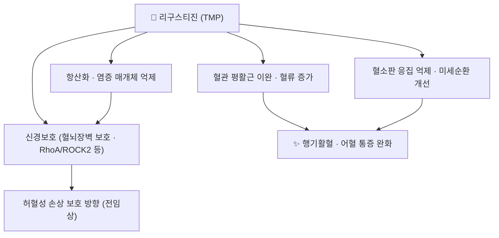

# 🔬 리구스티진 (Ligustrazine, Tetramethylpyrazine, TMP)

> **핵심 요약 (Key Summary)**:
> 🔬 화학: 피라진 고리 알칼로이드(C8H12N2, 136.19 g/mol). [[천궁]]의 대표 지표성분이다.
> 📍 기전: 혈관 확장·혈소판 응집 억제·항산화·신경보호(혈뇌장벽 보호, RhoA/ROCK2 등) 방향의 다중 기전이 보고된다.
> 🎯 임상 의의: [[천궁]]의 행기활혈 작용과 [[목단과립]] 같은 활혈 처방의 미세순환 축을 설명하는 분자다.
> ⚠️ 주의: 단독 성분의 인체 임상 근거는 제한적이다. 항혈전제 병용 시 출혈 위험을 함께 점검한다.

---

## 1. 기본 화학 정보 & 분자 구조식

![[리구스티진_01_구조식2D.png|320]]
> [그림 1: 리구스티진(테트라메틸피라진)의 2D 화학 분자 구조식 — PubChem CID 14296 (PubChem PNG 정본)]

| 항목 | 상세 정보 |
| :--- | :--- |
| 이명 | 리구스티진, ligustrazine, 테트라메틸피라진(TMP) |
| PubChem CID | [14296](https://pubchem.ncbi.nlm.nih.gov/compound/14296) |
| 화학식 / 분자량 | C8H12N2 / 136.19 g/mol |
| 계열 | 피라진(pyrazine) 알칼로이드 — [[천궁]] 정유·알칼로이드 분획의 주성분 |
| 특성 | 승화성 있고 물에 잘 녹는 저분자 화합물 |

## 2. 주요 함유 본초 및 천연 기원

| 본초 | 관계 |
| :--- | :--- |
| [[천궁]] | 대표 지표성분(川芎嗪) — 행기활혈의 핵심 분자 |
| [[단삼]] | 같은 활혈 처방군으로 병용 — 분자는 다르지만 축이 겹친다 |
| [[목단과립]] 구성 | [[천궁]]을 통해 미세순환 축 담당 |

## 3. 분자약리 표적 & 신호전달 네트워크

- [[천궁]]의 전통 효능(행기활혈·거풍지통) 가운데 미세순환 축이 리구스티진으로 설명된다 → [[천궁]]
- 허혈성 뇌손상 모델에서 혈뇌장벽 보호·신경가소성 개선 방향의 전임상 연구가 축적되어 있으나, 인체 임상 결론은 아니다 → [[뇌졸중]]

## 4. 생체 내 흡수·대사·생체이용률

- 경구 흡수 후 분포가 빠르고 반감기가 짧다는 보고가 있어, 임상에서는 처방 단위(반복 투여)로 노출을 유지한다.
- [[천궁]] 함유 처방은 활혈 작용이 누적될 수 있어 항혈전제 병용 시 출혈 경향을 점검한다 → [[와파린]] · [[아스피린]]
- 개별 약동학 수치는 시험·제형에 따라 차이가 커서 단일 값으로 단정하지 않는다.

## 5. 주요 약리 효능 & 분자 기전

| 효과 | 층위 | 비고 |
| :--- | :--- | :--- |
| 미세순환 개선·혈관 확장 | 전임상·임상 관찰 | [[천궁]] 행기활혈의 핵심 설명 |
| 항산화·항염 | 전임상 | [[산화 스트레스]]·[[NF-κB]] 축 |
| 신경보호 | 전임상 | 허혈성 손상 모델 중심 |
| 진통 보조 | 처방 단위 | [[연호색]]·[[몰약]] 등과 배오해 지통 축 보강 |

## 6. 함유 처방 시너지 & 배오 매트릭스

| 처방 | 리구스티진([[천궁]])의 위치 |
| :--- | :--- |
| [[목단과립]] | 활혈 축 — 미세혈관 순환 개선 → [[당뇨병성 말초신경병증]] |
| [[당귀수산]] | 활혈거어 축 |
| 사물탕 계열 | [[당귀]]·[[백작약]]과 배오해 조혈·순환 축 조율 |
| [[보양환오탕]] | 익기활혈 축 |

## 7. 양약 상호작용 & 약물동태학적 간섭

- 항혈소판·항응고제와 병용 시 출혈 위험 상승 우려 → [[와파린]] · [[아스피린]] · [[NSAIDs]]
- 혈압 강하제와 병용 시 혈압 변동(어지럼) 확인 → [[암로디핀]]
- 활혈화어 처방 전체를 복용하는 환자에서는 수술 전 1~2주 중단 여부를 주치의와 상의하도록 안내한다.

## 8. 💡 사용자 진료실 핵심 필기 & 임상 응용

- "천궁이 머리를 맑게 한다"는 설명은 미세순환 축으로 번역한다 — 어지럼·두통 환자에서 혈압·복용약(항혈전제) 확인이 먼저다.
- 단독 성분 근거를 환자에게 임상 효과로 단정해 말하지 않는다. 처방 단위 효과와 성분 기전을 구분해 설명한다.
- 항혈전제 복용자에게 활혈 처방을 시작할 때는 멍·잇몸출혈·흑변 문진을 매 방문 확인한다.

## 9. 출처 및 학술 참고 문헌 (References)

1. **Tetramethylpyrazine: A review on its mechanisms and functions.** *Biomed Pharmacother*. 2022;150:113005. [PMID 35483189](https://pubmed.ncbi.nlm.nih.gov/35483189/)
   - [연구 요약] 리구스티진(TMP)의 혈관·신경·항산화 기전을 정리한 리뷰 — 본 노트 §3·§5 근거다.
2. **Efficacy and safety of Mudan granules for diabetic peripheral neuropathy.** *J Ethnopharmacol*. 2026;368:121754. [PMID 42069162](https://pubmed.ncbi.nlm.nih.gov/42069162/)
   - [연구 요약] [[목단과립]] 구성 9味 중 [[천궁]]의 미세순환 축 위치 확인.
3. **PubChem Compound Summary — Tetramethylpyrazine (CID 14296).** [링크](https://pubchem.ncbi.nlm.nih.gov/compound/14296)
   - [연구 요약] 분자식 C8H12N2·분자량 136.19 g/mol·2D 구조식(그림 1) 확인.

## 함께 보기
- [[천궁]] · [[목단과립]] · [[단삼]] · [[당귀수산]] · [[뇌졸중]] · [[와파린]] · [[CYP3A4]]
- [[2026-10-15_통합의학약리학_심층리뷰]] 1번
