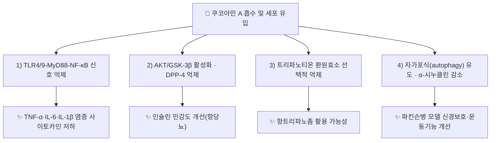

# 🔬 [[쿠코아민 A]] (Kukoamine A / C₂₈H₄₂N₄O₆)

> **핵심 3줄 요약 (Key Summary)**:
> - 🌿 기원 본초 & 화학 계열: [[지골피]](地骨皮, *Lycium chinense* 뿌리껍질)의 KP 규격 지표성분(건조물 기준 ≥0.15%). 스페르민(spermine)에 디하이드로카페오일기 2개가 아마이드 결합한 폴리아민계 알칼로이드.
> - 🎯 핵심 분자 표적 & 조절 경로: TLR4/9-MyD88-NF-κB 염증 신호 억제, AKT/GSK-3β 경로 활성화·DPP-4 억제(항당뇨), Crithidia fasciculata 트리파노티온 환원효소 선택적 억제.
> - 🩺 주요 약리 활성 & 질환 치료 기전: 항염증·항산화·신경보호(파킨슨병 모델)·항종양(교모세포종 세포)·항당뇨 등 다방면 약리 활성이 보고된다. 단, 경구투여 혈압강하 효과는 최근 동물실험에서 재현되지 않았다.
> - ⚠️ 독성·생체이용률 한계 & 상호작용: 사람 대상 경구 생체이용률·CYP 대사 데이터는 확인하지 못함. 근연 물질 쿠코아민 B는 건강인·패혈증 환자 1/2상에서 0.06~0.24mg/kg 용량으로 내약성이 확인되었으나(일과성 두통 등 경미한 부작용), 쿠코아민 A 자체의 인체 임상 데이터는 ⚠️ 확인 필요.

---

## 📌 목차
1. [기본 화학 정보 & 분자 구조식](#1-기본-화학-정보--분자-구조식-chemical-identity)
2. [주요 함유 본초 및 천연 기원](#2-주요-함유-본초-및-천연-기원-botanical-sources--content)
3. [분자약리 표적 & 신호전달 네트워크](#3-분자약리-표적--신호전달-네트워크-molecular-targets)
4. [생체 내 흡수·대사·생체이용률](#4-생체-내-흡수대사생체이용률-pharmacokinetics-adme)
5. [주요 질환별 약리 효능 & 분자 기전](#5-주요-질환별-약리-효능--분자-기전-therapeutic-efficacy)
6. [함유 본초 방제 시너지 & 약재 배오 매트릭스](#6-함유-본초-방제-시너지--약재-배오-매트릭스-herbal-synergies)
7. [양약 상호작용 & 약물동태학적 간섭](#7-양약-상호작용--약물동태학적-간섭-drug-interactions)
8. [💡 사용자 진료실 핵심 필기 & 임상 응용 팁](#8--사용자-진료실-핵심-필기--임상-응용-팁-melt-in--high-yield)
9. [출처 및 학술 참고 문헌 (References)](#9-출처-및-학술-참고-문헌-references)

---
## 1. 기본 화학 정보 & 분자 구조식 (Chemical Identity)

> [!abstract]+ 🧪 3D 약리 분자 구조 (Interactive 3D Viewer)
> <iframe src="https://molecule-viewer-rho.vercel.app/?cid=5318865" width="100%" height="450px" frameborder="0" allow="webgl" style="border-radius: 8px;"></iframe>

| 항목 | 상세 내용 |
| :--- | :--- |
| **분자식 / 분자량** | C₂₈H₄₂N₄O₆ / 530.67 g/mol |
| **PubChem CID** | [5318865](https://pubchem.ncbi.nlm.nih.gov/compound/5318865) |
| **CAS 등록 번호** | 75288-96-9 |
| **화학 골격 분류** | 폴리아민계 알칼로이드 — 스페르민(spermine) 골격 양 말단에 디하이드로카페오일(디하이드로카페인산)기가 아마이드 결합으로 연결된 구조. 쿠코아민 B·C·D 등 동족체가 존재한다 |
| **물리화학적 성상** | 카테콜(catechol) 및 디하이드로카페오일 폴리아민 유도체로 분류되며, 감자·토마토 등 가지과(Solanaceae) 식물에서도 발견된다 |

---

## 2. 주요 함유 본초 및 천연 기원 (Botanical Sources & Content)

| 함유 본초 (한글/한자) | 기원 식물학적 명칭 (과명 / 학명) | 주요 함유 약용 부위 | 지표 함량 (%) | 한의학적 귀경 및 약효 특성 |
| :--- | :--- | :--- | :--- | :--- |
| [[지골피]] (地骨皮) | 가지과(Solanaceae) / *Lycium chinense* Mill. | 뿌리껍질 | KP 규격 ≥0.15% | 간·신경(腎經) / 양혈청열(凉血淸熱)·퇴허열(退虛熱) |

> 가지과 식물 전반(감자·토마토)에서도 쿠코아민류가 보고되어 있으나, 한의학적으로 활용되는 것은 [[지골피]]이다(Parr et al. 2005, *J Agric Food Chem*, PMID 15969534).

---

## 3. 분자약리 표적 & 신호전달 네트워크 (Molecular Targets)

### 1) 항염증·항당뇨 기전 (리뷰, PMID 41701421)
* TLR4/9-MyD88-NF-κB 신호를 억제해 TNF-α·IL-6·IL-1β 등 염증 사이토카인을 낮추고, AKT/GSK-3β 경로 활성화와 DPP-4 억제를 통해 인슐린 민감도를 개선한다는 기전이 종설에 종합되어 있다. 철(Fe²⁺) 킬레이트를 통한 항산화 작용도 함께 보고된다.

### 2) 신경보호 기전 (파킨슨병 모델)
* MPP⁺로 손상시킨 SH-SY5Y 세포(20·40 μM)에서 자가포식을 유도해 세포 생존율을 높이고, MPTP 유발 마우스 모델(20 mg/kg/day)에서 흑질·선조체 도파민 신경세포를 증가시키며 α-시누클린 발현을 감소시키고 운동기능을 개선한다(Hu et al. 2017 *Neuropharmacology*; Zhang et al. 2017 *Neurotoxicity Research*).

### 3) 항종양 기전 (교모세포종 세포)
* U251·WJ1 교모세포종 세포에서 5~20 μg/mL 농도로 콜로니 형성을 억제하고, 60~80 μg/mL에서 G0/G1 세포주기를 정지시키며 세포자멸사를 유도한다(Wang et al. 2016 *Scientific Reports*).

### 4) 선택적 효소 억제를 통한 항트리파노좀 가능성
* *Crithidia fasciculata*의 트리파노티온 환원효소를 Ki = 1.8 μM로 억제하나, 인체 글루타치온 환원효소에 대해서는 Ki > 10 mM로 선택성이 매우 높다(Ponasik et al. 1995 *Biochemical Journal*) — 기생충 특이적 표적 가능성을 시사하나 임상 적용 데이터는 확인하지 못함(⚠️).

---

## 4. 생체 내 흡수·대사·생체이용률 (Pharmacokinetics: ADME)

* ⚠️ 쿠코아민 A 단독의 인체 경구 생체이용률(F%), 간 CYP 대사, 혈장 반감기 등 정량 ADME 데이터는 검색 범위 내에서 확인하지 못했다.
* 근연 물질 쿠코아민 B는 건강인 및 패혈증 환자 대상 1/2상 임상시험에서 0.06~0.24 mg/kg 용량 투여 시 내약성이 확인되었고, 부작용은 일과성 두통 등 경미한 수준으로 보고되었다(리뷰, PMID 41701421). 쿠코아민 A 자체의 임상 PK 데이터는 아직 확인되지 않았다(⚠️).
* 2022년 *PLoS ONE* 연구에서는 합성 쿠코아민 A를 마우스에 단회 경구투여(5·10 mg/kg)했을 때 14일 안전성 평가상 특이 이상이 없었다는 예비 결과가 있다.

---

## 5. 주요 질환별 약리 효능 & 분자 기전 (Therapeutic Efficacy)

### 1) 심혈관계 — 혈압에 대한 상반된 근거 (⚠️ 중요 주의)
* 쿠코아민류는 전통적으로 혈압 강하 작용이 있다고 알려져 왔으나, 2022년 *PLoS ONE*에 발표된 자발성 고혈압쥐(SHR) 모델 연구(Butts et al., *PLoS ONE* 2022;17(5):e0267567, doi:10.1371/journal.pone.0267567)에서는 합성 쿠코아민 A를 0·5·10 mg/kg 용량으로 35일간 경구투여했을 때 **고혈압에 대한 유의한 효과를 관찰하지 못했다**("We observed no effect of orally administered synthetic kukoamine A on arterial hypertension"). 지골피 전탕액·복합방제 수준의 혈압 효과와 쿠코아민 A 단일성분 경구투여 효과는 구분해서 이해할 필요가 있다.

### 2) 대사성 질환(당뇨) 및 전신 염증
* §3-1 참조. AKT/GSK-3β·DPP-4 경로를 통한 항당뇨 기전이 리뷰 수준에서 제시된다.

### 3) 신경계 — 신경보호·신경염증 조절
* §3-2 참조(파킨슨병 모델). 방사선 유발 해마 신경염증 랫드 모델에서도 10·20 mg/kg 투여 시 IL-1β·TNF-α·COX-2가 낮아지고 해마 신경세포생성이 증가했다는 보고가 있다(Zhang et al. 2017).

### 4) 항종양 보조 가능성
* §3-3 참조(교모세포종 세포주 수준, 동물·임상 데이터는 확인하지 못함).

---

## 6. 함유 본초 방제 시너지 & 약재 배오 매트릭스 (Herbal Synergies)

| 함유 본초 / 방제 | 공존 유효 성분군 | 분자약리 시너지 기전 | 전통 한의학적 효능 연계 |
| :--- | :--- | :--- | :--- |
| [[지골피]] | 디하이드로신나모일티라민, [[베타인]] | 폴리아민·페놀산 복합 항산화·해열 작용(개별 기전은 성분별 구분 필요) | 양혈청열(凉血淸熱), 퇴허열(退虛熱) |
| [[청골산]] | [[지골피]]+[[은시호]]+[[호황련]]+[[지모]]+[[별갑]] | 복합방제 수준 해열 효과 — 쿠코아민 A 단일 기전으로 환원 불가 | 간신음허·골증조열 치료 |

---

## 7. 양약 상호작용 & 약물동태학적 간섭 (Drug Interactions)

* ⚠️ 쿠코아민 A와 특정 양약(경구혈당강하제, 항고혈압제 등) 간의 임상적 상호작용을 직접 다룬 문헌은 검색 범위 내에서 확인하지 못했다.
* DPP-4 억제 기전이 리뷰 수준에서 제시되므로, DPP-4 억제제(시타글립틴 등) 병용 시 이론적 상가 작용 가능성이 있으나 실측 근거는 아니다(⚠️ 추정).

---

## 8. 💡 사용자 진료실 핵심 필기 & 임상 응용 팁 (Melt-In & High-Yield)

* ⚠️ 원장님의 진료실 필기가 아직 반영되지 않았습니다. 지골피·청골산·사백산 처방 시 쿠코아민 A 관련 임상 관찰이 있으면 추가해 주시면 다음 정원 가꾸기 때 녹여 정리하겠습니다.

---

## 9. 출처 및 학술 참고 문헌 (References)

1. **Mssillou I, et al. (2026)**. *Pharmacological properties, safety, pharmacokinetic and clinical trials of kukoamine A and B*. **Inflammopharmacology**, 34(3), 1487-1508.
   - [PubMed: PMID 41701421](https://pubmed.ncbi.nlm.nih.gov/41701421/)
   - **[연구 요약]**: 쿠코아민 A·B의 항산화·항염증(TLR4/9-MyD88-NF-κB 억제)·항당뇨(AKT/GSK-3β·DPP-4)·신경보호 기전과 안전성·약동학·임상시험(쿠코아민 B 1/2상, 0.06~0.24 mg/kg) 데이터를 종합한 최신 종설. [[지골피]] 노트 §7-1과 동일 출처.
2. **Butts CA, Hedderley DI, Martell S, et al. (2022)**. *Influence of oral administration of kukoamine A on blood pressure in a rat hypertension model*. **PLoS ONE**, 17(5), e0267567. doi:10.1371/journal.pone.0267567.
   - **[연구 요약]**: 합성 쿠코아민 A를 자발성 고혈압쥐(SHR)에 35일간 경구투여(5·10 mg/kg)한 결과 혈압에 유의한 효과가 없었다는 음성 결과 보고. 전통적 "쿠코아민=혈압강하" 통념에 대한 반증 자료로 중요.
3. **Parr AJ, et al. (2005)**. *Dihydrocaffeoyl polyamines (kukoamine and allies) in potato tubers*. **Journal of Agricultural and Food Chemistry**, 53(13), 5461-5466.
   - [PubMed: PMID 15969534](https://pubmed.ncbi.nlm.nih.gov/15969534/)
   - **[연구 요약]**: 쿠코아민류의 화학적 정체(디하이드로카페오일 폴리아민)와 감자 등 가지과 식물 내 분포를 규명. PubChem CID 5318865(쿠코아민 A) 등 동족체 CID를 확정.
4. **Caymanchem 제품정보(Kukoamine A, Item No. 25139)** — 교모세포종·파킨슨병·방사선 신경염증·트리파노티온 환원효소 관련 1차 문헌(Wang et al. 2016 *Sci Rep*; Hu et al. 2017 *Neuropharmacology*; Zhang et al. 2017 *Neurotoxicity Research*; Ponasik et al. 1995 *Biochem J*) 인용을 교차 확인하는 데 사용. 개별 PMID는 이번 조사에서 전수 검증하지 못함(⚠️ 확인 필요).

> ⚠️ 확인 불가/추정 표시 총괄: 단일성분 인체 ADME, 양약 상호작용 정량 데이터, §9-4 개별 논문 PMID는 검색 범위 내에서 확정하지 못해 각 섹션에 표시했다. 분자식 C₂₈H₄₂N₄O₆, CAS 75288-96-9, PubChem CID 5318865, PMID 41701421·15969534는 복수 출처로 교차 확인된 값이다.

---
🏛️ **상위 허브**: [[00_약리성분_MOC]]
