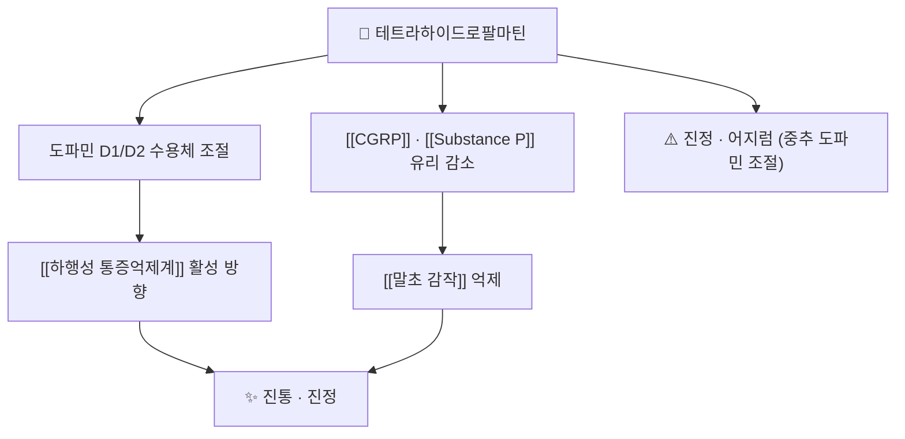

# 🔬 테트라하이드로팔마틴 (Tetrahydropalmatine, THP)

> **핵심 요약 (Key Summary)**:
> 🔬 화학: 프로토베르베린 계열 이소퀴놀린 알칼로이드(C21H25NO4, 355.4 g/mol). [[연호색]]의 대표 지표성분이다.
> 📍 기전: 도파민 수용체(D1/D2) 조절과 말초 신경펩타이드 유리 감소를 통해 진통·진정 방향으로 작동한다.
> 🎯 임상 의의: [[연호색]]·[[목단과립]] 등 활혈행기지통 처방의 진통 축을 설명하는 분자다.
> ⚠️ 주의: 전임상 중심 근거다. 인체에서 단독 성분의 진통 효과를 확립한 임상시험은 제한적이며, 진정·어지럼이 보고된다.

---

## 1. 기본 화학 정보 & 분자 구조식

![[테트라하이드로팔마틴_01_구조식2D.png|320]]
> [그림 1: (−)-테트라하이드로팔마틴의 2D 화학 분자 구조식 — PubChem CID 72301 (PubChem PNG 정본)]

| 항목 | 상세 정보 |
| :--- | :--- |
| 이명 | 테트라하이드로팔마틴, THP, 로테트라하이드로팔마틴 |
| PubChem CID | [72301](https://pubchem.ncbi.nlm.nih.gov/compound/72301) |
| 화학식 / 분자량 | C21H25NO4 / 355.4 g/mol |
| 계열 | 프로토베르베린(protoberberine) 이소퀴놀린 알칼로이드 |
| 입체화학 | 천연형은 (−)체, 합성·라세미체 제품도 존재 |

## 2. 주요 함유 본초 및 천연 기원

| 본초 | 관계 |
| :--- | :--- |
| [[연호색]] | 대표 지표성분 — 延胡索 알칼로이드의 주성분 |
| [[현호색]] | 같은 속(Corydalis) 본초 — 알칼로이드 조성이 유사하다 |
| [[목단피]] | 프로토베르베린 계열 대사 경로를 공유하는 본초(성분은 다르다) |

- Corydalis 속 본초들의 진통 작용을 설명하는 중심 분자다 → [[연호색]]

## 3. 분자약리 표적 & 신호전달 네트워크

- 도파민 수용체를 통한 진통 설명은 아편계와 다른 경로다. 그래서 [[오피오이드]] 내성·의존 억제 방향의 전임상 연구가 시도되었다 → [[오피오이드]]
- 말초 축에서는 신경펩타이드 유리 감소를 통해 [[말초 감작]]을 낮추는 방향으로 설명된다.

## 4. 생체 내 흡수·대사·생체이용률

- 경구 흡수 후 간에서 광범위하게 대사되며, 생체이용률이 낮다는 보고가 있다(개별 수치는 원문 미제시 항목이 많아 단정하지 않는다).
- [[연호색]]은 전통적으로 초산(醋炙) 가공을 거치는데, 알칼로이드 용출과 지통 작용 강화를 목적으로 한 가공이다.
- 다제복용 환자에서는 중추 억제(진정) 중첩 여부를 확인한다.

## 5. 주요 약리 효능 & 분자 기전

| 효과 | 층위 | 비고 |
| :--- | :--- | :--- |
| 진통 | 전임상·전통 사용 | [[하행성 통증억제계]]·말초 감작 두 축 |
| 진정 | 전임상·임상 관찰 | 진정·어지럼이 보고된다 |
| 모르핀 내성·의존 억제 | 전임상 | 인체 결론 아님 → [[오피오이드]] |
| 심혈관 | 전임상 | 항부정맥·혈관 확장 방향 보고(임상 적용 근거 아님) |

## 6. 함유 처방 시너지 & 배오 매트릭스

| 처방 | 테트라하이드로팔마틴의 위치 |
| :--- | :--- |
| [[목단과립]] | [[연호색]]을 통해 진통 축 담당 → [[당뇨병성 말초신경병증]] |
| 금령자산 | 기체성 위·복통의 지통 축 |
| 소활락단 계열 | 기혈어체 통증의 활혈지통 축 |

## 7. 양약 상호작용 & 약물동태학적 간섭

- 중추 진정 작용이 있어 벤조디아제핀·진정제·알코올과 병용 시 진정 중첩 우려가 있다 → [[벤조디아제핀]]
- [[오피오이드]]와 병용 시 진통 상승 가능성과 진정 중첩을 함께 본다.
- 항혈전제 병용 시에는 [[연호색]] 자체의 활혈 작용을 포함해 출혈 위험을 점검한다 → [[와파린]] · [[아스피린]]

## 8. 💡 사용자 진료실 핵심 필기 & 임상 응용

- 진료실에서는 단독 성분으로 쓰기보다 [[연호색]]·처방 단위로 쓴다. 성분 단독 근거는 전임상 중심임을 환자 설명에서 과장하지 않는다.
- 진정·어지럼이 있으면 운전·기계 조작 주의를 안내하고, 야간 복용 시 낙상 위험을 확인한다.
- 항혈전제 복용자는 복용 시작 전 출혈 증상(멍·잇몸출혈)을 문진한다.

## 9. 출처 및 학술 참고 문헌 (References)

1. **The Analgesic Properties of Corydalis yanhusuo.** *Molecules*. 2021;26(24). [PMID 34946576](https://pubmed.ncbi.nlm.nih.gov/34946576/)
   - [연구 요약] 연호색 알칼로이드(THP 포함)의 진통 기전·전임상 근거 리뷰 — 본 노트 §3·§5 근거다.
2. **The Extract of Corydalis yanhusuo Prevents Morphine Tolerance and Dependence.** *Pharmaceuticals (Basel)*. 2021;14(10). [PMID 34681258](https://pubmed.ncbi.nlm.nih.gov/34681258/)
   - [연구 요약] 연호색 추출물의 모르핀 내성·의존 억제 전임상 연구 — 인체 결론이 아님을 명시하는 근거다.
3. **PubChem Compound Summary — (−)-Tetrahydropalmatine (CID 72301).** [링크](https://pubchem.ncbi.nlm.nih.gov/compound/72301)
   - [연구 요약] 분자식 C21H25NO4·분자량 355.4 g/mol·2D 구조식(그림 1) 확인.

## 함께 보기
- [[연호색]] · [[현호색]] · [[목단과립]] · [[오피오이드]] · [[하행성 통증억제계]] · [[말초 감작]] · [[벤조디아제핀]]
- [[2026-10-15_통합의학약리학_심층리뷰]] 1번
