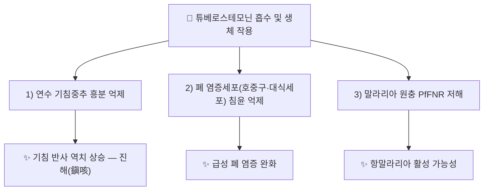

# 🔬 [[튜베로스테모닌]] (Tuberostemonine / C₂₂H₃₃NO₄)

> **핵심 3줄 요약 (Key Summary)**:
> - 🌿 기원 본초 & 화학 계열: [[백부근]](百部根, *Stemona tuberosa* 뿌리)의 KHP 규격 지표성분(건조물 기준 ≥0.15%). 스테닌(stenine)형 삼환 피롤로[3,2,1-jk]벤즈아제핀 핵을 가진 스테모나 알칼로이드.
> - 🎯 핵심 분자 표적 & 조절 경로: 연수 기침중추 흥분 억제를 통한 진해 작용, 폐 염증모델에서 호중구·대식세포 침윤 억제, 말라리아 원충 페레독신-NADP⁺ 환원효소(PfFNR) 저해.
> - 🩺 주요 약리 활성 & 질환 치료 기전: 기니피그 모델에서 경구·복강 투여 모두 유효한 진해 작용이 확인되었고(경구·복강 효력 동등), 급성 폐 염증 억제·항말라리아·살충 활성도 보고된다.
> - ⚠️ 독성·생체이용률 한계 & 상호작용: 인체 임상 ADME·상호작용 데이터는 확인하지 못함. 백부근은 전통적으로 다량·장기 복용 시 오심·구토 등 소화기 부작용과 비위허약자 주의가 언급되는 본초이므로, 단일성분 독성 데이터가 불충분한 현재로서는 과량 복용에 주의가 필요하다(⚠️ 확인 필요).

---

## 📌 목차
1. [기본 화학 정보 & 분자 구조식](#1-기본-화학-정보--분자-구조식-chemical-identity)
2. [주요 함유 본초 및 천연 기원](#2-주요-함유-본초-및-천연-기원-botanical-sources--content)
3. [분자약리 표적 & 신호전달 네트워크](#3-분자약리-표적--신호전달-네트워크-molecular-targets)
4. [생체 내 흡수·대사·생체이용률](#4-생체-내-흡수대사생체이용률-pharmacokinetics-adme)
5. [주요 질환별 약리 효능 & 분자 기전](#5-주요-질환별-약리-효능--분자-기전-therapeutic-efficacy)
6. [함유 본초 방제 시너지 & 약재 배오 매트릭스](#6-함유-본초-방제-시너지--약재-배오-매트릭스-herbal-synergies)
7. [양약 상호작용 & 약물동태학적 간섭](#7-양약-상호작용--약물동태학적-간섭-drug-interactions)
8. [💡 사용자 진료실 핵심 필기 & 임상 응용 팁](#8--사용자-진료실-핵심-필기--임상-응용-팁-melt-in--high-yield)
9. [출처 및 학술 참고 문헌 (References)](#9-출처-및-학술-참고-문헌-references)

---
## 1. 기본 화학 정보 & 분자 구조식 (Chemical Identity)

| 항목 | 상세 내용 |
| :--- | :--- |
| **분자식 / 분자량** | C₂₂H₃₃NO₄ / 375.51 g/mol |
| **PubChem CID** | ⚠️ 확인 필요(검색 과정에서 Tuberostemonine N 등 동족체와 CID가 혼재되어 단일 CID를 확정하지 못함 — CAS 번호로 식별 권장) |
| **CAS 등록 번호** | 6879-01-2 |
| **화학 골격 분류** | 스테닌(stenine)형 스테모나 알칼로이드 — 포화 삼환 피롤로[3,2,1-jk]벤즈아제핀 핵에 부티로락톤 측쇄가 결합된 구조. 네오튜베로스테모닌·튜베로스테모닌 H·J 등 동족체가 존재한다 |

---

## 2. 주요 함유 본초 및 천연 기원 (Botanical Sources & Content)

| 함유 본초 (한글/한자) | 기원 식물학적 명칭 (과명 / 학명) | 주요 함유 약용 부위 | 지표 함량 (%) | 한의학적 귀경 및 약효 특성 |
| :--- | :--- | :--- | :--- | :--- |
| [[백부근]] (百部根) | 백합과(Stemonaceae) / *Stemona tuberosa* Lour. | 뿌리 | KHP 규격 ≥0.15% | 폐경(肺經) / 윤폐지해(潤肺止咳)·살충(殺蟲) |

> [[백부근]] 노트는 튜베로스테모닌을 [[스테모닌]]과 함께 핵심 지표 알칼로이드로 기재하고 있다. 다만 백부근 노트가 인용한 PMID 14648394(Chung et al. 2003)는 실제로는 네오튜베로스테모닌·네오스테닌의 진해 활성을 보고한 논문이며, 튜베로스테모닌 자체에 특이적인 진해 1차 문헌은 본 노트가 인용한 Zhou et al. (2009, PMID 19214944)이다. 두 논문을 혼동하지 않도록 주의가 필요하다.

---

## 3. 분자약리 표적 & 신호전달 네트워크 (Molecular Targets)

### 1) 진해(鎭咳) 기전 — 경구·복강 투여 등효
* 기니피그 시트르산 유발 기침 모델에서 네오튜베로스테모닌·튜베로스테모닌·튜베로스테모닌 H 세 알칼로이드의 복강투여 진해 활성을 비교한 결과, 모두 용량 의존적으로 기침을 억제했다. 특히 튜베로스테모닌은 경구투여와 복강투여의 진해 효력이 거의 동등했던 반면, 네오튜베로스테모닌은 경구투여 시 효력이 유의하게 낮았고 튜베로스테모닌 H는 경구 활성이 없었다. Caco-2 세포 투과도 실험에서도 튜베로스테모닌은 상대적으로 투과도가 높아, 네 알칼로이드 모두 경구 흡수 가능성이 있다고 결론지었다(Zhou et al. 2009).

### 2) 급성 폐 염증 억제 기전
* 담배연기로 유발한 마우스 급성 폐 염증 모델에서 튜베로스테모닌 1~10 mg/kg 투여 시 기관지폐포세척액의 호중구·대식세포 침윤이 감소했고(림프구는 변화 없음), 기관지·혈관 주위 염증세포 침윤도 줄었다(Jung et al. 2016, ⚠️ PMID 미확인 — Caymanchem 제품정보 인용, 1차 논문 직접 확인 못함).

### 3) 항말라리아·살충 활성
* *Plasmodium falciparum* 페레독신-NADP⁺ 환원효소(PfFNR)를 저해하는 항말라리아 활성이 보고되어 있으며, *Spodoptera littoralis* 유충에 대한 섭식저해·기피 활성(0.01·0.1 μg/cm²)도 보고된다(Brem et al. 2002, ⚠️ PMID 미확인).

---

## 4. 생체 내 흡수·대사·생체이용률 (Pharmacokinetics: ADME)

* Caco-2 세포 투과도 실험에서 튜베로스테모닌은 네오튜베로스테모닌·튜베로스테모닌 H·J 중 비교적 투과도가 높은 편으로 측정되어, 경구 흡수 가능성이 있다고 평가되었다(Zhou et al. 2009).
* ⚠️ 인체 대상 경구 생체이용률(F%), 간 CYP 대사 효소, 혈장 반감기 등 정량 ADME 데이터는 검색 범위 내에서 확인하지 못했다.

---

## 5. 주요 질환별 약리 효능 & 분자 기전 (Therapeutic Efficacy)

### 1) 호흡기계 — 만성·급성 기침 관리(윤폐지해)
* §3-1 참조. [[백부근]]의 전통적 지해(止咳) 효능과 분자약리 근거가 비교적 잘 일치하는 성분으로, 기니피그 모델에서 경구 활성이 확인된 점이 임상적 의미를 갖는다.

### 2) 호흡기 염증(급성 폐 염증) 조절
* §3-2 참조. 흡연 관련 급성 폐 염증 모델에서의 보조적 항염증 활용 가능성이 제시되나, 만성폐쇄성폐질환(COPD) 등 임상 적응증으로 확장하기에는 ⚠️ 추가 검증이 필요하다.

### 3) 항말라리아·살충 — 임상 적응증 외 활용
* §3-3 참조. 한의학적 임상 적응증과는 별개로, 백부근의 전통적 외용 살충(머릿니·사면발니) 효능과 기전적으로 연결될 수 있는 소견이다.

---

## 6. 함유 본초 방제 시너지 & 약재 배오 매트릭스 (Herbal Synergies)

| 함유 본초 / 방제 | 공존 유효 성분군 | 분자약리 시너지 기전 | 전통 한의학적 효능 연계 |
| :--- | :--- | :--- | :--- |
| [[백부근]] | [[스테모닌]] | 스테모나 알칼로이드 복합 진해·살충 작용(개별 기여도는 성분별 구분 필요) | 윤폐지해(潤肺止咳), 살충(殺蟲) |
| [[지해산]] | [[백부근]]+[[자완]]+[[길경]]+[[형개]] | 복합방제 수준 진해·거담 효과 — 튜베로스테모닌 단일 기전으로 환원 불가 | 외감 해수, 만성 기침 |

---

## 7. 양약 상호작용 & 약물동태학적 간섭 (Drug Interactions)

* ⚠️ 튜베로스테모닌과 양방 진해제(덱스트로메토르판 등) 또는 기관지확장제 간의 임상적 상호작용을 직접 다룬 문헌은 검색 범위 내에서 확인하지 못했다.
* 중추성 진해제와 병용 시 이론적으로 진해 효과가 상가될 가능성이 있으나 실측 근거는 아니다(⚠️ 추정).

---

## 8. 💡 사용자 진료실 핵심 필기 & 임상 응용 팁 (Melt-In & High-Yield)

* ⚠️ 원장님의 진료실 필기가 아직 반영되지 않았습니다. 백부근·지해산 처방 시 튜베로스테모닌 관련 임상 관찰이 있으면 추가해 주시면 다음 정원 가꾸기 때 녹여 정리하겠습니다.

---

## 9. 출처 및 학술 참고 문헌 (References)

1. **Zhou X, Leung PHH, Li N, Ye Y, Zhang L, Zuo Z, Lin G. (2009)**. *Oral Absorption and Antitussive Activity of Tuberostemonine Alkaloids from the Roots of Stemona tuberosa*. **Planta Medica**, 75(6), 575-580. doi:10.1055/s-0029-1185363.
   - [PubMed: PMID 19214944](https://pubmed.ncbi.nlm.nih.gov/19214944/)
   - **[연구 요약]**: 네오튜베로스테모닌·튜베로스테모닌·튜베로스테모닌 H·J 네 알칼로이드의 장관 흡수(Caco-2)와 기니피그 시트르산 기침 모델 진해 활성을 비교. 튜베로스테모닌은 경구·복강 투여 효력이 거의 동등해 네 성분 중 경구 활성이 가장 뚜렷했다.
2. **Jung KH, et al. (2016)**. *The therapeutic effects of tuberostemonine against cigarette smoke-induced acute lung inflammation in mice*. **European Journal of Pharmacology**, 774, 80-86.
   - ⚠️ PMID 미확인(Caymanchem 제품정보 인용 — 1차 논문 직접 열람 못함, 서지정보만 교차 확인됨)
   - **[연구 요약]**: 담배연기 유발 급성 폐 염증 마우스 모델에서 튜베로스테모닌(1~10 mg/kg)이 기관지폐포세척액 호중구·대식세포 침윤 및 기관지·혈관 주위 염증세포 침윤을 감소시킴을 보고.
3. **대한민국약전외한약(생약)규격집(KHP) (2022)**. 백부근(Stemonae Radix) 규격 기준.
   - **[공정서 규격]**: 건조물 기준 튜베로스테모닌(C₂₂H₃₃NO₄) 0.15% 이상 함유 규격 명시(출처: [[백부근]] 노트 §7-2 교차 확인).

> ⚠️ 확인 불가/추정 표시 총괄: PubChem CID, Jung et al. (2016)의 PMID, 인체 ADME 데이터는 검색 범위 내에서 확정하지 못해 각 섹션에 표시했다. 분자식 C₂₂H₃₃NO₄, CAS 6879-01-2, PMID 19214944는 복수 출처(MedChemExpress·ChemicalBook·Thieme Connect)로 교차 확인된 값이다.

---
🏛️ **상위 허브**: [[00_약리성분_MOC]]
